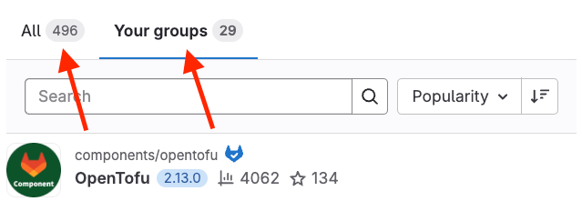
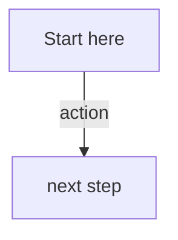

## Illustrations

GitLab documentation uses two illustration types:

- Screenshots, used to show a portion of the GitLab user interface.
- Diagrams, used to illustrate processes or relationships between entities.

Illustrations can help the reader understand a concept, where they are in a complicated process,
or how they should interact with the application. Use illustrations sparingly because:

- They become outdated.
- They are difficult and expensive to localize.
- They cannot be read by screen readers.

If you must use illustrations in documentation, they should:

- Supplement the text, not replace it.
  The reader should not have to rely only on the illustration to get the needed information.
- Have an introductory sentence in the preceding text.
  For example, `The following diagram illustrates the product analytics flow:`.
- Be accessible. For more information, see the guidelines specific to screenshots and diagrams.
- Exclude personally identifying information.

### Screenshots

Use screenshots to show a portion of the GitLab user interface, if some relevant information
can't be conveyed in text.

#### Capture the screenshot

When you take screenshots:

- Ensure the content in the screenshot adheres to the
  [GitLab SAFE framework](https://handbook.gitlab.com/handbook/legal/safe-framework/). To check,
  follow the
  [SAFE flowchart](https://handbook.gitlab.com/handbook/legal/safe-framework/#safe-flowchart).
- **Ensure it provides value.** Don't use `lorem ipsum` text.
  Try to replicate how the feature would be used in a real-world scenario, and
  [use realistic text](language.md#fake-user-information).
- **Capture only the relevant UI.** Don't include unnecessary white
  space or areas of the UI that don't help illustrate the point. The
  sidebars in GitLab can change, so don't include
  them in screenshots unless absolutely necessary.
- **Keep it small.** If you don't have to show the full width of the screen, don't.
  Reduce the size of your browser window as much as possible to keep elements close
  together and reduce empty space. Try to keep the screenshot dimensions as small as possible.
- **Review how the image renders on the page.** Preview the image locally or use the
  review app in the merge request. Make sure the image isn't blurry or overwhelming.
- **Be consistent.** Coordinate screenshots with the other screenshots already on
  a documentation page for a consistent reading experience. Ensure your navigation theme
  is set to the default preference **Neutral** and the syntax highlighting theme is also set to the default preference **Light**.

#### Add callouts

To emphasize an area in a screenshot, use an arrow.

- For color, use `#EE2604`. If you use the Preview application on macOS, this is the default red.
- For the line width, use 3 pt. If you use the Preview application on macOS, this is the third line in the list.
- Use the arrow style shown in the following image.
- If you have multiple arrows, make them parallel when possible.



#### Image requirements

- Resize any wide or tall screenshots.
  - Width should be 1000 pixels or less.
  - Height should be 500 pixels or less.
  - Make sure the screenshot is still clear after being resized and compressed.
- Use PNG images instead of JPEG.
- All images must be [compressed](#compress-images) to 100 KB or less.
  In many cases, 25-50 KB or less is often possible without reducing image quality.
- Save the image with a lowercase filename that's descriptive of the feature
  or concept in the image:
  - If the image is of the GitLab interface, append the GitLab version to the filename,
    based on this format: `image-name-vX_Y.png`. For example, for a screenshot taken
    from the pipelines page of GitLab 19.2, a valid name is `pipelines-v19_2.png`.
  - If you're adding an illustration that doesn't include parts of the user interface,
    add the release number corresponding to the release the image was added to.
    For an MR added in the 19.2 milestone, a valid name for an illustration is `devops-diagram-v19_2.png`.
- Place images in a separate directory named `img/` in the same directory where
  the `.md` document that you're working on is located.
  - Do not link to externally-hosted images. Download a copy and store it in the appropriate `img` directory within the docs directory.
- Compress GIFs with <https://ezgif.com/optimize> or similar tool.

See also how to link and embed [videos](links.md#videos) to illustrate the documentation.

#### Compress images

Compress new images you add to the documentation.
This helps reduce file sizes and improve page loading performance.

You can use [`pngquant`](https://pngquant.org/), which is cross-platform and
open source. Install it by visiting the official website and following the
instructions for your OS.

You can compress images automatically or manually:

- For automatic compression on macOS, see
  [One simple trick to make your screenshots 80% smaller](https://about.gitlab.com/blog/simple-trick-for-smaller-screenshots/).
- For manual compression, use the [`pngquant` script](https://gitlab.com/gitlab-org/gitlab/-/blob/master/bin/pngquant).

To use the `pngquant` script, in the root directory of your local copy of `https://gitlab.com/gitlab-org/gitlab`,
run the following commands as needed:

- To check that all documentation PNG images are compressed:

  ```shell
  bin/pngquant lint
  ```

- To compress all documentation PNG images:

  ```shell
  bin/pngquant compress
  ```

- To compress specific files:

  ```shell
  bin/pngquant compress doc/user/img/award_emoji_select.png doc/user/img/markdown_logo.png
  ```

- To compress all PNG files in a specific directory:

  ```shell
  bin/pngquant compress doc/user/img
  ```

##### Convert image files to PNG format

If the compression script creates `.compressed` files instead of compressing in place,
the files likely have PNG extensions but are other image formats (like JPEG).

The `png_quantizator` gem crashes on non-PNG files, preventing the script from completing.

Prerequisites:

- Install GraphicsMagick:

  ```shell
  # macOS:
  brew install graphicsmagick
  ```

To convert image files to PNG format:

1. Check the file format:

   ```shell
   file doc/user/img/problematic_file.png
   ```

   The `file` command examines the file contents (magic bytes/headers) rather than
   the extension. A misnamed JPEG file shows:

   ```shell
   doc/user/img/problematic_file.png: JPEG image data, JFIF standard 1.01...
   ```

1. Convert the file to PNG format using GraphicsMagick:

   ```shell
   gm convert problematic_file.png corrected_file.png
   ```

1. Run the compression script again.

If the original was a JPEG file, the converted PNG file might appear larger
because PNG uses lossless compression while JPEG uses lossy compression.

##### Deleting images

Do not delete image files when you remove references to them from English documentation.
Localized documentation (for example, Japanese pages) uses the same image files as the English docs.
Even if an image is no longer referenced in English docs, it might still be in use by translated pages.

The docs site build process checks image paths. If you delete an image that's still in use,
the `hugo_build` job in your merge request pipeline will fail.

The images not used anywhere are cleaned up as part of the [monthly maintenance](https://handbook.gitlab.com/handbook/marketing/product-and-technical-marketing/technical-writing/#regularly-scheduled-tasks).

#### Animated images

Avoid animated images (such as animated GIFs). They can be distracting
and annoying for users.

If you're describing a complicated interaction in the user interface and want to
include a visual representation to help readers understand it, you can:

- Use a static image (screenshot) and if necessary, add callouts to emphasize an area of the screen.
- Create a short video of the interaction and link to it.

#### Add the image link to content

The Markdown code for including an image in a document is:
``

#### Alternative text

Alt text provides an accessible experience.
Screen readers use alt text to describe the image, and alt text displays
if an image fails to download.

Alt text should describe the context of the image, not the content. Add context that
relates to the topic of the page or section. Consider what you would say about the image
if you were helping someone read and interact with the page and they couldn't see it.

Do:

``

Do not:

``

When writing alt text:

- Write short, descriptive alt text in 155 characters or fewer.
  Screen readers typically stop reading after this many characters.
- If the image has complex information like a workflow diagram, use short alt text
  to identify the image and include detailed information in the text.
- Use a period at the end of the string, whether it's a sentence or not.
- Use sentence case and avoid all caps.
  Some screen readers read capitals as individual letters.
- Do not use phrases like **Image of** or **Graphic of**.
- Do not use a string of keywords.
  Include keywords in the text to enhance context.
- Introduce the image in the topic, not the alt text.
- Try to avoid repeating text you've already used in the topic.
- Do not use inline styling like bold, italics, or backticks.
  Screen readers read `**text**` as `star star text star star`.
- Use an empty alt text tag (`alt=""`) instead of omitting the tag altogether when the image does not add any unique information to the page. For example, when the image is decorative or is already fully described in the body text or caption. An empty alt tag tells assistive technologies that you have omitted the text intentionally, while a missing alt tag is ambiguous.

#### Automatic screenshot generator

You can use an automatic screenshot generator to take and compress screenshots.

1. Set up the [GitLab Development Kit (GDK)](https://gitlab.com/gitlab-org/gitlab-development-kit/blob/main/doc/howto/gitlab_docs.md).
1. Go to the subdirectory with your cloned GitLab repository, typically `gdk/gitlab`.
1. Make sure that your GDK database is fully migrated: `bin/rake db:migrate RAILS_ENV=development`.
1. Install `pngquant`, see the tool website for more information: [`pngquant`](https://pngquant.org/)
1. Run `scripts/docs_screenshots.rb spec/docs_screenshots/<name_of_screenshot_generator>.rb <milestone-version>`.
1. Identify the location of the screenshots, based on the `gitlab/doc` location defined by the `it` parameter in your script.
1. Commit the newly created screenshots.

##### Extending the tool

To add an additional screenshot generator:

1. In the `spec/docs_screenshots` directory, add a new file with a `_docs.rb` extension.
1. Add the following information to your file:

   ```ruby
   require 'spec_helper'

   RSpec.describe '<What I am taking screenshots of>', :js do
     include DocsScreenshotHelpers # Helper that enables the screenshots taking mechanism

     before do
       page.driver.browser.manage.window.resize_to(1366, 1024) # length and width of the page
     end
   ```

1. To each `it` block, add the path where the screenshot is saved:

   ```ruby
   it '<path/to/images/directory>'
   ```

You can take a screenshot of a page with `visit <path>`.
To avoid blank screenshots, use `expect` to wait for the content to load.

###### Single-element screenshots

You can take a screenshot of a single element.

- Add the following to your screenshot generator file:

  ```ruby
  screenshot_area = find('<element>') # Find the element
  scroll_to screenshot_area # Scroll to the element
  expect(screenshot_area).to have_content '<content>' # Wait for the content you want to capture
  set_crop_data(screenshot_area, <padding>) # Capture the element with added padding
  ```

Use `spec/docs_screenshots/container_registry_docs.rb` as a guide to create your own scripts.

### Diagrams

Use a diagram to illustrate a process or the relationship between entities, if the information is too
complex to be understood from text only.

To create a diagram, use either:

- [Mermaid](https://mermaid.js.org/#/) (recommended). Mermaid version 11 is supported in documentation.
- [Draw.io](https://draw.io).

Mermaid is the recommended diagramming tool, but it is not suitable for all situations. For example,
complex diagram requirements might result in a layout that is difficult to understand.

GUI diagramming tools can help authors overcome Mermaid's complexity and layout issue. Draw.io is
the preferred GUI tool because, when you use the editor, both the diagram and its definition are
stored in the SVG file, so it can be edited. Draw.io is also integrated with the GitLab wiki.

| Feature                                   | Mermaid                                                                 | Draw.io |
|-------------------------------------------|-------------------------------------------------------------------------|---------|
| **Editor required**                       | Text editor                                                             | Draw.io editor |
| **WYSIWYG editing**                       |  No                                      |  Yes |
| **Text content findable by `grep`**       |  Yes                             |  No |
| **Appearance controlled by**              | Web site's CSS                                                          | Diagram's author |
| **File format**                           | SVG                                                                     | SVG     |
| **VS Code integration (with extensions)** |  Yes (Preview and local editing) |  Yes (Preview and local editing) |
| **Generated dynamically**                 |  Yes                             |  No |

#### Diagram guidelines

To create accessible and maintainable diagrams, follow these guidelines:

- Keep diagrams simple and focused. Include only essential elements and information.
- Use only shapes to distinguish between elements. Do not use color to differentiate elements, as
  diagrams must be compatible with both light and dark modes.

  Recommended shapes are:
  - Rectangles for processes or steps.
  - Diamonds for decision points.
  - Solid lines for direct relationships between elements.
  - Dotted lines for indirect relationship between elements.
  - Arrows for flow or direction in a process.
- Shapes that represent the same element should have the same shape and size.
- Add clear labels and brief descriptions to diagram elements.
- For elements that have text, ensure adequate white space exists between the text and the
  shape's outline. If required, increase the size of the shape and all similar shapes in the diagram.
- Include a title and brief description for the diagram.
- Use GitLab Sans font for text, or Google Inter font as a fallback option.
- For complex processes, consider creating multiple simple diagrams instead of one large diagram.
- Validate diagrams work well when viewed on different devices and screen sizes.
- Do not include links. Links embedded in diagrams with [`click` actions](https://mermaid.js.org/syntax/classDiagram.html#interaction) are not testable with our link checking tools.
- Update diagrams along with documentation or code when processes change to maintain accuracy.

#### Create a diagram with Mermaid

To learn how to create diagrams with the [Mermaid syntax](https://mermaid.js.org/intro/syntax-reference.html),
see the [Mermaid user guide](https://mermaid.js.org/intro/getting-started.html)
and the examples on the Mermaid site.

To create a diagram for GitLab documentation with Mermaid:

1. In the [Mermaid Live Editor](https://mermaid.live/), create the diagram.
1. Copy the content of the **Code** pane and paste it in the Markdown file, wrapped in a `mermaid` code block. For more
   details, see [GitLab Flavored Markdown for Mermaid](../../../user/markdown.md#mermaid).
1. On the next line after declaring the type of diagram
   (like `flowchart` or `sequenceDiagram`), add the following lines for accessibility:

   ```yaml
   accTitle: your diagram title here
   accDescr: describe what your diagram does in a single sentence, with no line breaks.
   ```

   Make sure the title and description follow the [alternative text guidelines](#alternative-text).

For example, this flowchart contains accessibility information:

````markdown

````

#### Create a diagram with Draw.io

Use either the [Draw.io](https://draw.io) web application or the (unofficial)
VS Code [Draw.io Integration](https://marketplace.visualstudio.com/items?itemName=hediet.vscode-drawio)
extension to create the diagram. Each tool provides the same diagram editing experience, but the web
application provides editable example diagrams.

Diagrams created by using Draw.io must comply with the general
[diagram guidelines](#diagram-guidelines) and the Draw.io-specific guidelines.

##### Draw.io guidelines

When you create a diagram in Draw.io, it should be visually consistent with a diagram you would
create with Mermaid. The following rules are an addition to the general
[diagram guidelines](#diagram-guidelines).

Fonts:

- Use the Inter font for all text. This font is not included in the default fonts.
  To add Inter font as a custom font:
  1. From the font dropdown list, select **Custom**.
  1. Select **Google fonts** and in the **Font name** text box, enter `Inter`.

Shapes:

- For elements, use the rectangle shape.
- For flowcharts, use shapes from the **Flowchart** shape collection.

##### Use the web application

To create a diagram by using the Draw.io web application:

1. In the [Draw.io](https://draw.io) web application, create the diagram.
1. Save the diagram:
   1. In the Draw.io web application, select **File** > **Export as** > **SVG**.
   1. Select the **Include a copy of my diagram: All pages** checkbox, then select **Export**. Use
      the file extension `drawio.svg` to indicate it can be edited in Draw.io.
1. [Add the SVG to the docs as an image](#add-the-image-link-to-content).
   These SVGs use the same Markdown as other non-SVG images.

##### Use the VS Code extension

To create a diagram by using the Draw.io Integration extension for VS Code:

1. In the directory that will contain the diagram, create an empty file with the suffix
   `drawio.svg`.
1. Open the file in VS Code then create the diagram.
1. Save the file.

   The diagram's definition is stored in Draw.io-compatible format in the SVG file.
1. [Add the SVG to the docs as an image](#add-the-image-link-to-content).
   These SVGs use the same Markdown as other non-SVG images.

## GitLab SVG icons

You can use icons from the [GitLab SVG library](https://design.gitlab.com/svgs/)
directly in the documentation. For example, `` renders as: .

In most cases, avoid icons in text.
However, use the icon when hover text is the only
available way to describe a UI element. For example, **Delete** or **Edit** buttons
often have hover text only.

When you do use an icon, start with the hover text and follow it with the SVG reference in parentheses.

- Avoid: `Select  **Edit**.` This generates as: Select  **Edit**.
- Use instead: `Select **Edit** ().` This generates as: Select **Edit** ().

Do not use words to describe the icon:

- Avoid: `Select **Erase job log** (the trash icon).`
- Use instead: `Select **Erase job log** ().` This generates as: Select **Erase job log** ().

When the button doesn't have any hover text, describe the icon.
Follow up by creating a
[UX bug issue](https://gitlab.com/gitlab-org/gitlab/-/work_items/new?description_template=Bug)
to add hover text to the button to improve accessibility.

- Avoid: `Select .`
- Use instead: `Select the vertical ellipsis ().` This generates as: Select the vertical ellipsis ().
