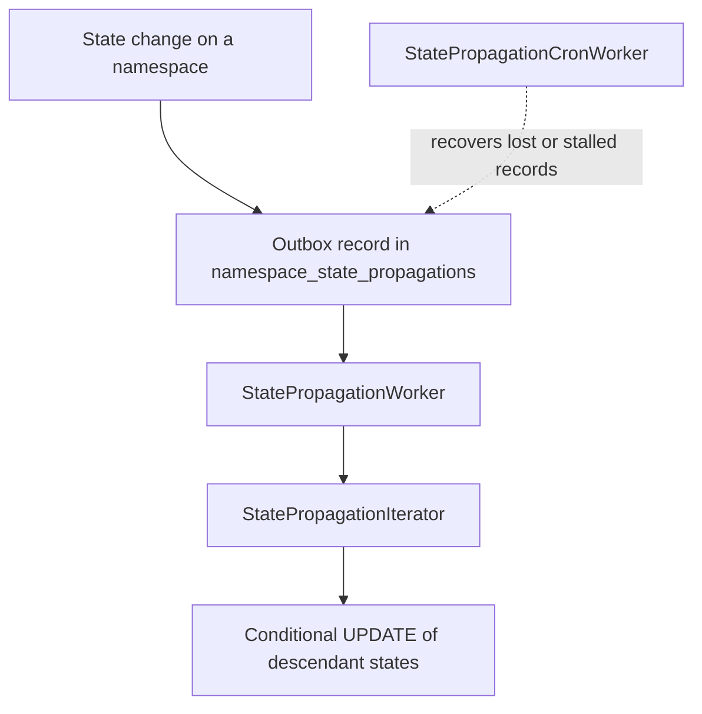
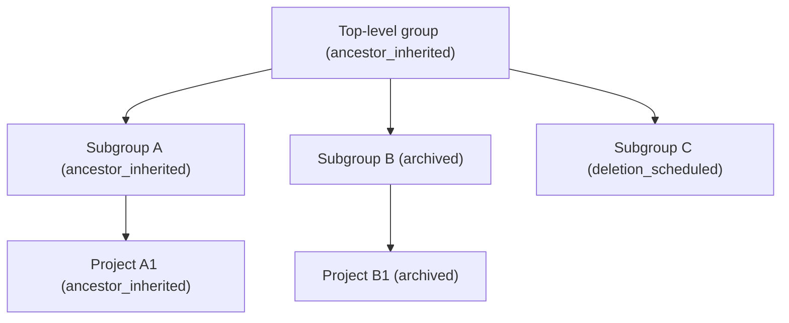
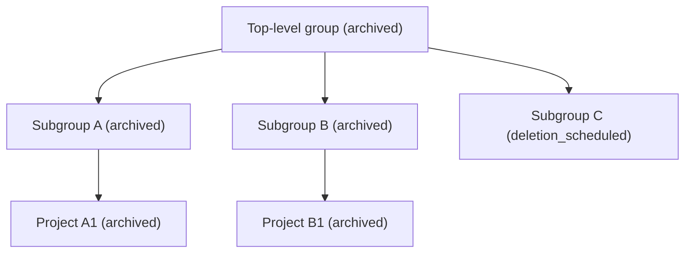

GitLab represents the namespace hierarchy as a tree.
The root element is the top-level namespace, and the child elements are subgroups and `Namespaces::ProjectNamespace` records.
Each namespace has a state, such as `ancestor_inherited` (the default, active state), `archived`, or `deletion_scheduled`.
When you set a state on a namespace, GitLab applies that state to every descendant in the tree.

For the structure of the namespace tree itself, see [Namespaces](namespaces.md).
For the underlying batch iteration algorithm, see [Batch iteration in a tree hierarchy](database/poc_tree_iterator.md).

## Why propagation instead of lookup

The original model determined the effective state of a namespace by traversing up the ancestor chain at read time.
A read of a deeply nested project checked each ancestor until it found a state.
This approach had several problems:

- Every state check added query overhead because it walked the hierarchy.
- The effective state was inferred differently across descendants.
- Caching was required to keep read performance acceptable, which added complexity.

The propagation model writes the resulting state to every descendant when the state changes on a namespace.
Reads then become a single-column comparison, with no ancestor traversal.
The trade-off is that writes do more work, and that work happens asynchronously.

For more information, see
[ADR 003: State propagation model](https://handbook.gitlab.com/handbook/engineering/architecture/design-documents/group_and_project_operations_and_state_management/decisions/003_state_propagation_model/).

## States that propagate

These states participate in propagation:

| State                | Precedence | Description                                  |
|----------------------|------------|----------------------------------------------|
| `ancestor_inherited` | 0          | The default, active state                    |
| `archived`           | 1          | The namespace and its descendants are archived |
| `deletion_scheduled` | 2          | The namespace and its descendants are scheduled for deletion |
| `maintenance`        | 6          | The namespace and its descendants are in a read-only mode during an organization transfer |

The precedence values mirror the canonical namespace state enum, so `maintenance` uses `6` rather than a contiguous rank.
Only the ordering matters for precedence comparisons, and `maintenance` has the highest precedence.

A higher precedence state wins over a lower one.
A lower-precedence propagation does not overwrite a descendant that is already in a higher-precedence state.
For example, a namespace that is `deletion_scheduled` does not change when an ancestor propagates `archived`.

The `maintenance` state puts a namespace and its descendants into a read-only mode so the whole hierarchy is prepared for an organization transfer.
The `maintenance` state is not yet used, and its propagation is not yet fully wired up.

Other states, such as `transfer_in_progress` and `transfer_scheduled`, do not propagate.
A namespace-level transfer affects only the selected namespace, not the effective state of its descendants.

## Components

Propagation uses four components that work together.



### Transactional outbox

When a namespace state changes, GitLab writes the state change and an outbox record in the same database transaction.
The outbox record is a row in the `namespace_state_propagations` table.
Because both writes commit together, the propagation request cannot be lost.
If the worker that processes the record crashes, the record remains and is retried.

This pattern is the
[transactional outbox](https://microservices.io/patterns/data/transactional-outbox.html).
The `Namespaces::StatePropagation` model stores the originating `namespace_id`, the `source_state`, the `target_state`, and a `status` of `pending` or `processing`.
A namespace can have several records, one for each transition that changes the state its descendants inherit.
A unique partial index allows only one `processing` record for each namespace.
For how the records of one namespace are ordered, see [Same-namespace ordering](#same-namespace-ordering).

### State precedence

The `Namespaces::Stateful::StatePrecedence` module decides which descendant states a propagation may overwrite.
The `overwritable_states(source_state, target_state)` method returns the descendant states that the propagation can change, based on the precedence table.

The set of overwritable states depends on both the target state and the state the namespace is leaving:

| Source state         | Target state         | Overwritable descendant states         | Reason                                          |
|----------------------|----------------------|-----------------------------------------|-------------------------------------------------|
| `ancestor_inherited` | `archived`           | `ancestor_inherited`                    | Archive active descendants                      |
| `ancestor_inherited` | `deletion_scheduled` | `ancestor_inherited`, `archived`        | Schedule deletion for active and archived descendants |
| `archived`           | `deletion_scheduled` | `ancestor_inherited`, `archived`        | Schedule deletion for active and archived descendants |
| `archived`           | `ancestor_inherited` | `archived`                              | Unarchive, but stop at `deletion_scheduled`     |
| `deletion_scheduled` | `ancestor_inherited` | `deletion_scheduled`, `archived`        | Restore everything the deletion swept up, but stop at descendants that scheduled their own deletion |

When the source and target states have equal precedence, or the combination is unsupported, the method returns an empty array and no descendant changes.

### State propagation worker

`Namespaces::StatePropagationWorker` performs the propagation.
For a given `namespace_id`, the worker takes the namespace's outbox records oldest first.
For each record, the worker:

1. Stops if the record is `processing`, because an earlier run is still active or its process died.
   Otherwise, marks it `processing`.
1. Computes the overwritable states with `StatePrecedence`.
1. Drives the iterator over descendants in batches.
1. Applies a conditional update for each batch.
1. Deletes the outbox record when propagation completes, then continues with the next record.

The worker checks its runtime limit only between records.
If the limit is exceeded and records remain, the worker re-enqueues itself for the namespace instead of starting the next record.
This keeps a namespace with many records from holding a worker slot for long.
A single record always runs to completion, so one walk over a large subtree can still exceed the limit.

The update never changes the namespace where the propagation started.
That namespace already has its new state, and it might have changed again since the record was written.

The conditional update only changes descendants that are still in an overwritable state:

```sql
UPDATE namespaces
SET state = :target_state
WHERE id IN (:batch_ids)
  AND state IN (:overwritable_states)
```

If the worker raises an error partway through, it returns the outbox record to `pending` and Sidekiq retries the job.
If the worker process dies instead, the record stays `processing` until the reconciliation worker resets and re-enqueues it.

### State-aware iterator

`Gitlab::Database::Namespaces::StatePropagationIterator` is a subclass of the namespace tree iterator described in
[Batch iteration in a tree hierarchy](database/poc_tree_iterator.md).
The base iterator walks the hierarchy depth-first and returns descendant IDs in batches.
The subclass adds a `state_filter` that constrains the walk to namespaces whose state is in the filter.

The worker passes the overwritable states plus the target state as the filter.
The target state is included so the walk continues through descendants that already have the target state.
The iterator does not check the state of the namespace where the walk starts.
The conditional update then guarantees that only descendants in an overwritable state change.

State alone can't tell a descendant that scheduled its own deletion apart from one that inherited `deletion_scheduled` through propagation.
The difference is `namespace_details.deletion_scheduled_at`.
The `schedule_deletion` transition sets the column, and propagation never does.

When an ancestor cancels its deletion (`deletion_scheduled` to `ancestor_inherited` or `archived`), the worker passes `options: { preserve_descendants_deletion: true }`.
With this option, the iterator treats any descendant with `deletion_scheduled_at` set as a boundary.
The iterator skips that descendant and its subtree, so they keep their deletion schedule.
The propagation root is never a boundary.
Other state changes don't set the option and don't check `namespace_details`.

### Reconciliation worker

`Namespaces::StatePropagationCronWorker` recovers lost or stalled propagation jobs.
On a fixed schedule defined in `config/schedule.yml`, the worker:

1. Counts `pending` records that exceeded the stale threshold, and adds the count to `stale_pending_total`.
   The count runs before the reset, so records reset in the next step are not also counted as stale.
1. Resets `processing` records that exceeded the stuck threshold back to `pending`, clears `started_at`,
   and adds the number of reset records to `stuck_processing_total`.
1. Enqueues one `StatePropagationWorker` job for each namespace with `pending` records.
   The counters are updated before this step, so a failed re-enqueue doesn't hide stale or stuck records.
1. Refreshes the `pending` and `processing` outbox gauges described in [Metrics](#metrics).

Deduplication on `StatePropagationWorker` avoids queueing more than one job for each namespace.
If a job is dropped as a duplicate while another job runs, the worker runs once more afterwards to pick up records created in the meantime.
Only one record for each namespace is applied at a time, because a job must claim a record as `processing`, and the unique partial index allows one `processing` record for each namespace.

### Same-namespace ordering

A namespace can change state again before the propagation of its previous change finishes.
For example, a group is archived and then unarchived while descendants are still being archived.

GitLab applies the records of one namespace one at a time, in `id` order, and each record runs to completion.
Records are never merged or skipped, so:

- The `source_state` of a record always matches the state descendants inherit when the record runs.
- Preserved states are saved and restored correctly.
  For example, scheduling deletion while an archive is half applied still preserves `archived` for every descendant.
- After all records finish, descendants have the state of the namespace's last transition.

`id` order matches commit order for one namespace.
The transition locks the namespace row before it inserts the record, and holds the lock until the transaction commits.
A second transition on the same namespace waits for that lock, so its record gets a higher `id`.

The lock orders the records, but does not refresh the state the second request loaded.
If two requests load the namespace before either commits, the second record can have a stale `source_state`.
[Issue 638361](https://gitlab.com/gitlab-org/gitlab/-/work_items/638361) tracks this.

A failed record blocks later records for the same namespace until it completes.

## Metrics

`Gitlab::NamespaceStatePropagation::Metrics` defines the Prometheus metrics for propagation.
The `target_state` label is the propagated state, such as `archived`.
No metric has a `namespace_id` label, to keep cardinality bounded.

| Name | Type | Labels | Description |
|------|------|--------|-------------|
| `gitlab_namespaces_state_propagation_duration_seconds` | Histogram | `target_state` | Time from marking an outbox record `processing` to deleting it. Observed only for successful runs that propagate a state. |
| `gitlab_namespaces_state_propagation_batches_total` | Counter | `target_state` | Descendant batches that the iterator yields and the worker updates. |
| `gitlab_namespaces_state_propagation_boundary_rewinds_total` | Counter | None | Times the iterator rewinds its cursor past a boundary. A boundary that ends the walk is not counted. |
| `gitlab_namespaces_state_propagation_failures_total` | Counter | `target_state` | `StatePropagationWorker` runs that raise an error. The error is re-raised. A `target_state` that is not a namespace state is labeled `unknown`. |
| `gitlab_namespaces_state_propagation_pending_records` | Gauge | None | Number of `pending` records in `namespace_state_propagations`. |
| `gitlab_namespaces_state_propagation_processing_records` | Gauge | None | Number of `processing` records in `namespace_state_propagations`. |
| `gitlab_namespaces_state_propagation_stuck_processing_total` | Counter | None | `processing` records that `StatePropagationCronWorker` resets to `pending` because they started more than 30 minutes ago. |
| `gitlab_namespaces_state_propagation_stale_pending_total` | Counter | None | `pending` records created more than 15 minutes ago. `StatePropagationCronWorker` adds the current count on every run, so the counter keeps rising while a record stays stale. |

The duration histogram uses buckets of 0.1, 0.5, 1, 5, 15, 30, 60, 120, 300, 600, and 1800 seconds.

`StatePropagationCronWorker` refreshes both gauges at the end of every run.
The gauges use the `max` multiprocess mode, because each count is table-wide and summing it across Sidekiq processes would over-count.
A process keeps the last value it set until the cron worker runs on it again or the process restarts.
As a result, after the outbox drains, a gauge can report a stale value from a process that ran the cron worker earlier.

To alert on stale records, use the `stuck_processing_total` and `stale_pending_total` counters instead of the gauges.
Counters are monotonic and summed across processes, so they don't report stale values after the outbox drains.
Alert on `increase(...[window]) > 0` instead of the absolute value.
Every Sidekiq process creates both counters at zero when it starts.
`increase()` ignores the first sample of a series, so a counter created by its first real increment would miss that increment.
Because `stale_pending_total` adds the stale count on every run, its rate depends on the cron schedule.

`StatePropagationCronWorker` failures are not counted separately.
Use the standard `sidekiq_jobs_failed_total` metric for the worker instead.

## Logging

Propagation writes structured log entries to `Gitlab::AppLogger`.
Each event has a distinct `message` value that you can search for:

| `message`                                    | Level   | Fields |
|----------------------------------------------|---------|--------|
| `Namespace state propagation started`        | `info`  | `class_name`, `gl_namespace_id`, `source_state`, `target_state` |
| `Namespace state propagation completed`      | `info`  | `class_name`, `gl_namespace_id`, `target_state`, `batch_count`, `duration_s`, `descendants_updated` |
| `Namespace state propagation cursor rewound` | `info`  | `class_name`, `gl_namespace_id`, `boundary_id`, `boundary_state`, `depth_before`, `depth_after` |
| `Namespace state propagation failed`         | `error` | `class_name`, `gl_namespace_id`, `target_state`, `error_type`, `error_message` |

In these entries:

- `gl_namespace_id` is the namespace where the propagation started.
- `descendants_updated` counts only the rows that the conditional update changed, so the value can be lower than the number of namespaces visited.
- `duration_s` covers only the batch walk.
- `depth_before` and `depth_after` are the cursor path lengths before and after the iterator rewinds past a boundary.

No entry is logged when the outbox record does not exist, when no descendant states can be overwritten, or when another job has already claimed the record.
After the failure is logged, the error is raised again, so retry and reconciliation behave as before.

## Walkthrough

Consider this hierarchy, where each node shows its current state:



When you archive the top-level group, the propagation runs with `source_state` of `ancestor_inherited` and `target_state` of `archived`.
`StatePrecedence.overwritable_states(:ancestor_inherited, :archived)` returns `[:ancestor_inherited]`, so only active descendants change.

The result is:



In this example:

- Subgroup A and project A1 change from `ancestor_inherited` to `archived`.
- Subgroup B and project B1 are already `archived`, so they do not change.
- Subgroup C stays `deletion_scheduled` because `deletion_scheduled` has higher precedence than `archived`.

## Foundational merge requests

The propagation algorithm was built across several merge requests:

- [Add the namespace state propagation iterator](https://gitlab.com/gitlab-org/gitlab/-/merge_requests/237682) adds the `StatePropagationIterator`.
- [Add `Namespaces::Stateful::StatePrecedence`](https://gitlab.com/gitlab-org/gitlab/-/merge_requests/241091) adds the overwritable states logic.
- [Add `Namespaces::StatePropagationWorker`](https://gitlab.com/gitlab-org/gitlab/-/merge_requests/242220) adds the propagation worker.
- [Add `Namespaces::StatePropagationCronWorker`](https://gitlab.com/gitlab-org/gitlab/-/merge_requests/242221) adds the reconciliation worker.

For the overall plan, see
[epic 21607](https://gitlab.com/groups/gitlab-org/-/work_items/21607).
