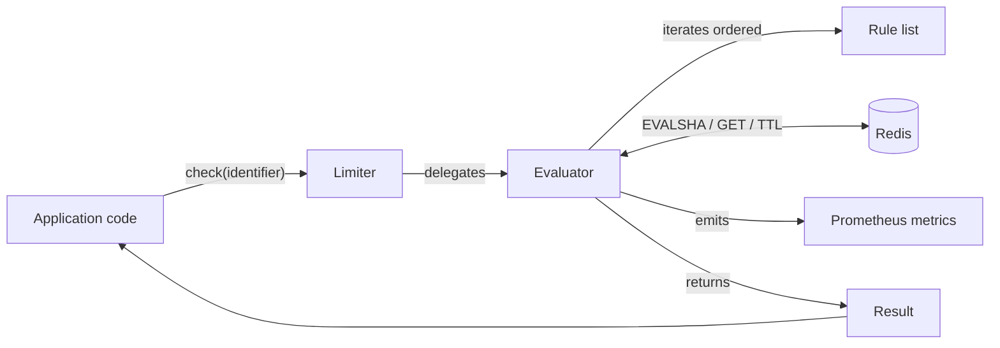
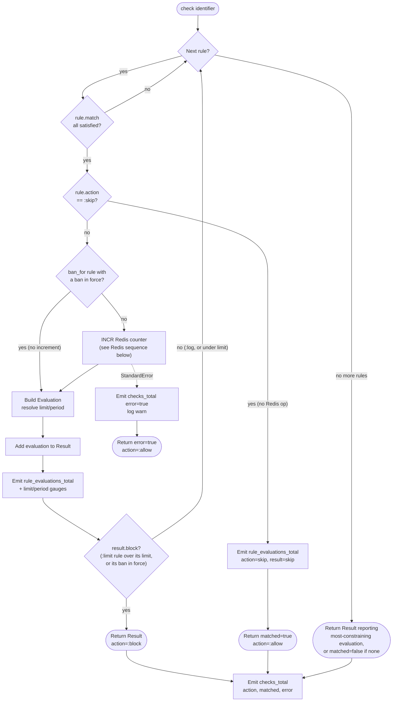
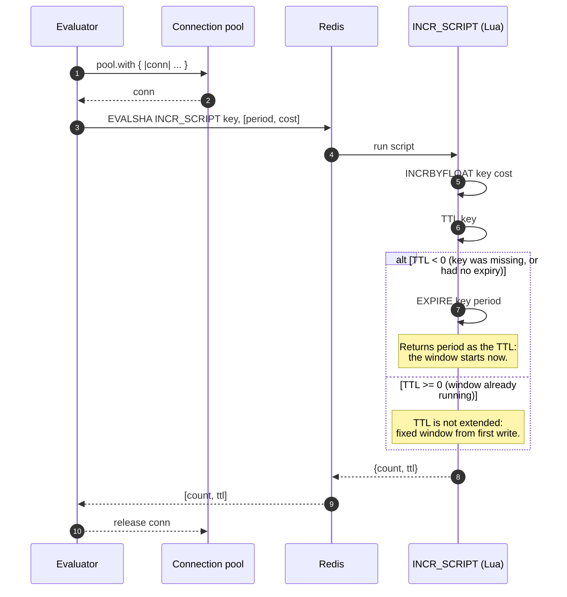

# Labkit::RateLimit

`Labkit::RateLimit` is a rules-based rate limiter backed by Redis counters. It
maintains a fixed-window counter per `(call-site, rule, characteristics)` tuple
and decides whether each request is within the configured limit.

The module is intentionally small: a `Limiter` is configured at boot with an
ordered list of `Rule`s, and every request calls `Limiter#check(identifier)` to
get back a `Result` describing what the caller should do.

## Architecture



A `Limiter` is configured once per call site and holds an `Evaluator` plus the
compiled `Rule` list. Every `check` call delegates to the same `Evaluator`,
which iterates the rules in declaration order, talks to Redis, emits metrics,
and builds a `Result`.

## Configuration

`Labkit::RateLimit.configure` sets a global Redis connection pool and logger
that are reused across all `Limiter` instances unless a per-Limiter override is
supplied:

```ruby
Labkit::RateLimit.configure do |c|
  c.redis  = ConnectionPool.new(size: 5) { Redis.new(url: ENV["REDIS_URL"]) }
  c.logger = Labkit::Logging::JsonLogger.new($stdout)
end
```

The `redis` value must respond to `.with { |conn| ... }` and yield a connection
that supports `incr`, `ttl`, `get`, `expire`, and `pipelined`. A
`ConnectionPool` of `Redis` clients is the typical choice.

The logger is used only for warnings (invalid rule names, fail-open errors,
duplicate rule names in production). It defaults to a JSON logger writing to
`$stdout`.

## Defining a Limiter

A `Limiter` is the unit of configuration for one call site (e.g. "rack
requests", "graphql mutations", "ai actions"). Construct it once and reuse it:

```ruby
RACK_LIMITER = Labkit::RateLimit::Limiter.new(
  name: "rack_request",
  rules: [
    Labkit::RateLimit::Rule.new(
      name: "api_user",
      limit: 600,
      period: 60,
      characteristics: [:user],
      match: { endpoint: { re: '\A/api/' } }
    ),
    Labkit::RateLimit::Rule.new(
      name: "unauthenticated",
      limit: 60,
      period: 60,
      characteristics: [:ip],
      match: { user: nil }
    )
  ]
)
```

- `name` must match `/\A[a-z0-9_]+\z/`. It is used as the first segment of
  every Redis counter key for this limiter, so renaming a `Limiter` abandons
  any in-flight counters.
- `rules` is an ordered array of `Rule` objects. Every rule whose `match` hash
  is satisfied is evaluated and counted (see [Evaluation flow](#evaluation-flow)).
- `redis` and `logger` are optional; they fall back to the global
  `Labkit::RateLimit.config` values.

A `Labkit::RateLimit.check(name:, identifier:, rules:, ...)` convenience method
exists for one-off cases that cannot cache a `Limiter` instance, but it
allocates a fresh `Limiter` on every call and is not the recommended path.

## Checking a request

`Limiter#check(identifier)` increments the counter for the matched rule and
returns a `Result`. `identifier` is either an `Identifier` or a plain `Hash`
of caller attributes:

```ruby
result = RACK_LIMITER.check(
  user:     current_user&.id,
  ip:       request.ip,
  endpoint: request.path
)

if result.action == :block
  response.headers.merge!(result.to_response_headers)
  render plain: "Too Many Requests", status: 429
  return
end
```

The `endpoint` key is treated specially: the query string is stripped at
`Identifier` construction time so URLs that vary only by query parameter share
the same counter.

### Peeking without incrementing

`Limiter#peek(identifier)` returns the same `Result` shape but does not
mutate Redis. It is useful when one code path should account for the request
(`check`) and another should gate a side-effect on whether the caller is
already over-limit. `peek` reads `:log` rules too: `check` can report a
`:log` rule's evaluation, so excluding them would make `peek` answer a
different question than `check`. A matched `:skip` rule terminates `peek`
the same way it terminates `check`: matched, `:allow`, no Redis read, no
`info`.

A peek is counted by its own `peeks_total` counter. See [Metrics](#metrics).

### Clearing state

`Limiter#clear(identifier)` deletes this limiter's counters for one
identifier, along with any ban a rule carrying `ban_for` has written, and returns the
number of keys removed.

```ruby
RACK_LIMITER.clear({ ip: "1.2.3.4" }) # => 2
```

Counters otherwise only disappear when their window expires; this is the only
way to end one early. It exists for call sites where a later success should
wipe earlier failures, such as an authentication ban cleared by a valid
login.

Every rule in the limiter is cleared, matched or not, because a caller
clearing state after a success knows the identifier rather than which rules
happened to match on the way in. Each rule is deleted in its own call, since
rules do not share a Redis Cluster slot. Clearing an identifier with no state
is a no-op returning `0`. A Redis failure fails open like `check`, leaving the
rest of the state to expire on its own, and the return value counts whatever
was removed before the failure.

## Identifier

`Identifier` is a small value object wrapping a hash of caller attributes.
You can pass a `Hash` to `check`/`peek` and `Limiter` will wrap it for you, or
construct one explicitly:

```ruby
id = Labkit::RateLimit::Identifier.new(
  user:     42,
  ip:       "1.2.3.4",
  endpoint: "/api/v4/projects/1?per_page=20"  # becomes "/api/v4/projects/1"
)
```

Keys can be symbols or strings — they are normalised to symbols on the way
in.

## Rule

A `Rule` is a `Data.define` value object with the following fields:

| field             | meaning                                                                                                                                                              |
|-------------------|----------------------------------------------------------------------------------------------------------------------------------------------------------------------|
| `name`            | Stable identifier used in Redis keys and metric labels. Must match `/\A[a-z0-9_]+\z/`, max 64 chars. Renaming a rule abandons its in-flight counters.                |
| `match`           | Hash of identifier key/value predicates that must **all** be satisfied for the rule to apply. Empty hash matches anything. See [Matchers](#matchers).                |
| `limit`           | Integer request threshold per `period`, at least 1. May be a callable resolved on every check.                                                                       |
| `period`          | Window length in seconds, at least 1; a fraction truncates to whole seconds. May be a callable resolved on every check.                                              |
| `action`          | What the rule does when it matches. One of `:limit`, `:log`, `:skip`. Default `:limit`. See [Actions](#actions).                                                     |
| `characteristics` | Array of identifier keys whose values are folded into the Redis counter key. Each unique combination gets its own counter.                                           |
| `count_distinct`  | Optional identifier key. When set, the rule counts distinct values seen for that key within the window, backed by a Redis SET rather than a counter. Must not overlap `characteristics`. |
| `ban_for`         | Optional ban duration, whole seconds, minimum 1. Changes the accounting; `action` still decides who is blocked. Rejected on `:skip`. May be a callable resolved on every check.     |

Making `limit` or `period` callable is the supported pattern for
runtime-tunable thresholds (e.g. feature flags or database-backed settings):

```ruby
Labkit::RateLimit::Rule.new(
  name: "api_user",
  limit:  -> { Settings.rate_limit_api_user_per_minute },
  period: 60,
  characteristics: [:user]
)
```

`Rule.new` raises `ArgumentError` for a static `limit` under 1 or a static
`period` under one second, except on `:skip` rules where both are inert.
Callables are not validated: a `limit` resolving to `0` blocks every matching
request, which is how to express "deny all" dynamically, and a `period`
resolving under one second reaches `EXPIRE` as `0` and deletes the counter on
every write.

### Matchers

A `match` hash gates whether a rule applies. Each value is normalised through
`Matcher.build`:

| input shape       | matcher  | example                                                |
|-------------------|----------|--------------------------------------------------------|
| plain value       | `eq`     | `match: { user: nil }`, `match: { method: "POST" }`    |
| `Regexp`          | `re`     | `match: { endpoint: %r{\A/api/} }`                     |
| `{ eq: <value> }` | `eq`     | `match: { method: { eq: "POST" } }` (YAML-friendly)    |
| `{ ne: <value> }` | `ne`     | `match: { method: { ne: "OPTIONS" } }`                 |
| `{ re: <source> }`| `re`     | `match: { endpoint: { re: '\A/api/' } }` (YAML-friendly) |
| `{ nre: <source> }`| `nre`   | `match: { endpoint: { nre: '\A/api/' } }`              |
| `{ oneOf: <Array> }` | `oneOf` | `match: { user: { oneOf: ["7", "42"] } }` (YAML-friendly) |
| `{ noneOf: <Array> }` | `noneOf` | `match: { plan: { noneOf: ["premium"] } }`         |
| `Array` of matchers | `all` | `match: { endpoint: [%r{\A/api/}, { nre: 'internal' }] }` |

`re` and `nre` coerce the identifier value via `#to_s` before matching, so they
can be used against non-String values (e.g. matching a 503 status against
`{ re: '^5' }`).

`oneOf` is set membership via `Set#include?` (`eql?`/`hash` equality, no
coercion): it agrees with `eq` for Strings, Symbols, booleans, nil, and
same-class numerics, but cross-type numerics differ (`1 == 1.0`, yet
`{ oneOf: [1] }` does not match `1.0`). `noneOf` is its complement.

An Array means **AND**, so one identifier key can carry several predicates:

```yaml
endpoint:
  - nre: '/oauth/'
  - nre: '\A/api/'
  - nre: '\A/-/(?:health|liveness|readiness|metrics)'
```

Its entries must be matcher Hashes or bare `Regexp`s, the two shapes that
already mean "a matcher" on their own. An Array of plain values is rejected.
A value meant as one matcher, arriving as a list, therefore fails loudly rather
than becoming a membership test. Membership is spelled `{ oneOf: [...] }`.

An Array holds matchers, not other Arrays, so a match value nests three deep at
most: an Array, a matcher Hash inside it, and that Hash's `oneOf` list. A value
nesting deeper than `Matcher::MAX_NESTING_DEPTH` is rejected when the rule is
built.

#### Negation and absent keys

`ne`, `nre` and `noneOf` are plain complements of their positive forms, with no
special case for a missing key. The `Evaluator` looks an identifier key up
rather than requiring it, so an absent key reaches the matcher as `nil`, and a
complement is therefore **true** for one: a request with no `endpoint` is not a
request to an excluded endpoint.

That widens a rule rather than narrowing it. A rule that should apply only when
the key is present says so, with a presence matcher alongside the exclusions:

```ruby
match: { endpoint: [/./, { nre: '\A/api/' }] }
```

Since this follows from inversion, a matcher that does accept `nil` inverts the
other way: `{ ne: nil }`, `{ noneOf: [nil] }` and `{ nre: '^$' }` are all false
for an absent key, the last because `nil.to_s` is `""`.

There is no cap on regex source length. Rules are written by operators, and the
only bound on a pattern is `Matcher::MATCH_TIMEOUT_SECONDS`, a 50ms wall-clock
budget applied per compiled `Regexp`.

Glob and prefix matchers are intentionally out of scope.

### Evaluation flow

`check` walks the rule list in order and evaluates **every** rule that matches:
each one increments its own counter, and the request debits `cost` from all of
them. Matching alone does not stop the walk. Only two things terminate it:

- a matched `:skip` rule (bypass, nothing counted), and
- a `:limit` rule that is **over its limit** — the request is rejected, so the
  remaining rules cannot change the outcome. Rules declared after it are neither
  counted nor evaluated, meaning a blocked request debits every rule up to and
  including the one that blocked, and none after it.

A `:limit` rule that is under its limit does not terminate, so it behaves
exactly like `:log` until the moment it blocks.

The returned `Result` collects one `Result::Evaluation` per counted rule
(`result.evaluations`), and its readers (`rule`, `info`, `exceeded?`,
`to_response_headers`) report the **most constraining** one: a blocking
evaluation first, then exceeded ones, then the fewest requests remaining,
ties broken by declaration order (the ranking is `Result::Evaluation#<=>`).
That is what keeps `to_response_headers` honest — reporting any other matched
rule would advertise headroom that a different rule is about to refuse:

```
per_ip    limit 1000  count  20  remaining 980
per_user  limit  100  count  99  remaining   1   <- reported
```

An exceeded rule has `remaining` 0 and therefore outranks any rule still under
its limit. For a `:log` rule that means shadow traffic surfaces to the caller
as `exceeded? == true` (with `action` still `:allow`) — visible, but unable to
block. A `:log`-only path that matches therefore returns `matched? == true`
and its check is counted as `checks_total{matched="true"}`.



Error handling is whole-check, not per-rule: a Redis failure part-way through
discards the verdicts of the rules already evaluated, even though their counters
were incremented. Those requests are counted but produce no verdict — the
fail-open trade-off is that a request is never blocked on a partial evaluation.

`rule_evaluations_total` is emitted **per evaluated rule** (including matched
`:skip` rules); `checks_total` is emitted **exactly once per check**, whatever
path the evaluation takes — so summing `checks_total` by `rate_limiter` counts
requests through the limiter, and "no rule matched" is `matched="false"` on the
check rather than a placeholder rule.

Only matched rules are evaluated: a rule whose `match:` conditions are not
satisfied emits nothing to `rule_evaluations_total` (match-testing is not an
evaluation), so the counter has no "didn't match" population and needs no
label for it. A matched `count_distinct` rule skipped by the missing-key
fail-open also emits nothing here — it was never evaluated; that check is
visible via `checks_total{error="true"}` and the
`rate_limit_missing_count_distinct` log, which carries the rule name.

### Actions

The rule's `action` describes what the rule does; the result's `action`
describes the outcome — what the caller should do — and is only ever `:allow`
or `:block`. A matching rule increments its counter, with two exceptions:
`:skip` rules never touch Redis, and a rule carrying `ban_for` whose ban is
already in force short-circuits before incrementing. The `result` label on
`rule_evaluations_total` records what each evaluation decided:

| rule action | what it does                                  | exceeded? | result action | `result` label | terminating?  |
|-------------|-----------------------------------------------|-----------|---------------|----------------|---------------|
| `:limit`    | count against the limit                       | no        | `:allow`      | `allow`        | no — continue |
| `:limit`    | count against the limit                       | yes       | `:block`      | `block`        | yes — stop    |
| `:log`      | count against the limit (observability only)  | no        | `:allow`      | `allow`        | no — continue |
| `:log`      | count against the limit (observability only)  | yes       | `:allow`      | `log`          | no — continue |
| `:skip`     | don't count (bypass)                          | n/a       | `:allow`      | `skip`         | yes — stop    |

A rule may also carry `ban_for`, which changes the accounting rather than the
action. On crossing the limit it writes a ban that outlives the counting
window, and it stops counting while that ban holds:

| rule action | with `ban_for`                                | exceeded? | result action | `result` label | terminating?  |
|-------------|-----------------------------------------------|-----------|---------------|----------------|---------------|
| `:limit`    | count, or skip counting while banned          | yes       | `:block`      | `banned`       | yes — stop    |
| `:log`      | same accounting, records what it would do     | yes       | `:allow`      | `banned`       | no — continue |

- `:limit` — when exceeded, `Result#action` is `:block` and evaluation
  terminates. Caller should reject the request (e.g. with HTTP 429). When under
  the limit, evaluation continues to the next rule.
- `:log` — **never terminating and never blocking**. The rule counts the
  request and records metrics, but evaluation always continues to the next
  rule. This is the mechanism for shadow rules during rollout: stack a `:log`
  rule and a `:limit` rule together and the `:log` rule cannot disable the
  `:limit` rule. When exceeded, a `:log` rule can still be the rule reported in
  the `Result` (`exceeded? == true`, `action == :allow`) if nothing more
  constraining matched.
- `:skip` — bypass. A matching rule terminates evaluation with
  `Result#action` `:allow` **without any Redis operation**: nothing is
  counted, so `limit`, `period`, `characteristics`, and `count_distinct` are
  inert and the result carries no `info` (`to_response_headers` is `{}`).
  The match is still observable via `rule_evaluations_total{action="skip"}`.
  Use this for bypasses.
- `ban_for` — enforcement that outlives the window, on either counting action.
  On crossing the limit the rule writes a second key that keeps blocking for
  `ban_for` seconds, long after the counter window has expired. While that ban
  is in force the rule reports `exceeded? == true` and does not count, so a
  caller cannot extend its own ban, and `reset_at` reports when the ban lifts
  rather than when the window rolls. Use this where repeated failures should
  cost more than a window, such as authentication attempts. State can be
  discarded early with [`#clear`](#clearing-state).

  With `action: :limit` the ban blocks. With `action: :log` the rule does all
  of the same accounting, including writing the ban and suppressing counting
  while it holds, and only skips the blocking, so a shadow measures what
  enforcement would have produced rather than approximating it.

  A `ban_for` shorter than `period` is legal but surprising: the ban can lapse
  while the counter is still over the limit, so `peek` reports not-exceeded
  while the next `check` re-bans immediately. Bans are normally longer than the
  window they are counted in.

  The duration is whole seconds and must be at least 1, since the ban is
  written with `SET EX`. A callable is checked again each time it resolves, and
  a value under a second raises rather than reaching Redis. Being an error, it
  fails open like any other, so a rule whose `ban_for` cannot resolve stops
  blocking entirely: watch `checks_total{error="true"}` after changing one.

  Take care combining `ban_for` with `cost:`. One expensive call can cross the
  limit on its own, and with a ban attached that costs the caller the whole ban
  rather than a single rejection. Checking with `peek` first has the same edge,
  since the call it deliberately lets through is enough to start a ban. Bans
  suit counting discrete failures, such as bad credentials, better than they
  suit variable-cost resource limits.

### Redis keys

Each matched check writes a key shaped:

```
labkit:rl:{<limiter_name>:<rule_name>:<char>:<value>[:<char>:<value>...]}
```

The braces are a Redis [hash tag](https://redis.io/docs/latest/operate/oss_and_stack/reference/cluster-spec/#hash-tags):
on a Redis Cluster only the braced part decides the slot, so every key for one
rule and identifier lands on the same shard. `BAN_SCRIPT` touches two keys in
one call, and a cluster rejects a script whose keys span slots.

Characteristic values longer than 200 bytes are replaced with a SHA-256
hexdigest to bound key length. Missing or empty characteristic values are
encoded as `_unknown_`. The TTL is set on the first write of each window and
is not extended on subsequent increments, so the window is a true fixed
window starting at the first request, not a sliding window.

A check is a single `EVALSHA` of `INCR_SCRIPT` (or `SADD_SCRIPT` for
`count_distinct` rules, or `BAN_SCRIPT` for rules carrying `ban_for`). Doing the whole
read-modify-write inside Lua means there is no window between the increment
and the `EXPIRE` in which a key could be left without a TTL.

A rule carrying `ban_for` writes a second key alongside its counter, sharing the
same hash tag and carrying its own `ban_for` TTL:

```
labkit:rl:{<limiter_name>:<rule_name>:<char>:<value>[:<char>:<value>...]}:ban
```

The suffix sits outside the tag, so it cannot change the slot and cannot
collide with a characteristic value, and both keys are found by the same
`labkit:rl:{<limiter>:<rule>*` glob. The ban key outlives its counter by
design: that is the whole point of `ban_for`.
`BAN_SCRIPT` checks the ban before incrementing, so the ban check,
the increment and the ban write are one atomic operation and a concurrent
check cannot miss the threshold crossing.



Because `INCRBYFLOAT` preserves an existing key's TTL, and creates a missing
key with no expiry, the TTL only needs reading once — after the increment.
That single read distinguishes both cases the script must handle, so there is
no reason to read it again before mutating.

`peek` does not use a script: it pipelines `GET` + `TTL` (or `SCARD` + `TTL`)
and never issues `EXPIRE`, so it cannot start or extend a window. A missing
key (`GET → nil`, `TTL → -2`) is reported as `count = 0`, and `build_evaluation`
falls back to the rule's period for `reset_at` since there is no Redis-side
window to read.

## Result

`Result` carries the decision back to the caller. It collects one
`Result::Evaluation` per counted rule; `rule`, `exceeded?`, and `info` report
the most constraining one (see [Evaluation flow](#evaluation-flow)):

```ruby
result.matched?           # => true if some rule matched
result.skipped?           # => true if a matched :skip rule bypassed the check
result.exceeded?          # => true if the reported rule's counter > limit
result.action             # => :block | :allow — what the caller should do
result.block?             # => result.action == :block
result.rule               # => the reported Rule, or nil
result.error?             # => true if Redis failed (see Fail-open)
result.degraded?          # => true if a matched count_distinct rule was skipped
result.info               # => Result::Info or nil
result.evaluations        # => every counted Result::Evaluation, in rule order
result.to_response_headers
# => { "RateLimit-Name" => "<rule name>", "RateLimit-Limit" => "...", "RateLimit-Observed" => "...",
#      "RateLimit-Remaining" => "...", "RateLimit-Reset" => "<unix-ts>" }
```

`Result::Info` holds the per-window counter snapshot:

| field             | meaning                                                          |
|-------------------|------------------------------------------------------------------|
| `resolved_limit`  | The evaluated `Integer` limit for this check.                    |
| `resolved_period` | The evaluated `Integer` period in seconds for this check.        |
| `count`           | Raw INCR value; useful for utilization-ratio metrics.            |
| `remaining`       | `resolved_limit - count`, clamped to `[0, max(resolved_limit, 0)]`. |
| `reset_at`        | Best-effort UTC `Time` when the window resets (advisory only).   |

`to_response_headers` returns `{}` for an unmatched or error result, so it is
safe to merge unconditionally.

### Response headers

`Result#to_response_headers` reports the most constraining evaluation.
`Result::Evaluation#to_response_headers` builds the same headers for one evaluation, for a caller that picks its own evaluation across several results.

| header                | present           | value                                               |
|-----------------------|-------------------|-----------------------------------------------------|
| `RateLimit-Name`      | always            | The rule's `name`.                                  |
| `RateLimit-Limit`     | always            | `resolved_limit` in the rule's period, at least 0.  |
| `RateLimit-Observed`  | always            | `count`, as an Integer, at least 0.                 |
| `RateLimit-Remaining` | always            | `remaining`, as an Integer.                         |
| `RateLimit-Reset`     | always            | `reset_at` as a Unix timestamp.                     |
| `Retry-After`         | blocking only     | Seconds to `reset_at`, rounded up, at least 0.      |
| `RateLimit-ResetTime` | blocking only     | `reset_at` as an HTTP date.                         |

`Retry-After` and `RateLimit-ResetTime` belong on the 429, so they appear only when the evaluation blocks.
For a rule with `ban_for`, `reset_at` is the end of the ban, so these headers report when the ban lifts.

`RateLimit-Limit`, `RateLimit-Observed` and `RateLimit-Remaining` all count within the rule's `period`.
The headers do not state the period, so a client that needs it must know the rule.

## Fail-open

The evaluator wraps `check` and `peek` in a broad rescue. Any `StandardError`
(Redis connection failure, timeout, OOM in user-supplied callables, …) is
logged at WARN with `error_type: "rate_limit_error"` and returned as an error
`Result` (`matched?` false, `error?` true, `action` `:allow`). The caller
should treat the request as allowed.

A negative `cost:` takes the same path: it would credit quota back, so `check`
refuses it before touching any rule. Nothing is counted and the WARN line
carries `rule: null`.

A failed-open `check` is still counted: it emits
`checks_total{action="allow", matched="false", error="true"}`, so the fraction
of checks that encountered an error is `checks_total{error="true"}` over
`checks_total`. `error="true"` also covers a check where a matched
`count_distinct` rule was skipped because the identifier was missing its
`count_distinct` key — that check completes (`action` and `matched` describe
its outcome as usual), so `error="true"` is not exclusively fail-open traffic.

A failed-open `peek` emits `peeks_total{error="true"}`, so the fraction of
peeks that encountered an error is `peeks_total{error="true"}` over
`peeks_total`. A `peek` emits no `checks_total`.

`clear` emits no counter at all. A failure there is benign — the counters it
could not delete expire on their own — so it is only logged, with the limiter
name in the `name` field.

Metric emission itself is best-effort: a failure in the metrics stack never
alters the verdict or breaks fail-open, and is logged at WARN with
`error_type: "rate_limit_metrics_error"` (once per process, to avoid
flooding).

## Metrics

`Labkit::RateLimit::Metrics` emits the following Prometheus metrics through
`Labkit::Metrics::Client`:

| metric                                              | type    | labels                                       | meaning                                                              |
|-----------------------------------------------------|---------|----------------------------------------------|----------------------------------------------------------------------|
| `gitlab_labkit_rate_limiter_checks_total`           | counter | `rate_limiter`, `action`, `matched`, `error` | Exactly one increment per `check` call, including fail-open. `action` is what the caller should do (`"allow"` or `"block"`); `matched` and `error` are `"true"`/`"false"`. |
| `gitlab_labkit_rate_limiter_rule_evaluations_total` | counter | `rate_limiter`, `rule`, `action`, `result`   | One increment per evaluated rule (plus one per matched `:skip` rule). `action` is the configured rule action (`"limit"`, `"log"`, `"skip"`); `result` is what the evaluation decided (`"allow"`, `"block"`, `"log"`, `"skip"`, `"banned"` — see the Actions table). |
| `gitlab_labkit_rate_limiter_peeks_total`            | counter | `rate_limiter`, `error`                      | Exactly one increment per `peek` call, including fail-open. `error` is `"true"`/`"false"`. |
| `gitlab_labkit_rate_limiter_limit`                  | gauge   | `rate_limiter`, `rule`                       | Resolved limit at the last check (useful when `limit:` is callable). |
| `gitlab_labkit_rate_limiter_period_seconds`         | gauge   | `rate_limiter`, `rule`                       | Resolved period at the last check.                                   |

`sum by (rate_limiter) (rate(gitlab_labkit_rate_limiter_checks_total[5m]))` is
the request rate through a limiter — no exclusions or dedup needed. A single
`check` call emits **one** `checks_total` increment and as many
`rule_evaluations_total` increments as rules it evaluated (possibly zero).

## Block summary

`Labkit::RateLimit::BlockSummary` counts blocks per `(endpoint_id, rule)` in
one process and logs the counts every interval (300 seconds by default). The
number of lines grows with the number of distinct pairs the process blocked,
not with request rate, so an attack does not multiply log volume.

Each process tracks at most `max_pairs` pairs (10 by default) per interval.
Blocks for any further pair are counted on one `endpoint_id: "other"`,
`rate_limit_rule: "other"` line, with no `feature_category`, so a process
writes at most `max_pairs + 1` lines per flush and the tally's memory stays
bounded.

```ruby
BLOCK_SUMMARY = Labkit::RateLimit::BlockSummary.new(logger: logger)

# On every blocked request. feature_category is optional:
BLOCK_SUMMARY.add(endpoint_id: "GET /api/:version/projects", rule: "unauthenticated_api", feature_category: "source_code_management")

# The caller owns the thread. Start it in each worker process, after any fork:
thread = Thread.new { BLOCK_SUMMARY.call }

# On shutdown, flush what is left and let the thread return:
BLOCK_SUMMARY.stop
thread.join
```

Each flush writes one INFO line per pair and then empties the counts:

```json
{"message": "rate_limit_block_summary", "endpoint_id": "GET /api/:version/projects", "rate_limit_rule": "unauthenticated_api", "feature_category": "source_code_management", "block_count": 412}
```

`feature_category` is left out when the caller passed none. It does not split
a pair: the first non-nil one passed for a pair is the one logged. The first
flush waits a random part of the interval, so processes started together do
not all flush at once. A flush with nothing counted writes nothing. The caller
decides what `endpoint_id` means. LabKit does not resolve it. Counts in a
process that exits without `stop` are lost, up to one interval's worth. `stop`
only signals the thread in `call`, which runs the final flush, so it flushes
nothing if no thread is running `call`.

`interval` must be a positive number and `max_pairs` a positive Integer, or
`new` raises `ArgumentError`.

A logging failure during a flush is logged at WARN with
`message: "rate_limit_error"`, `error_type: "rate_limit_error"` and
`dropped_pairs`, the number of lines that flush lost. It never raises, so the
flush thread keeps running.

## Dev/test vs production guards

`Limiter.new` and `Rule.new` validate names and configuration. In
`Labkit.dev_or_test?` mode (`RAILS_ENV` set to `development` or `test`), they
raise `ArgumentError` on:

- invalid limiter or rule names
- duplicate rule names within a single `Limiter`
- unknown `action` values
- rule names longer than 64 characters

In production, the same conditions are downgraded: invalid names are
sanitised (and the original/sanitised pair is logged), duplicate rule names
are dropped (first occurrence wins), and a warning is logged. This keeps a
misconfiguration from taking the application down at boot.
