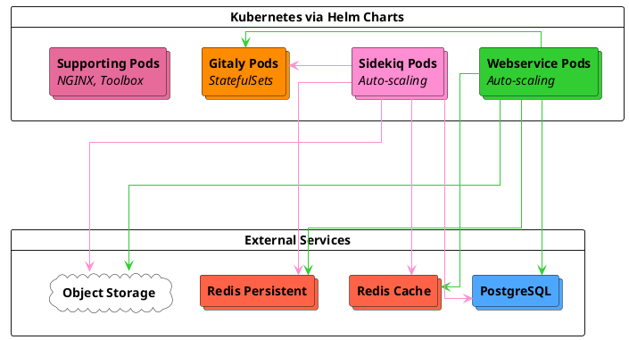



- Édition : Gratuite, GitLab Premium, GitLab Ultimate
- Offre : GitLab Self-Managed



Les architectures de référence Cloud Native sont conçues pour les modèles de déploiement cloud-native modernes avec quatre tailles standardisées (S/M/L/XL) basées sur les caractéristiques de la charge de travail. Ces architectures déploient tous les composants GitLab dans Kubernetes, tandis que PostgreSQL, Redis et le stockage d'objets utilisent des solutions tierces externes, notamment des services gérés ou des options sur site.

## Vue d'ensemble de l'architecture {#architecture-overview}

Les architectures Cloud Native déploient les composants GitLab sur Kubernetes et des services externes :

**Composants Kubernetes :**

- **Webservice** \- Traite les requêtes web
- **Sidekiq** \- Traite les jobs en arrière-plan
- **Gitaly** \- Gère les dépôts Git à l'aide de StatefulSets avec des volumes persistants
- **Services de support** \- Envoy Gateway, Toolbox et composants de surveillance

> [!note]
> Lors du déploiement de Gitaly sur Kubernetes, Gitaly ne prend en charge que les configurations fragmentées (non-cluster). Vous pouvez mettre à niveau Gitaly sans interruption de service grâce aux [nouvelles tentatives du client](../settings/gitaly_timeouts.md). Chaque pod Gitaly constitue un point de défaillance unique pour les dépôts qu'il héberge. Gitaly Cluster (Praefect) sur Kubernetes est en version bêta (voir [Gitaly Cluster on Kubernetes](../gitaly/praefect/_index.md#gitaly-cluster-on-kubernetes)) et n'est pas inclus dans cette architecture de référence.
>
> Si vous avez besoin d'une haute disponibilité Gitaly avec basculement automatique, envisagez les [architectures Cloud Native Hybrid](_index.md#cloud-native-hybrid), qui déploient Gitaly Cluster sur des machines virtuelles tout en exécutant les composants sans état dans Kubernetes. Pour connaître les exigences et les limitations de Gitaly sur Kubernetes, consultez [Gitaly on Kubernetes](../gitaly/kubernetes.md#requirements).

**Services externes :**

- **PostgreSQL** \- Service de base de données géré déployé avec un réplica en veille optionnel pour la haute disponibilité et des réplicas en lecture pour une stabilité et des performances supplémentaires
- **Redis** \- Instances de cache et persistantes séparées, chacune optionnellement déployée avec un réplica en veille pour la haute disponibilité
- **Stockage d'objets** \- Services de stockage d'objets tels que S3, Google Cloud Storage ou Azure Blob Storage pour les artefacts et les packages

Pour les fournisseurs de services gérés recommandés (tels que GCP Cloud SQL, AWS RDS, Azure Database), consultez [l'infrastructure et les services](_index.md#infrastructure-and-services).

## Architectures disponibles {#available-architectures}

Ces architectures sont conçues autour de plages de RPS cibles représentant les modèles de charge de travail de production typiques. Les cibles RPS servent de points de départ. Vos besoins en capacité spécifiques dépendent de la composition de la charge de travail et des modèles d'utilisation. Pour des conseils sur la composition RPS et les cas où des ajustements sont nécessaires, consultez [Comprendre la composition RPS](../../install/sizing.md#understanding-rps-composition-and-workload-patterns).

| Taille | RPS cible | Charge de travail prévue |
|------|------------|-------------------|
| S | ≤100 | Équipes avec une activité de développement légère et une automatisation minimale |
| M | ≤200 | Organisations avec une vélocité de développement modérée et une utilisation standard de CI/CD |
| L | ≤500 | Grandes équipes avec une activité de développement intensive et une automatisation significative |
| XL | ≤1000 | Déploiements d'entreprise avec des charges de travail intensives et des intégrations étendues |

> [!note]
> Ces cibles RPS supposent une composition de charge de travail typique. L'utilisation pilotée par l'IA, comme la [GitLab Duo Agent Platform](#scaling-for-gitlab-duo-agent-platform), n'évolue pas en fonction du nombre d'utilisateurs et peut pousser la charge réelle au-delà de ces cibles. Surveillez l'utilisation réelle plutôt que de dimensionner uniquement en fonction du nombre d'utilisateurs pour les environnements avec une activité agentique significative.

Pour des conseils détaillés sur la détermination de votre charge attendue et la sélection de la taille appropriée, consultez le [guide de dimensionnement des architectures de référence](../../install/sizing.md).

## Principaux avantages {#key-benefits}

Les architectures Cloud Native offrent :

- **Infrastructure auto-réparatrice** \- Kubernetes redémarre automatiquement les pods défaillants et replanifie les charges de travail sur les nœuds sains
- **Mise à l'échelle dynamique des ressources** \- L'autoscaler de pods horizontal et l'autoscaler de cluster ajustent la capacité en fonction de la demande réelle
- **Déploiement simplifié** \- Aucune gestion traditionnelle de machines virtuelles pour les composants GitLab, tout est orchestré via Kubernetes
- **Charge opérationnelle réduite** \- Les services externes pour PostgreSQL, Redis et le stockage d'objets éliminent la maintenance des bases de données et des caches
- **Haute disponibilité intégrée** \- Déploiements multi-zones avec basculement automatique pour tous les composants
- **Efficacité des coûts améliorée** \- Les ressources diminuent pendant les périodes de faible demande tout en maintenant la capacité pour les pics

## Prérequis {#requirements}

Avant de déployer une architecture Cloud Native, assurez-vous de disposer des éléments suivants :

- [Cluster Kubernetes](https://docs.gitlab.com/charts/installation/cloud/) pris en charge et autres [prérequis pour les Charts](https://docs.gitlab.com/charts/installation/tools/) en place
- Instance PostgreSQL externe avec base(s) de données, utilisateur(s) et extension(s) configurés
- Instance(s) Redis externe(s)
- Service de stockage d'objets (S3, Google Cloud Storage, Azure Blob Storage ou autre)

Pour les exigences complètes, notamment la mise en réseau, les types de machines et les services des fournisseurs cloud, consultez les [exigences des architectures de référence](_index.md#requirements).

Pour les exigences et limitations spécifiques de Gitaly sur Kubernetes, consultez les [exigences de Gitaly on Kubernetes](../gitaly/kubernetes.md#requirements).

## Petite (S) {#small-s}

**Charge cible :** ≤100 RPS \| Charge globale légère

**Caractéristiques de la charge de travail :**

- **Plage RPS totale :** ≤100 requêtes par seconde
- **Opérations Git :** Activité légère de push et pull Git
- **Taille du dépôt :** Non adapté aux monodépôts utilisés activement
- **Utilisation CI/CD :** Exécution légère de pipelines en parallèle
- **Trafic API :** Capacité légère pour les charges de travail automatisées
- **Modèles d'utilisation :** Une certaine résilience aux pics d'utilisation

### Composants Kubernetes {#kubernetes-components}

| Composant | Ressources par pod | Pods/Workers minimum | Pods/Workers maximum | Exemple de configuration de nœud |
|-----------|------------------|------------------|------------------|---------------------------|
| Webservice | 4 vCPU, 5 Go (demande), 7 Go (limite) | 6 pods (24 workers) | 9 pods (36 workers) | GCP : 3 × n2-standard-16 (16 vCPU, 64 Go) AWS : 3 × c6i.4xlarge (16 vCPU, 32 Go) |
| Sidekiq | 900m vCPU, 2 Go (demande), 4 Go (limite) | 8 workers | 12 workers | GCP : 3 × n2-standard-4 (4 vCPU, 16 Go) AWS : 3 × m6i.xlarge (4 vCPU, 16 Go) |
| Gitaly | 7 vCPU, 30 Go (demande et limite) | 3 pods | 3 pods | GCP : 3 × n2-standard-8 (8 vCPU, 32 Go) AWS : 3 × m6i.2xlarge (8 vCPU, 32 Go) |
| Support | Variable selon le service | 12 vCPU, 48 Go | 12 vCPU, 48 Go | GCP : 3 × n2-standard-4 (4 vCPU, 16 Go) AWS : 3 × c6i.xlarge (4 vCPU, 8 Go) |

### Configuration de mise à l'échelle des pods {#pod-scaling-configuration}

| Composant | Pods min → max | Workers min → max | Ressources par pod | Workers par pod |
|-----------|----------------|-------------------|-------------------|-----------------|
| Webservice | 6 → 9 | 24 → 36 | 4 vCPU, 5 Go (demande), 7 Go (limite) | 4 |
| Sidekiq | 8 → 12 | 8 → 12 | 900m vCPU, 2 Go (demande), 4 Go (limite) | 1 |
| Gitaly | 3 (sans mise à l'échelle automatique) | sans objet | 7 vCPU, 30 Go (demande et limite) | sans objet |

**Notes Gitaly :** cgroups Git : 27 Go, tampon : 3 Go. Cgroups de dépôt définis à 1. Consultez la [configuration des cgroups Gitaly](#gitaly-cgroups-configuration) pour des conseils d'ajustement.

### Services externes {#external-services}

| Service | Configuration | Équivalent GCP | Équivalent AWS |
|---------|---------------|----------------|----------------|
| PostgreSQL | 8 vCPU, 32 Go | n2-standard-8 | m6i.2xlarge |
| Redis - Cache | 2 vCPU, 8 Go | n2-standard-2 | m6g.large |
| Redis - Persistant | 2 vCPU, 8 Go | n2-standard-2 | m6g.large |
| Stockage d'objets | Service du fournisseur cloud | Google Cloud Storage | Amazon S3 |

## Moyenne (M) {#medium-m}

**Charge cible :** ≤200 RPS \| Charge globale modérée

**Caractéristiques de la charge de travail :**

- **Plage RPS totale :** ≤200 requêtes par seconde
- **Opérations Git :** Activité modérée de push et pull Git
- **Taille du dépôt :** Monodépôts peu utilisés pris en charge. Les monodépôts plus grands ou très utilisés peuvent nécessiter une taille d'architecture plus grande.
- **Utilisation CI/CD :** Concurrence modérée des pipelines
- **Trafic API :** Charges de travail d'automatisation standard prises en charge
- **Modèles d'utilisation :** Bonne résilience aux fluctuations d'utilisation

### Composants Kubernetes {#kubernetes-components-1}

| Composant | Ressources par pod | Pods/Workers minimum | Pods/Workers maximum | Exemple de configuration de nœud |
|-----------|------------------|------------------|------------------|---------------------------|
| Webservice | 4 vCPU, 5 Go (demande), 7 Go (limite) | 14 pods (56 workers) | 21 pods (84 workers) | GCP : 3 × n2-standard-32 (32 vCPU, 128 Go) AWS : 3 × c6i.8xlarge (32 vCPU, 64 Go) |
| Sidekiq | 900m vCPU, 2 Go (demande), 4 Go (limite) | 16 workers | 24 workers | GCP : 3 × n2-standard-8 (8 vCPU, 32 Go) AWS : 3 × m6i.2xlarge (8 vCPU, 32 Go) |
| Gitaly | 15 vCPU, 62 Go (demande et limite) | 3 pods | 3 pods | GCP : 3 × n2-standard-16 (16 vCPU, 64 Go) AWS : 3 × m6i.4xlarge (16 vCPU, 64 Go) |
| Support | Variable selon le service | 12 vCPU, 48 Go | 12 vCPU, 48 Go | GCP : 3 × n2-standard-4 (4 vCPU, 16 Go) AWS : 3 × c6i.xlarge (4 vCPU, 8 Go) |

### Configuration de mise à l'échelle des pods {#pod-scaling-configuration-1}

| Composant | Pods min → max | Workers min → max | Ressources par pod | Workers par pod |
|-----------|----------------|-------------------|-------------------|-----------------|
| Webservice | 14 → 21 | 56 → 84 | 4 vCPU, 5 Go (demande), 7 Go (limite) | 4 |
| Sidekiq | 16 → 24 | 16 → 24 | 900m vCPU, 2 Go (demande), 4 Go (limite) | 1 |
| Gitaly | 3 (sans mise à l'échelle automatique) | sans objet | 15 vCPU, 62 Go (demande et limite) | sans objet |

**Notes Gitaly :** cgroups Git : 56 Go, tampon : 6 Go. Cgroups de dépôt définis à 1. Consultez la [configuration des cgroups Gitaly](#gitaly-cgroups-configuration) pour des conseils d'ajustement.

### Services externes {#external-services-1}

| Service | Configuration | Équivalent GCP | Équivalent AWS |
|---------|---------------|----------------|----------------|
| PostgreSQL | 16 vCPU, 64 Go | n2-standard-16 | m6i.4xlarge |
| Redis - Cache | 2 vCPU, 8 Go | n2-standard-2 | m6g.large |
| Redis - Persistant | 2 vCPU, 8 Go | n2-standard-2 | m6g.large |
| Stockage d'objets | Service du fournisseur cloud | Google Cloud Storage | Amazon S3 |

## Grande (L) {#large-l}

**Charge cible :** ≤500 RPS \| Charge globale élevée

**Caractéristiques de la charge de travail :**

- **Plage RPS totale :** ≤500 requêtes par seconde
- **Opérations Git :** Activité intensive de push et pull Git
- **Taille du dépôt :** Monodépôts modérément utilisés pris en charge. Les monodépôts plus grands ou très utilisés peuvent nécessiter une taille d'architecture plus grande.
- **Utilisation CI/CD :** Utilisation intensive des pipelines avec une mise à l'échelle appropriée de Sidekiq
- **Trafic API :** Charges de travail d'automatisation significatives prises en charge
- **Modèles d'utilisation :** Forte résilience aux fluctuations d'utilisation

### Composants Kubernetes {#kubernetes-components-2}

| Composant | Ressources par pod | Pods/Workers minimum | Pods/Workers maximum | Exemple de configuration de nœud |
|-----------|------------------|------------------|------------------|---------------------------|
| Webservice | 4 vCPU, 5 Go (demande), 7 Go (limite) | 28 pods (112 workers) | 42 pods (168 workers) | GCP : 6 × n2-standard-32 (32 vCPU, 128 Go) AWS : 6 × c6i.8xlarge (32 vCPU, 64 Go) |
| Sidekiq | 900m vCPU, 2 Go (demande), 4 Go (limite) | 32 workers | 48 workers | GCP : 6 × n2-standard-8 (8 vCPU, 32 Go) AWS : 6 × m6i.2xlarge (8 vCPU, 32 Go) |
| Gitaly | 31 vCPU, 126 Go (demande et limite) | 3 pods | 3 pods | GCP : 3 × n2-standard-32 (32 vCPU, 128 Go) AWS : 3 × m6i.8xlarge (32 vCPU, 128 Go) |
| Support | Variable selon le service | 12 vCPU, 48 Go | 12 vCPU, 48 Go | GCP : 3 × n2-standard-4 (4 vCPU, 16 Go) AWS : 3 × c6i.xlarge (4 vCPU, 8 Go) |

### Configuration de mise à l'échelle des pods {#pod-scaling-configuration-2}

| Composant | Pods min → max | Workers min → max | Ressources par pod | Workers par pod |
|-----------|----------------|-------------------|-------------------|-----------------|
| Webservice | 28 → 42 | 112 → 168 | 4 vCPU, 5 Go (demande), 7 Go (limite) | 4 |
| Sidekiq | 32 → 48 | 32 → 48 | 900m vCPU, 2 Go (demande), 4 Go (limite) | 1 |
| Gitaly | 3 (sans mise à l'échelle automatique) | sans objet | 31 vCPU, 126 Go (demande et limite) | sans objet |

**Notes Gitaly :** cgroups Git : 120 Go, tampon : 6 Go. Cgroups de dépôt définis à 1. Consultez la [configuration des cgroups Gitaly](#gitaly-cgroups-configuration) pour des conseils d'ajustement.

### Services externes {#external-services-2}

| Service | Configuration | Équivalent GCP | Équivalent AWS |
|---------|---------------|----------------|----------------|
| PostgreSQL | 32 vCPU, 128 Go | n2-standard-32 | m6i.8xlarge |
| Redis - Cache | 2 vCPU, 16 Go | n2-highmem-2 | r6g.large |
| Redis - Persistant | 2 vCPU, 16 Go | n2-highmem-2 | r6g.large |
| Stockage d'objets | Service du fournisseur cloud | Google Cloud Storage | Amazon S3 |

## Très grande (XL) {#extra-large-xl}

**Charge cible :** ≤1000 RPS \| Charge globale intensive

**Caractéristiques de la charge de travail :**

- **Plage RPS totale :** ≤1000 requêtes par seconde
- **Opérations Git :** Activité très intensive de push et pull Git
- **Taille du dépôt :** Monodépôts très utilisés pris en charge. Les monodépôts utilisés de façon intensive peuvent nécessiter une taille d'architecture plus grande.
- **Utilisation CI/CD :** Charges de travail CI/CD intensives
- **Trafic API :** Trafic d'automatisation et d'intégration élevé
- **Modèles d'utilisation :** Conçu pour des modèles d'accès variés

### Composants Kubernetes {#kubernetes-components-3}

| Composant | Ressources par pod | Pods/Workers minimum | Pods/Workers maximum | Exemple de configuration de nœud |
|-----------|------------------|------------------|------------------|---------------------------|
| Webservice | 4 vCPU, 5 Go (demande), 7 Go (limite) | 56 pods (224 workers) | 84 pods (336 workers) | GCP : 6 × n2-standard-64 (64 vCPU, 256 Go) AWS : 6 × c6i.16xlarge (64 vCPU, 128 Go) |
| Sidekiq | 900m vCPU, 2 Go (demande), 4 Go (limite) | 64 workers | 96 workers | GCP : 6 × n2-standard-16 (16 vCPU, 64 Go) AWS : 6 × m6i.4xlarge (16 vCPU, 64 Go) |
| Gitaly | 63 vCPU, 254 Go (demande et limite) | 3 pods | 3 pods | GCP : 3 × n2-standard-64 (64 vCPU, 256 Go) AWS : 3 × m6i.16xlarge (64 vCPU, 256 Go) |
| Support | Variable selon le service | 24 vCPU, 96 Go | 24 vCPU, 96 Go | GCP : 3 × n2-standard-8 (8 vCPU, 32 Go) AWS : 3 × c6i.2xlarge (8 vCPU, 16 Go) |

### Configuration de mise à l'échelle des pods {#pod-scaling-configuration-3}

| Composant | Pods min → max | Workers min → max | Ressources par pod | Workers par pod |
|-----------|----------------|-------------------|-------------------|-----------------|
| Webservice | 56 → 84 | 224 → 336 | 4 vCPU, 5 Go (demande), 7 Go (limite) | 4 |
| Sidekiq | 64 → 96 | 64 → 96 | 900m vCPU, 2 Go (demande), 4 Go (limite) | 1 |
| Gitaly | 3 (sans mise à l'échelle automatique) | sans objet | 63 vCPU, 254 Go (demande et limite) | sans objet |

**Notes Gitaly :** cgroups Git : 248 Go, tampon : 6 Go. Cgroups de dépôt définis à 1. Consultez la [configuration des cgroups Gitaly](#gitaly-cgroups-configuration) pour des conseils d'ajustement.

### Services externes {#external-services-3}

| Service | Configuration | Équivalent GCP | Équivalent AWS |
|---------|---------------|----------------|----------------|
| PostgreSQL | 64 vCPU, 256 Go | n2-standard-64 | m6i.16xlarge |
| Redis - Cache | 2 vCPU, 16 Go | n2-highmem-2 | r6g.large |
| Redis - Persistant | 2 vCPU, 16 Go | n2-highmem-2 | r6g.large |
| Stockage d'objets | Service du fournisseur cloud | Google Cloud Storage | Amazon S3 |

## Informations complémentaires {#additional-information}

Cette section fournit des conseils complémentaires pour le déploiement et l'exploitation des architectures Cloud Native, notamment la sélection des types de machines, les considérations spécifiques aux composants et les stratégies de mise à l'échelle.

### Conseils sur les types de machines {#machine-type-guidance}

Les types de machines indiqués sont des exemples utilisés lors de la validation et des tests. Vous pouvez utiliser :

- Types de machines de nouvelle génération
- Instances basées sur ARM (AWS Graviton)
- Familles de machines différentes qui atteignent ou dépassent les spécifications
- Types de machines personnalisés dimensionnés selon vos besoins spécifiques

N'utilisez pas de types d'instances modulables en raison de performances inconsistantes.

Pour plus d'informations, consultez [Comment les spécifications sont dérivées](_index.md#how-specifications-are-derived).

### Configuration du pool de nœuds {#node-pool-configuration}

Les configurations de nœuds présentées pour chaque taille utilisent un pool dédié par type de composant, correspondant aux [exemples de référence des Charts GitLab](https://gitlab.com/gitlab-org/charts/gitlab/-/tree/master/examples/ref). La combinaison de Webservice, Sidekiq et Supporting dans un seul pool partagé est également prise en charge, à condition que les nœuds soient dimensionnés pour héberger les trois charges de travail ensemble. Gitaly nécessite toujours ses propres nœuds dédiés, quel que soit le regroupement des autres composants.

### Considérations relatives à Gitaly {#gitaly-considerations}

Gitaly dans Kubernetes avec les architectures Cloud Native utilise des StatefulSets avec les spécifications suivantes :

- **Placement exclusif sur les nœuds** \- Les pods Gitaly sont déployés sur des nœuds dédiés afin d'éviter les problèmes de voisins bruyants.
- **Allocation des ressources** \- Les demandes et limites des pods sont définies à la capacité du nœud moins la surcharge (2 Go de mémoire, 1 vCPU réservé aux processus système Kubernetes).
- **Mémoire cgroups Git** \- Allouée avec un tampon de 10 % par défaut, plafonnée à 6 Go maximum pour les pods plus grands. Par exemple, la taille Small alloue 27 Go aux cgroups Git avec un tampon de 3 Go, tandis que les tailles Medium et supérieures utilisent le plafond de 6 Go (56 Go de cgroups avec un tampon de 6 Go pour Medium).

**Mode de déploiement Gitaly :**

Par conception, Gitaly (non-Cluster) sur Kubernetes est un service à point de défaillance unique pour les dépôts stockés sur chaque pod. Les données sont sourcées et servies depuis une seule instance par pod. Chaque pod Gitaly gère son propre ensemble de dépôts, assurant une mise à l'échelle horizontale du stockage Git grâce à la distribution des dépôts.

Gitaly Cluster (Praefect) sur Kubernetes est en version bêta et n'est pas inclus dans les architectures Cloud Native. Pour plus d'informations, consultez [Gitaly Cluster on Kubernetes](../gitaly/praefect/_index.md#gitaly-cluster-on-kubernetes) et [Gitaly on Kubernetes](../gitaly/kubernetes.md).

**Distribution des dépôts :**

Avec plusieurs stockages Gitaly configurés (par exemple `default`, `storage1`, `storage2`), GitLab crée par défaut tous les nouveaux dépôts sur le stockage `default`. Pour distribuer les dépôts sur tous les pods Gitaly, configurez les poids de stockage afin d'équilibrer la charge.

Pour des conseils sur la configuration des poids de stockage des dépôts, consultez [configurer l'emplacement de création des nouveaux dépôts](../repository_storage_paths.md#configure-where-new-repositories-are-stored).

#### Configuration des cgroups Gitaly {#gitaly-cgroups-configuration}

Gitaly utilise les [cgroups](../gitaly/cgroups.md) pour se protéger contre l'épuisement des ressources causé par des opérations Git individuelles. La configuration par défaut définit le nombre de cgroups de dépôt à 1, ce qui fournit un point de départ permettant à n'importe quel dépôt individuel d'utiliser toutes les ressources du pod grâce à la sursouscription.

Cependant, cette configuration peut ne pas être optimale pour toutes les charges de travail. Pour les environnements avec de nombreux dépôts actifs ou des exigences spécifiques d'isolation des ressources, vous devez ajuster la configuration des cgroups en fonction des modèles d'utilisation observés. Cela inclut l'ajustement du nombre de cgroups de dépôt et des allocations de mémoire.

Pour des conseils détaillés sur la mesure, l'ajustement et la configuration des cgroups Gitaly, consultez [Cgroups Gitaly](../gitaly/cgroups.md).

Pour les grands monodépôts (plus de 2 Go) ou les charges de travail Git intensives, des ajustements supplémentaires de Gitaly peuvent être nécessaires. Consultez le [guide de dimensionnement des architectures de référence](../../install/sizing.md) pour des conseils détaillés.

### Notes sur les services externes {#external-service-notes}

- PostgreSQL peut être déployé avec un réplica en veille pour la haute disponibilité. Des réplicas en lecture peuvent être ajoutés pour une stabilité et des performances supplémentaires. Les environnements plus grands (L, XL) bénéficient davantage des réplicas en lecture pour distribuer la charge de la base de données.
- Les instances Redis peuvent être déployées avec un réplica en veille pour la haute disponibilité. Sur GCP, les instances Memorystore sont configurées uniquement par la mémoire. Les spécifications des machines sont indiquées à titre de référence.
- Pour tous les services de fournisseurs cloud impliquant la configuration d'instances, il est recommandé de mettre en œuvre un minimum de trois nœuds dans trois zones de disponibilité différentes, conformément aux bonnes pratiques d'architecture cloud résiliente.

### Mise à l'échelle automatique et nombre minimum de pods {#autoscaling-and-minimum-pod-counts}

Toutes les architectures utilisent l'autoscaler de pods horizontal Kubernetes (HPA) et le Cluster Autoscaler pour gérer la capacité :

- **Webservice** \- La mise à l'échelle est basée sur l'utilisation du CPU avec des nombres minimum de pods conservateurs
- **Sidekiq** \- La mise à l'échelle est basée sur l'utilisation du CPU
- **Cluster Autoscaler** \- Provisionne et supprime les nœuds automatiquement en fonction des demandes de ressources des pods

Les nombres minimum de pods sont définis à environ 2/3 du maximum pour équilibrer l'efficacité des coûts et la fiabilité des performances, sur la base de tests internes visant les objectifs suivants :

- Mise à l'échelle réactive lors des augmentations de la demande
- Capacité suffisante lors des défaillances ou des mises à niveau de nœuds
- Optimisation des coûts pendant les périodes de faible demande

Si vous avez des modèles de charge bien compris, vous pouvez ajuster les minimums en fonction de vos besoins :

- **Augmenter les minimums** pour les environnements avec des pics de trafic importants ou des SLA de performance stricts
- **Diminuer les minimums** une fois que la surveillance indique une charge soutenue constamment inférieure aux valeurs par défaut

### Mise à l'échelle avancée {#advanced-scaling}

Les architectures Cloud Native sont conçues pour évoluer au-delà de leurs spécifications de base. Vous devrez peut-être ajuster la capacité si votre environnement présente :

- Un débit constamment supérieur aux cibles RPS indiquées
- Une composition de charge de travail atypique (voir [Comprendre la composition RPS](../../install/sizing.md#understanding-rps-composition-and-workload-patterns))
- Des grands monodépôts (plus de 2 Go)
- Des charges de travail supplémentaires significatives
- Une utilisation intensive de GitLab Duo Agent Platform

Les stratégies de mise à l'échelle diffèrent selon le type de composant.

#### Mise à l'échelle horizontale (Webservice et Sidekiq) {#horizontal-scaling-webservice-and-sidekiq}

Pour augmenter la capacité, effectuez une mise à l'échelle horizontale en ajustant le nombre maximum de réplicas et la capacité du pool de nœuds :

- **Webservice** \- Augmentez `maxReplicas` dans les valeurs Helm et ajoutez les nœuds correspondants au pool de nœuds Webservice
- **Sidekiq** \- Augmentez `maxReplicas` pour gérer un débit de jobs plus élevé et ajoutez des nœuds au pool de nœuds Sidekiq

La mise à l'échelle horizontale est l'approche recommandée pour ces composants sans état.

#### Mise à l'échelle verticale (PostgreSQL, Redis, Gitaly) {#vertical-scaling-postgresql-redis-gitaly}

Pour les composants avec état, augmentez les spécifications des instances ou des pods :

- **PostgreSQL et Redis** \- Effectuez une mise à niveau vers des types d'instances plus grands via votre fournisseur de services.
- **Gitaly** \- Augmentez les spécifications de CPU et de mémoire par pod. Cela nécessite des types de nœuds plus importants dans le pool de nœuds Gitaly et des ajustements correspondants à l'allocation de mémoire des cgroups Git.

#### Optimisation des files d'attente Sidekiq {#sidekiq-queue-optimization}

Par défaut, Sidekiq traite tous les types de jobs dans une seule file d'attente. Pour les environnements avec des modèles de charge de travail diversifiés, vous pouvez configurer des files d'attente distinctes selon les caractéristiques des jobs :

- **Files d'attente haute priorité** \- Pour les jobs urgents tels que le traitement des pipelines CI et la livraison des webhooks
- **Files d'attente liées au CPU** \- Pour les jobs intensifs en calcul avec des paramètres de concurrence ajustés
- **File d'attente par défaut** \- Pour le traitement standard en arrière-plan

La séparation des files d'attente peut améliorer la fiabilité du traitement des jobs et empêcher les jobs de faible priorité de bloquer les opérations urgentes, particulièrement dans les environnements de grande taille (L, XL) avec des charges de travail d'automatisation importantes.

Pour plus d'informations sur la configuration des files d'attente Sidekiq, consultez [le traitement de classes de jobs spécifiques](../sidekiq/processing_specific_job_classes.md).

#### Mise à l'échelle pour GitLab Duo Agent Platform {#scaling-for-gitlab-duo-agent-platform}

GitLab Duo Agent Platform introduit des exigences d'infrastructure supplémentaires au-delà des charges de travail GitLab standard. Pour des conseils détaillés sur la surveillance et la mise à l'échelle pour l'adoption de l'Agent Platform, consultez [Mise à l'échelle pour GitLab Duo Agent Platform](_index.md#scaling-for-gitlab-duo-agent-platform).

#### Considérations de mise à l'échelle {#scaling-considerations}

Lors de la mise à l'échelle significative d'un composant :

- Surveillez les composants dépendants pour détecter toute saturation des ressources. Une charge accrue sur Webservice ou Sidekiq peut impacter PostgreSQL et Gitaly.
- Testez d'abord les modifications de mise à l'échelle dans des environnements hors production.
- Mettez à l'échelle les composants interdépendants ensemble pour éviter de déplacer les goulots d'étranglement entre les services.

Pour des conseils complets sur la mise à l'échelle, consultez [la mise à l'échelle d'un environnement](_index.md#scaling-an-environment).

## Déploiement {#deployment}

Prérequis :

- PostgreSQL externe avec les bases de données, utilisateurs et permissions requis configurés
- Instances Redis externes configurées et accessibles
- Buckets de stockage d'objets créés
- Secrets Kubernetes créés pour l'authentification si nécessaire (mot de passe PostgreSQL, mots de passe Redis, identifiants de stockage d'objets, secrets GitLab)

Pour les prérequis détaillés et la configuration des secrets, consultez [les prérequis du chart GitLab](https://docs.gitlab.com/charts/installation/tools/) et [configurer les secrets](https://docs.gitlab.com/charts/installation/secrets/).

Pour déployer à l'aide des charts Helm :

1. Configurez les services externes requis et les secrets comme décrit dans les prérequis
1. Configurez un cluster Kubernetes avec les pools de nœuds appropriés et l'autoscaler
1. Appliquez la configuration des valeurs Helm indiquée dans la section [Configuration du chart Helm](#helm-chart-configurations)
1. Déployez GitLab à l'aide de `helm install`

Pour les étapes détaillées de déploiement, consultez [l'installation de GitLab sur Kubernetes](https://docs.gitlab.com/charts/installation/).

## Configurations du chart Helm {#helm-chart-configurations}

Pour des exemples complets de configuration du chart Helm et des conseils de déploiement détaillés, consultez le [dépôt GitLab Charts](https://gitlab.com/gitlab-org/charts/gitlab/-/tree/master/examples/ref).

Domaines de configuration clés pour les architectures Cloud Native :

- **Spécifications des ressources** \- Les limites de CPU et de mémoire des pods correspondent aux spécifications de chaque taille d'architecture ci-dessus
- **Mise à l'échelle automatique** \- Les configurations HPA définissent le nombre minimum de pods à 2/3 du maximum avec des cibles de mise à l'échelle basées sur le CPU
- **Placement des nœuds** \- Les sélecteurs de nœuds s'assurent que les charges de travail sont déployées vers les pools de nœuds appropriés (par exemple : `webservice`, `sidekiq`, `gitaly`, `support`)
- **Services externes** \- Détails de connexion pour PostgreSQL, Redis et le stockage d'objets
- **Gitaly** \- Configuration StatefulSet avec cgroups, persistance et distribution du stockage

Pour les nombres de réplicas et les valeurs de ressources spécifiques à chaque architecture, référez-vous aux spécifications de chaque section de taille ci-dessus.

## Étapes suivantes {#next-steps}

Après le déploiement, les environnements nécessitent généralement une surveillance et un ajustement pour correspondre aux modèles de charge de travail réels.

### Surveiller et valider {#monitor-and-validate}

1. **Surveiller l'utilisation des ressources** \- Suivre l'utilisation du CPU, de la mémoire et les profondeurs de file d'attente sur tous les composants à l'aide de [Prometheus](../monitoring/prometheus/_index.md)
1. **Valider les hypothèses RPS** \- Comparez votre [répartition RPS](../../install/sizing.md#extract-peak-traffic-metrics) réelle à la composition supposée 80/10/10
1. **Identifier les ajustements potentiels** \- Recherchez les composants dont l'utilisation est constamment supérieure à 70 %
1. **Examiner les cgroups Gitaly** \- Envisagez d'ajuster les [nombres de cgroups de dépôts](../gitaly/cgroups.md) en fonction de vos modèles d'accès aux dépôts

### Ajuster selon les besoins {#adjust-as-needed}

Les architectures de référence sont des points de départ. De nombreux environnements bénéficient d'ajustements basés sur :

- **Composition réelle de la charge de travail** \- Si votre répartition API/Web/Git diffère significativement des modèles typiques, consultez [Comprendre la composition RPS](../../install/sizing.md#understanding-rps-composition-and-workload-patterns)
- **Caractéristiques des dépôts** \- Les tailles des monodépôts, la fréquence de clonage et les modèles d'accès peuvent nécessiter des [ajustements spécifiques aux composants](../../install/sizing.md#identify-component-adjustments)
- **Modèles de croissance** \- Augmentation du nombre d'utilisateurs, expansion CI/CD ou mise à l'échelle de l'automatisation

Consultez [Mise à l'échelle avancée](#advanced-scaling) pour des conseils d'ajustement spécifiques aux composants.

### Configurer les fonctionnalités optionnelles {#configure-optional-features}

Vous pouvez configurer des fonctionnalités optionnelles supplémentaires de GitLab en fonction de vos besoins. Consultez [les étapes après l'installation de GitLab](../../install/next_steps.md) pour plus d'informations.

> [!note]
> Une capacité supplémentaire peut être requise pour les fonctionnalités optionnelles. Consultez la documentation spécifique à chaque fonctionnalité pour connaître les exigences.
