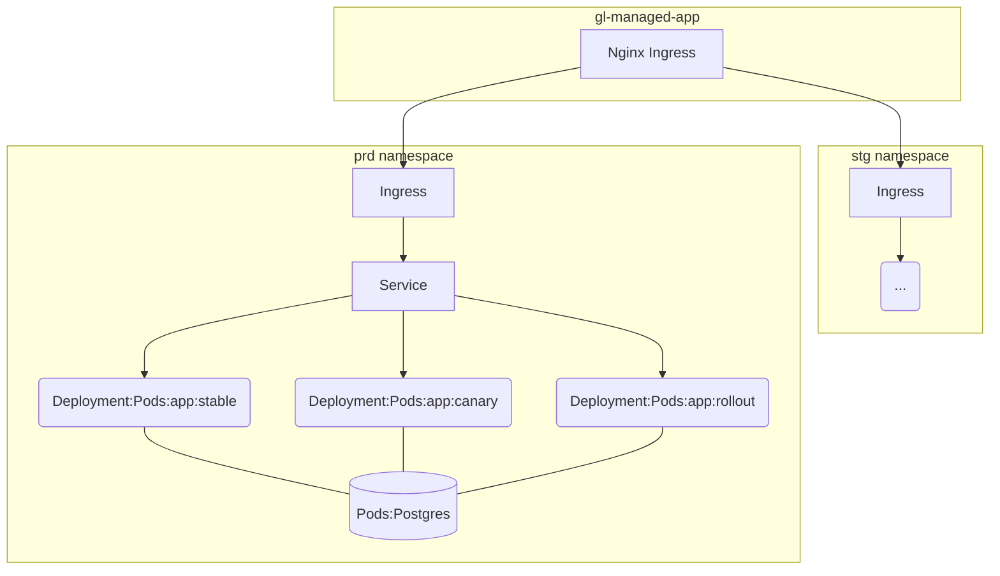
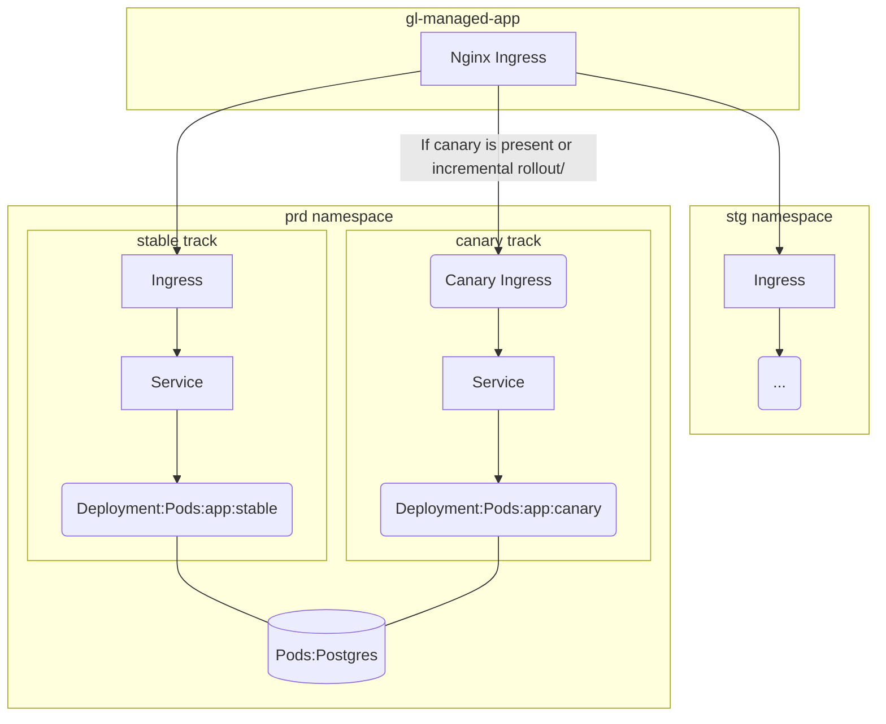



- Édition : Gratuite, GitLab Premium, GitLab Ultimate
- Offre : GitLab.com, GitLab Self-Managed, GitLab Dedicated



[Auto Deploy](stages.md#auto-deploy) est une fonctionnalité qui déploie votre application dans un cluster Kubernetes. Elle comprend plusieurs dépendances :

- [Le template Auto Deploy](https://gitlab.com/gitlab-org/gitlab/-/blob/master/lib/gitlab/ci/templates/Jobs/Deploy.gitlab-ci.yml) est un ensemble de jobs de pipeline et de scripts qui utilisent `auto-deploy-image`.
- [`auto-deploy-image`](https://gitlab.com/gitlab-org/cluster-integration/auto-deploy-image) est l'image exécutable qui communique avec le cluster Kubernetes.
- [`auto-deploy-app chart`](https://gitlab.com/gitlab-org/cluster-integration/auto-deploy-image/-/tree/master/assets/auto-deploy-app) est le chart Helm permettant de déployer votre application.

Les graphiques `auto-deploy-image` et `auto-deploy-app` utilisent la [gestion sémantique de version](https://semver.org/). Par défaut, votre projet Auto DevOps continue d'utiliser la version stable et sans rupture de compatibilité. Cependant, ces dépendances pourraient être mises à niveau dans une version majeure de GitLab avec des changements incompatibles vous obligeant à mettre à niveau vos déploiements.

Ce guide explique comment mettre à niveau vos déploiements avec des versions majeures plus récentes ou différentes des dépendances Auto Deploy.

## Vérifier les versions des dépendances {#verify-dependency-versions}

Le processus de vérification des versions actuelles varie selon le template que vous utilisez. Vérifiez d'abord quel template est en cours d'utilisation :

- Pour les instances GitLab Self-Managed, le [template Auto Deploy stable fourni avec le package GitLab](https://gitlab.com/gitlab-org/gitlab/-/blob/master/lib/gitlab/ci/templates/Jobs/Deploy.gitlab-ci.yml) est utilisé.
- [Le template Auto Deploy stable de GitLab.com](https://gitlab.com/gitlab-org/gitlab/-/blob/master/lib/gitlab/ci/templates/Jobs/Deploy.gitlab-ci.yml) est utilisé si l'une des conditions suivantes est vraie :
  - Votre projet Auto DevOps ne possède pas de fichier `.gitlab-ci.yml`.
  - Votre projet Auto DevOps possède un fichier `.gitlab-ci.yml` et [inclut](../../ci/yaml/_index.md#includetemplate) le template `Auto-DevOps.gitlab-ci.yml`.
- [Le dernier template Auto Deploy](https://gitlab.com/gitlab-org/gitlab/-/blob/master/lib/gitlab/ci/templates/Jobs/Deploy.latest.gitlab-ci.yml) est utilisé si les deux conditions suivantes sont vraies :
  - Votre projet Auto DevOps possède un fichier `.gitlab-ci.yml` et [inclut](../../ci/yaml/_index.md#includetemplate) le template `Auto-DevOps.gitlab-ci.yml`.
  - Il inclut également [le dernier template Auto Deploy](#early-adopters)

Si vous savez quel template est utilisé :

- La version de `auto-deploy-image` est indiquée dans le template (par exemple `auto-deploy-image:v1.0.3`).
- La version du chart `auto-deploy-app` se trouve [dans le dépôt auto-deploy-image](https://gitlab.com/gitlab-org/cluster-integration/auto-deploy-image/-/blob/v1.0.3/assets/auto-deploy-app/Chart.yaml) (par exemple `version: 1.0.3`).

## Compatibilité {#compatibility}

Le tableau suivant explique la compatibilité des versions entre GitLab et les dépendances Auto Deploy :

| Version de GitLab   | Version de `auto-deploy-image` | Remarques |
|------------------|-----------------------------|-------|
| v10.0 à v14.0   | v0.1.0 à v2.0.0            | Les versions v0 et v1 d'auto-deploy-image sont rétrocompatibles. |
| v13.4 et versions ultérieures  | v2.0.0 et versions ultérieures            | La version v2 d'auto-deploy-image contient des changements incompatibles, comme expliqué dans le [guide de mise à niveau](#upgrade-deployments-to-the-v2-auto-deploy-image). |

Vous pouvez trouver la version stable actuelle d'auto-deploy-image dans le [template Auto Deploy stable](https://gitlab.com/gitlab-org/gitlab/-/blob/master/lib/gitlab/ci/templates/Jobs/Deploy.gitlab-ci.yml).

## Guide de mise à niveau {#upgrade-guide}

Les projets utilisant Auto DevOps doivent utiliser le chart non modifié géré par GitLab. Les [graphiques personnalisés](customize.md#custom-helm-chart) ne sont pas pris en charge.

### Mettre à niveau les déploiements vers la version v1 de `auto-deploy-image` {#upgrade-deployments-to-the-v1-auto-deploy-image}

Le chart v1 est rétrocompatible avec le chart v0, donc aucun changement de configuration n'est nécessaire.

### Mettre à niveau les déploiements vers la version v2 de `auto-deploy-image` {#upgrade-deployments-to-the-v2-auto-deploy-image}

La version v2 d'auto-deploy-image contient plusieurs modifications de dépendances et d'architecture. Si votre projet Auto DevOps possède un environnement actif déployé avec la version v1 de `auto-deploy-image`, procédez avec le guide de mise à niveau suivant. Sinon, vous pouvez ignorer ce processus.

#### Kubernetes 1.16+ {#kubernetes-116}

La version v2 d'auto-deploy-image abandonne la prise en charge de Kubernetes 1.15 et des versions antérieures. Si vous devez mettre à niveau votre cluster Kubernetes, suivez les instructions de votre fournisseur cloud. Voici [un exemple sur GKE](https://docs.cloud.google.com/kubernetes-engine/docs/how-to/upgrading-a-cluster).

#### Helm v3 {#helm-v3}

Le `auto-deploy-image` utilise le binaire Helm pour manipuler les releases. Auparavant, `auto-deploy-image` utilisait Helm v2, qui utilisait Tiller dans un cluster. Dans la version v2 de `auto-deploy-image`, Helm v3 est utilisé, ce qui ne nécessite plus Tiller.

Si votre projet Auto DevOps possède un environnement actif déployé avec la version v1 de `auto-deploy-image`, suivez les étapes ci-dessous pour effectuer la mise à niveau vers v2, qui utilise Helm v3 :

1. Définissez les variables CI/CD suivantes :

   - `MIGRATE_HELM_2TO3` sur `true`. Si cette variable n'est pas présente, les jobs de migration ne s'exécutent pas.
   - `AUTO_DEVOPS_FORCE_DEPLOY_V2` sur `1`.
   - **Facultatif** : `BACKUP_HELM2_RELEASES` sur `1`. Si vous définissez cette variable, le job de migration enregistre une sauvegarde pendant 1 semaine dans un artefact de job appelé `helm-2-release-backups`. Si vous supprimez accidentellement les releases Helm v2 avant d'être prêt, vous pouvez restaurer cette sauvegarde à partir d'un fichier manifeste Kubernetes en utilisant `kubectl apply -f $backup`.

     > [!warning]
     > N'utilisez pas cette option si vous avez des pipelines publics. Cet artefact peut contenir des secrets et est visible par tout utilisateur pouvant voir votre job.

1. Exécutez un pipeline et déclenchez le job `<environment-name>:helm-2to3:migrate`.
1. Déployez votre environnement comme d'habitude. Ce déploiement utilise Helm v3.
1. Si le déploiement réussit, vous pouvez exécuter `<environment-name>:helm-2to3:cleanup` en toute sécurité. Cette opération supprime toutes les données de release Helm v2 de l'espace de nommage.
1. Supprimez la variable CI/CD `MIGRATE_HELM_2TO3` ou définissez-la sur `false`. Vous pouvez effectuer cette opération un environnement à la fois en utilisant les [portées d'environnement](../../ci/environments/_index.md#limit-the-environment-scope-of-a-cicd-variable).

#### In-Cluster PostgreSQL Channel 2 {#in-cluster-postgresql-channel-2}

La version v2 d'auto-deploy-image abandonne la prise en charge du [PostgreSQL in-cluster hérité](upgrading_postgresql.md). Si votre cluster Kubernetes en dépend encore, [mettez à niveau et migrez vos données](upgrading_postgresql.md) avec la [version v1 d'auto-deploy-image](#use-a-specific-version-of-auto-deploy-dependencies).

#### Modification du routage du trafic pour les déploiements canari et les déploiements progressifs {#traffic-routing-change-for-canary-deployments-and-incremental-rollouts}

Auto Deploy prend en charge des stratégies de déploiement avancées telles que les [déploiements canari](cicd_variables.md#deploy-policy-for-canary-environments) et les [déploiements progressifs](../../ci/environments/incremental_rollouts.md).

Auparavant, `auto-deploy-image` créait un service pour équilibrer le trafic entre les tracks instables et stables en modifiant le ratio de réplicas. Dans la version v2 de `auto-deploy-image`, le trafic est contrôlé via [Canary Ingress](https://kubernetes.github.io/ingress-nginx/user-guide/nginx-configuration/annotations/#canary).

Pour plus de détails, consultez [l'architecture des ressources du chart v2 `auto-deploy-app`](#v2-chart-resource-architecture).

Si votre projet Auto DevOps possède des releases de track `canary` ou `rollout` actives dans l'environnement `production` déployé avec la version v1 de `auto-deploy-image`, suivez les étapes ci-dessous pour effectuer la mise à niveau vers v2 :

1. Vérifiez que votre projet [utilise la version v1 de `auto-deploy-image`](#verify-dependency-versions). Si ce n'est pas le cas, [spécifiez la version](#use-a-specific-version-of-auto-deploy-dependencies).
1. Si vous êtes en cours de déploiement de déploiements `canary` ou `rollout`, promouvez-les d'abord vers `production` pour supprimer les tracks instables.
1. Vérifiez que votre projet [utilise la version v2 de `auto-deploy-image`](#verify-dependency-versions). Si ce n'est pas le cas, [spécifiez la version](#use-a-specific-version-of-auto-deploy-dependencies).
1. Ajoutez une variable CI/CD `AUTO_DEVOPS_FORCE_DEPLOY_V2` avec la valeur `true` dans les paramètres CI/CD de GitLab.
1. Créez un nouveau pipeline et exécutez le job `production` pour renouveler l'architecture des ressources avec la version v2 de `auto-deploy-app chart`.
1. Supprimez la variable `AUTO_DEVOPS_FORCE_DEPLOY_V2`.

### Utiliser une version spécifique des dépendances Auto Deploy {#use-a-specific-version-of-auto-deploy-dependencies}

Pour utiliser une version spécifique des dépendances Auto Deploy, spécifiez le template Auto Deploy stable précédent qui contient la [version souhaitée de `auto-deploy-image` et de `auto-deploy-app`](#verify-dependency-versions).

Par exemple, si le template est fourni avec GitLab 19.2, modifiez votre `.gitlab-ci.yml` comme suit :

```yaml
include:
  - template: Auto-DevOps.gitlab-ci.yml
  - remote: https://gitlab.com/gitlab-org/gitlab/-/raw/v19.2.0-ee/lib/gitlab/ci/templates/Jobs/Deploy.gitlab-ci.yml
```

### Ignorer les avertissements et continuer le déploiement {#ignore-warnings-and-continue-deploying}

Si vous êtes certain que la nouvelle version du chart peut être déployée en toute sécurité, vous pouvez ajouter la [variable CI/CD](cicd_variables.md#build-and-deployment-variables) `AUTO_DEVOPS_FORCE_DEPLOY_V<major-version-number>` pour forcer la poursuite du déploiement.

Par exemple, si vous souhaitez déployer le chart `v2.0.0` sur un déploiement qui utilisait précédemment le chart `v0.17.0`, ajoutez `AUTO_DEVOPS_FORCE_DEPLOY_V2`.

## Premiers adoptants {#early-adopters}

Si vous souhaitez utiliser la dernière version [bêta](../../policy/development_stages_support.md#beta) ou instable de `auto-deploy-image`, incluez le dernier template Auto Deploy dans votre `.gitlab-ci.yml` :

```yaml
include:
  - template: Auto-DevOps.gitlab-ci.yml
  - template: Jobs/Deploy.latest.gitlab-ci.yml
```

> [!warning]
> L'utilisation d'une version [bêta](../../policy/development_stages_support.md#beta) ou instable de `auto-deploy-image` pourrait causer des dommages irrécupérables à vos environnements. Ne le testez pas avec des projets ou des environnements importants.

## Architectures des ressources du chart `auto-deploy-app` {#resource-architectures-of-the-auto-deploy-app-chart}

### Architecture des ressources des charts v0 et v1 {#v0-and-v1-chart-resource-architecture}



### Architecture des ressources du chart v2 {#v2-chart-resource-architecture}



## Dépannage {#troubleshooting}

### Avertissement de discordance de version majeure {#major-version-mismatch-warning}

Si vous déployez un chart dont la version majeure est différente de la précédente, le nouveau chart pourrait ne pas être correctement déployé. Cela pourrait être dû à un changement d'architecture. Si cela se produit, le job de déploiement échoue avec un message similaire à :

```plaintext
*************************************************************************************
                                   [WARNING]
Detected a major version difference between the chart that is currently deploying (auto-deploy-app-v0.7.0), and the previously deployed chart (auto-deploy-app-v1.0.0).
A new major version might not be backward compatible with the current release (production). The deployment could fail or be stuck in an unrecoverable status.
...
```

Pour effacer ce message d'erreur et reprendre les déploiements, vous devez effectuer l'une des opérations suivantes :

- Mettez à niveau manuellement la [version du chart](#upgrade-guide).
- [Utilisez une version spécifique du chart](#use-a-specific-version-of-auto-deploy-dependencies).

### Erreur : `missing key "app.kubernetes.io/managed-by": must be set to "Helm"` {#error-missing-key-appkubernetesiomanaged-by-must-be-set-to-helm}

Si votre cluster possède un déploiement qui a été déployé avec la version v1 de `auto-deploy-image`, vous pourriez rencontrer l'erreur suivante :

- `Error: rendered manifests contain a resource that already exists. Unable to continue with install: Secret "production-postgresql" in namespace "<project-name>-production" exists and cannot be imported into the current release: invalid ownership metadata; label validation error: missing key "app.kubernetes.io/managed-by": must be set to "Helm"; annotation validation error: missing key "meta.helm.sh/release-name": must be set to "production-postgresql"; annotation validation error: missing key "meta.helm.sh/release-namespace": must be set to "<project-name>-production"`

Cela est dû au fait que le déploiement précédent a été effectué avec Helm2, qui n'est pas compatible avec Helm3. Pour résoudre le problème, suivez le [guide de mise à niveau](#upgrade-deployments-to-the-v2-auto-deploy-image).
