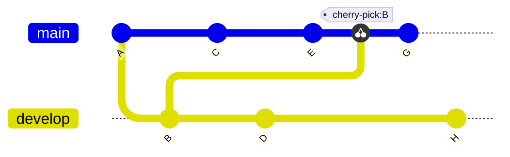



- Édition : Gratuite, GitLab Premium, GitLab Ultimate
- Offre : GitLab.com, GitLab Self-Managed, GitLab Dedicated



Lorsque vous utilisez `git cherry-pick` depuis la ligne de commande, vous copiez des modifications spécifiques d'une branche existante vers votre branche actuelle. Les cherry-picks sont utiles lorsque vous souhaitez :

- Rétroporter un correctif de bug vers des branches de release plus anciennes sans intégrer de nouvelles fonctionnalités.
- Réutiliser le travail de branches qui ne peuvent jamais être fusionnées.
- Rétroporter de petites fonctionnalités vers une release précédente, sans inclure de modifications expérimentales.
- Appliquer un correctif d'urgence en production (hotfix) à une branche de développement.
- Copier des modifications d'une duplication vers le dépôt en amont.

Pour plus d'informations sur le cherry-pick depuis l'interface GitLab, voir [cherry-pick de modifications](../../user/project/merge_requests/cherry_pick_changes.md).

Lorsque vous effectuez un cherry-pick d'un commit, Git :

- Crée un nouveau commit avec les mêmes modifications sur votre branche actuelle.
- Conserve le message du commit original et les informations sur l'auteur.
- Génère un nouveau SHA de commit. (Le commit original reste inchangé.)

<!-- Diagram reused in doc/user/projects/merge_requests/cherry_pick_changes.md -->



Utilisez `git cherry-pick` avec précaution, car cette commande peut créer des commits en double avec des modifications identiques mais des algorithmes de hachage sécurisé (SHA) différents. Cela peut potentiellement compliquer l'historique de votre projet. Envisagez d'abord ces alternatives :

- Si vous avez besoin de la plupart des modifications d'une branche et que l'historique de la branche est propre, fusionnez la branche entière dans votre branche actuelle.
- Si le commit original inclut des dépendances complexes dont vous n'avez pas besoin dans votre nouvelle branche, créez un nouveau commit plutôt que d'effectuer un cherry-pick de l'ancien commit.

## Appliquer un commit à une autre branche {#apply-one-commit-to-another-branch}

Pour effectuer le cherry-pick d'un seul commit vers votre branche de travail actuelle :

1. Identifiez le SHA du commit sur lequel vous souhaitez effectuer un cherry-pick. Pour ce faire, consultez l'historique des commits ou utilisez la commande `git log`. Par exemple :

   ```shell
   $ git log

   commit abc123f
   Merge: 88888999999 aaaaabbbbbb
   Author: user@example.com
   Date:   Tue Aug 31 21:19:41 2021 +0000

       Fixes a regression we found yesterday
   ```

1. Extrayez la branche vers laquelle vous souhaitez effectuer le cherry-pick :

   ```shell
   git checkout release
   ```

1. Utilisez la commande `git cherry-pick` pour copier le commit `abc123f` de la branche de fonctionnalité vers la branche `release`. Remplacez `abc123f` par le SHA du commit que vous avez identifié :

   ```shell
   git cherry-pick abc123f
   ```

Git copie les modifications du commit `abc123f` vers la branche `release` et affiche une notification en cas de conflits. Résolvez les conflits et continuez le processus de cherry-pick. Répétez l'opération pour chaque branche qui a besoin du contenu du commit `abc123f`.

## Appliquer plusieurs commits à une autre branche {#apply-multiple-commits-to-another-branch}

Si le code dont vous avez besoin a été ajouté au cours de plusieurs commits, effectuez un cherry-pick de chacun de ces commits vers votre branche cible souhaitée :

1. Identifiez les SHA des commits sur lesquels vous souhaitez effectuer un cherry-pick. Pour ce faire, consultez l'historique des commits ou utilisez la commande `git log`. Par exemple, si la modification du code se trouve dans un commit et que l'amélioration de la couverture de test se trouve dans le commit suivant :

   ```shell
   $ git log

   commit abc123f
   Merge: 88888999999 aaaaabbbbbb
   Author: user@example.com
   Date:   Tue Aug 31 21:19:41 2021 +0000

       Fixes a regression we found yesterday

   commit ghi456j
   Merge: 44444666666 cccccdddddd
   Author: user@example.com
   Date:   Tue Aug 31 21:19:41 2021 +0000

       Adds tests to ensure the problem does not happen again
   ```

1. Extrayez la branche (`release`) vers laquelle vous souhaitez effectuer le cherry-pick :

   ```shell
   git checkout release
   ```

1. Copiez les commits vers votre branche `release`.

   - Pour copier chaque commit individuellement dans la branche `release`, utilisez la commande `git cherry-pick` pour chaque commit. Remplacez `abc123f` et `ghi456j` par le SHA des commits souhaités :

     ```shell
     git cherry-pick abc123f
     git cherry-pick ghi456j
     ...
     ```

   - Pour effectuer le cherry-pick d'une plage de commits vers votre branche `release`, en utilisant les SHA pour marquer le début et la fin, utilisez la notation `..`. Cette commande applique tous les commits entre `abc123f` et `ghi456j` :

     ```shell
     git cherry-pick abc123f..ghi456j
     ```

## Copier le contenu d'une branche entière {#copy-the-contents-of-an-entire-branch}

Lorsque vous effectuez un cherry-pick du commit de fusion d'une branche, votre cherry-pick copie toutes les modifications de la branche vers votre branche de travail actuelle. Le cherry-pick d'un commit de fusion nécessite l'indicateur `-m`. Cet indicateur indique à Git quel commit parent utiliser. Les commits de fusion peuvent avoir plusieurs commits parents selon la façon dont ils ont été créés.

Dans les cas simples, `-m 1` utilise le premier parent, qui est le commit de fusion de la branche. Pour spécifier le deuxième parent, qui est souvent le dernier commit avant la fusion de la branche de fonctionnalité, utilisez `-m 2`. Ces indicateurs déterminent les modifications que Git applique à votre branche actuelle.

Pour effectuer le cherry-pick du commit de fusion de la branche `feature-1` vers votre branche de travail actuelle :

1. Identifiez le SHA du commit sur lequel vous souhaitez effectuer un cherry-pick. Pour ce faire, consultez l'historique des commits ou utilisez la commande `git log`. Par exemple :

   ```shell
   $ git log

   commit 987pqr6
   Merge: 88888999999 aaaaabbbbbb
   Author: user@example.com
   Date:   Tue Aug 31 21:19:41 2021 +0000

       Merges feature-1 into main
   ```

1. Extrayez la branche vers laquelle vous souhaitez effectuer le cherry-pick :

   ```shell
   git checkout feature-2
   ```

1. Utilisez la commande `git cherry-pick` avec l'option `-m` et l'index du commit parent que vous souhaitez utiliser comme ligne principale. Remplacez `<merge-commit-hash>` par le SHA du commit de fusion et `<parent_index>` par l'index du commit parent. L'index commence à partir de `1`. Par exemple :

   ```shell
   # git cherry-pick -m <parent_index> <merge-commit-hash>
   git cherry-pick -m 1 987pqr6
   ```

Lorsque vous exécutez cette commande, Git copie le contenu du commit de fusion `987pqr6` dans votre branche `feature-2`. Si, au lieu du commit de fusion `987pqr6`, vous souhaitez utiliser le dernier commit de la branche `feature-1`, utilisez `-m 2` à la place.

## Sujets connexes {#related-topics}

- [Cherry-pick de modifications avec l'interface GitLab](../../user/project/merge_requests/cherry_pick_changes.md).
- [API de commits](../../api/commits.md#cherry-pick-a-commit)

## Dépannage {#troubleshooting}

Si vous rencontrez des conflits lors du cherry-pick :

1. Résolvez les conflits manuellement dans les fichiers concernés.
1. Indexez les fichiers résolus :

   ```shell
   git add <resolved_file>
   ```

1. Continuez le processus de cherry-pick :

   ```shell
   git cherry-pick --continue
   ```

Pour abandonner le processus de cherry-pick et revenir à l'état précédent, utilisez la commande suivante :

```shell
git cherry-pick --abort
```

Cette opération annule toutes les modifications apportées pendant le processus de cherry-pick.
