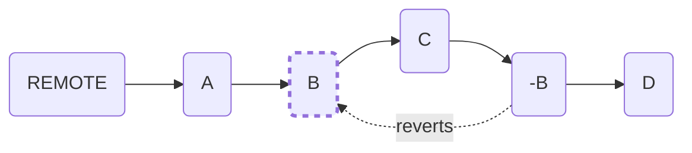

Travailler avec Git implique expérimentation et itération. Des erreurs se produisent lors du développement, et il est parfois nécessaire d'annuler des modifications. Git vous donne le contrôle sur l'historique de votre code grâce à des fonctionnalités permettant d'annuler des modifications à tout moment dans votre [workflow Git](get_started.md#understand-the-git-workflow).

Récupérez à la suite de commits accidentels, supprimez des données sensibles, corrigez des merges incorrects et maintenez un historique de dépôt propre. Lors d'une collaboration avec d'autres personnes, préservez la transparence avec de nouveaux commits de revert, ou réinitialisez votre travail localement avant de le partager. La méthode à utiliser dépend de si les modifications sont :

- Uniquement sur votre ordinateur local.
- Stockées à distance sur un serveur Git tel que GitLab.com.

## Annuler les modifications locales {#undo-local-changes}

Tant que vous n'avez pas poussé vos modifications vers un dépôt distant, les modifications que vous apportez dans Git ne sont présentes que dans votre environnement de développement local.

Lorsque vous _indexez_ un fichier dans Git, vous demandez à Git de suivre les modifications apportées au fichier en vue d'un commit. Pour ignorer les modifications apportées à un fichier et ne pas l'inclure dans votre prochain commit, _désindexez_ le fichier.

### Annuler les modifications locales non indexées {#revert-unstaged-local-changes}

Pour annuler les modifications locales qui ne sont pas encore indexées :

1. Confirmez que le fichier n'est pas indexé (que vous n'avez pas utilisé `git add <file>`) en exécutant `git status` :

   ```shell
   git status
   ```

   Exemple de sortie :

   ```shell
   On branch main
   Your branch is up-to-date with 'origin/main'.
   Changes not staged for commit:
     (use "git add <file>..." to update what will be committed)
     (use "git checkout -- <file>..." to discard changes in working directory)

       modified:   <file>
   no changes added to commit (use "git add" and/or "git commit -a")
   ```

1. Choisissez une option et annulez vos modifications :

   - Pour écraser les modifications locales :

     ```shell
     git checkout -- <file>
     ```

   - Pour supprimer définitivement les modifications locales apportées à tous les fichiers :

     ```shell
     git reset --hard
     ```

### Annuler les modifications locales indexées {#revert-staged-local-changes}

Vous pouvez annuler les modifications locales déjà indexées. Dans l'exemple suivant, un fichier a été ajouté à la zone d'index, mais n'a pas été commité :

1. Confirmez que le fichier est indexé avec `git status` :

   ```shell
   git status
   ```

   Exemple de sortie :

   ```shell
   On branch main
   Your branch is up-to-date with 'origin/main'.
   Changes to be committed:
     (use "git restore --staged <file>..." to unstage)

     new file:   <file>
   ```

1. Choisissez une option et annulez vos modifications :

   - Pour désindexer le fichier tout en conservant vos modifications :

     ```shell
     git restore --staged <file>
     ```

   - Pour tout désindexer tout en conservant vos modifications :

     ```shell
     git reset
     ```

   - Pour désindexer le fichier vers le commit actuel (HEAD) :

     ```shell
     git reset HEAD <file>
     ```

   - Pour supprimer définitivement tout :

     ```shell
     git reset --hard
     ```

## Annuler les commits locaux {#undo-local-commits}

Lorsque vous effectuez un commit dans votre dépôt local avec `git commit`, Git enregistre vos modifications. Étant donné que vous n'avez pas encore poussé vers un dépôt distant, vos modifications ne sont pas publiques ni partagées avec d'autres. À ce stade, vous pouvez annuler vos modifications.

### Annuler des commits sans modifier l'historique {#revert-commits-without-altering-history}

Vous pouvez annuler un commit tout en conservant l'historique des commits.

Cet exemple utilise cinq commits `A`,`B`,`C`,`D`,`E`, commités dans l'ordre suivant : `A-B-C-D-E`. Le commit que vous souhaitez annuler est `B`.

1. Trouvez le SHA du commit vers lequel vous souhaitez revenir. Pour parcourir un journal des commits, utilisez la commande `git log`.
1. Choisissez une option et annulez vos modifications :

   - Pour annuler les modifications introduites par le commit `B` :

     ```shell
     git revert <commit-B-SHA>
     ```

   - Pour annuler les modifications apportées à un seul fichier ou répertoire depuis le commit `B`, mais les conserver dans l'état indexé :

     ```shell
     git checkout <commit-B-SHA> <file>
     ```

   - Pour annuler les modifications apportées à un seul fichier ou répertoire depuis le commit `B`, mais les conserver dans l'état non indexé :

     ```shell
     git reset <commit-B-SHA> <file>
     ```

### Annuler des commits et modifier l'historique {#revert-commits-and-modify-history}

Les sections suivantes décrivent les tâches qui réécrivent l'historique Git. Pour plus d'informations, voir [rebase et résolution des conflits](git_rebase.md).

#### Supprimer un commit spécifique {#delete-a-specific-commit}

Vous pouvez supprimer un commit spécifique. Par exemple, si vous avez des commits `A-B-C-D` et que vous souhaitez supprimer le commit `B`.

1. Rebasez la plage allant du commit actuel `D` jusqu'à `B` :

   ```shell
   git rebase -i A
   ```

   Une liste de commits s'affiche dans votre éditeur.
1. Devant le commit `B`, remplacez `pick` par `drop`.
1. Conservez la valeur par défaut, `pick`, pour tous les autres commits.
1. Enregistrez et quittez l'éditeur.

#### Modifier un commit spécifique {#edit-a-specific-commit}

Vous pouvez modifier un commit spécifique. Par exemple, si vous avez des commits `A-B-C-D` et que vous souhaitez modifier quelque chose introduit dans le commit `B`.

1. Rebasez la plage allant du commit actuel `D` jusqu'à `B` :

   ```shell
   git rebase -i A
   ```

   Une liste de commits s'affiche dans votre éditeur.
1. Devant le commit `B`, remplacez `pick` par `edit`.
1. Conservez la valeur par défaut, `pick`, pour tous les autres commits.
1. Enregistrez et quittez l'éditeur.
1. Ouvrez le fichier dans votre éditeur, apportez vos modifications et commitez les changements :

   ```shell
   git commit -a
   ```

### Annuler plusieurs commits {#undo-multiple-commits}

Si vous créez plusieurs commits (`A-B-C-D`) sur votre branche, puis constatez que les commits `C` et `D` sont incorrects, annulez les deux commits incorrects :

1. Extrayez le dernier commit correct. Dans cet exemple, `B`.

   ```shell
   git checkout <commit-B-SHA>
   ```

1. Créez une nouvelle branche.

   ```shell
   git checkout -b new-path-of-feature
   ```

1. Ajoutez, poussez et commitez vos modifications.

   ```shell
   git add .
   git commit -m "Undo commits C and D"
   git push --set-upstream origin new-path-of-feature
   ```

Les commits sont maintenant `A-B-C-D-E`.

Vous pouvez également [cherry-picker](../../user/project/merge_requests/cherry_pick_changes.md#cherry-pick-a-single-commit) ce commit dans une nouvelle merge request.

> [!note]
> Une autre solution consiste à réinitialiser à `B` et à commiter `E`. Cependant, cette solution aboutit à `A-B-E`, ce qui entre en conflit avec ce que les autres ont localement. N'utilisez pas cette solution si votre branche est partagée.

### Récupérer des commits annulés {#recover-undone-commits}

Vous pouvez rappeler des commits locaux précédents. Cependant, tous les commits précédents ne sont pas disponibles, car Git [nettoie régulièrement les commits inaccessibles par les branches ou les tags](https://git-scm.com/book/en/v2/Git-Internals-Maintenance-and-Data-Recovery).

Pour afficher l'historique du dépôt et suivre les commits précédents, exécutez `git reflog show`. Par exemple :

```shell
$ git reflog show

# Example output:
b673187 HEAD@{4}: merge 6e43d5987921bde189640cc1e37661f7f75c9c0b: Merge made by the 'recursive' strategy.
eb37e74 HEAD@{5}: rebase -i (finish): returning to refs/heads/master
eb37e74 HEAD@{6}: rebase -i (pick): Commit C
97436c6 HEAD@{7}: rebase -i (start): checkout 97436c6eec6396c63856c19b6a96372705b08b1b
...
88f1867 HEAD@{12}: commit: Commit D
97436c6 HEAD@{13}: checkout: moving from 97436c6eec6396c63856c19b6a96372705b08b1b to test
97436c6 HEAD@{14}: checkout: moving from master to 97436c6
05cc326 HEAD@{15}: commit: Commit C
6e43d59 HEAD@{16}: commit: Commit B
```

Cette sortie affiche l'historique du dépôt, notamment :

- Le SHA du commit.
- Il y a combien d'actions modifiant `HEAD` que le commit a été effectué (`HEAD@{12}` était il y a 12 actions modifiant `HEAD`).
- L'action effectuée, par exemple : commit, rebase, merge.
- Une description de l'action qui a modifié `HEAD`.

## Annuler les modifications distantes {#undo-remote-changes}

Vous pouvez annuler les modifications distantes sur votre branche. Cependant, vous ne pouvez pas annuler les modifications sur une branche qui a été mergée dans votre branche. Dans ce cas, vous devez annuler les modifications sur la branche distante.

### Annuler les modifications distantes sans modifier l'historique {#revert-remote-changes-without-altering-history}

Pour annuler des modifications dans le dépôt distant, vous pouvez créer un nouveau commit avec les modifications que vous souhaitez annuler. Ce processus préserve l'historique et fournit une chronologie claire ainsi qu'une structure de développement :



Pour annuler les modifications introduites dans un commit spécifique `B` :

```shell
git revert B
```

### Annuler les modifications distantes et modifier l'historique {#revert-remote-changes-and-modify-history}

Vous pouvez annuler les modifications distantes et modifier l'historique.

Même avec un historique mis à jour, les anciens commits restent accessibles par leur SHA, au moins jusqu'à ce que tout le nettoyage automatisé des commits détachés soit effectué, ou qu'un nettoyage soit exécuté manuellement. Même le nettoyage peut ne pas supprimer les anciens commits si des références pointent encore vers eux.


Vous ne devriez pas modifier l'historique lorsque vous travaillez dans une branche publique ou une branche susceptible d'être utilisée par d'autres.

> [!note]
> Ne modifiez jamais l'historique des commits de votre [branche par défaut](../../user/project/repository/branches/default.md) ou d'une branche partagée.

### Modifier l'historique avec `git rebase` {#modify-history-with-git-rebase}

La branche d'une merge request est une branche publique qui peut être utilisée par d'autres développeurs. Cependant, les règles du projet peuvent vous obliger à utiliser `git rebase` pour réduire le nombre de commits affichés sur la branche cible une fois les revues terminées.

Vous pouvez modifier l'historique en utilisant `git rebase -i`. Utilisez cette commande pour modifier, squasher et supprimer des commits.

```shell
#
# Commands:
# p, pick = use commit
# r, reword = use commit, but edit the commit message
# e, edit = use commit, but stop for amending
# s, squash = use commit, but meld into previous commit
# f, fixup = like "squash", but discard this commit's log message
# x, exec = run command (the rest of the line) using shell
# d, drop = remove commit
#
# These lines can be re-ordered; they are executed from top to bottom.
#
# If you remove a line THAT COMMIT WILL BE LOST.
#
# However, if you remove everything, the rebase will be aborted.
#
# Empty commits are commented out
```

> [!note]
> Si vous décidez d'arrêter un rebase, ne fermez pas votre éditeur. À la place, supprimez toutes les lignes non commentées et enregistrez.

Utilisez `git rebase` avec précaution sur les branches partagées et distantes. Expérimentez localement avant de pousser vers le dépôt distant.

```shell
# Modify history from commit-id to HEAD (current commit)
git rebase -i commit-id
```

### Modifier l'historique avec `git merge --squash` {#modify-history-with-git-merge---squash}

Lorsque vous contribuez à de grands dépôts open source, envisagez de squasher vos commits en un seul commit. Cette pratique :

- Aide à maintenir un historique de projet propre et linéaire.
- Simplifie le processus d'annulation des modifications, car toutes les modifications sont condensées en un seul commit.

Pour squasher les commits de votre branche en un seul commit sur une branche cible lors du merge, utilisez `git merge --squash`. Par exemple :

1. Extrayez la branche de base. Dans cet exemple, la branche de base est `main` :

   ```shell
   git checkout main
   ```

1. Mergez votre branche cible avec `--squash` :

   ```shell
   git merge --squash <target-branch>
   ```

1. Commitez les modifications :

   ```shell
   git commit -m "Squash commit from feature-branch"
   ```

Pour savoir comment squasher des commits depuis l'interface de GitLab, voir [Squash et merge](../../user/project/merge_requests/squash_and_merge.md).

### Annuler un commit de merge vers un parent différent {#revert-a-merge-commit-to-a-different-parent}

Lorsque vous annulez un commit de merge, la branche vers laquelle vous avez mergé est toujours le premier parent. Par exemple, la [branche par défaut](../../user/project/repository/branches/default.md) ou `main`. Pour annuler un commit de merge vers un parent différent, vous devez annuler le commit depuis la ligne de commande :

1. Identifiez le SHA du commit parent vers lequel vous souhaitez revenir.
1. Identifiez le numéro du parent du commit vers lequel vous souhaitez revenir. (Par défaut à `1`, pour le premier parent.)
1. Exécutez cette commande en remplaçant `2` par le numéro du parent et `7a39eb0` par le SHA du commit :

   ```shell
   git revert -m 2 7a39eb0
   ```

Pour plus d'informations sur l'annulation des modifications depuis l'interface GitLab, voir [annuler des modifications](../../user/project/merge_requests/revert_changes.md).

## Gérer les informations sensibles {#handle-sensitive-information}

Des informations sensibles, telles que des mots de passe et des clés API, peuvent être accidentellement commitées dans un dépôt Git. Cette section couvre les façons de gérer cette situation.

### Expurger des informations {#redact-information}

Supprimez définitivement les informations sensibles ou confidentielles qui ont été accidentellement commitées et assurez-vous qu'elles ne sont plus accessibles dans l'historique de votre dépôt. Ce processus remplace une liste de chaînes par `***REMOVED***`.

Vous pouvez également, pour supprimer complètement des fichiers spécifiques d'un dépôt, consulter [supprimer des blobs](../../user/project/repository/repository_size.md#remove-blobs).

Pour expurger du texte de votre dépôt, voir [expurger du texte du dépôt](../../user/project/repository/repository_size.md#redact-text-from-repository).

### Supprimer des informations des commits {#remove-information-from-commits}

Vous pouvez utiliser Git pour supprimer des informations sensibles de vos commits passés. Cependant, l'historique est modifié au cours du processus.

Pour réécrire l'historique avec [certains filtres](https://git-scm.com/docs/git-filter-branch#_options), exécutez `git filter-branch`.

Pour supprimer complètement un fichier de l'historique, utilisez :

```shell
git filter-branch --tree-filter 'rm filename' HEAD
```

La commande `git filter-branch` peut être lente sur les grands dépôts. Des outils sont disponibles pour exécuter les commandes Git plus rapidement. Ces outils sont plus rapides car ils ne fournissent pas le même ensemble de fonctionnalités que `git filter-branch`, mais se concentrent sur des cas d'utilisation spécifiques.

Pour plus d'informations sur la purge des fichiers de l'historique du dépôt et du stockage GitLab, voir [réduire la taille du dépôt](../../user/project/repository/repository_size.md#methods-to-reduce-repository-size).

## Annuler et supprimer des commits {#undo-and-remove-commits}

- Annulez votre dernier commit et replacez tout dans la zone d'index :

  ```shell
  git reset --soft HEAD^
  ```

- Ajoutez des fichiers et modifiez le message de commit :

  ```shell
  git commit --amend -m "New Message"
  ```

- Annulez la dernière modification et supprimez toutes les autres modifications, si vous n'avez pas encore poussé :

  ```shell
  git reset --hard HEAD^
  ```

- Annulez la dernière modification et supprimez les deux derniers commits, si vous n'avez pas encore poussé :

  ```shell
  git reset --hard HEAD^^
  ```

### Exemple de workflow `git reset` {#example-git-reset-workflow}

Voici un workflow Git reset courant :

1. Modifiez un fichier.
1. Vérifiez le statut de la branche :

   ```shell
   git status
   ```

1. Commitez les modifications sur la branche avec un message de commit incorrect :

   ```shell
   git commit -am "kjkfjkg"
   ```

1. Consultez le journal Git :

   ```shell
   git log
   ```

1. Modifiez le commit avec le message de commit correct :

   ```shell
   git commit --amend -m "New comment added"
   ```

1. Consultez à nouveau le journal Git :

   ```shell
   git log
   ```

1. Effectuez un soft reset de la branche :

   ```shell
   git reset --soft HEAD^
   ```

1. Consultez à nouveau le journal Git :

   ```shell
   git log
   ```

1. Récupérez les mises à jour de la branche depuis le dépôt distant :

   ```shell
   git pull origin <branch>
   ```

1. Poussez les modifications de la branche vers le dépôt distant :

   ```shell
   git push origin <branch>
   ```

## Annuler des commits avec un nouveau commit {#undo-commits-with-a-new-commit}

Si un fichier a été modifié dans un commit et que vous souhaitez le rétablir dans l'état où il se trouvait dans le commit précédent, tout en conservant l'historique des commits, vous pouvez utiliser `git revert`. La commande crée un nouveau commit qui annule toutes les actions effectuées dans le commit original.

Par exemple, pour supprimer les modifications d'un fichier dans le commit `B` et restaurer son contenu depuis le commit `A`, exécutez :

```shell
git revert <commit-sha>
```

## Supprimer un fichier d'un dépôt {#remove-a-file-from-a-repository}

- Pour supprimer un fichier du disque et du dépôt, utilisez `git rm`. Pour supprimer un répertoire, utilisez l'option `-r` :

  ```shell
  git rm '*.txt'
  git rm -r <dirname>
  ```

- Pour conserver un fichier sur le disque mais le supprimer du dépôt (par exemple un fichier que vous souhaitez ajouter à `.gitignore`), utilisez la commande `rm` avec l'option `--cache` :

  ```shell
  git rm <filename> --cache
  ```

Ces commandes suppriment le fichier des branches actuelles, mais ne l'effacent pas de l'historique de votre dépôt. Pour supprimer complètement toutes les traces du fichier, passées et présentes, de votre dépôt, voir [supprimer des blobs](../../user/project/repository/repository_size.md#remove-blobs).

## Comparer `git revert` et `git reset` {#compare-git-revert-and-git-reset}

- La commande `git reset` supprime entièrement le commit.
- La commande `git revert` supprime les modifications, mais laisse le commit intact. Elle est plus sûre, car vous pouvez annuler un revert.

```shell
# Changed file
git commit -am "bug introduced"
git revert HEAD
# New commit created reverting changes
# Next, reapply the reverted commit
git log # take hash from the revert commit
git revert <rev commit hash>
# reverted commit is back (new commit created again)
```

## Sujets connexes {#related-topics}

- [`git blame`](../../user/project/repository/files/git_blame.md)
- [Cherry-pick](../../user/project/merge_requests/cherry_pick_changes.md)
- [Historique Git](../../user/project/repository/files/git_history.md)
- [Annuler un commit existant](../../user/project/merge_requests/revert_changes.md#revert-a-commit)
- [Squash et merge](../../user/project/merge_requests/squash_and_merge.md)
