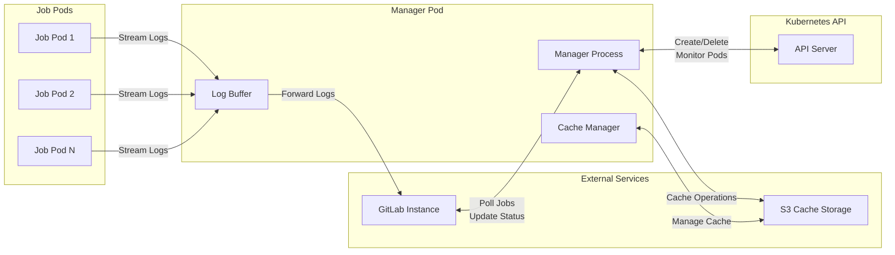
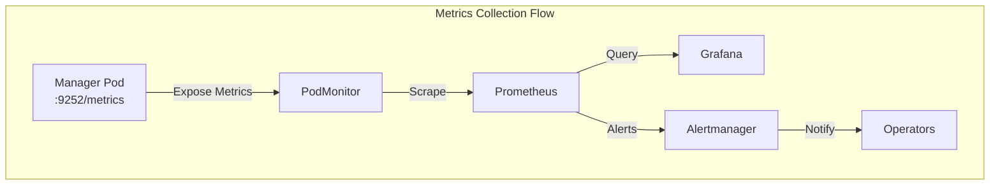
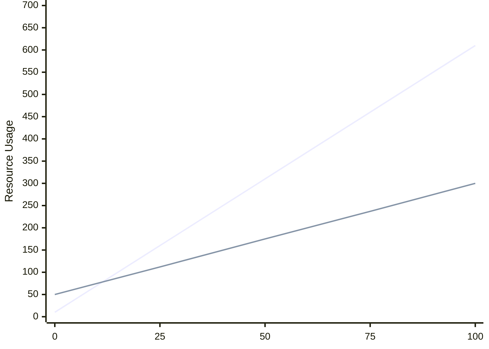
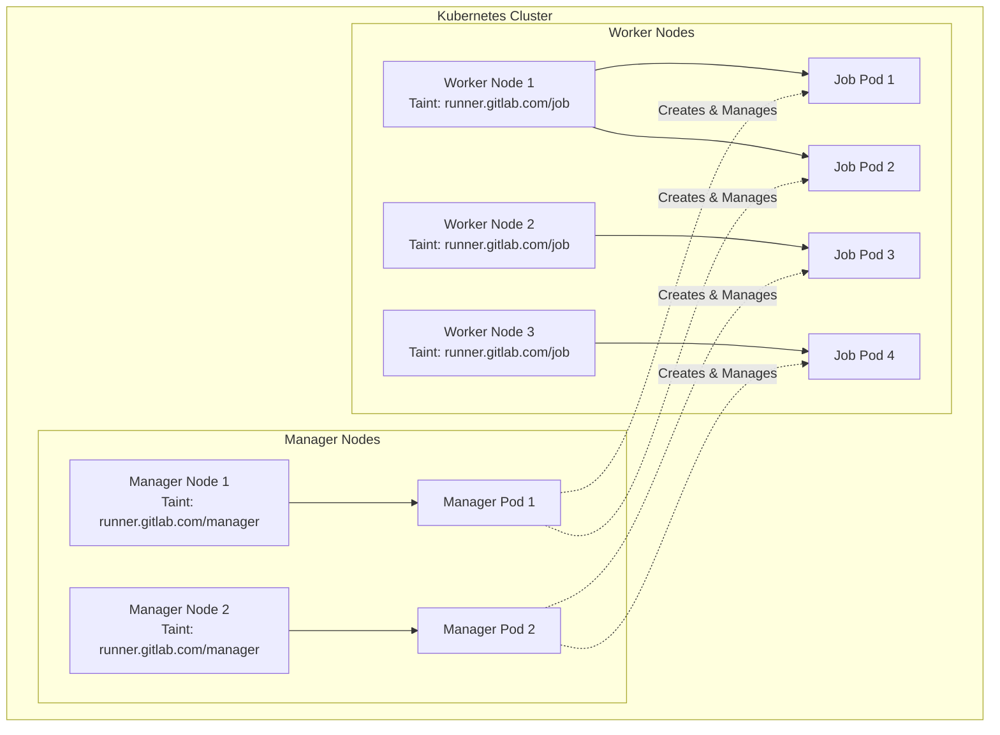



- Édition : Gratuite, GitLab Premium, GitLab Ultimate
- Offre : GitLab.com, GitLab Self-Managed, GitLab Dedicated



Pour surveiller et optimiser les performances du pod gestionnaire de GitLab Runner dans les environnements Kubernetes, GitLab recommande les bonnes pratiques suivantes. Appliquez-les pour identifier les goulots d'étranglement des performances et mettre en œuvre des solutions pour une exécution optimale des pipelines CI/CD.

## Prérequis {#prerequisites}

Avant de mettre en œuvre ces recommandations :

- Déployez GitLab Runner dans Kubernetes en utilisant l'[exécuteur Kubernetes](https://docs.gitlab.com/runner/executors/kubernetes/)
- Disposez d'un accès administrateur à votre cluster Kubernetes
- Configurez la [surveillance Prometheus](../../administration/monitoring/_index.md) pour GitLab Runner
- Ayez une compréhension de base de la gestion des ressources Kubernetes

## Responsabilités du pod gestionnaire de GitLab Runner {#gitlab-runner-manager-pod-responsibilities}

Le pod gestionnaire de GitLab Runner coordonne l'ensemble de l'exécution des jobs CI/CD dans Kubernetes. Ses performances ont un impact direct sur l'efficacité de vos pipelines.

Il gère :

- **Traitement des logs** : collecte et transfère les job logs des pods worker vers GitLab
- **Gestion du cache** : coordonne les opérations de mise en cache locales et basées sur le cloud
- **Requêtes vers l'API Kubernetes** : crée, surveille et supprime les pods worker
- **Communication avec l'API GitLab** : interroge les jobs et rapporte les mises à jour de statut
- **Gestion du cycle de vie des pods** : gère le provisionnement et le nettoyage des pods worker



Chaque responsabilité affecte les performances différemment :

- **Intensif en CPU** : opérations de l'API Kubernetes, traitement des logs
- **Intensif en mémoire** : mise en mémoire tampon des logs, gestion de la file d'attente des jobs
- **Intensif en réseau** : communication avec l'API GitLab, diffusion des logs

## Déployer GitLab Runner dans Kubernetes {#deploy-gitlab-runner-in-kubernetes}

Installez GitLab Runner via l'[Opérateur GitLab Runner](https://gitlab.com/gitlab-org/gl-openshift/gitlab-runner-operator). L'Opérateur reçoit activement de nouvelles fonctionnalités et améliorations. L'équipe GitLab Runner installe l'Opérateur via le [framework expérimental GRIT](https://gitlab.com/gitlab-org/ci-cd/runner-tools/grit/-/tree/main/scenarios/google/gke/operator?ref_type=heads).

La façon la plus simple d'installer GitLab Runner dans Kubernetes est d'appliquer le [manifeste `operator.k8s.yaml` issu de la dernière release](https://gitlab.com/gitlab-org/gl-openshift/gitlab-runner-operator/-/releases), puis de suivre les instructions de la [documentation d'installation de l'Opérateur](https://docs.gitlab.com/runner/install/operator/#install-on-kubernetes).

## Configurer la surveillance {#configure-monitoring}

L'observabilité est essentielle pour l'administration de GitLab Runner dans Kubernetes, car les pods sont éphémères et les métriques constituent la principale source de visibilité opérationnelle.

Pour la surveillance, installez [`kube-prometheus-stack`](https://github.com/prometheus-community/helm-charts/blob/main/charts/kube-prometheus-stack/README.md).

Pour configurer la surveillance de l'Opérateur, consultez [Surveiller l'Opérateur GitLab Runner](https://docs.gitlab.com/runner/monitoring#monitor-gitlab-runner-operator).

## Surveillance des performances {#performance-monitoring}

Une surveillance efficace est indispensable pour maintenir des performances optimales du pod gestionnaire.



### Métriques de performance clés {#key-performance-metrics}

Surveillez ces métriques essentielles :

| Métrique                                             | Description                      | Indicateur de performance |
| -------------------------------------------------- | -------------------------------- | --------------------- |
| `gitlab_runner_jobs`                               | Jobs en cours d'exécution             | Saturation de la file d'attente des jobs  |
| `gitlab_runner_limit`                              | Limite de concurrence des jobs configurée | Utilisation de la capacité  |
| `gitlab_runner_request_concurrency_exceeded_total` | Requêtes dépassant la limite de concurrence | Limitation de l'API        |
| `gitlab_runner_errors_total`                       | Total des erreurs interceptées              | Stabilité du système      |
| `container_cpu_usage_seconds_total`                | Utilisation CPU du conteneur              | Consommation des ressources  |
| `container_memory_working_set_bytes`               | Utilisation de la mémoire du conteneur           | Pression mémoire       |

### Requêtes Prometheus {#prometheus-queries}

Suivez les performances du pod gestionnaire avec ces requêtes :

```prometheus
# Manager pod memory usage in MB
container_memory_working_set_bytes{pod=~"gitlab-runner.*"} / 1024 / 1024

# Manager pod CPU utilization in Millicores
rate(container_cpu_usage_seconds_total{pod=~"gitlab-runner.*"}[5m]) * 1000

# Job queue saturation
gitlab_runner_jobs / gitlab_runner_limit

# Jobs per runner
gitlab_runner_jobs

# API request rate
sum(rate(apiserver_request_total[5m]))
```

### Exemple de tableau de bord {#example-dashboard}

Le tableau de bord suivant affiche l'utilisation du pod gestionnaire sur l'ensemble des pods à l'aide des requêtes Prometheus décrites précédemment :


Ce tableau de bord vous aide à visualiser :

- Tendances d'utilisation de la mémoire sur l'ensemble des pods gestionnaires
- Modèles d'utilisation CPU pendant l'exécution des jobs
- Niveaux de saturation de la file d'attente des jobs
- Consommation des ressources par pod individuel

## Identifier les pods gestionnaires surchargés {#identify-overloaded-manager-pods}

Détectez la dégradation des performances avant qu'elle n'impacte vos pipelines.

### Indicateurs d'utilisation des ressources {#resource-utilization-indicators}

Par défaut, l'Opérateur GitLab Runner n'applique pas de limites de CPU ou de mémoire aux pods gestionnaires.

Pour définir des limites de ressources :

```shell
kubectl patch deployment gitlab-runner -p '{"spec":{"template":{"spec":{"containers":[{"name":"gitlab-runner","resources":{"requests":{"cpu":"500m","memory":"256Mi"},"limits":{"cpu":"1000m","memory":"512Mi"}}}]}}}}'
```

> [!note]
> La fonctionnalité permettant le patching des déploiements depuis la configuration de l'Opérateur est en cours de développement. Pour plus d'informations, consultez la [merge request 197](https://gitlab.com/gitlab-org/gl-openshift/gitlab-runner-operator/-/merge_requests/197).

**Modèles d'utilisation CPU élevée :**

- CPU constamment supérieur à 70 % lors des opérations standard
- Pics de CPU dépassant 90 % lors de la création de jobs
- CPU élevé soutenu sans activité de job correspondante

**Tendances de consommation de la mémoire :**

- Utilisation de la mémoire supérieure à 80 % des limites allouées
- Croissance continue de la mémoire sans augmentation de la charge de travail
- Événements de mémoire insuffisante (OOM) dans les logs du pod gestionnaire

### Signes de dégradation des performances {#performance-degradation-signs}

Surveillez ces symptômes opérationnels :

- Jobs restant en attente plus longtemps que d'habitude
- Temps de création des pods dépassant 30 secondes
- Sortie des logs retardée dans les interfaces de jobs GitLab
- Erreurs `etcdserver: request timed out` dans les logs

### Commandes de diagnostic {#diagnostic-commands}

```shell
# Current resource usage
kubectl top pods --containers

> POD                                                 NAME              CPU(cores)   MEMORY(bytes)
> gitlab-runner-runner-86cd68d899-m6qqm               runner            7m           32Mi

# Check for performance errors
kubectl logs gitlab-runner-runner-86cd68d899-m6qqm --since=2h | grep -E "(error|timeout|failed)"
```

## Configuration des ressources {#resource-configuration}

Une configuration correcte des ressources est essentielle pour des performances optimales.

### Méthodologie de test des performances {#performance-testing-methodology}

Les performances du pod gestionnaire de GitLab Runner sont testées à l'aide d'un job qui maximise la sortie des logs :

<details>
<summary>Définition du job de test de performances</summary>

```yaml
performance_test:
  stage: build
  timeout: 30m
  tags:
    - kubernetes_runner
  image: alpine:latest
  parallel: 100
  variables:
    FILE_SIZE_MB: 4
    CHUNK_SIZE_BYTES: 1024
    FILE_NAME: "test_file_${CI_JOB_ID}_${FILE_SIZE_MB}MB.dat"
    KUBERNETES_CPU_REQUEST: "200m"
    KUBERNETES_CPU_LIMIT: "200m"
    KUBERNETES_MEMORY_REQUEST: "200Mi"
    KUBERNETES_MEMORY_LIMIT: "200Mi"
  script:
    - echo "Starting performance test job ${CI_PARALLEL_ID}/${CI_PARALLEL_TOTAL} with ${FILE_SIZE_MB}MB file size, ${CHUNK_SIZE_BYTES} bytes chunk size"
    - dd if=/dev/urandom of="${FILE_NAME}" bs=1M count=${FILE_SIZE_MB}
    - echo "File generated successfully. Size:"
    - ls -lh "${FILE_NAME}"
    - echo "Reading file in ${CHUNK_SIZE_BYTES} byte chunks"
    - |
      TOTAL_SIZE=$(stat -c%s "${FILE_NAME}")
      BLOCKS=$((TOTAL_SIZE / CHUNK_SIZE_BYTES))
      echo "Processing $BLOCKS blocks of $CHUNK_SIZE_BYTES bytes each"
      for i in $(seq 0 99 $BLOCKS); do
        echo "Processing blocks $i to $((i+99))"
        dd if="${FILE_NAME}" bs=${CHUNK_SIZE_BYTES} skip=$i count=100 2>/dev/null | xxd -l $((CHUNK_SIZE_BYTES * 100)) -c 16
        sleep 0.5
      done
```

</details>

Ce test génère 4 Mo de sortie de logs par job, ce qui atteint la valeur par défaut de [`output_limit`](https://docs.gitlab.com/runner/configuration/advanced-configuration/#the-runners-section) pour tester la résistance des capacités de traitement des logs du pod gestionnaire.

**Résultats des tests :**

| Jobs parallèles | Pic d'utilisation CPU | Pic d'utilisation de la mémoire |
| ------------- | -------------- | ----------------- |
| 50            | 308m           | 261 Mo            |
| 100           | 657m           | 369 Mo            |



**Conclusions clés :**

- L'utilisation du CPU évolue approximativement de manière linéaire avec les jobs concurrents
- L'utilisation de la mémoire augmente avec le nombre de jobs, mais pas de manière linéaire
- Tous les jobs s'exécutent de manière concurrente sans mise en file d'attente

### Besoins en CPU {#cpu-requirements}

Sur la base des tests de performances GitLab, calculez les besoins en CPU du pod gestionnaire :

CPU du pod gestionnaire = CPU de base + (Jobs concurrents × Facteur CPU par job)

Où :

- CPU de base : 10m (charge de base)
- Facteur CPU par job : ~6m par job concurrent (basé sur les tests)

**Exemples basés sur les résultats des tests :**

Pour 50 jobs concurrents :

```yaml
resources:
  requests:
    cpu: "310m" # 10m + (50 × 6m) = 310m
  limits:
    cpu: "465m" # 50% headroom for burst traffic
```

Pour 100 jobs concurrents :

```yaml
resources:
  requests:
    cpu: "610m" # 10m + (100 × 6m) = 610m
  limits:
    cpu: "915m" # 50% headroom
```

### Besoins en mémoire {#memory-requirements}

Sur la base des tests GitLab, calculez les besoins en mémoire :

Mémoire du pod gestionnaire = Mémoire de base + (Jobs concurrents × Mémoire par job)

Où :

- Mémoire de base : 50 Mo (charge de base)
- Mémoire par job : ~2,5 Mo par job concurrent (avec une sortie de logs de 4 Mo)

**Exemples basés sur les résultats des tests :**

Pour 50 jobs concurrents :

```yaml
resources:
  requests:
    memory: "175Mi" # 50 + (50 × 2.5) = 175 MB
  limits:
    memory: "350Mi" # 100% headroom
```

Pour 100 jobs concurrents :

```yaml
resources:
  requests:
    memory: "300Mi" # 50 + (100 × 2.5) = 300 MB
  limits:
    memory: "600Mi" # 100% headroom
```

> [!note]
> L'utilisation de la mémoire varie significativement en fonction du volume des logs. Les jobs produisant plus de 4 Mo de logs nécessitent proportionnellement plus de mémoire.

### Exemples de configuration {#configuration-examples}

**Petite échelle (1 à 20 jobs concurrents) :**

```yaml
resources:
  limits:
    cpu: 300m
    memory: 256Mi
  requests:
    cpu: 150m
    memory: 128Mi

runners:
  config: |
    concurrent = 20

    [[runners]]
      limit = 20
      request_concurrency = 5
```

**Grande échelle (75 jobs concurrents et plus) :**

```yaml
resources:
  limits:
    cpu: 1000m
    memory: 1Gi
  requests:
    cpu: 600m
    memory: 600Mi

runners:
  config: |
    concurrent = 150

    [[runners]]
      limit = 150
      request_concurrency = 20
```

### Autoscaler horizontal de pods {#horizontal-pod-autoscaler}

Configurez la mise à l'échelle automatique :

```yaml
apiVersion: autoscaling/v2
kind: HorizontalPodAutoscaler
metadata:
  name: gitlab-runner-hpa
spec:
  scaleTargetRef:
    apiVersion: apps/v1
    kind: Deployment
    name: gitlab-runner
  minReplicas: 2
  maxReplicas: 5
  metrics:
    - type: Resource
      resource:
        name: cpu
        target:
          type: Utilization
          averageUtilization: 70
    - type: Resource
      resource:
        name: memory
        target:
          type: Utilization
          averageUtilization: 80
```

## Résoudre les problèmes de performances {#troubleshoot-performance-issues}

Résolvez les problèmes courants de performances du pod gestionnaire grâce à ces solutions.

### Limitation de débit de l'API {#api-rate-limiting}

**Problème :** Le pod gestionnaire dépasse les limites de débit de l'API Kubernetes.

**Solution :** Optimisez l'interrogation de l'API :

```toml
[[runners]]
  [runners.kubernetes]
    poll_interval = "5s"  # Increase from default 3s
    poll_timeout = "180s"
```

## Optimisation des performances {#performance-optimization}

Appliquez ces stratégies d'optimisation des performances pour les scénarios complexes.

### Optimisation du cache {#cache-optimization}

Configurez la mise en cache distribuée pour réduire la charge du pod gestionnaire. Cette action réduit les calculs requis pour les pods de jobs en partageant les fichiers en cache :

```toml
[runners.cache]
  Type = "s3"
  Shared = true

  [runners.cache.s3]
    ServerAddress = "cache.example.com"
    BucketName = "gitlab-runner-cache"
    PreSignedURLDisabled = false
```

## Ségrégation des nœuds {#node-segregation}

Séparez les pods gestionnaires des pods de jobs en utilisant des nœuds dédiés pour garantir des performances stables et éviter la contention des ressources. Cette isolation empêche les pods de jobs de perturber les opérations critiques du pod gestionnaire.



### Configurer les taints des nœuds {#configure-node-taints}

**Pour les nœuds gestionnaires :**

```shell
# Taint nodes dedicated to Manager Pods
kubectl taint nodes <manager-node-name> runner.gitlab.com/manager=:NoExecute

# Label nodes for easier selection
kubectl label nodes <manager-node-name> runner.gitlab.com/workload-type=manager
```

**Pour les nœuds worker :**

```shell
# Taint nodes dedicated to job pods
kubectl taint nodes <worker-node-name> runner.gitlab.com/job=:NoExecute

# Label nodes for job scheduling
kubectl label nodes <worker-node-name> runner.gitlab.com/workload-type=job
```

### Configurer la planification des pods gestionnaires {#configure-manager-pod-scheduling}

Mettez à jour la configuration de l'Opérateur GitLab Runner pour planifier les pods gestionnaires uniquement sur des nœuds dédiés :

```yaml
apiVersion: apps.gitlab.com/v1beta2
kind: Runner
metadata:
  name: gitlab-runner
spec:
  gitlabUrl: https://gitlab.example.com
  token: gitlab-runner-secret
  buildImage: alpine
  podSpec:
    name: "manager-node-affinity"
    patch: |
      {
        "spec": {
          "nodeSelector": {
            "runner.gitlab.com/workload-type": "manager"
          },
          "tolerations": [
            {
              "key": "runner.gitlab.com/manager",
              "operator": "Exists",
              "effect": "NoExecute"
            }
          ]
        }
      }
    patchType: "strategic"
```

### Configurer la planification des pods de jobs {#configure-job-pod-scheduling}

Assurez-vous que les pods de jobs s'exécutent uniquement sur des nœuds worker en mettant à jour `config.toml`.

```toml
[runners.kubernetes.node_selector]
"runner.gitlab.com/workload-type" = "job"

[runners.kubernetes.node_tolerations]
"runner.gitlab.com/job=" = "NoExecute"
```

**Avantages de la ségrégation des nœuds :**

- Ressources dédiées aux pods gestionnaires sans interférence des jobs
- Performances prévisibles sans contention des ressources
- Option d'exécution sans limites de ressources lors de l'utilisation de nœuds dédiés
- Planification de capacité simplifiée avec une mise à l'échelle basée sur les nœuds

### Procédures d'urgence {#emergency-procedures}

**Redémarrage progressif :**

```shell
# Scale down to stop accepting new jobs
kubectl scale deployment gitlab-runner --replicas=0

# Wait for active jobs to complete (max 10 minutes)
timeout 600 bash -c 'while kubectl get pods -l job-type=user-job | grep Running; do sleep 10; done'

# Scale back up
kubectl scale deployment gitlab-runner --replicas=1
```

## Planification de capacité {#capacity-planning}

Ces calculs sont basés sur des tests avec une sortie de logs de 4 Mo par job. Vos besoins en ressources peuvent varier selon :

- Volume des logs par job
- Modèles d'exécution des jobs
- Utilisation du cache
- Latence réseau vers GitLab

Calculez les ressources optimales à l'aide de cette fonction Python :

```python
def calculate_manager_resources(concurrent_jobs, avg_log_mb_per_job=4):
    """Calculate Manager Pod resources based on performance testing."""
    # CPU: ~6m per concurrent job + 10m base
    base_cpu = 0.01  # 10m
    cpu_per_job = 0.006  # 6m per job
    total_cpu = base_cpu + (concurrent_jobs * cpu_per_job)

    # Memory: ~2.5MB per job + 50MB base (for 4MB log output)
    base_memory = 50
    memory_per_job = 2.5 * (avg_log_mb_per_job / 4)  # Scale with log size
    total_memory = base_memory + (concurrent_jobs * memory_per_job)

    return {
        'cpu_request': f"{int(total_cpu * 1000)}m",
        'cpu_limit': f"{int(total_cpu * 1.5 * 1000)}m",  # 50% headroom
        'memory_request': f"{int(total_memory)}Mi",
        'memory_limit': f"{int(total_memory * 2.0)}Mi"  # 100% headroom
    }
```

## Seuils de performance {#performance-thresholds}

Établissez des seuils pour une intervention proactive :

| Métrique         | Avertissement        | Critique       | Action requise         |
| -------------- | -------------- | -------------- | ----------------------- |
| Utilisation CPU      | 70 % soutenu  | 85 % soutenu  | Mettre à l'échelle ou optimiser       |
| Utilisation de la mémoire   | 80 % de la limite   | 90 % de la limite   | Augmenter les limites         |
| Taux d'erreurs de l'API | 2 % des requêtes | 5 % des requêtes | Analyser les goulots d'étranglement |
| Temps d'attente des jobs | 30 secondes     | 2 minutes      | Réviser la capacité         |

## Sujets connexes {#related-topics}

- [Configuration de la flotte de runners GitLab et bonnes pratiques](gitlab_runner_fleet_config_and_best_practices.md) \- Optimisation des performances des pods de jobs
- [Exécuteurs GitLab Runner](https://docs.gitlab.com/runner/executors/) \- Caractéristiques de performance de l'environnement d'exécution
- [Surveillance de GitLab Runner](../../administration/monitoring/_index.md) \- Configuration générale de la surveillance
- [Planifier et exploiter une flotte de runners](https://docs.gitlab.com/runner/fleet_scaling/) \- Déploiement stratégique de la flotte

## Résumé {#summary}

L'optimisation des performances du pod gestionnaire de GitLab Runner nécessite une surveillance systématique, une allocation appropriée des ressources et une résolution proactive des problèmes.

Les stratégies clés comprennent :

- **Surveillance proactive** grâce aux métriques Prometheus et aux tableaux de bord Grafana
- **Planification des ressources** basée sur la capacité de jobs concurrents et le volume des logs
- **Architecture multi-gestionnaire** pour la tolérance aux pannes et la distribution de la charge
- **Procédures d'urgence** pour une résolution rapide des problèmes

Mettez en œuvre ces stratégies pour garantir une exécution fiable des pipelines CI/CD tout en maintenant une utilisation optimale des ressources.
