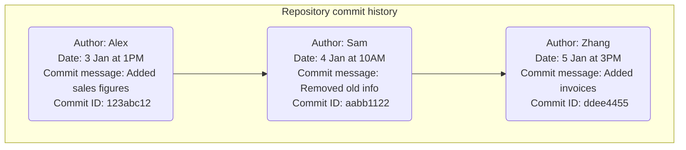
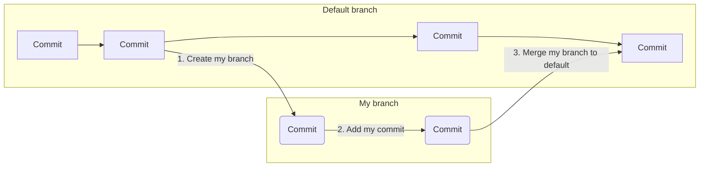

<!-- vale gitlab_base.FutureTense = NO -->

Ce tutoriel vous enseignera les bases du fonctionnement de Git. Il vous guide à travers les étapes de création de votre propre projet, de modification d'un fichier et de commit de modifications dans un dépôt Git depuis la ligne de commande.

Une fois terminé, vous disposerez d'un projet sur lequel vous pourrez vous entraîner à utiliser Git.

## Avant de commencer {#before-you-begin}

- [Installez Git sur votre machine locale](../../topics/git/how_to_install_git/_index.md).
- Assurez-vous de pouvoir vous connecter à une instance de GitLab. Si votre organisation ne dispose pas de GitLab, créez un compte sur GitLab.com.
- [Créez des clés SSH et ajoutez-les à GitLab](../../user/ssh.md). Les clés SSH vous permettent de communiquer de manière sécurisée entre votre ordinateur et GitLab.

## Qu'est-ce que Git ? {#what-is-git}

Avant de passer aux étapes, passons en revue quelques concepts Git de base.

Git est un système de contrôle de version. Il est utilisé pour suivre les modifications apportées aux fichiers.

Vous stockez des fichiers, tels que du code ou des documents, dans un *dépôt* Git. Pour modifier les fichiers, vous *clonez* le dépôt sur votre ordinateur, effectuez les modifications et *poussez* vos modifications vers le dépôt. Dans GitLab, un dépôt Git est situé dans un *projet*.

Chaque fois que vous poussez une modification, Git l'enregistre sous la forme d'un *commit* unique. Ces commits constituent l'historique indiquant quand et comment un fichier a été modifié, et par qui.



Lorsque vous travaillez dans un dépôt Git, vous travaillez dans des *branches*. Par défaut, le contenu d'un dépôt se trouve dans une branche par défaut. Pour apporter des modifications, vous devez :

1. Créer votre propre branche, qui est un instantané de la branche par défaut au moment où vous la créez.
1. Effectuer des modifications et les pousser vers votre branche. Chaque push crée un commit.
1. Lorsque vous êtes prêt, *fusionnez* votre branche dans la branche par défaut.



Si tout cela vous semble un peu accablant, ne vous découragez pas. Vous êtes sur le point de voir ces concepts en action.

## Étapes {#steps}

Voici un aperçu de ce que nous allons faire :

1. [Créer un exemple de projet](#create-a-sample-project).
1. [Cloner le dépôt](#clone-the-repository).
1. [Créer une branche et apporter vos modifications](#create-a-branch-and-make-changes).
1. [Committer et pousser vos modifications](#commit-and-push-your-changes).
1. [Fusionner vos modifications](#merge-your-changes).
1. [Afficher vos modifications dans GitLab](#view-your-changes-in-gitlab).

### Créer un exemple de projet {#create-a-sample-project}

Pour commencer, créez un exemple de projet dans GitLab.

1. Dans GitLab, dans le coin supérieur droit, sélectionnez **Créer un nouveau** () et **Nouveau projet/dépôt**.
1. Pour **Nom du projet**, saisissez `My sample project`. Le slug du projet est généré automatiquement. Ce slug est l'URL que vous pouvez utiliser pour accéder au projet après sa création.
1. Assurez-vous que **Initialiser le dépôt avec un README** est sélectionné. La façon dont vous remplissez les autres champs dépend de vous.
1. Sélectionnez **Créer le projet**.

### Cloner le dépôt {#clone-the-repository}

Vous pouvez maintenant cloner le dépôt dans votre projet. *Cloner* un dépôt signifie que vous créez une copie sur votre ordinateur, ou à l'endroit où vous souhaitez stocker et utiliser les fichiers.

1. Sur la page de présentation de votre projet, dans le coin supérieur droit, sélectionnez **Code**, puis copiez l'URL pour **Cloner avec SSH**.

   
1. Ouvrez un terminal sur votre ordinateur et accédez au répertoire dans lequel vous souhaitez cloner les fichiers.
1. Saisissez `git clone` et collez l'URL :

   ```shell
   git clone git@gitlab.com:gitlab-example/my-sample-project.git
   ```

1. Accédez au répertoire :

   ```shell
   cd my-sample-project
   ```

1. Par défaut, vous avez cloné la branche par défaut du dépôt. Généralement, cette branche est `main`. Pour en être sûr, obtenez le nom de la branche par défaut :

   ```shell
   git branch
   ```

   La branche sur laquelle vous vous trouvez est marquée d'un astérisque. Appuyez sur `Q` sur votre clavier pour revenir à la fenêtre principale du terminal.

### Créer une branche et apporter des modifications {#create-a-branch-and-make-changes}

Maintenant que vous disposez d'une copie du dépôt, créez votre propre branche afin de pouvoir travailler sur vos modifications de manière indépendante.

1. Créez une nouvelle branche appelée `example-tutorial-branch`.

   ```shell
   git checkout -b example-tutorial-branch
   ```

1. Dans un éditeur de texte tel que Visual Studio Code, Sublime, `vi`, ou tout autre éditeur, ouvrez le fichier README.md et ajoutez ce texte :

   ```plaintext
   Hello world! I'm using Git!
   ```

1. Enregistrez le fichier.
1. Git effectue le suivi des fichiers modifiés. Pour confirmer quels fichiers ont été modifiés, obtenez le statut.

   ```shell
   git status
   ```

   Vous devriez obtenir une sortie similaire à la suivante :

   ```shell
   On branch example-tutorial-branch
   Changes not staged for commit:
   (use "git add <file>..." to update what will be committed)
   (use "git restore <file>..." to discard changes in working directory)
   modified:   README.md

   no changes added to commit (use "git add" and/or "git commit -a")
   ```

### Committer et pousser vos modifications {#commit-and-push-your-changes}

Vous avez apporté des modifications à un fichier de votre dépôt. Il est maintenant temps d'enregistrer ces modifications en effectuant votre premier commit.

1. Ajoutez le fichier `README.md` à la zone de *staging*. La zone de staging est l'endroit où vous placez les fichiers avant de les committer.

   ```shell
   git add README.md
   ```

1. Confirmez que le fichier est en staging :

   ```shell
   git status
   ```

   Vous devriez obtenir une sortie similaire à la suivante, et le nom du fichier devrait apparaître en texte vert.

   ```shell
   On branch example-tutorial-branch
   Changes to be committed:
   (use "git restore --staged <file>..." to unstage)
   modified:   README.md
   ```

1. Committez maintenant le fichier en staging et incluez un message décrivant la modification que vous avez apportée. Assurez-vous d'entourer le message de guillemets doubles (").

   ```shell
   git commit -m "I added text to the README file"
   ```

1. La modification a été committée dans votre branche, mais votre branche et ses commits ne sont encore disponibles que sur votre ordinateur. Personne d'autre n'y a encore accès. Poussez votre branche vers GitLab :

   ```shell
   git push origin example-tutorial-branch
   ```

Votre branche est maintenant disponible sur GitLab et visible par les autres utilisateurs de votre projet.


### Fusionner vos modifications {#merge-your-changes}

Vous êtes maintenant prêt à fusionner les modifications de votre branche `example-tutorial-branch` dans la branche par défaut (`main`).

1. Basculez vers la branche par défaut de votre dépôt.

   ```shell
   git checkout main
   ```

1. Fusionnez votre branche dans la branche par défaut.

   ```shell
   git merge example-tutorial-branch
   ```

1. Poussez les modifications.

   ```shell
   git push
   ```

> [!note]
> Pour ce tutoriel, vous fusionnez votre branche directement dans la branche par défaut de votre dépôt. Dans GitLab, vous utilisez généralement une [merge request](../../user/project/merge_requests/_index.md) pour fusionner votre branche.

### Afficher vos modifications dans GitLab {#view-your-changes-in-gitlab}

Vous l'avez fait ! Vous avez mis à jour le fichier `README.md` dans votre branche et fusionné ces modifications dans la branche `main`.

Examinons l'interface utilisateur et confirmons vos modifications. Accédez à votre projet.

- Faites défiler vers le bas et affichez le contenu du fichier `README.md`. Vos modifications devraient être visibles.
- Au-dessus du fichier `README.md`, affichez le texte dans la colonne **Dernière validation**. Votre message de commit est affiché dans cette colonne :

  

Vous pouvez maintenant revenir à la ligne de commande et rebasculer vers votre branche personnelle (`git checkout example-tutorial-branch`). Vous pouvez continuer à mettre à jour des fichiers ou à en créer de nouveaux. Saisissez `git status` pour afficher le statut de vos modifications et committer librement.

Ne vous inquiétez pas si vous faites des erreurs. Tout dans Git peut être annulé, et si vous n'arrivez pas à récupérer vos données, vous pouvez toujours créer une nouvelle branche et recommencer.

Bon travail.

## Trouver d'autres ressources d'apprentissage Git {#find-more-git-learning-resources}

- Obtenez une introduction complète à Git dans le <i class="fa-youtube-play" aria-hidden="true"></i> cours pour débutants [Git for GitLab](https://www.youtube.com/watch?v=4lxvVj7wlZw) (1h 33min).
- Trouvez d'autres tutoriels sur Git et GitLab sur la [page des tutoriels](../_index.md).
- Téléchargement PDF : [Git Cheat Sheet](https://gitlab.com/gitlab-com/www-gitlab-com/-/blob/master/source/images/press/git-cheat-sheet.pdf).
- Article de blog : [Git Tips & Tricks](https://about.gitlab.com/blog/git-tips-and-tricks/).
- Article de blog : [Huit conseils pour mieux travailler avec Git](https://about.gitlab.com/blog/8-tips-to-help-you-work-better-with-git/).
- [Documentation officielle Git](https://git-scm.com), notamment [Git on the Server - GitLab](https://git-scm.com/book/en/v2/Git-on-the-Server-GitLab).
