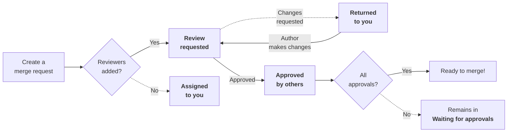



- Édition : Gratuite, GitLab Premium, GitLab Ultimate
- Offre : GitLab.com, GitLab Self-Managed, GitLab Dedicated





- [Introduction](https://gitlab.com/groups/gitlab-org/-/work_items/13448) dans GitLab 17.9 [avec le feature flag](../../administration/feature_flags/_index.md) `merge_request_dashboard`. Fonctionnalité désactivée par défaut.
- Feature flag `merge_request_dashboard` [activé](https://gitlab.com/gitlab-org/gitlab/-/issues/480854) sur GitLab.com dans GitLab 17.9.
- Feature flag `mr_dashboard_list_type_toggle` [activé](https://gitlab.com/gitlab-org/gitlab/-/issues/535244) sur GitLab.com dans GitLab 18.1.
- Feature flag `merge_request_dashboard` [activé par défaut](https://gitlab.com/gitlab-org/gitlab/-/merge_requests/194999) dans GitLab 18.2.



> [!flag]
> La disponibilité de cette fonctionnalité est contrôlée par un feature flag. Pour plus d'informations, consultez l'historique.

Ce tutoriel vous présente la nouvelle interface utilisateur pour la gestion des merge requests.

Que vous soyez un auteur en attente d'une revue, ou un relecteur fournissant des commentaires, cette page vous aide à suivre votre travail. Elle classe votre travail en catégories claires pour vous aider à :

- Passer moins de temps à suivre les merge requests qui nécessitent votre attention.
- Vous concentrer en priorité sur le travail le plus urgent.
- Consulter le statut de vos contributions.
- Éviter que le travail en cours ne soit oublié.
- Améliorer votre vitesse de revue de code.

## Voir en action {#see-it-in-action}

Pour afficher votre page d'accueil des merge requests sur GitLab.com, effectuez l'une des actions suivantes :

- Utilisez le <kbd>Shift</kbd>+<kbd>m</kbd> [raccourci clavier](../../user/shortcuts.md).
- Dans la barre latérale gauche, sélectionnez **Requêtes de fusion**.

Elle est organisée en trois onglets, pour vous aider à vous concentrer sur ce qui nécessite votre attention immédiate, tout en vous donnant accès aux autres travaux récents :

- **Actif** : ces merge requests nécessitent votre attention, ou celle d'un membre de votre équipe.
- **Fusionnées** : ces merge requests ont été fusionnées au cours des 14 derniers jours, et vous étiez une personne assignée ou un relecteur.
- **Rechercher** : recherchez toutes les merge requests et filtrez-les selon vos besoins.

GitLab affiche le nombre total de merge requests **Actif** dans le coin supérieur droit de toutes les pages. Par exemple, cet utilisateur a :

- 8 tickets ouverts ()
- 3 merge requests actives ()
- 6 éléments de la liste de tâches ()

Chaque ligne du tableau regroupe les informations relatives à une merge request en colonnes :

- **Statut** \- Le statut actuel de la merge request.
- **Intitulé** \- Métadonnées importantes sur le ticket, notamment :
  - Le titre de la merge request.
  - L'avatar de la personne assignée.
  - Le nombre de fichiers et de lignes ajoutés et supprimés (`+` / `-`).
  - Jalon.
- **Auteur** \- L'avatar de l'auteur.
- **Relecteur** \- Les avatars des relecteurs. Les relecteurs avec une coche verte ont approuvé la merge request.
- **Vérifications** \- Une évaluation compacte de la capacité à fusionner.
  - Nombre de fils de discussion ouverts, par exemple `0 of 3`.
  - [statut d'approbation](../../user/project/merge_requests/approvals/_index.md#in-the-list-of-merge-requests) requis actuel.
  - Statut du pipeline le plus récent.
  - Date de la dernière mise à jour.

## Définir vos préférences d'affichage {#set-your-display-preferences}

En haut à droite, sélectionnez **Préférences d'affichage** () pour trier vos merge requests par :

- **Flux de travail**. Cette vue regroupe les merge requests par statut. Les merge requests nécessitant votre attention s'affichent en premier, que vous soyez l'auteur ou le relecteur.
- **Rôle**. Cette vue regroupe les merge requests selon que vous êtes le relecteur ou l'auteur.





Dans la vue **Flux de travail**, l'onglet **Actif** trie les merge requests dans cet ordre :

- **Vous a été retourné(e)**
- **Révision demandée**
- **Vos requêtes de fusion**

Les merge requests dans ces états sont exclues du compteur **Actif** :

- **En attente de la personne assignée**
- **En attente d'approbations**
- **Approuvé(e) par vous**
- **Approuvé(e) par un tiers**





Dans la vue **Rôle**, l'onglet **Actif** trie les merge requests dans cet ordre :

- **Relecteur (Actif)**
- **Relecteur (Inactif)**
- **Vos requêtes de fusion (Actif)**
- **Vos requêtes de fusion (Inactif)**





## Comprendre la vue Rôle {#understand-the-role-view}

La vue **Rôle** regroupe les merge requests pour lesquelles vous êtes une personne assignée ou un relecteur :

- **Relecteur (Actif)** : en attente d'une revue de votre part.
- **Relecteur (Inactif)** : déjà relu par vous.
- **Vos requêtes de fusion (Actif)**
- **Vos requêtes de fusion (Inactif)**

Les merge requests dans les listes **Actif** sont comptabilisées dans le total affiché dans la barre latérale gauche.

## Comprendre la vue Flux de travail {#understand-the-workflow-view}

La vue **Flux de travail** regroupe les merge requests selon leur position dans le [processus de revue](../../user/project/merge_requests/reviews/_index.md). Cette vue vous aide à comprendre quelle action entreprendre ensuite :

Ce flux de revue suppose les hypothèses suivantes :

1. La **Personne assignée** est l'auteur de la merge request.
1. Les **Relecteur** sont les utilisateurs qui passent en revue le travail dans la merge request.
1. Les relecteurs utilisent les fonctionnalités [**Démarrer une révision**](../../user/project/merge_requests/reviews/_index.md#start-a-review) et [**Envoyer une révision**](../../user/project/merge_requests/reviews/_index.md#submit-a-review).

Les merge requests ayant l'un des statuts **Actif** sont comptabilisées dans le total affiché dans la barre latérale gauche :

- Statuts actifs : **Vous a été retourné(e)**, **Révision demandée**, **Vos requêtes de fusion**
- Statuts inactifs : **En attente de la personne assignée**, **En attente d'approbations**, **Approuvé(e) par vous**, **Approuvé(e) par un tiers**

## Vue Flux de travail : statuts actifs {#workflow-view-active-statuses}

ces merge requests nécessitent votre attention, ou celle d'un membre de votre équipe.

### Vous a été retourné(e) {#returned-to-you}

Les relecteurs ont fourni des commentaires ou demandé des modifications.

- Étape suivante : traiter les commentaires des relecteurs et implémenter les modifications suggérées.
- Statuts :
  - **Modifications demandées** : un relecteur a demandé des modifications.
  - **Le relecteur ou la relectrice a posté un commentaire** : un relecteur a laissé des commentaires sans demander de modifications.

### Révision demandée {#review-requested}

Vous êtes relecteur pour cette merge request.

- Étape suivante : passer en revue la merge request. Fournir une approbation et des commentaires. Demander des modifications si nécessaire.
- Statuts :
  - **Demandé** : vous n'avez pas encore démarré de revue.
  - **Revue commencée** : vous avez démarré une revue, mais ne l'avez pas encore terminée.

### Vos requêtes de fusion {#your-merge-requests}

Vous êtes l'auteur ou la personne assignée de la merge request. Vous n'avez pas encore ajouté de relecteurs.

- Étape suivante : ajouter des relecteurs pour démarrer le processus de revue.
- Statuts :
  - **Brouillon** : la merge request est marquée comme brouillon.
  - **Relecteurs et relectrices nécessaires** : la merge request n'est pas un brouillon, mais n'a pas de relecteurs.

## Vue Flux de travail : statuts inactifs {#workflow-view-inactive-statuses}

L'onglet **Actif** affiche toutes vos merge requests en cours, triées par statut. Ces merge requests sont exclues du compteur actif, car aucune action de votre part n'est requise pour le moment :

### En attente de la personne assignée {#waiting-for-assignee}

Vos merge requests assignées en attente d'approbations, et les revues pour lesquelles vous avez demandé des modifications.

- Étape suivante : attendre les revues et les approbations.
- Statuts :
  - **Vous avez demandé des modifications** : vous avez terminé votre revue et demandé des modifications.
  - **Vous avez émis des commentaires** : vous avez émis des commentaires, mais n'avez pas terminé votre revue.

### En attente d'approbations {#waiting-for-approvals}

Vos merge requests assignées en attente d'approbations, et les revues pour lesquelles vous avez demandé des modifications.

- Étape suivante : attendre que toutes les conditions d'approbation soient satisfaites.
- Statuts :
  - **Approbation requise** \- Nombre d'approbations requises restantes.
  - **Approuvée** \- Vous avez approuvé, ou toutes les approbations requises sont satisfaites.
  - **En attente d'approbations**.

### Approuvé(e) par vous {#approved-by-you}

Les merge requests que vous avez passées en revue et approuvées.

- Étape suivante : attendre les autres approbations et que les autres conditions de fusion soient satisfaites.
- Statuts :
  - **Approuvée** \- Vous avez approuvé, et les approbations requises sont satisfaites.
  - **Approbation requise** \- Vous avez approuvé, mais toutes les approbations requises ne sont pas satisfaites.

### Approuvé(e) par un tiers {#approved-by-others}

Les merge requests qui ont reçu des approbations d'autres membres de l'équipe.

- Étape suivante : potentiellement prêt à fusionner, si toutes les conditions sont satisfaites.
- Statuts :
  - **Approuvée** \- Votre merge request a reçu les approbations nécessaires.
