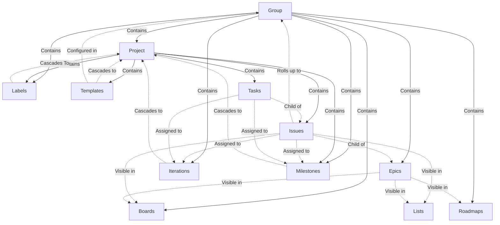
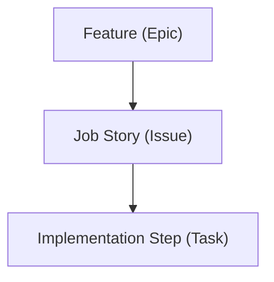
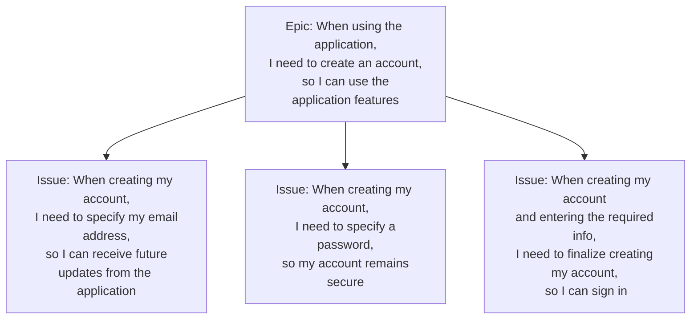
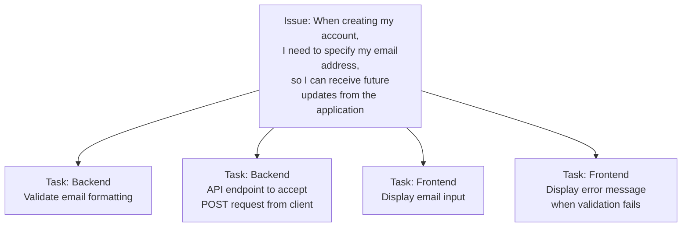

<!-- vale gitlab_base.FutureTense = NO -->

Ce tutoriel fournit des instructions pas à pas sur l'utilisation des fonctionnalités de planification et de suivi agile dans GitLab pour faciliter les cérémonies et workflows Scrum essentiels. En configurant les groupes, projets, tableaux et autres fonctionnalités de manière réfléchie, les équipes peuvent bénéficier d'une transparence, d'une collaboration et de cadences de livraison améliorées.

Selon le [Modèle de fluidité agile](https://martinfowler.com/articles/agileFluency.html) de Martin Fowler, les équipes qui pratiquent [Scrum](https://scrumguides.org/scrum-guide.html) :

> ...pensent et planifient en termes de bénéfices que leurs commanditaires, clients et utilisateurs tireront de leur logiciel.

Elles y parviennent en démontrant leurs progrès mensuellement, en réfléchissant régulièrement à l'amélioration de leurs processus et habitudes de travail pour apporter davantage de valeur métier et client.

Ce tutoriel couvre les sujets suivants :

- [Configurer vos groupes et projets](#setting-up-your-groups-and-projects)
- [Gérer votre backlog de fonctionnalités](#managing-your-feature-backlog)
- [Gérer votre backlog de stories](#managing-your-story-backlog)
- [Suivre la progression du sprint](#tracking-sprint-progress)

## Configurer vos groupes et projets {#setting-up-your-groups-and-projects}

Pour faciliter les pratiques Scrum dans GitLab, vous devez d'abord configurer la structure de base des groupes et des projets. Vous utiliserez des groupes pour créer des tableaux et des labels qui pourront être hérités par les projets imbriqués sous ce groupe. Les projets contiendront les tickets et les tâches qui constituent les éléments de travail réels pour chaque sprint.

### Comprendre le modèle d'héritage dans GitLab {#understanding-the-inheritance-model-in-gitlab}

GitLab possède une structure hiérarchique dans laquelle les groupes contiennent des projets. Les paramètres et configurations appliqués à un groupe se propagent en cascade aux projets enfants, ce qui vous permet de standardiser les labels, les tableaux et les itérations sur plusieurs projets :



- Les groupes contiennent un ou plusieurs projets, epics, tableaux, labels et itérations. L'appartenance des utilisateurs aux groupes se propage en cascade aux projets du groupe.
- Vous pouvez créer des tableaux et des labels dans un groupe ou un projet. Pour ce tutoriel, vous devriez les créer dans un groupe afin de faciliter des workflows de planification standardisés et la génération de rapports sur plusieurs projets au sein d'un seul groupe.
- Tout objet qui se propage en cascade vers un projet peut être associé aux tickets de ce projet ; par exemple : vous pouvez appliquer des labels d'un groupe à des tickets.

### Créer votre groupe {#create-your-group}

Créez un groupe dédié à vos activités Scrum. Ce groupe sera le conteneur parent des projets et des configurations telles que les tableaux et les labels que vous souhaitez standardiser sur l'ensemble des projets.

Ce groupe sera l'emplacement principal pour les différentes activités au cours d'une cadence Scrum typique. Il contiendra vos tableaux, vos fonctionnalités (epics), le récapitulatif des stories (tickets) et les labels.

Pour créer un groupe :

1. Dans le coin supérieur droit, sélectionnez **Créer un nouveau** () et **Nouveau groupe**.
1. Sélectionnez **Créer un groupe**.
1. Dans la zone de texte **Nom du groupe**, saisissez le nom du groupe. Pour obtenir la liste des mots qui ne peuvent pas être utilisés comme noms de groupe, consultez les [noms réservés](../../user/reserved_names.md).
1. Dans la zone de texte **URL du groupe**, saisissez le chemin du groupe utilisé pour l'[espace de nommage](../../user/namespace/_index.md).
1. Sélectionnez le [**Niveau de visibilité**](../../user/public_access.md) du groupe.
1. Facultatif. Pour personnaliser votre expérience GitLab :
   - Dans la liste déroulante **Rôle**, sélectionnez votre rôle.
   - Pour **Qui utilisera ce groupe ?**, sélectionnez une option.
   - Dans la liste déroulante **À quoi vous servira ce groupe ?**, sélectionnez une option.
1. Facultatif. Pour inviter des membres au groupe, dans la zone de texte **Email 1**, saisissez l'adresse e-mail de l'utilisateur que vous souhaitez inviter. Pour inviter d'autres utilisateurs, sélectionnez **Inviter un autre membre** et saisissez l'adresse e-mail de l'utilisateur.
1. Sélectionnez **Créer un groupe**.

### Créer vos projets {#create-your-projects}

Dans le groupe que vous avez créé, créez un ou plusieurs projets. Votre projet contiendra les stories qui remontent vers votre groupe parent.

Pour créer un projet vide :

1. Dans le coin supérieur droit, sélectionnez **Créer un nouveau** () et **Nouveau projet/dépôt**.
1. Sélectionnez **Créer un projet vide**.
1. Saisissez les détails du projet :
   - Dans la zone de texte **Nom du projet**, saisissez le nom de votre projet. Consultez les [limitations relatives aux noms de projet](../../user/reserved_names.md).
   - Dans la zone de texte **Identifiant « slug » du projet**, saisissez le chemin vers votre projet. L'instance GitLab utilise le slug comme chemin d'URL vers le projet. Pour modifier le slug, saisissez d'abord le nom du projet, puis modifiez le slug.
   - Pour modifier les [droits d'affichage et d'accès](../../user/public_access.md) au projet pour les utilisateurs, modifiez le **Niveau de visibilité**.
   - Pour créer un fichier README afin que le dépôt Git soit initialisé, dispose d'une branche par défaut et puisse être cloné, sélectionnez **Initialiser le dépôt avec un README**.
1. Sélectionnez **Créer le projet**.

### Créer des labels à portée limitée pour prendre en charge les différentes phases du cycle de vie Scrum {#create-scoped-labels-to-support-different-phases-of-the-scrum-lifecycle}

Ensuite, dans le groupe que vous avez créé, vous allez créer des labels à ajouter aux tickets pour les catégoriser.

Le meilleur outil pour cela est celui des [labels à portée limitée](../../user/project/labels.md#scoped-labels), que vous pouvez utiliser pour définir des attributs mutuellement exclusifs.

Le double deux-points (`::`) dans le nom d'un label à portée limitée empêche l'utilisation simultanée de deux labels de même portée. Par exemple, si vous ajoutez le label `status::in progress` à un ticket qui possède déjà `status::ready`, le précédent est supprimé.

Pour créer chaque label :

1. Dans la barre supérieure, sélectionnez **Rechercher ou accéder à**, puis recherchez votre groupe.
1. Dans la barre latérale gauche, sélectionnez **Gérer** > **Labels**.
1. Sélectionnez **Nouveau label**.
1. Dans la zone de texte **Intitulé**, saisissez le nom du label. Commencez par `priority::now`.
1. Facultatif. Sélectionnez une couleur parmi les couleurs disponibles ou saisissez une valeur de couleur hexadécimale pour une couleur spécifique dans la zone de texte **Couleur d'arrière‐plan**.
1. Sélectionnez **Créer un label**.

Répétez ces étapes pour créer tous les labels dont vous aurez besoin :

- **Priorité** : vous les utiliserez sur un tableau d'epics pour faciliter la priorisation des releases au niveau des fonctionnalités.
  - `priority::now`
  - `priority::next`
  - `priority::later`
- **Statut** : vous utiliserez ces labels sur un tableau des tickets pour comprendre l'étape actuelle d'une story dans le cycle de vie de développement global.
  - `status::triage`
  - `status::refine`
  - `status::ready`
  - `status::in progress`
  - `status::in review`
  - `status::acceptance`
  - `status::done`
- **Type** : vous utiliserez ces labels pour représenter les différents types de travaux généralement inclus dans une seule itération :
  - `type::story`
  - `type::bug`
  - `type::maintenance`

### Créer une cadence d'itération {#create-an-iteration-cadence}

Dans GitLab, les sprints sont appelés itérations. Les cadences d'itération contiennent les timeboxes d'itération individuelles et séquentielles pour la planification et la génération de rapports sur vos tickets. Comme les labels, les itérations se propagent en cascade dans votre hiérarchie de groupes, sous-groupes et projets. C'est pourquoi vous allez créer la cadence d'itération dans le groupe que vous avez créé.

Prérequis :

- Vous devez disposer du rôle Reporter, Developer, Maintainer ou Owner pour un groupe.

Pour créer une cadence d'itération :

1. Dans la barre supérieure, sélectionnez **Rechercher ou accéder à**, puis recherchez votre groupe.
1. Dans la barre latérale gauche, sélectionnez **Forfait** > **Itérations**.
1. Sélectionnez **Nouvelle cadence d'itération**.
1. Saisissez le titre et la description de la cadence d'itération.
1. Assurez-vous que la case **Activer la programmation automatique** est cochée.
1. Renseignez les champs requis pour utiliser la programmation automatique.
   - Sélectionnez la date de début de l'automatisation de la cadence d'itération. Les itérations sont programmées pour commencer le même jour de la semaine que celui de la date de début.
   - Dans la liste déroulante **Durée**, sélectionnez **2**.
   - Dans la liste déroulante **Itérations à venir**, sélectionnez **4**.
   - Cochez la case **Activer le report**.
1. Sélectionnez **Créer une cadence**. La page de liste des cadences s'ouvre.

Avec votre cadence d'itération configurée de cette façon :

- Chaque sprint dure deux semaines.
- GitLab crée automatiquement quatre sprints dans le futur.
- Les tickets incomplets d'un sprint sont automatiquement réassignés au sprint suivant lorsque le sprint en cours est clôturé.

Vous pouvez également désactiver la **Programmation automatique** et [créer et gérer manuellement des itérations](../../user/group/iterations/_index.md#create-an-iteration-manually) dans votre cadence.

## Gérer votre backlog de fonctionnalités {#managing-your-feature-backlog}

Un backlog de fonctionnalités capture les idées et les fonctionnalités souhaitées sous forme d'epics. Au fil de l'affinage de ce backlog, les epics seront priorisés pour être intégrés aux prochains sprints. Cette section explique comment créer un tableau d'epics pour faciliter la gestion du backlog et comment rédiger votre premier epic de fonctionnalité.

### Choisir une façon de structurer votre travail {#decide-on-a-way-to-structure-your-work}

GitLab est extensible pour prendre en charge différentes approches de gestion du backlog. Ce tutoriel structure les livrables de la façon suivante :



- Un epic représente une fonctionnalité qu'une équipe peut livrer en une seule itération.
- Chaque epic contiendra de nombreuses [job stories](https://medium.com/@umang.soni/moving-from-user-role-based-approach-to-problem-statement-based-approach-for-product-development-18b2d2395e5).
  - Une story doit apporter une valeur client tangible, contenir des critères d'acceptation explicites et être suffisamment petite pour qu'une personne puisse la terminer en un ou deux jours.
  - En tant qu'équipe, vous devriez terminer quatre à dix stories par sprint.
- Bien qu'il existe de nombreuses stratégies pour découper les fonctionnalités, une excellente stratégie consiste à [découper verticalement](https://www.agilerant.info/vertical-slicing-to-boost-software-value/) les stories en stories discrètes et autonomes qu'un utilisateur doit accomplir pour atteindre son objectif.

  Même si vous ne livrez pas forcément une seule story à vos clients, votre équipe peut tester et interagir avec chaque story en utilisant un feature flag en production ou dans un environnement de staging. Non seulement cela permet aux parties prenantes de suivre l'avancement de la story, mais c'est aussi un mécanisme pour décomposer des fonctionnalités plus complexes en objectifs de développement accessibles.
- Selon la complexité des stories, vous pouvez utiliser des tâches pour décomposer les stories en étapes d'implémentation discrètes que les développeurs doivent effectuer pour compléter la story.

En termes d'horizons temporels, ciblez les directives suivantes pour dimensionner et cadrer les éléments de travail :

- Une **fonctionnalité** peut être complétée en une seule itération.
- Une **story** peut être complétée en quelques jours.
- Une **tâche** peut être complétée en quelques heures à une journée.

#### Exemple : découper une fonctionnalité verticalement {#example-vertically-slicing-a-feature}

Voici un exemple de décomposition d'une fonctionnalité en job stories découpées verticalement en fonction du parcours de l'utilisateur final :



Vous avez pris la fonctionnalité de création de compte non modifiée pour une application et vous l'avez décomposée en trois stories distinctes :

1. Saisir une adresse e-mail.
1. Saisir un mot de passe.
1. Sélectionner un bouton pour exécuter la création du compte.

Après avoir décomposé une fonctionnalité en stories, vous pouvez décomposer davantage la story en étapes d'implémentation discrètes :



### Configurer un tableau de planification de release {#set-up-a-release-planning-board}

Vous avez défini votre structure de livrables. L'étape suivante consiste à créer un tableau d'epics que vous utiliserez pour développer et maintenir votre backlog de fonctionnalités.

Pour créer un nouveau tableau d'epics :

1. Dans la barre supérieure, sélectionnez **Rechercher ou accéder à**, puis recherchez votre groupe.
1. Dans la barre latérale gauche, sélectionnez **Forfait** > **Tableaux d'épopées**.
1. Dans le coin supérieur gauche, sélectionnez la liste déroulante avec le nom du tableau actuel.
1. Sélectionnez **Créer un nouveau tableau**.
1. Saisissez le titre du nouveau tableau : `Release Planning`.
1. Sélectionnez **Créer un tableau**.

Ensuite, [créez des listes](../../user/group/epics/epic_boards.md#create-a-new-list) pour les labels `priority::later`, `priority::next` et `priority::now`.

Pour créer une nouvelle liste :

1. Dans le coin supérieur droit de votre tableau, sélectionnez **Créer une liste**.
1. Dans la colonne **Nouvelle liste**, développez la liste déroulante **Sélectionnez un label** et sélectionnez le label à utiliser comme portée de la liste.
1. Sélectionnez **Ajouter au tableau**.

Vous utiliserez ces listes pour faciliter le déplacement des fonctionnalités dans votre tableau de gauche à droite.

Utilisez chaque liste de votre tableau de planification de release pour représenter les horizons temporels suivants :

- **Ouvrir** : fonctionnalités qui ne sont pas encore prêtes pour la priorisation.
- **Plus tard** : fonctionnalités qui seront priorisées dans une release ultérieure.
- **Suivant** : fonctionnalités provisoirement planifiées pour la prochaine release.
- **Maintenant** : fonctionnalités priorisées pour votre release actuelle.
- **Fermé** : fonctionnalités qui ont été complétées ou annulées.

### Créer votre premier epic {#create-your-first-epic}

Ensuite, créez un nouvel epic dans la liste `priority::now` :

1. En haut de la liste **`priority::now`**, sélectionnez l'icône **Nouvelle épopée** ().
1. Saisissez le titre du nouvel epic :

   ```plaintext
   When using the application, I need to create an account, so that I can use the application features.
   ```

1. Sélectionnez **Créer une épopée**.

Lorsque vous avez terminé cette étape, votre tableau devrait ressembler à ceci :


Vous pouvez désormais utiliser le tableau de **planification de release** pour construire rapidement votre backlog.

Ébauchez de nombreuses fonctionnalités et priorisez-les dans les listes **Maintenant**, **Suivant** et **Plus tard**. Ensuite, prenez le temps de décomposer davantage chaque story en stories et en tâches.

Pour réorganiser les epics de fonctionnalités dans une liste ou entre les listes, faites glisser les cartes d'epics. Vous pouvez également [déplacer les cartes en haut ou en bas](../../user/group/epics/epic_boards.md#move-an-epic-to-the-start-of-the-list) d'une liste.

## Gérer votre backlog de stories {#managing-your-story-backlog}

Lorsque vous avez des fonctionnalités définies sous forme d'epics, l'étape suivante consiste à décomposer ces fonctionnalités en tranches verticales granulaires sous forme de tickets. Vous affinerez ensuite et séquencerez ces tickets sur plusieurs itérations dans un tableau de backlog dédié.

### Décomposer les fonctionnalités en stories {#break-down-features-into-stories}

Décomposez les fonctionnalités en stories découpées verticalement à l'avance pour avoir une réunion de planification de sprint efficace. À l'étape précédente, vous avez créé votre première fonctionnalité. Décomposons-la en stories.

Pour créer vos premières stories :

1. Dans la barre supérieure, sélectionnez **Rechercher ou accéder à**, puis recherchez votre groupe.
1. Dans la barre latérale gauche, sélectionnez **Forfait** > **Tableaux d'épopées**.
1. Dans le coin supérieur gauche, assurez-vous que la liste déroulante avec le nom du tableau actuel affiche **Planification de release**. Si ce n'est pas le cas, sélectionnez ce tableau dans la liste déroulante.
1. Ouvrez un epic en cliquant sur le titre de la carte d'epic.
1. Dans la section **Tickets et epics enfants**, sélectionnez **Ajouter** > **Ajouter un nouveau ticket**.
1. Saisissez le titre suivant pour le ticket :

   ```plaintext
   When creating my account, I need to specify my email address so that I can receive future updates from the application
   ```

1. Dans la liste déroulante **Projet**, sélectionnez le projet dans lequel vous souhaitez créer le ticket.
1. Sélectionnez **Créer un ticket**.
1. Répétez ce processus pour les deux autres tranches verticales :

   ```plaintext
   When creating my account, I need to specify a password so that my account remains secure
   ```

   ```plaintext
   When creating my account and entering the required information, I need to finalize creating my account so that I can sign in
   ```

### Affiner votre backlog de stories {#refine-your-story-backlog}

À l'étape précédente, vous avez décomposé une fonctionnalité en user stories nécessaires pour la compléter. Ensuite, configurez un tableau des tickets pour servir d'emplacement de référence pour la gestion et l'affinage de votre backlog de stories.

Dans votre groupe, créez un nouveau tableau des tickets intitulé **Backlog**. Vous utiliserez ce tableau pour séquencer et planifier vos stories dans les prochains sprints (itérations) :

1. Dans la barre supérieure, sélectionnez **Rechercher ou accéder à**, puis recherchez votre groupe.
1. Dans la barre latérale gauche, sélectionnez **Forfait** > **Tableaux des tickets**.
1. Dans le coin supérieur gauche, sélectionnez la liste déroulante avec le nom du tableau actuel.
1. Sélectionnez **Créer un nouveau tableau**.
1. Saisissez le titre du nouveau tableau : `Backlog`.
1. Sélectionnez **Créer un tableau**.

Après avoir créé le tableau, créez une nouvelle liste pour chaque itération à venir :

1. Dans le coin supérieur droit de la page du tableau des tickets, sélectionnez **Créer une liste**.
1. Dans la colonne qui apparaît, sous **Portée**, sélectionnez **Itération**.
1. Dans la liste déroulante **Valeur**, sélectionnez l'une des itérations.
1. Sélectionnez **Ajouter au tableau**.
1. Répétez l'étape précédente pour les autres itérations à venir.

Ensuite, lorsqu'une itération est terminée, vous devriez [supprimer la liste de l'itération terminée](../../user/project/issue_board.md#remove-a-list) et ajouter une nouvelle liste pour la nouvelle itération future créée automatiquement en fonction des paramètres de votre cadence.

À ce stade, les stories n'ont pas encore été estimées ni affinées en tâches. Marquez-les pour affinement :

1. [Sélectionnez la carte de chaque ticket](../../user/project/issue_board.md#edit-an-issue) dans le tableau et appliquez le label `status::refine` :
   1. Dans la section **Labels** de la barre latérale, sélectionnez **Modifier**.
   1. Dans la liste **Sélectionner des labels**, sélectionnez le label `status::refine`.
   1. Sélectionnez n'importe quelle zone en dehors de la section des labels.
1. Faites glisser les trois stories vers le prochain sprint souhaité pour les assigner à la timebox de sprint correspondante.

À ce stade du tutoriel, votre tableau **Backlog** devrait ressembler à ceci :


En pratique, vous utiliserez ce tableau pour séquencer de nombreuses stories dans les itérations à venir. Lorsque votre backlog s'agrandit et que vous avez des dizaines de stories réparties sur plusieurs fonctionnalités, il peut être utile d'activer [**Regrouper par epic**](../../user/project/issue_board.md#group-issues-in-swimlanes) pour afficher les stories liées à leur epic de fonctionnalité correspondant. Lorsque les stories sont regroupées, il est plus facile de les séquencer dans les prochains sprints.

### Cérémonie de planification du sprint {#sprint-planning-ceremony}

Le backlog étant prêt, il est temps de planifier le prochain sprint. Vous pouvez utiliser des méthodes synchrones et asynchrones pour faciliter les réunions de planification de sprint dans GitLab.

#### Planification synchrone {#synchronous-planning}

Lorsque le moment est venu pour votre cérémonie de planification de sprint, ouvrez le tableau **Backlog** avec l'équipe et parcourez chaque story. Vous devriez commencer à planifier votre prochain sprint le dernier jour de votre sprint actuel. Lors de la discussion de chaque ticket :

- Passez en revue les critères d'acceptation et collaborez dessus. Vous pouvez les saisir dans la description du ticket en utilisant des listes de contrôle ou des éléments de liste.
- [Décomposez davantage la story en tâches](../../user/tasks.md#create-a-task) pour chaque étape d'implémentation.
- Estimez l'effort ou la complexité en points de story du ticket et définissez cette valeur dans la zone de texte **Poids** du ticket.
- Lorsque l'équipe est satisfaite de la portée du ticket et s'est mise d'accord sur la valeur en points de story, appliquez le label `status::ready` au ticket :

  1. Dans la section **Labels** de la barre latérale, sélectionnez **Modifier**.
  1. Dans la liste **Sélectionner des labels**, sélectionnez le label `status::ready`.
  1. Sélectionnez n'importe quelle zone en dehors de la section des labels.

Après avoir passé en revue tous les tickets de la prochaine itération, vous avez terminé la planification du sprint !

N'oubliez pas d'intégrer la vélocité de votre équipe dans votre engagement de sprint. Vous pouvez trouver le nombre total de points de story (poids) alloués à chaque sprint en haut de chaque liste d'itération. Il convient également de tenir compte des points de story susceptibles d'être reportés depuis le sprint précédent.

#### Planification asynchrone {#asynchronous-planning}

Au lieu de tenir une réunion synchrone, utilisez un ticket pour gérer votre planification de sprint.

Compte tenu de la nature de la planification de sprint asynchrone, vous devriez commencer quelques jours avant la fin du sprint actuel. Accordez à tous les membres de l'équipe le temps nécessaire pour contribuer et collaborer.

1. Ouvrez le tableau des tickets **Backlog** :
   1. Dans la barre supérieure, sélectionnez **Rechercher ou accéder à**, puis recherchez votre groupe.
   1. Sélectionnez **Forfait** > **Tableaux des tickets**.
   1. Dans le coin supérieur gauche, sélectionnez la liste déroulante avec le nom du tableau actuel.
   1. Sélectionnez **Backlog**.
1. Dans la liste du prochain sprint, sélectionnez **Créer un nouveau ticket** ().
1. Saisissez le titre du ticket : `Release Planning`.
1. Sélectionnez **Créer un ticket**.
1. Ouvrez le ticket et créez un fil de discussion pour chaque story assignée au prochain sprint.

   Ajoutez `+` à l'URL du ticket pour déplier automatiquement le titre. Ajoutez `+s` à l'URL du ticket pour déplier automatiquement le titre, le jalon et les personnes assignées. Vous pouvez utiliser le modèle suivant pour ces fils de discussion afin de créer des cases à cocher :

   ```markdown
   ## https://gitlab.example.com/my-group/application-b/-/issues/5+

   - [ ] Acceptance criteria defined
   - [ ] Weight set
   - [ ] Implementation steps (tasks) created
   ```

   Par exemple :

   
1. Lorsque chaque story dispose d'un fil de discussion, modifiez la description du ticket et [mentionnez chaque membre de l'équipe](../../user/discussions/_index.md#mentions). Mentionner des membres de l'équipe crée automatiquement un élément de la liste de tâches pour eux dans leurs [listes de tâches](../../user/todos.md) respectives.
1. Ensuite, de manière asynchrone, avant le début du prochain sprint, les membres de l'équipe doivent :

   - Discuter de chaque ticket, poser des questions et collaborer pour s'aligner sur les critères d'acceptation de chaque ticket planifié.
   - Utiliser un emoji de réaction tel que `:one:`, `:two:` et `:three:` pour voter sur la valeur des points de story (poids). Si les membres de l'équipe définissent des valeurs de points de story différentes, c'est une excellente occasion de discuter davantage jusqu'à parvenir à un consensus. Vous pouvez également faire la moyenne de toutes les différentes réactions pour vous mettre d'accord sur la valeur des points de story.
   - Décomposer les tranches verticales (tickets) en étapes d'implémentation (tâches).

1. À la conclusion de chaque discussion de story, mettez à jour le ticket avec les modifications apportées aux critères d'acceptation et définissez la valeur des points de story dans la zone de texte **Poids**.
1. Une fois la story mise à jour, ajoutez le label `status::ready` à chaque ticket.
1. Ensuite, pour signaler que la planification de cette tranche verticale est terminée, [résolvez chaque fil de discussion](../../user/discussions/_index.md#resolve-a-thread) dans le ticket de planification.

## Suivre la progression du sprint {#tracking-sprint-progress}

Pour visualiser et gérer le travail pendant un sprint, les équipes peuvent créer un tableau des tickets dédié représentant la portée du sprint actuel. Ce tableau offre une transparence sur la progression de l'équipe et les éventuels blocages. Les équipes peuvent également utiliser les analyses d'itération pour une visibilité supplémentaire grâce aux graphiques d'avancement (burndown chart).

### Créer un tableau pour votre sprint actuel {#create-a-board-for-your-current-sprint}

Dans votre groupe, créez un nouveau tableau des tickets intitulé **Sprint actuel** :

1. Dans la barre supérieure, sélectionnez **Rechercher ou accéder à**, puis recherchez votre groupe.
1. Dans la barre latérale gauche, sélectionnez **Forfait** > **Tableaux des tickets**.
1. Dans le coin supérieur gauche, sélectionnez la liste déroulante avec le nom du tableau actuel.
1. Sélectionnez **Créer un nouveau tableau**.
1. Saisissez le titre du nouveau tableau : `Current Sprint`.
1. À côté de **Portée**, sélectionnez **Étendre**.
1. À côté de **Itération**, sélectionnez **Modifier**.
1. Sous votre cadence d'itération, sélectionnez **Actuelle**.
1. Sélectionnez **Créer un tableau**.

Le tableau est désormais filtré pour n'afficher que les tickets assignés à l'itération actuelle. Utilisez-le pour visualiser la progression de l'équipe dans le sprint actif.

Ensuite, créez des listes de labels pour tous les statuts :

1. Dans le coin supérieur droit de la page du tableau des tickets, sélectionnez **Créer une liste**.
1. Dans la colonne qui apparaît, sous **Portée**, sélectionnez **Label**.
1. Dans la liste déroulante **Valeur**, sélectionnez l'un des labels :

   - `status::refine` : le ticket nécessite un affinement supplémentaire avant d'être développé.
   - `status::ready` : le ticket est prêt pour le développement.
   - `status::in progress` : le ticket est en cours de développement.
   - `status::review` : les MR correspondant au ticket font l'objet d'une revue de code.
   - `status::acceptance` : le ticket est prêt pour la validation par les parties prenantes et les tests d'assurance qualité.
   - `status::done` : les critères d'acceptation du ticket ont été satisfaits.

1. Sélectionnez **Ajouter au tableau**.
1. Répétez les étapes précédentes pour les autres labels.

Ensuite, au fil de l'avancement du sprint, faites glisser les tickets vers différentes listes pour modifier leur label `status::`.

### Afficher les graphiques d'avancement (burndown et burnup) pour votre sprint {#view-burndown-and-burnup-charts-for-your-sprint}

Il peut être utile de consulter le rapport d'itération pendant le sprint. Les rapports d'itération fournissent des métriques de progression ainsi que des graphiques d'avancement (burndown chart) et de progression cumulative (burnup chart).

Pour afficher votre rapport d'itération :

1. Dans la barre supérieure, sélectionnez **Rechercher ou accéder à**, puis recherchez votre groupe.
1. Dans la barre latérale gauche, sélectionnez **Forfait** > **Itérations** et sélectionnez une cadence d'itération.
1. Sélectionnez une itération.
