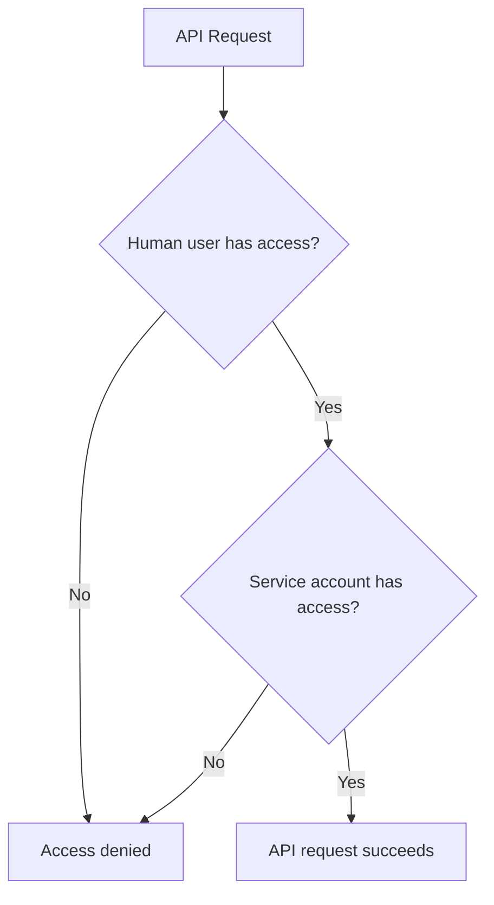



- Édition : GitLab Ultimate
- Module d'extension : GitLab Duo with Amazon Q
- Offre : GitLab Self-Managed





- Introduit en version [bêta](../../policy/development_stages_support.md#beta) dans GitLab 17.7 [avec un feature flag](../../administration/feature_flags/_index.md) nommé `amazon_q_integration`. Fonctionnalité désactivée par défaut.
- Suppression du feature flag `amazon_q_integration` dans GitLab 17.8.
- Généralement disponible avec la prise en charge de fonctionnalités GitLab Duo supplémentaires dans GitLab 17.11.



> [!note]
> GitLab Duo with Amazon Q ne peut pas être combiné avec d'autres add-ons GitLab Duo.

Lors de re:Invent 2024, Amazon a annoncé l'intégration GitLab Duo with Amazon Q. Grâce à cette intégration, vous pouvez automatiser des tâches et augmenter votre productivité.

GitLab Duo with Amazon Q :

- Peut effectuer diverses tâches dans les tickets et les merge requests.
- [Inclut de nombreuses autres fonctionnalités GitLab Duo](../gitlab_duo/feature_summary.md).

Pour une démonstration interactive, consultez [la visite guidée du produit GitLab Duo with Amazon Q](https://gitlab.navattic.com/duo-with-q).
<!-- Demo published on 2025-04-23 -->

Pour obtenir un abonnement à GitLab Duo with Amazon Q, contactez votre chargé de compte.

Vous pouvez également demander un essai en [remplissant ce formulaire](https://about.gitlab.com/partners/technology-partners/aws/#form).

## Configurer GitLab Duo with Amazon Q {#set-up-gitlab-duo-with-amazon-q}

Lorsque vous disposez d'un abonnement GitLab Duo with Amazon Q et de GitLab 17.11 ou version ultérieure, vous pouvez [configurer GitLab Duo with Amazon Q sur votre instance](setup.md).

## Utiliser GitLab Duo with Amazon Q dans un ticket {#use-gitlab-duo-with-amazon-q-in-an-issue}

Pour invoquer GitLab Duo with Amazon Q dans un ticket, vous utiliserez les [actions rapides](../project/quick_actions.md).

### Transformer une idée en merge request {#turn-an-idea-into-a-merge-request}

Transformez une idée dans un ticket en merge request contenant l'implémentation proposée.

Amazon Q utilise le titre et la description du ticket, ainsi que le contexte du projet, pour créer une merge request avec le code permettant de traiter le ticket.

#### Depuis la description du ticket {#from-the-issue-description}

1. Créez un nouveau ticket ou ouvrez un ticket existant, puis dans le coin supérieur droit, sélectionnez **Modifier**.
1. Dans la zone de description, saisissez `/q dev`.
1. Sélectionnez **Enregistrer les modifications**.

#### Depuis un commentaire {#from-a-comment}

1. Dans le ticket, dans un commentaire, saisissez `/q dev`.
1. Sélectionnez **Commentaire**.

### Mettre à niveau Java {#upgrade-java}

Amazon Q peut analyser du code Java 8 ou 11 et déterminer les modifications Java nécessaires pour mettre à jour le code vers Java 17.

[Voir une présentation guidée](https://gitlab.navattic.com/duo-q-transform).

Prérequis :

- Vous devez [disposer d'un runner et d'un pipeline CI/CD configurés pour votre projet](../../ci/_index.md).
- Votre fichier `pom.xml` doit avoir une [source et une cible](https://maven.apache.org/plugins/maven-compiler-plugin/examples/set-compiler-source-and-target.html).

Pour mettre à niveau Java :

1. Créez un ticket.
1. Dans le titre et la description du ticket, expliquez que vous souhaitez mettre à niveau Java. Il n'est pas nécessaire de saisir les détails de version. Amazon Q peut déterminer la version.
1. Enregistrez le ticket. Ensuite, dans un commentaire, saisissez `/q transform`.
1. Sélectionnez **Commentaire**.

Un job CI/CD démarre. Un commentaire s'affiche avec les détails et un lien vers le job.

- Si le job réussit, une merge request contenant les modifications de code nécessaires à la mise à niveau est créée.
- Si le job échoue, un commentaire fournit des détails sur les corrections potentielles.

## Utiliser GitLab Duo with Amazon Q dans une merge request {#use-gitlab-duo-with-amazon-q-in-a-merge-request}

Pour invoquer GitLab Duo with Amazon Q dans une merge request, vous utiliserez les [actions rapides](../project/quick_actions.md).

### Réviser une merge request {#review-a-merge-request}

Amazon Q peut analyser votre merge request et suggérer des améliorations à votre code. Il peut détecter des problèmes de sécurité, des problèmes de qualité, des inefficacités et d'autres erreurs.

[Vous pouvez demander à Amazon Q d'effectuer une revue automatiquement](setup.md#enter-the-arn-in-gitlab-and-enable-amazon-q) lorsque vous ouvrez ou rouvrez une merge request, ou vous pouvez démarrer manuellement une revue.

Pour démarrer manuellement :

1. Ouvrez votre merge request.
1. Dans l'onglet **Vue d'ensemble**, dans un commentaire, saisissez `/q review`.
1. Sélectionnez **Commentaire**.

Amazon Q effectue une revue des modifications de la merge request et affiche les résultats dans des commentaires.

### Modifier le code en fonction des retours {#make-code-changes-based-on-feedback}

Amazon Q peut apporter des modifications au code en fonction des retours du relecteur.

1. Ouvrez une merge request qui contient des retours de relecteur.
1. Dans l'onglet **Vue d'ensemble**, accédez au commentaire que vous souhaitez traiter.
1. Sous le commentaire, dans la zone **Répondre**, saisissez `/q dev`.
1. Sélectionnez **Ajouter un commentaire**.

Amazon Q propose des modifications à la merge request sur la base des commentaires et des retours du relecteur.

### Générer des tests unitaires {#generate-unit-tests}

Générez de nouveaux tests unitaires pour votre code à l'aide d'Amazon Q.

#### Depuis un ticket {#from-an-issue}

1. Créez un ticket.
1. Utilisez l'une des options suivantes pour demander la génération de tests pour votre code :
   - Dans la description du ticket, décrivez votre demande et sélectionnez **Enregistrer les modifications**.
   - Dans un commentaire, saisissez `/q dev` et sélectionnez **Commentaire**.

Amazon Q crée une merge request avec les tests suggérés.

#### Depuis une merge request {#from-a-merge-request}

1. Ouvrez votre merge request.
1. Dans l'onglet **Modifications**, laissez un commentaire en ligne à l'endroit où vous souhaitez ajouter des tests. Incluez autant de détails que possible dans vos retours, tels que le nom du fichier, le nom de la classe et le numéro de ligne.
1. Dans le commentaire, saisissez `/q dev` sur une nouvelle ligne et sélectionnez **Ajouter un commentaire**.

Amazon Q met à jour la merge request avec les tests suggérés.

## Authentification et autorisation {#authentication-and-authorization}



- [Introduit](https://gitlab.com/gitlab-org/gitlab/-/issues/506641) dans GitLab 17.9.



GitLab Duo with Amazon Q utilise une identité composite pour authentifier les requêtes.

> [!note]
> La prise en charge d'une identité composite dans d'autres parties du produit est proposée dans le [ticket 511373](https://gitlab.com/gitlab-org/gitlab/-/issues/511373).

Le jeton qui authentifie les requêtes est une composition de deux identités :

- L'auteur principal, qui est le [compte de service](../profile/service_accounts.md) Amazon Q. Ce compte de service est à l'échelle de l'instance et dispose du rôle Developer sur le projet où l'action rapide Amazon Q a été utilisée. Le compte de service est le propriétaire du jeton.
- L'auteur secondaire, qui est l'utilisateur humain ayant soumis l'action rapide. L'`id` de cet utilisateur est inclus dans les portées du jeton.

Cette identité composite garantit que toutes les activités réalisées par Amazon Q sont correctement attribuées au compte de service Amazon Q. En même temps, l'identité composite garantit qu'il n'y a pas de [élévation de privilèges](https://en.wikipedia.org/wiki/Privilege_escalation) pour l'utilisateur humain.

Cette [portée dynamique](https://github.com/doorkeeper-gem/doorkeeper/pull/1739) est vérifiée lors de l'autorisation de la requête API. Lorsqu'une autorisation est demandée, GitLab valide que le compte de service et l'utilisateur à l'origine de l'action rapide disposent tous deux des autorisations suffisantes.

## Sujets connexes {#related-topics}

- [Configurer GitLab Duo with Amazon Q](setup.md)
- [Authentification et autorisation](#authentication-and-authorization)
- <i class="fa-youtube-play" aria-hidden="true"></i> [GitLab Duo with Amazon Q - De l'idée à la merge request](https://youtu.be/jxxzNst3jpo?si=QHO8JnPgMoFIllbL) <!-- Video published on 2025-04-17 -->
- <i class="fa-youtube-play" aria-hidden="true"></i> [GitLab Duo with Amazon Q - Mise à niveau Java](https://www.youtube.com/watch?v=qGyzG9wTsEo) <!-- Video published on 2025-10-16 -->
- <i class="fa-youtube-play" aria-hidden="true"></i> [GitLab Duo with Amazon Q - Optimisation de la revue de code](https://youtu.be/4gFIgyFc02Q?si=S-jO2M2jcXnukuN_) <!-- Video published on 2025-05-20 -->
- <i class="fa-youtube-play" aria-hidden="true"></i> [GitLab Duo with Amazon Q - Modifier le code en fonction des retours](https://youtu.be/31E9X9BrK5s?si=v232hBDmlGpv6fqC) <!-- Video published on 2025-05-30 -->
