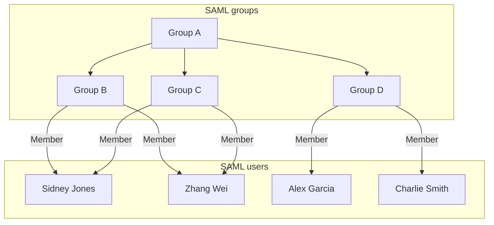
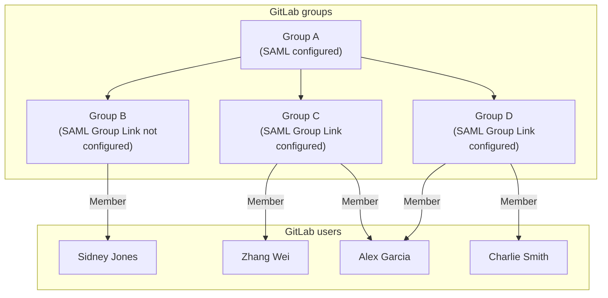
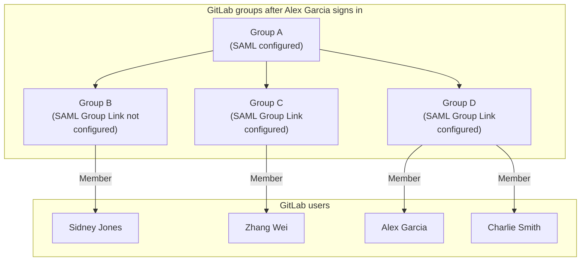



- Édition : GitLab Premium, GitLab Ultimate
- Offre : GitLab.com, GitLab Self-Managed, GitLab Dedicated



Utilisez la synchronisation des groupes SAML pour attribuer des utilisateurs et utilisatrices avec des rôles spécifiques à des groupes GitLab existants, en fonction de l'affectation de groupe des utilisateurs et utilisatrices dans le fournisseur d'identité (IdP) SAML. Avec la synchronisation des groupes SAML, vous pouvez créer un mappage multiple entre les groupes IdP SAML et les groupes GitLab.

Par exemple, si l'utilisateur ou l'utilisatrice `@amelia` est affecté(e) au groupe `security` dans l'IdP SAML, vous pouvez utiliser la synchronisation des groupes SAML pour affecter `@amelia` au groupe `security-gitlab` avec le rôle Maintainer, et au groupe `vulnerability` avec le rôle Reporter.

La synchronisation des groupes SAML ne crée pas de groupes. Vous devez d'abord [créer un groupe](../_index.md#create-a-group), puis créer le mappage.

Sur GitLab.com, la synchronisation des groupes SAML est configurée par défaut. Sur GitLab Self-Managed, vous devez la configurer manuellement.

## Priorisation des rôles {#role-prioritization}

La synchronisation des groupes détermine le rôle et le type d'appartenance d'un utilisateur ou d'une utilisatrice dans le groupe mappé.

### Plusieurs IdPs SAML {#multiple-saml-idps}



- Offre : GitLab Self-Managed



Lorsqu'un utilisateur ou une utilisatrice se connecte, GitLab :

- Vérifie tous les liens de groupe SAML configurés.
- Ajoute cet utilisateur ou cette utilisatrice aux groupes GitLab correspondants en fonction des groupes SAML auxquels il ou elle appartient parmi les différents IdPs.

Le mappage des liens de groupe dans GitLab n'est pas lié à un IdP spécifique, vous devez donc configurer tous les IdPs SAML pour inclure des attributs de groupe dans la réponse SAML. Cela signifie que GitLab est capable de faire correspondre des groupes dans la réponse SAML, quel que soit l'IdP utilisé pour se connecter.

Par exemple, vous disposez de 2 IdPs : `SAML1` et `SAML2`.

Dans GitLab, sur un groupe spécifique, vous avez configuré deux liens de groupe :

- `gtlb-owner => Owner role`.
- `gtlb-dev => Developer role`.

Dans `SAML1`, l'utilisateur ou l'utilisatrice est membre de `gtlb-owner` mais pas de `gtlb-dev`.

Dans `SAML2`, l'utilisateur ou l'utilisatrice est membre de `gtlb-dev` mais pas de `gtlb-owner`.

Lorsqu'un utilisateur ou une utilisatrice se connecte à un groupe avec `SAML1`, la réponse SAML indique qu'il ou elle est membre de `gtlb-owner`, donc GitLab définit le rôle de l'utilisateur ou de l'utilisatrice dans ce groupe comme `Owner`.

L'utilisateur ou l'utilisatrice se déconnecte ensuite et se reconnecte au groupe avec `SAML2`. La réponse SAML indique que l'utilisateur ou l'utilisatrice est membre de `gtlb-dev`, donc GitLab définit son rôle dans ce groupe comme `Developer`.

Modifions maintenant l'exemple précédent de sorte que l'utilisateur ou l'utilisatrice ne soit membre ni de `gtlb-owner` ni de `gtlb-dev` dans `SAML2`.

- Lorsque l'utilisateur ou l'utilisatrice se connecte à un groupe avec `SAML1`, il ou elle reçoit le rôle `Owner` dans ce groupe.
- Lorsque l'utilisateur ou l'utilisatrice se connecte avec `SAML2`, il ou elle est supprimé(e) du groupe car il ou elle n'est membre d'aucun des liens de groupe configurés.

### Plusieurs groupes SAML {#multiple-saml-groups}

Si un utilisateur ou une utilisatrice est membre de plusieurs groupes SAML qui mappent vers le même groupe GitLab, il ou elle se voit attribuer le rôle le plus élevé parmi ces groupes SAML.

Par exemple, si un utilisateur ou une utilisatrice a le rôle Invité dans un groupe et le rôle Maintainer dans un autre groupe, le rôle Maintainer lui est attribué.

### Types d'appartenance {#membership-types}

Si le rôle d'un utilisateur ou d'une utilisatrice dans un groupe SAML est supérieur à son rôle dans l'un de ses sous-groupes, son [appartenance](../../project/members/_index.md#display-direct-members) dans le groupe GitLab mappé diffère en fonction de son rôle attribué dans le groupe mappé.

Si, via la synchronisation des groupes, l'utilisateur ou l'utilisatrice s'est vu attribuer :

- Un rôle supérieur, il ou elle est membre direct(e) du groupe.
- Un rôle identique ou inférieur, il ou elle est membre hérité(e) du groupe.

## Suppression automatique des membres {#automatic-member-removal}

Après une synchronisation de groupe, les utilisateurs et utilisatrices qui ne sont pas membres d'un groupe SAML mappé sont supprimés du groupe. Sur GitLab.com, les utilisateurs et utilisatrices du groupe principal se voient attribuer le rôle d'appartenance par défaut au lieu d'être supprimés.

Par exemple, dans le diagramme suivant :

- Alex Garcia se connecte à GitLab et est supprimé(e) du groupe GitLab C car il ou elle n'appartient pas au groupe SAML C.
- Sidney Jones appartient au groupe SAML C, mais n'est pas ajouté(e) au groupe GitLab C car il ou elle ne s'est pas encore connecté(e).







## Configurer la synchronisation des groupes SAML {#configure-saml-group-sync}

L'ajout ou la modification d'une configuration de synchronisation de groupe peut supprimer des utilisateurs et utilisatrices du groupe GitLab mappé, si les noms de groupe ne correspondent pas à la liste `groups` dans la réponse SAML. Pour éviter que des utilisateurs et utilisatrices ne soient supprimés, avant de configurer la synchronisation des groupes, assurez-vous que l'une ou l'autre des conditions suivantes est remplie :

- La réponse SAML inclut l'attribut `groups` et la valeur `AttributeValue` correspond au **Nom du groupe SAML** dans GitLab.
- Tous les groupes sont supprimés de GitLab pour désactiver la synchronisation des groupes.

Si vous utilisez la synchronisation des groupes SAML et disposez de plusieurs nœuds GitLab, par exemple dans une architecture distribuée ou hautement disponible, vous devez inclure le bloc de configuration SAML sur tous les nœuds Sidekiq en plus des nœuds d'application Rails.





Pour configurer la synchronisation des groupes SAML :

1. Consultez [l'authentification unique SAML pour les groupes GitLab.com](_index.md).
1. Assurez-vous que votre fournisseur d'identité SAML envoie une déclaration d'attribut nommée `Groups` ou `groups`.





Pour configurer la synchronisation des groupes SAML :

1. Configurez le [fournisseur OmniAuth SAML](../../../integration/saml.md).
1. Assurez-vous que votre fournisseur d'identité SAML envoie une déclaration d'attribut avec le même nom que la valeur du paramètre `groups_attribute`. Cet attribut est sensible à la casse. Consultez l'exemple de configuration de fournisseur suivant dans `/etc/gitlab/gitlab.rb` à titre de référence :

   ```ruby
   gitlab_rails['omniauth_providers'] = [
     {
       name: "saml",
       label: "Provider name", # optional label for login button, defaults to "Saml",
       groups_attribute: 'Groups',
       args: {
         assertion_consumer_service_url: "https://gitlab.example.com/users/auth/saml/callback",
         idp_cert_fingerprint: "43:51:43:a1:b5:fc:8b:b7:0a:3a:a9:b1:0f:66:73:a8",
         idp_sso_target_url: "https://login.example.com/idp",
         issuer: "https://gitlab.example.com",
         name_identifier_format: "urn:oasis:names:tc:SAML:2.0:nameid-format:persistent"
       }
     }
   ]
   ```

   Dans cet exemple, `groups_attribute` est une clé du hachage du fournisseur, au même niveau que `name` et `label`, et non à l'intérieur de `args`. S'il se trouve dans `args`, la synchronisation des groupes ne s'exécute pas. Les utilisateurs et utilisatrices se connectent toujours et la réponse SAML transmet toujours les groupes, mais GitLab ne modifie aucune appartenance et n'enregistre aucune erreur. Pour plus d'informations, consultez [Les liens de groupe SAML existent mais aucune appartenance ne change](troubleshooting.md#saml-group-links-exist-but-no-memberships-change).





La valeur de `Groups` ou `groups` dans la réponse SAML peut être soit le nom du groupe, soit un identifiant. Par exemple, Azure AD envoie l'ID d'objet de groupe Azure au lieu du nom. Utilisez la valeur de l'identifiant lors de la configuration des [liens de groupe SAML](#configure-saml-group-links).

```xml
<saml:AttributeStatement>
  <saml:Attribute Name="Groups">
    <saml:AttributeValue xsi:type="xs:string">Developers</saml:AttributeValue>
    <saml:AttributeValue xsi:type="xs:string">Product Managers</saml:AttributeValue>
  </saml:Attribute>
</saml:AttributeStatement>
```

Les autres noms d'attributs tels que `http://schemas.microsoft.com/ws/2008/06/identity/claims/groups` ne sont pas acceptés comme source de groupes.

Pour plus d'informations sur la configuration du nom d'attribut de groupe requis dans les paramètres du fournisseur d'identité SAML, consultez les exemples de configurations pour [Azure AD](example_saml_config.md#group-sync) et [Okta](example_saml_config.md#group-sync-1).

## Configurer les liens de groupe SAML {#configure-saml-group-links}

La synchronisation des groupes SAML ne gère un groupe que si ce groupe possède un ou plusieurs liens de groupe SAML.

Prérequis :

- Votre instance GitLab Self-Managed doit avoir la synchronisation des groupes SAML configurée.

Lorsque SAML est activé, les utilisateurs et utilisatrices ayant le rôle Owner voient un nouvel élément de menu dans **Paramètres** > **Liens de groupe SAML** du groupe.

- Vous pouvez configurer un ou plusieurs **Liens de groupe SAML** pour mapper un nom de groupe IdP SAML à un rôle GitLab.
- Les membres du groupe IdP SAML sont ajoutés en tant que membres du groupe GitLab lors de leur prochaine connexion SAML.
- L'appartenance au groupe est évaluée à chaque connexion d'un utilisateur ou d'une utilisatrice via SAML.
- Les liens de groupe SAML peuvent être configurés pour un groupe principal ou n'importe quel sous-groupe.
- Si un lien de groupe SAML est créé puis supprimé, et qu'il existe :
  - D'autres liens de groupe SAML configurés, les utilisateurs et utilisatrices qui étaient dans le lien de groupe supprimé sont automatiquement supprimés du groupe lors de la synchronisation.
  - Aucun autre lien de groupe SAML configuré, les utilisateurs et utilisatrices restent dans le groupe lors de la synchronisation. Ces utilisateurs et utilisatrices doivent être supprimés manuellement du groupe.

Pour lier les groupes SAML :

1. Dans **Nom du groupe SAML**, saisissez la valeur du `saml:AttributeValue` concerné. Le nom du groupe SAML est sensible à la casse et doit correspondre exactement à la valeur envoyée dans la réponse SAML.
1. Choisissez un [rôle par défaut](../../permissions.md) ou un [rôle de membre personnalisé](../../custom_roles/_index.md) dans **Niveau d'accès**.
1. Sélectionnez **Enregistrer**.
1. Répétez l'opération pour ajouter des liens de groupe supplémentaires si nécessaire.

## Gérer l'attribution des sièges GitLab Duo {#manage-gitlab-duo-seat-assignment}



- Offre : GitLab.com, GitLab Self-Managed





- [Introduit](https://gitlab.com/gitlab-org/gitlab/-/issues/480766) pour GitLab.com dans GitLab 17.8 [avec un feature flag](../../../administration/feature_flags/_index.md) nommé `saml_groups_duo_pro_add_on_assignment`. Désactivé par défaut. Fonctionnalité désactivée par défaut.
- [Introduit](https://gitlab.com/gitlab-org/gitlab/-/issues/512141) pour GitLab Self-Managed dans GitLab 18.0.



Prérequis :

- Un [abonnement au module complémentaire GitLab Duo](../../../subscriptions/subscription-add-ons.md) actif

La synchronisation des groupes SAML peut gérer l'attribution et la suppression des sièges GitLab Duo en fonction de l'appartenance aux groupes IdP. Les sièges ne sont attribués que lorsqu'il reste des sièges disponibles dans l'abonnement.





Pour configurer pour GitLab.com :

1. Lors de la [configuration d'un lien de groupe SAML](#configure-saml-group-links), cochez la case **Assigner des sièges GitLab Duo à des utilisateurs et utilisatrices de ce groupe**.
1. Sélectionnez **Enregistrer**.
1. Répétez l'opération pour ajouter des liens de groupe supplémentaires pour tous les utilisateurs et utilisatrices SAML devant se voir attribuer un siège GitLab Duo Pro ou GitLab Duo Enterprise. Les sièges GitLab Duo sont désattribués pour les utilisateurs et utilisatrices dont les appartenances aux groupes du fournisseur d'identité ne correspondent pas à un lien de groupe avec ce paramètre activé.

La case à cocher n'apparaît pas pour les groupes sans abonnement actif au module complémentaire GitLab Duo.





Pour configurer GitLab Self-Managed :

1. Configurez le [fournisseur OmniAuth SAML](../../../integration/saml.md).
1. Assurez-vous que votre configuration inclut `groups_attribute` et `duo_add_on_groups`. Tout utilisateur ou toute utilisatrice membre d'un ou plusieurs des `duo_add_on_groups` se verra attribuer un siège GitLab Duo, si un siège est disponible. Consultez l'exemple de configuration de fournisseur suivant dans `/etc/gitlab/gitlab.rb` à titre de référence :

   ```ruby
   gitlab_rails['omniauth_providers'] = [
     {
       name: "saml",
       label: "Provider name",
       groups_attribute: 'Groups',
       duo_add_on_groups: ['Developers', 'Freelancers'],
       args: {
         assertion_consumer_service_url: "https://gitlab.example.com/users/auth/saml/callback",
         idp_cert_fingerprint: "43:51:43:a1:b5:fc:8b:b7:0a:3a:a9:b1:0f:66:73:a8",
         idp_sso_target_url: "https://login.example.com/idp",
         issuer: "https://gitlab.example.com",
         name_identifier_format: "urn:oasis:names:tc:SAML:2.0:nameid-format:persistent"
       }
     }
   ]
   ```





## Intégration de Microsoft Azure Active Directory {#microsoft-azure-active-directory-integration}

> [!note]
> Microsoft a [annoncé](https://azure.microsoft.com/en-us/updates?id=azure-ad-is-becoming-microsoft-entra-id) qu'Azure Active Directory (AD) est renommé en Entra ID.

<i class="fa-youtube-play" aria-hidden="true"></i> Pour une démonstration de la synchronisation des groupes avec Microsoft Azure, consultez [Démo : synchronisation des groupes SAML](https://youtu.be/Iqvo2tJfXjg).

Azure AD envoie jusqu'à 150 groupes dans le claim `groups`. Lors de l'utilisation d'Azure AD avec la synchronisation des groupes SAML, si un utilisateur ou une utilisatrice de votre organisation est membre de plus de 150 groupes, Azure AD envoie un attribut de claim `groups` dans la réponse SAML pour les [dépassements de groupes](https://learn.microsoft.com/en-us/security/zero-trust/develop/configure-tokens-group-claims-app-roles#group-overages), et l'utilisateur ou l'utilisatrice peut être automatiquement supprimé(e) des groupes.

Pour éviter ce problème, vous pouvez utiliser l'intégration Azure AD, qui :

- N'est pas limitée à 150 groupes.
- Utilise l'API Microsoft Graph pour obtenir toutes les appartenances des utilisateurs et utilisatrices. Le [point de terminaison de l'API Graph](https://learn.microsoft.com/en-us/graph/api/user-list-transitivememberof?view=graph-rest-1.0&tabs=http#http-request) accepte uniquement un [ID d'objet utilisateur](https://learn.microsoft.com/en-us/partner-center/find-ids-and-domain-names#find-the-user-object-id) ou un [userPrincipalName](https://learn.microsoft.com/en-us/entra/identity/hybrid/connect/plan-connect-userprincipalname#what-is-userprincipalname) en tant qu'attribut Identifiant unique de l'utilisateur (Identificateur de nom) [configuré dans Azure](_index.md#azure).
- Prend en charge uniquement les liens de groupe configurés avec des identifiants uniques de groupe (comme `12345678-9abc-def0-1234-56789abcde`) lors du traitement de la synchronisation des groupes.

Vous pouvez également modifier les [revendications de groupe](https://learn.microsoft.com/en-us/entra/identity/hybrid/connect/how-to-connect-fed-group-claims) pour utiliser l'option **Groupes affectés à l'application**.

### Configurer Azure AD {#configure-azure-ad}

Dans le cadre de l'intégration, vous devez autoriser GitLab à communiquer avec l'API Microsoft Graph.

<!-- vale gitlab_base.SentenceSpacing = NO -->

Pour configurer Azure AD :

1. Dans le [portail Azure](https://portal.azure.com), accédez à **Microsoft Entra ID** > **Inscriptions d'applications** > **Toutes les applications**, et sélectionnez votre application SAML GitLab.
1. Sous **Informations essentielles**, les valeurs **ID d'application (client)** et **ID de répertoire (locataire)** sont affichées. Copiez ces valeurs, car vous en aurez besoin pour la configuration de GitLab.
1. Dans le panneau de navigation gauche, sélectionnez **Certificats et secrets**.
1. Dans l'onglet **Secrets client**, sélectionnez **Nouveau secret client**.
   1. Dans la zone de texte **Description**, ajoutez une description.
   1. Dans la liste déroulante **Expire**, définissez la date d'expiration des informations d'identification. Si le secret expire, l'intégration GitLab ne fonctionnera plus jusqu'à ce que les informations d'identification soient mises à jour.
   1. Pour générer les informations d'identification, sélectionnez **Ajouter**.
   1. Copiez la **Valeur** des informations d'identification. Cette valeur ne s'affiche qu'une seule fois et vous en aurez besoin pour la configuration de GitLab.
1. Dans le panneau de navigation gauche, sélectionnez **Autorisations d'API**.
1. Sélectionnez **Microsoft Graph** > **Autorisations d'application**.
1. Cochez les cases **GroupMember.Read.All** et **User.Read.All**.
1. Sélectionnez **Ajouter des autorisations** pour enregistrer.
1. Sélectionnez **Accorder le consentement administrateur pour `<application_name>`**, puis dans la boîte de dialogue de confirmation, sélectionnez **Oui**. La colonne **Statut** pour les deux autorisations doit afficher une coche verte avec **Accordé pour `<application_name>`**.

<!-- vale gitlab_base.SentenceSpacing = YES -->

### Configurer GitLab {#configure-gitlab}

Après avoir configuré Azure AD, vous devez configurer GitLab pour qu'il communique avec Azure AD.

Avec cette configuration, si un utilisateur ou une utilisatrice se connecte avec SAML et qu'Azure envoie un claim `group` dans la réponse, GitLab lance un job de synchronisation des groupes pour appeler l'API Microsoft Graph et récupérer l'appartenance aux groupes de l'utilisateur ou de l'utilisatrice. L'appartenance aux groupes GitLab est ensuite mise à jour conformément aux liens de groupe SAML.

Le tableau suivant répertorie les paramètres GitLab et les champs Azure AD correspondants pour la configuration :

| Paramètre GitLab | Champ Azure                                |
| -------------- | ------------------------------------------ |
| ID du locataire      | ID de répertoire (locataire)                      |
| ID du client      | ID d'application (client)                    |
| Secret du client  | Valeur (sur la page **Certificats et secrets**) |





Pour configurer Azure AD pour un groupe GitLab.com :

1. Dans la barre supérieure, sélectionnez **Rechercher ou accéder à**, puis recherchez votre groupe. Ce groupe doit être au niveau principal.
1. Sélectionnez **Paramètres** > **Authentification unique SAML**.
1. Configurez [l'authentification unique SAML pour le groupe](_index.md).
1. Dans la section **Intégration Microsoft Azure**, cochez la case **Activer l'intégration Microsoft Azure pour ce groupe**. Cette section n'est visible que si l'authentification unique SAML est configurée et activée pour le groupe.
1. Saisissez l'**ID du locataire**, l'**ID du client** et le **Secret du client** obtenus précédemment lors de la configuration d'Azure Active Directory dans le portail Azure.
1. Facultatif. Si vous utilisez Azure AD pour le gouvernement américain ou Azure AD Chine, saisissez le **Point de terminaison de l'API de connexion** et le **Point de terminaison de l'API des graphiques** appropriés. Les valeurs par défaut conviennent à la plupart des organisations.
1. Sélectionnez **Enregistrer les modifications**.





Prérequis :

- Disposer d'un accès administrateur.

Pour configurer GitLab Self-Managed :

1. Configurez [l'authentification unique SAML pour l'instance](../../../integration/saml.md).
1. Dans le coin supérieur droit, sélectionnez **Admin**.
1. Dans la barre latérale gauche, sélectionnez **Paramètres** > **Généralités**.
1. Dans la section **Intégration Microsoft Azure**, cochez la case **Activer l'intégration Microsoft Azure pour ce groupe**.
1. Saisissez l'**ID du locataire**, l'**ID du client** et le **Secret du client** obtenus précédemment lors de la configuration d'Azure Active Directory dans le portail Azure.
1. Facultatif. Si vous utilisez Azure AD pour le gouvernement américain ou Azure AD Chine, saisissez le **Point de terminaison de l'API de connexion** et le **Point de terminaison de l'API des graphiques** appropriés. Les valeurs par défaut conviennent à la plupart des organisations.
1. Sélectionnez **Enregistrer les modifications**.





## Verrouillage global des appartenances aux groupes SAML {#global-saml-group-memberships-lock}



- Offre : GitLab Self-Managed, GitLab Dedicated



Vous pouvez appliquer un verrouillage global sur les appartenances aux groupes SAML. Ce verrouillage limite les personnes pouvant inviter de nouveaux membres dans les sous-groupes dont l'appartenance est synchronisée avec les liens de groupe SAML.

Lorsque le verrouillage global des appartenances aux groupes est activé :

- Vous ne pouvez pas définir un groupe ou un sous-groupe comme [propriétaire du code](../../project/codeowners/_index.md). Pour plus d'informations, consultez [Incompatibilité avec les verrouillages globaux des appartenances aux groupes](../../project/codeowners/troubleshooting.md#incompatibility-with-global-group-memberships-locks).
- Seuls les administrateurs et administratrices peuvent gérer les membres du groupe et modifier leurs niveaux d'accès.
- Les membres du groupe ne peuvent pas :
  - Partager un projet avec d'autres groupes.
  - Inviter des membres dans un projet créé dans un groupe.
  - Modifier l'appartenance d'un groupe principal configuré pour la synchronisation des liens de groupe SAML.

### Verrouiller les appartenances aux groupes {#lock-group-memberships}

Prérequis :

- [Authentification unique SAML pour GitLab Self-Managed](../../../integration/saml.md) configurée.
- Disposer d'un accès administrateur.

Pour verrouiller les appartenances à la synchronisation des liens de groupe SAML :

1. Dans le coin supérieur droit, sélectionnez **Admin**.
1. Dans la barre latérale gauche, sélectionnez **Paramètres** > **Généralités**.
1. Développez la section **Contrôles de visibilité et d'accès**.
1. Cochez la case **Verrouiller les attributions de droits à la synchronisation des liens du groupe SAML**.
