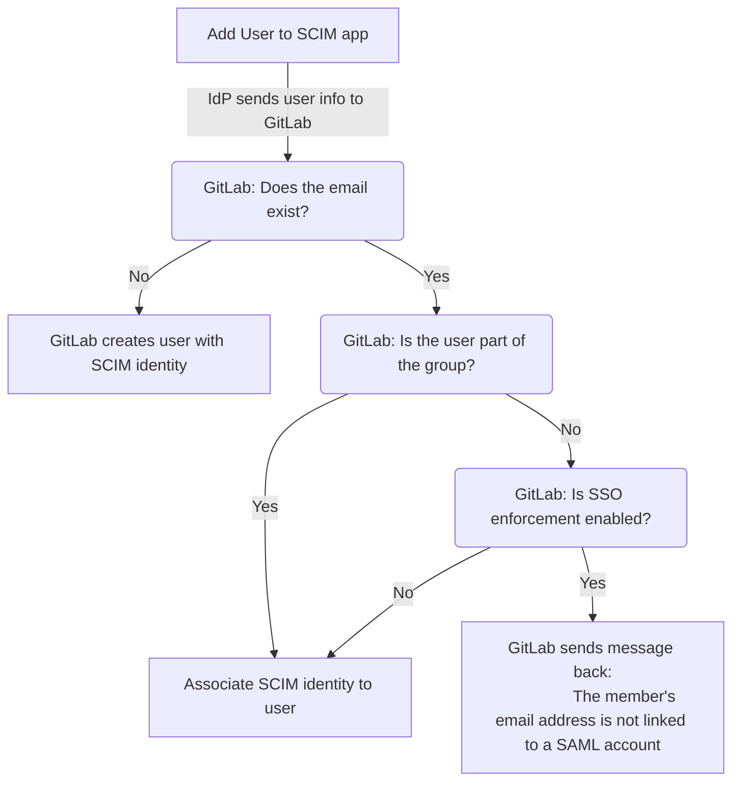
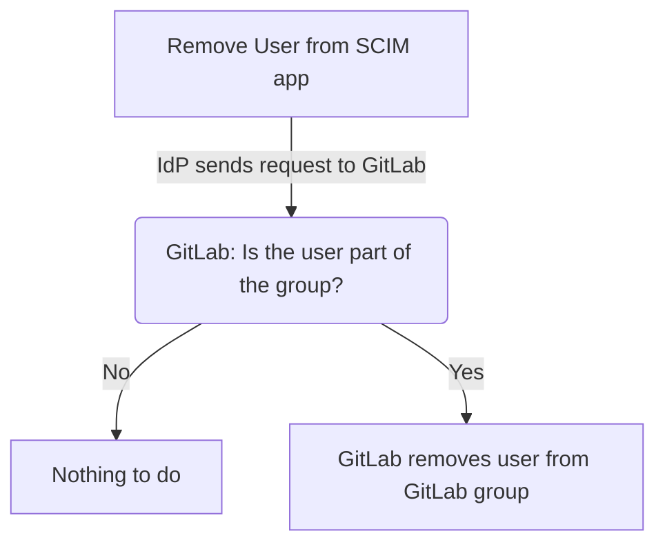



- Édition : GitLab Premium, GitLab Ultimate
- Offre : GitLab.com



Vous pouvez utiliser le standard ouvert System for Cross-domain Identity Management (SCIM) pour automatiquement :

- Créer des utilisateurs.
- Supprimer des utilisateurs (désactiver l'identité SCIM).
- Réajouter des utilisateurs (réactiver l'identité SCIM).

GitLab SAML SSO SCIM ne prend pas en charge la mise à jour des utilisateurs.

Lorsque SCIM est activé pour un groupe GitLab, l'appartenance à ce groupe est synchronisée entre GitLab et un fournisseur d'identité.

L'[API SCIM interne des groupes GitLab](../../../development/internal_api/_index.md#group-scim-api) implémente une partie du [protocole RFC7644](https://www.rfc-editor.org/info/rfc7644/). Les fournisseurs d'identité peuvent utiliser l'[API SCIM interne des groupes GitLab](../../../development/internal_api/_index.md#group-scim-api) pour développer une application SCIM.

Pour configurer SCIM sur GitLab Self-Managed, consultez [Configurer SCIM pour GitLab Self-Managed](../../../administration/settings/scim_setup.md).

## Configurer GitLab {#configure-gitlab}

Prérequis :

- [L'authentification unique de groupe](_index.md) doit être configurée.

Pour configurer GitLab SAML SSO SCIM :

1. Dans la barre supérieure, sélectionnez **Rechercher ou accéder à**, puis recherchez votre groupe.
1. Dans la barre latérale gauche, sélectionnez **Paramètres** > **Authentification unique SAML**.
1. Sélectionnez **Générer un jeton SCIM**.
1. Pour la configuration de votre fournisseur d'identité, enregistrez les éléments suivants :
   - Le jeton du champ **Votre jeton SCIM**.
   - L'URL du champ **URL du point de terminaison de l'API SCIM**.

## Configurer un fournisseur d'identité {#configure-an-identity-provider}

GitLab prend en charge SCIM avec plusieurs fournisseurs d'identité. D'autres fournisseurs d'identité peuvent fonctionner avec GitLab, mais ils n'ont pas été testés et ne sont pas pris en charge. Pour obtenir de l'aide avec un fournisseur non pris en charge, contactez directement le fournisseur. Le support GitLab peut aider à examiner les entrées de journal associées.

### Configurer Okta {#configure-okta}

L'application SAML créée lors de la configuration de [l'authentification unique](_index.md) pour Okta doit être configurée pour SCIM.

Prérequis :

- Vous devez utiliser le produit [Lifecycle Management](https://www.okta.com/products/lifecycle-management/) d'Okta. Cette édition du produit est requise pour utiliser SCIM sur Okta.
- [GitLab est configuré](#configure-gitlab).
- L'application SAML pour [Okta](https://developer.okta.com/docs/guides/build-sso-integration/saml2/main/) est configurée comme décrit dans les [notes de configuration d'Okta](_index.md#okta).
- Votre configuration SAML Okta correspond [exactement aux étapes de configuration](_index.md), notamment la configuration du NameID.

Pour configurer Okta pour SCIM :

1. Connectez-vous à Okta.
1. Dans le coin supérieur droit, sélectionnez **Admin**. Le bouton n'est pas visible depuis la zone **Admin**.
1. Dans l'onglet **Application**, sélectionnez **Browse App Catalog**.
1. Recherchez **GitLab**, trouvez et sélectionnez l'application **GitLab**.
1. Sur la page de présentation de l'application GitLab, sélectionnez **Ajouter**.
1. Sous **Application Visibility**, cochez les deux cases. Actuellement, l'application GitLab ne prend pas en charge l'authentification SAML, de sorte que l'icône ne doit pas être affichée aux utilisateurs.
1. Sélectionnez **Terminé** pour terminer l'ajout de l'application.
1. Dans l'onglet **Provisioning**, sélectionnez **Configure API integration**.
1. Sélectionnez **Enable API integration**.
   - Pour **Base URL**, collez l'URL copiée depuis **URL du point de terminaison de l'API SCIM** sur la page de configuration SCIM de GitLab.
   - Pour **API Token**, collez le jeton SCIM copié depuis **Votre jeton SCIM** sur la page de configuration SCIM de GitLab.
1. Pour vérifier la configuration, sélectionnez **Test API Credentials**.
1. Sélectionnez **Enregistrer**.
1. Après l'enregistrement des informations d'intégration de l'API, de nouveaux onglets de paramètres apparaissent à gauche. Sélectionnez **To App**.
1. Sélectionner **Éditer**.
1. Cochez la case **Activer** pour **Create Users** et **Deactivate Users**.
1. Sélectionnez **Enregistrer**.
1. Affectez des utilisateurs dans l'onglet **Affectations**. Les utilisateurs affectés sont créés et gérés dans votre groupe GitLab.

### Configurer Microsoft Entra ID {#configure-microsoft-entra-id}

Prérequis :

- [GitLab est configuré](#configure-gitlab).
- [L'authentification unique de groupe](_index.md) est configurée.

L'application SAML créée lors de la configuration de [l'authentification unique](_index.md) pour [Azure Active Directory](https://learn.microsoft.com/en-us/entra/identity/enterprise-apps/view-applications-portal) doit être configurée pour SCIM. Pour un exemple, consultez [exemple de configuration](example_saml_config.md#scim-mapping).

> [!note]
> Vous devez configurer le provisionnement SCIM exactement comme indiqué dans les instructions suivantes. En cas de mauvaise configuration, vous rencontrerez des problèmes avec le provisionnement des utilisateurs et la connexion, qui nécessiteront beaucoup d'efforts pour être résolus. Si vous rencontrez des difficultés ou avez des questions sur une étape, contactez le support GitLab.

Pour configurer Microsoft Entra ID pour SCIM :

1. Dans votre application, accédez à l'onglet **Provisioning** et sélectionnez **Démarrer**.
1. Définissez le **Provisioning Mode** sur **Automatic**.
1. Renseignez les **Admin Credentials** en utilisant la valeur de :
   - **URL du point de terminaison de l'API SCIM** dans GitLab pour le champ **Tenant URL**.
   - **Votre jeton SCIM** dans GitLab pour le champ **Secret Token**.
1. Sélectionnez **Test Connection**. Si le test réussit, enregistrez votre configuration avant de continuer, ou consultez les informations de [dépannage](troubleshooting.md).
1. Sélectionnez **Enregistrer**.

Après l'enregistrement, les sections **Mappings** et **Paramètres** apparaissent.

#### Configurer les mappages {#configure-mappings}

Dans la section **Mappings**, provisionnez d'abord les groupes :

1. Sélectionnez **Provision Microsoft Entra ID Groups**.
1. Sur la page Attribute Mapping, désactivez le bouton bascule **Activé**. Le provisionnement de groupes SCIM n'est pas pris en charge dans GitLab. Laisser le provisionnement de groupes activé ne perturbe pas le provisionnement des utilisateurs SCIM, mais cela génère des erreurs dans le journal de provisionnement SCIM d'Entra ID qui peuvent être sources de confusion et d'incompréhension.

   > [!note]
   > Même lorsque **Provision Microsoft Entra ID Groups** est désactivé, la section des mappages peut afficher « Enabled : Yes ». Ce comportement est un bug d'affichage que vous pouvez ignorer en toute sécurité.

1. Sélectionnez **Enregistrer**.

Ensuite, provisionnez les utilisateurs :

1. Sélectionnez **Provision Microsoft Entra ID Users**.
1. Vérifiez que le bouton bascule **Activé** est défini sur **Oui**.
1. Vérifiez que toutes les **Target Object Actions** sont activées.
1. Sous **Attribute Mappings**, configurez les mappages pour correspondre aux [mappages d'attributs configurés](#configure-attribute-mappings) :
   1. Facultatif. Dans la colonne **customappsso Attribute**, trouvez `externalId` et supprimez-le.
   1. Modifiez le premier attribut pour avoir :
      - **l'attribut source** `objectId`
      - **l'attribut cible** `externalId`
      - **la priorité de correspondance** `1`
   1. Mettez à jour les attributs **customappsso** existants pour correspondre aux [mappages d'attributs configurés](#configure-attribute-mappings).
   1. Supprimez tout attribut supplémentaire absent du tableau suivant. Leur absence de suppression ne pose pas de problème, mais GitLab ne consomme pas ces attributs.
1. Sous la liste des mappages, cochez la case **Show advanced options**.
1. Sélectionnez le lien **Edit attribute list for customappsso**.
1. Vérifiez que `id` est le champ principal et obligatoire, et que `externalId` est également obligatoire.
1. Sélectionnez **Sauvegarder**, ce qui vous ramène à la page de configuration Attribute Mapping.
1. Pour fermer la page de configuration **Attribute Mapping**, sélectionnez `X` dans le coin supérieur droit.

#### Configurer les paramètres {#configure-settings}

Dans la section **Paramètres** :

1. Facultatif. Si vous le souhaitez, cochez la case **Send an email notification when a failure occurs**.
1. Facultatif. Si vous le souhaitez, cochez la case **Prevent accidental deletion**.
1. Si nécessaire, sélectionnez **Sauvegarder** pour vous assurer que toutes les modifications ont été sauvegardées.

Une fois les mappages et les paramètres configurés, retournez à la page de présentation de l'application et sélectionnez **Start provisioning** pour démarrer le provisionnement SCIM automatique des utilisateurs dans GitLab.

> [!warning]
> Une fois synchronisé, la modification du champ mappé sur `id` et `externalId` peut provoquer des erreurs. Cela inclut des erreurs de provisionnement, des utilisateurs en double, et peut empêcher les utilisateurs existants d'accéder au groupe GitLab.

#### Configurer les mappages d'attributs {#configure-attribute-mappings}

> [!note]
> Pendant que Microsoft effectue la transition des schémas de nommage d'Azure Active Directory vers Entra ID, vous pourriez remarquer des incohérences dans votre interface utilisateur. Si vous rencontrez des difficultés, vous pouvez consulter une version plus ancienne de ce document ou contacter le support GitLab.

Lors de la [configuration d'Entra ID pour SCIM](#configure-microsoft-entra-id), vous configurez les mappages d'attributs. Pour un exemple, consultez [exemple de configuration](example_saml_config.md#scim-mapping).

Le tableau suivant fournit les mappages d'attributs requis pour GitLab.

| Attribut source                                                           | Attribut cible               | Priorité de correspondance |
|:---------------------------------------------------------------------------|:-------------------------------|:--------------------|
| `objectId`                                                                 | `externalId`                   | 1                   |
| `userPrincipalName` OU `mail`[^mail-source-attribute]                                 | `emails[type eq "work"].value` |                     |
| `mailNickname`                                                             | `userName`                     |                     |
| `displayName` OU `Join(" ", [givenName], [surname])`[^join-expression]          | `name.formatted`               |                     |
| `Switch([IsSoftDeleted], , "False", "True", "True", "False")`[^expression-mapping] | `active`                       |                     |

[^mail-source-attribute] : utilisez `mail` comme attribut source lorsque `userPrincipalName` n'est pas une adresse e-mail ou n'est pas distribuable. [^join-expression] : utilisez l'expression `Join` si votre `displayName` ne correspond pas au format `Firstname Lastname`. [^expression-mapping] : il s'agit d'un type de mappage par expression, et non d'un mappage direct. Sélectionnez `Expression` dans la liste déroulante **Mapping type**.

Chaque mappage d'attributs comprend :

- Un **customappsso Attribute**, qui correspond à l'**attribut cible**.
- Un **Microsoft Entra ID Attribute**, qui correspond à l'**attribut source**.
- Une priorité de correspondance.

Pour chaque attribut :

1. Modifiez l'attribut existant ou ajoutez un nouvel attribut.
1. Sélectionnez les mappages d'attributs source et cible requis dans les listes déroulantes.
1. Sélectionnez **Ok**.
1. Sélectionnez **Enregistrer**.

Si votre configuration SAML diffère des [paramètres SAML recommandés](_index.md#azure), sélectionnez les attributs de mappage et modifiez-les en conséquence. L'attribut source que vous mappez sur l'attribut cible `externalId` doit correspondre à l'attribut utilisé pour le SAML `NameID`.

Si un mappage n'est pas répertorié dans le tableau, utilisez les valeurs par défaut de Microsoft Entra ID. Pour obtenir la liste des attributs requis, consultez la documentation de l'[API SCIM interne des groupes](../../../development/internal_api/_index.md#group-scim-api).

## Accès utilisateur {#user-access}

Au cours du processus de synchronisation, tous les nouveaux utilisateurs :

- Reçoivent des comptes GitLab.
- Sont accueillis dans leurs groupes avec un e-mail d'invitation. Vous pouvez [contourner la confirmation par e-mail avec un domaine vérifié](_index.md#bypass-user-email-confirmation-with-verified-domains).

### Comportement de provisionnement avec accès restreint {#provisioning-behavior-with-restricted-access}



- [Introduction](https://gitlab.com/gitlab-org/gitlab/-/merge_requests/206932) dans GitLab 18.6 [avec le feature flag](../../../administration/feature_flags/_index.md) `bso_minimal_access_fallback`. Fonctionnalité désactivée par défaut.
- [Activé par défaut](https://gitlab.com/gitlab-org/gitlab/-/merge_requests/225777) dans GitLab 18.10.



Lorsque l'[accès restreint](../../../subscriptions/manage_seats.md#restricted-access) est activé et qu'aucun siège d'abonnement n'est disponible, les utilisateurs provisionnés via SCIM se voient attribuer le rôle d'accès minimum.

Dans ce cas, les utilisateurs sont créés avec succès avec l'accès minimum (réponse `HTTP 201 Created`), et l'attribut `roles` de l'utilisateur reflète cette attribution. Les opérations de mise à jour de rôle ultérieures peuvent échouer si aucun siège n'est disponible.

Pour plus d'informations, consultez [Comportement de provisionnement avec SAML, SCIM et LDAP](../../../subscriptions/manage_seats.md#provisioning-behavior-with-saml-scim-and-ldap).

Le diagramme suivant décrit ce qui se passe lorsque vous ajoutez des utilisateurs à votre application SCIM :

Lors du provisionnement :

- Les e-mails primaires et secondaires sont tous deux pris en compte lors de la vérification de l'existence d'un compte utilisateur GitLab.
- Les noms d'utilisateur en double sont gérés en ajoutant le suffixe `1` lors de la création de l'utilisateur. Par exemple, si `test_user` existe déjà, `test_user1` est utilisé. Si `test_user1` existe déjà, GitLab incrémente le suffixe pour trouver un nom d'utilisateur disponible. Si aucun nom d'utilisateur disponible n'est trouvé après 4 tentatives, une chaîne aléatoire est ajoutée au nom d'utilisateur.

Lors des visites suivantes, les nouveaux utilisateurs et les utilisateurs existants peuvent accéder aux groupes :

- Via le tableau de bord du fournisseur d'identité.
- En visitant directement les liens.

Pour des informations sur les rôles, consultez la page [SAML de groupe](_index.md#user-access-and-management).

### Mots de passe pour les utilisateurs créés via SCIM pour les groupes GitLab {#passwords-for-users-created-through-scim-for-gitlab-groups}

GitLab requiert des mots de passe pour tous les comptes utilisateurs. Pour les utilisateurs créés via le provisionnement SCIM, GitLab génère automatiquement un mot de passe aléatoire, et les utilisateurs n'ont pas besoin d'en définir un lors de leur première connexion. Pour plus d'informations sur la façon dont GitLab génère des mots de passe pour les utilisateurs créés via SCIM pour les groupes GitLab, consultez [les mots de passe générés pour les utilisateurs créés via l'authentification intégrée](../../profile/user_passwords.md).

### Lier les identités SCIM et SAML {#link-scim-and-saml-identities}

Si le [SAML de groupe](_index.md) est configuré et que vous disposez d'un compte GitLab.com existant, les utilisateurs peuvent lier leurs identités SCIM et SAML. Les utilisateurs doivent effectuer cette opération avant l'activation de la synchronisation, car des erreurs de provisionnement peuvent survenir pour les utilisateurs existants lorsque la synchronisation est active.

Pour lier vos identités SCIM et SAML :

1. Mettez à jour l'adresse [e-mail principale](../../profile/_index.md#change-your-primary-email) de votre compte utilisateur GitLab.com pour qu'elle corresponde à l'adresse e-mail du profil utilisateur dans votre fournisseur d'identité.
1. [Liez votre identité SAML](_index.md#link-saml-to-your-existing-gitlabcom-account).

### Supprimer l'accès {#remove-access}

Supprimez ou désactivez un utilisateur dans le fournisseur d'identité pour lui retirer l'accès à :

- Le groupe principal.
- Tous les sous-groupes et projets.

Une fois que le fournisseur d'identité effectue une synchronisation selon son calendrier configuré, l'appartenance de l'utilisateur est révoquée et il perd l'accès. Le compte GitLab de l'utilisateur n'est pas supprimé ; il continue d'exister sur GitLab.com.

Le déprovisionnement d'un utilisateur via SCIM ne supprime pas l'identité SAML liée.

Si vous avez configuré des [utilisateurs Enterprise](../../enterprise_user/_index.md), vous pouvez [supprimer l'utilisateur](../../enterprise_user/_index.md#delete-an-enterprise-user).

Lorsque vous activez SCIM, cela ne supprime pas automatiquement les utilisateurs existants qui n'ont pas d'identité SAML.

### Réactiver l'accès {#reactivate-access}

Après qu'un utilisateur a été supprimé ou désactivé via SCIM, vous pouvez le réactiver en l'ajoutant au fournisseur d'identité SCIM.

Une fois que le fournisseur d'identité effectue une synchronisation selon son calendrier configuré, l'identité SCIM de l'utilisateur est réactivée et ses appartenances aux groupes sont restaurées. Étant donné que l'identité SAML liée est conservée pendant le déprovisionnement, les utilisateurs peuvent immédiatement se connecter via SSO.

GitLab traite le déprovisionnement SCIM de manière asynchrone. Si vous réactivez un utilisateur avant la fin du processus, la demande de réactivation échoue. Pour plus d'informations, consultez [Erreur : `User is pending deprovisioning`](troubleshooting_scim.md#error-user-is-pending-deprovisioning).
