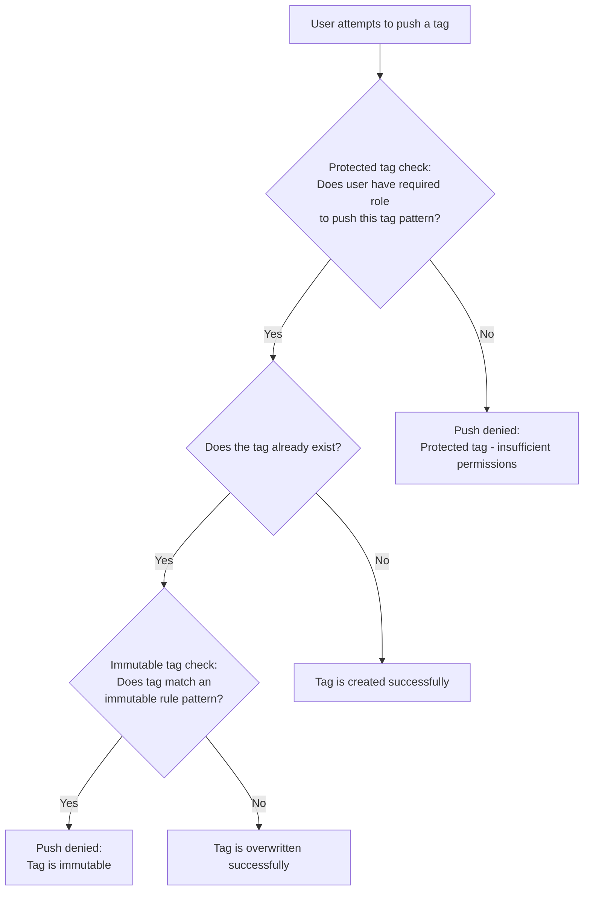



- Édition : GitLab Ultimate
- Offre : GitLab.com, GitLab Self-Managed





- [Introduite](https://gitlab.com/gitlab-org/gitlab/-/issues/523276) en tant que [version expérimentale](../../../policy/development_stages_support.md) dans GitLab 18.1 [avec un feature flag](../../../administration/feature_flags/_index.md) nommé `container_registry_immutable_tags`. Fonctionnalité désactivée par défaut.
- [Activée sur GitLab.com](https://gitlab.com/gitlab-org/gitlab/-/issues/523276) dans GitLab 18.2. Passée de version expérimentale à version bêta. Le feature flag `container_registry_immutable_tags` a été supprimé.
- [Disponibilité générale](https://gitlab.com/gitlab-org/gitlab/-/issues/588640) dans GitLab 18.10.



Utilisez des étiquettes immuables pour empêcher la mise à jour ou la suppression des étiquettes de conteneurs dans votre projet.

Par défaut, les utilisateurs disposant du rôle Développeur, Mainteneur ou Propriétaire peuvent pousser et supprimer des étiquettes d'images dans tous les dépôts de conteneurs du projet. Grâce aux règles d'immuabilité des étiquettes, vous pouvez :

- Empêcher la modification des étiquettes d'images critiques et atténuer le risque de modifications malveillantes ou accidentelles.
- Créer jusqu'à 5 règles de protection par projet.
- Appliquer des règles de protection à tous les dépôts de conteneurs de votre projet.

Une étiquette est immuable lorsqu'au moins une règle de protection d'immuabilité correspond au nom de l'étiquette. Si plusieurs règles correspondent, la règle la plus restrictive s'applique.

Les règles d'étiquettes immuables :

- Ne peuvent être que créées, et non mises à jour
- Ne peuvent pas être supprimées par les [politiques de nettoyage](reduce_container_registry_storage.md#cleanup-policy).

## Comparaison avec les étiquettes protégées {#comparison-with-protected-tags}

Bien que les [étiquettes protégées](protected_container_tags.md) et les étiquettes immuables préservent toutes deux l'intégrité des images, elles servent des objectifs différents.

Les étiquettes protégées limitent les personnes autorisées à créer, mettre à jour ou supprimer certaines étiquettes en fonction de leurs rôles. L'immuabilité des étiquettes garantit qu'une fois une étiquette créée, personne ne peut la mettre à jour ni la supprimer.

Le diagramme ci-dessous montre comment les règles de protection sont évaluées dans le contexte d'un push d'image :

### Exemples de scénarios {#example-scenarios}

Pour un projet avec ces règles :

- Règle d'étiquette protégée : le modèle `v.*` exige le rôle Mainteneur ou Propriétaire.
- Règle d'étiquette immuable : le modèle `v\d+\.\d+\.\d+` protège les étiquettes de version sémantique.

| Rôle utilisateur | Action | Vérification des étiquettes protégées | Vérification des étiquettes immuables | Résultat |
|-----------|--------|-------------------|-------------------|---------|
| Développeur | Pousser une nouvelle étiquette `v1.0.0` | Refusé | Non évaluée | Push refusé. L'utilisateur ne dispose pas du rôle requis. |
| Chargé de maintenance | Pousser une nouvelle étiquette `v1.0.0` | Autorisé | Non évaluée | Étiquette créée. |
| Chargé de maintenance | Écraser l'étiquette existante `v1.0.0` | Autorisé | Refusé | Push refusé. L'étiquette est immuable. |
| Chargé de maintenance | Pousser une nouvelle étiquette `v-beta` | Autorisé | Non évaluée | Étiquette créée. |

## Prérequis {#prerequisites}

Pour utiliser des étiquettes de conteneurs immuables, assurez-vous que le registre de conteneurs est disponible :

- Dans GitLab.com, le registre de conteneurs est activé par défaut.
- Dans GitLab Self-Managed, [activez la base de données de métadonnées](../../../administration/packages/container_registry_metadata_database.md).

## Créer une règle immuable {#create-an-immutable-rule}

Prérequis :

- Vous devez avoir le rôle Propriétaire.

Pour créer une règle immuable :

1. Dans la barre supérieure, sélectionnez **Rechercher ou accéder à**, puis recherchez votre projet.
1. Dans la barre latérale gauche, sélectionnez **Paramètres** > **Paquets et registres**.
1. Développez **Registre de conteneurs**.
1. Sous **Étiquettes de conteneurs protégées**, sélectionnez **Ajouter une règle de protection**.
1. Dans **Type de protection**, sélectionnez **Immuable**.
1. Dans **Appliquer la règle d'immuabilité à la mise en correspondance des étiquettes**, saisissez un modèle regex en utilisant la [syntaxe RE2](https://github.com/google/re2/wiki/Syntax). Les modèles ne doivent pas dépasser 100 caractères. Pour plus d'informations, consultez les [exemples de modèles regex](#regex-pattern-examples).
1. Sélectionnez **Ajouter une règle**.

La règle immuable est créée et les étiquettes correspondantes sont protégées.

## Exemples de modèles regex {#regex-pattern-examples}

Exemples de modèles que vous pouvez utiliser pour protéger les étiquettes de conteneurs :

| Modèle           | Description |
|-------------------|-------------|
| `.*`              | Protège toutes les étiquettes. |
| `^v.*`            | Protège les étiquettes commençant par « v » (comme `v1.0.0` ou `v2.1.0-rc1`). |
| `\d+\.\d+\.\d+`   | Protège les étiquettes de version sémantique (comme `1.0.0` ou `2.1.0`). |
| `^latest$`        | Protège l'étiquette `latest`. |
| `.*-stable$`      | Protège les étiquettes se terminant par « -stable » (comme `1.0-stable` ou `main-stable`). |
| `stable\|release` | Protège les étiquettes contenant « stable » ou « release » (comme `1.0-stable`). |

## Supprimer une règle immuable {#delete-an-immutable-rule}

Prérequis :

- Vous devez avoir le rôle Propriétaire.

Pour supprimer une règle immuable :

1. Dans la barre supérieure, sélectionnez **Rechercher ou accéder à**, puis recherchez votre projet.
1. Dans la barre latérale gauche, sélectionnez **Paramètres** > **Paquets et registres**.
1. Développez **Registre de conteneurs**.
1. Sous **Étiquettes de conteneurs protégées**, à côté de la règle immuable que vous souhaitez supprimer, sélectionnez **Supprimer** ().
1. Lorsque vous êtes invité à confirmer, sélectionnez **Supprimer**.

La règle immuable est supprimée et les étiquettes correspondantes ne sont plus protégées.

## Délai de propagation {#propagation-delay}

Les modifications de règles s'appuient sur des jetons JWT pour se propager entre les services. Par conséquent, les modifications apportées aux règles de protection et aux rôles d'accès des utilisateurs peuvent ne prendre effet qu'après l'expiration des jetons JWT actuels. Le délai est égal à la [durée de jeton configurée](../../../administration/packages/container_registry.md#increase-token-duration) :

- Par défaut : 5 minutes
- GitLab.com : [15 minutes](../../gitlab_com/_index.md#container-registry)

La plupart des clients de registre de conteneurs (notamment Docker, l'interface utilisateur GitLab et l'API) demandent un nouveau jeton pour chaque opération, mais les clients personnalisés peuvent conserver un jeton pendant toute sa période de validité.

## Suppressions de manifestes d'images {#image-manifest-deletions}

L'interface utilisateur et l'API de GitLab ne prennent pas en charge les suppressions directes de manifestes d'images. Via des appels directs à l'API du registre de conteneurs, les suppressions de manifestes affectent toutes les étiquettes associées.

Pour garantir la protection des étiquettes, les demandes de suppression directe de manifestes ne sont autorisées que lorsqu'il n'existe aucune règle d'étiquette immuable dans le projet correspondant.

Cette restriction s'applique indépendamment du fait que les modèles de règles correspondent ou non aux étiquettes d'images de conteneurs.
