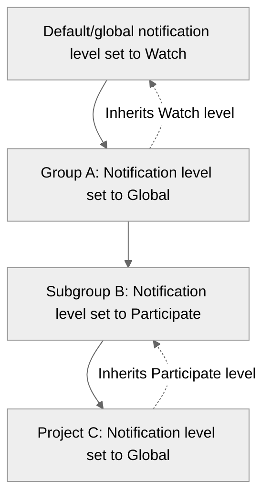



- Édition : Gratuite, GitLab Premium, GitLab Ultimate
- Offre : GitLab.com, GitLab Self-Managed, GitLab Dedicated





- Le style d'e-mail amélioré est [généralement disponible](https://gitlab.com/gitlab-org/gitlab/-/issues/355907) dans GitLab 18.3. Le feature flag `enhanced_notify_css` a été supprimé.



Restez informé de ce qui se passe dans GitLab grâce aux notifications par e-mail. Vous pouvez recevoir des mises à jour concernant l'activité dans les tickets, les merge requests, les epics et les designs.

Pour l'outil que les administrateurs GitLab peuvent utiliser pour envoyer des messages aux utilisateurs, consultez [E-mail depuis GitLab](../../administration/email_from_gitlab.md).

Dans GitLab 17.2 et versions ultérieures, les [notifications sont soumises à une limite de débit](../../rate_limits/non_configurable.md) par période de 24 heures par projet ou groupe et par utilisateur.

## Qui reçoit les notifications {#who-receives-notifications}

Lorsque les notifications sont activées pour un ticket, une merge request ou un epic, GitLab vous notifie des actions qui s'y produisent.

Vous pouvez recevoir des notifications pour l'une des raisons suivantes :

- Vous participez à un ticket, une merge request, un epic ou un design. Vous devenez participant lorsque vous commentez ou modifiez, ou lorsque quelqu'un mentionne votre nom d'utilisateur.
- Vous avez [activé les notifications dans un ticket, une merge request ou un epic](#issue-merge-request-and-epic-events).
- Vous avez configuré les notifications pour le [projet](#change-level-of-project-notifications) ou le [groupe](#group-notifications).
- Vous êtes abonné aux notifications de pipeline de groupe ou de projet via l'[intégration](../project/integrations/_index.md) des e-mails de pipeline.

GitLab n'envoie pas de notification dans les cas suivants :

- Le compte est un bot de projet.
- Le compte est un compte de service avec une adresse e-mail par défaut.
- Le compte est bloqué (banni) ou désactivé.
- Un administrateur a bloqué les notifications.

## Paramètres de notification globaux {#global-notification-settings}

Vos paramètres de notification globaux sont les paramètres par défaut, sauf si vous spécifiez des paramètres différents pour un projet ou un groupe. Par exemple, vous pouvez souhaiter être notifié de toute l'activité dans un projet spécifique. Pour d'autres projets, vous souhaitez uniquement être notifié lorsque vous êtes mentionné par nom.

Ces paramètres de notification s'appliquent uniquement à vous. Ils n'affectent pas les notifications reçues par les autres.

### Modifier les paramètres de notification {#edit-notification-settings}

Pour modifier vos paramètres de notification :

1. Dans le coin supérieur droit, sélectionnez votre avatar.
1. Sélectionnez **Préférences**.
1. Dans la barre latérale gauche, sélectionnez **Notifications**.
1. Dans **Courriel de notification globale**, saisissez l'adresse e-mail à laquelle vos notifications sont envoyées. Par défaut, il s'agit de votre adresse e-mail principale.
1. Pour **Niveau de notification global**, sélectionnez le [niveau de notification](#notification-levels) par défaut à appliquer à vos notifications.
1. Cochez la case **Recevoir des notifications sur votre propre activité** pour recevoir des notifications concernant votre propre activité. Non sélectionné par défaut.

### Niveaux de notification {#notification-levels}

À droite de chaque projet et groupe, vous pouvez sélectionner un niveau de notification :

| Niveau           | Description |
|-----------------|-------------|
| **Globales**      | Vos paramètres globaux par défaut s'appliquent. |
| **Surveiller**       | Recevez des notifications pour la plupart des activités. |
| **Participer** | Recevez des notifications pour les éléments auxquels vous [participez](#who-receives-notifications). |
| **En cas de citation**  | Recevez des notifications lorsque quelqu'un vous [mentionne](../discussions/_index.md#mentions) dans une description ou un commentaire. |
| **Désactivé**    | Ne recevez aucune notification. |
| **Personnalisé**      | Recevez des notifications pour les éléments auxquels vous [participez](#who-receives-notifications), ainsi que les [événements de ticket, de merge request et d'epic](#issue-merge-request-and-epic-events) ou les [événements de pipeline](#cicd-pipeline-events) que vous sélectionnez. Certains événements ne sont envoyés que si vous les sélectionnez, même si vous participez. |

### Portée des notifications {#notification-scope}

Vous pouvez ajuster la portée de vos notifications en sélectionnant différents niveaux de notification pour chaque projet et groupe.

La portée des notifications est appliquée du niveau le plus large au niveau le plus spécifique :

- Votre niveau de notification global, ou _par défaut_, s'applique si vous n'avez pas sélectionné de niveau de notification pour le projet ou le groupe dans lequel l'activité s'est produite.
- Votre paramètre de groupe remplace votre paramètre par défaut.
- Votre paramètre de projet remplace le paramètre de groupe.

Lorsque vous définissez le niveau de notification sur **Globales** pour un projet ou un sous-groupe, il n'hérite pas directement de vos paramètres de notification globaux. À la place, il remonte la hiérarchie et hérite du prochain niveau de notification non global configuré, dans l'ordre suivant :

1. Le paramètre du projet.
1. Le paramètre du groupe parent.
1. Les paramètres des groupes ancêtres (en remontant la hiérarchie).
1. Le paramètre de notification global comme paramètre de secours final.

Par exemple, vous définissez votre paramètre de notification global par défaut sur **Surveiller**, et vos niveaux de notification de groupe et de projet comme suit :



Le projet C hérite du niveau de notification **Participer** du sous-groupe B. Il n'hérite pas du niveau de notification **Surveiller** de vos paramètres de notification globaux.

### Notifications de groupe {#group-notifications}

Vous pouvez sélectionner un niveau de notification et une adresse e-mail pour chaque groupe.

#### Modifier le niveau des notifications de groupe {#change-level-of-group-notifications}

Pour sélectionner un niveau de notification pour un groupe, utilisez l'une des méthodes suivantes :

1. Dans le coin supérieur droit, sélectionnez votre avatar.
1. Sélectionnez **Préférences**.
1. Dans la barre latérale gauche, sélectionnez **Notifications**.
1. Localisez le groupe dans la section **Groupes**.
1. Sélectionnez le [niveau de notification](#notification-levels) souhaité.

Ou :

1. Dans la barre supérieure, sélectionnez **Rechercher ou accéder à**, puis recherchez votre groupe.
1. Sélectionnez la liste déroulante de notification, à côté de l'icône de cloche ().
1. Sélectionnez le [niveau de notification](#notification-levels) souhaité.

#### Modifier l'adresse e-mail utilisée pour les notifications de groupe {#change-email-address-used-for-group-notifications}

Vous pouvez sélectionner une adresse e-mail pour recevoir les notifications de chaque groupe auquel vous appartenez. Vous pouvez utiliser les notifications de groupe, par exemple, si vous travaillez en freelance et souhaitez séparer les e-mails concernant les projets de vos clients.

1. Dans le coin supérieur droit, sélectionnez votre avatar.
1. Sélectionnez **Préférences**.
1. Dans la barre latérale gauche, sélectionnez **Notifications**.
1. Localisez le groupe dans la section **Groupes**.
1. Sélectionnez l'adresse e-mail souhaitée.

### Modifier le niveau des notifications de projet {#change-level-of-project-notifications}

Pour vous aider à rester à jour, vous pouvez sélectionner un niveau de notification pour chaque projet.

Pour sélectionner un niveau de notification pour un projet, utilisez l'une des méthodes suivantes :

1. Dans le coin supérieur droit, sélectionnez votre avatar.
1. Sélectionnez **Préférences**.
1. Dans la barre latérale gauche, sélectionnez **Notifications**.
1. Localisez le projet dans la section **Projets**.
1. Sélectionnez le [niveau de notification](#notification-levels) souhaité.

Ou :

1. Dans la barre supérieure, sélectionnez **Rechercher ou accéder à**, puis recherchez votre projet.
1. Sélectionnez la liste déroulante de notification, à côté de l'icône de cloche ().
1. Sélectionnez le [niveau de notification](#notification-levels) souhaité.

<i class="fa-youtube-play" aria-hidden="true"></i> Pour apprendre à être notifié lorsqu'une nouvelle release est disponible, regardez [Notification pour les releases](https://www.youtube.com/watch?v=qyeNkGgqmH4).

## Événements de notification {#notification-events}

Des notifications sont envoyées pour les événements utilisateur, projet ou groupe, ainsi que pour l'activité sur les éléments de travail.

### Événements utilisateur {#user-events}



- La notification pour la rotation de jeton d'accès personnel a été [introduite](https://gitlab.com/gitlab-org/gitlab/-/merge_requests/199360) dans GitLab 18.3.



Événements de notification utilisateur :

| Événement                                    | Envoyé à | Détails |
|------------------------------------------|---------|---------|
| E-mail modifié                            | Utilisateur    | E-mail de sécurité, toujours envoyé. |
| Niveau d'accès au groupe modifié               | Utilisateur    |         |
| Nouvelle adresse e-mail ajoutée                  | Utilisateur    | E-mail de sécurité, envoyé à la nouvelle adresse e-mail ajoutée. |
| Nouvelle adresse e-mail ajoutée                  | Utilisateur    | E-mail de sécurité, envoyé à l'adresse e-mail principale. |
| Nouvelle clé SSH ajoutée                        | Utilisateur    | E-mail de sécurité, toujours envoyé. |
| Nouvel utilisateur créé                         | Utilisateur    | Envoyé lors de la création de l'utilisateur, sauf pour OmniAuth (LDAP). |
| Mot de passe modifié                         | Utilisateur    | E-mail de sécurité, toujours envoyé lorsque l'utilisateur modifie son propre mot de passe. |
| Mot de passe modifié par un administrateur        | Utilisateur    | E-mail de sécurité, toujours envoyé lorsqu'un administrateur modifie le mot de passe d'un autre utilisateur. |
| Le jeton d'accès personnel a été révoqué   | Utilisateur    | E-mail de sécurité, toujours envoyé. |
| Le jeton d'accès personnel a été renouvelé   | Utilisateur    | E-mail de sécurité, toujours envoyé. |
| Les jetons d'accès personnels expirent bientôt     | Utilisateur    | E-mail de sécurité, toujours envoyé. |
| Des jetons d'accès personnels ont été créés | Utilisateur    | E-mail de sécurité, toujours envoyé. |
| Les jetons d'accès personnels ont expiré      | Utilisateur    | E-mail de sécurité, toujours envoyé. |
| La clé SSH a expiré                      | Utilisateur    | E-mail de sécurité, toujours envoyé. |
| Authentification à deux facteurs désactivée     | Utilisateur    | E-mail de sécurité, toujours envoyé. |

### Événements de projet {#project-events}



- La notification pour l'expiration prochaine des jetons de déploiement de projet a été [introduite](https://gitlab.com/gitlab-org/gitlab/-/issues/512197) dans GitLab 18.3.
- La notification pour la planification de suppression d'un projet a été [introduite](https://gitlab.com/gitlab-org/gitlab/-/issues/522883) dans GitLab 17.11.



Événements de notification de projet :

| Événement                               | Envoyé à                               | Détails |
|-------------------------------------|---------------------------------------|---------|
| Nouvelle release                         | Membres du projet                       | Envoyé uniquement lorsque le niveau de notification personnalisé **La release est créée** est sélectionné. |
| Accès au projet expiré              | Membres du projet                       | Envoyé lorsque l'accès d'un utilisateur à un projet expire dans sept jours. |
| Niveau d'accès au projet modifié        | Membres du projet                       | Envoyé lorsque le niveau d'accès au projet d'un utilisateur est modifié. |
| Jetons d'accès au projet expirant bientôt | Propriétaires et Mainteneurs directs du projet | E-mail de sécurité, toujours envoyé. |
| Jetons de déploiement de projet expirant bientôt | Propriétaires et Mainteneurs du projet        | E-mail de sécurité, toujours envoyé. |
| Projet déplacé                       | Membres du projet                       | Envoyé pour tous les niveaux de notification sauf **Désactivé**, ou lorsque le niveau de notification personnalisé **Le projet est déplacé** est sélectionné. |
| Projet planifié pour suppression      | Propriétaires du projet                        | Envoyé lorsque la suppression d'un projet est planifiée. |
| Utilisateur ajouté au projet               | Utilisateur                                  | Envoyé lorsqu'un utilisateur est ajouté au projet. |

### Événements de groupe {#group-events}



- La notification pour la planification de suppression d'un groupe a été [introduite](https://gitlab.com/gitlab-org/gitlab/-/issues/522883) dans GitLab 17.11.



Événements de notification de groupe :

| Événement                             | Envoyé à             | Détails |
|-----------------------------------|---------------------|---------|
| Accès au groupe expiré              | Membres du groupe       | Envoyé lorsque l'accès d'un utilisateur à un groupe expire dans sept jours. |
| Jetons d'accès au groupe expirant bientôt | Propriétaires directs du groupe | E-mail de sécurité, toujours envoyé. |
| Groupe planifié pour suppression      | Propriétaires du groupe        | Envoyé lorsque la suppression d'un groupe est planifiée. |
| Utilisateur ajouté au groupe               | Utilisateur                | Envoyé lorsqu'un utilisateur est ajouté au groupe. |
| Nouvel utilisateur SAML/SCIM provisionné    | Utilisateur                | Envoyé lorsqu'un utilisateur est provisionné via SAML/SCIM. |

### Événements de ticket, de merge request et d'epic {#issue-merge-request-and-epic-events}



- Les notifications pour les merge requests que vous êtes éligible à approuver ont été [renommées](https://gitlab.com/gitlab-org/gitlab/-/issues/465347) dans GitLab 17.11.
- Les notifications de pipeline pour les comptes de service ont été [introduites](https://gitlab.com/gitlab-org/gitlab/-/merge_requests/178740) dans GitLab 18.1.



Les événements génèrent des notifications en fonction du [niveau de notification](#notification-levels) sélectionné. Certaines notifications peuvent être activées de manière optionnelle en sélectionnant le niveau de notification **Personnalisé** et en sélectionnant les événements souhaités. Vous pouvez également [vous abonner manuellement aux notifications](#subscribe-to-notifications-for-a-specific-issue-merge-request-or-epic) pour un epic, un ticket ou une merge request.

Par défaut, vous ne recevez pas de notifications pour les tickets, les merge requests ou les epics que vous créez. Vous pouvez activer les [notifications concernant votre propre activité](#global-notification-settings).

Les notifications d'événements d'epic sont envoyées pour les niveaux de notification suivants :

| Événement       | Surveiller | Participer | En cas de citation | Abonné | Personnalisé   | Détails supplémentaires |
|-------------|-------|-------------|------------|------------|----------|--------------------|
| Fermé      | Oui   | Oui         |            | Oui        | Oui      |                    |
| Nouvel epic    | Oui   | Oui         | Oui        |            | Oui      | Envoyé lorsque quelqu'un est mentionné par son nom d'utilisateur dans la description. |
| Nouveau commentaire | Oui   | Oui         | Oui        | Oui        | Si **Le commentaire est ajouté** est sélectionné | Également envoyé lorsque quelqu'un est mentionné par son nom d'utilisateur dans le commentaire. |
| Rouvert    | Oui   | Oui         |            | Oui        | Oui      |                    |

Les notifications d'événements de ticket sont envoyées pour les niveaux de notification suivants :

| Événement                        | Surveiller | Participer | En cas de citation | Abonné | Personnalisé   | Détails supplémentaires |
|------------------------------|-------|-------------|------------|------------|----------|--------------------|
| Fermé                       | Oui   | Oui         |            | Oui        | Si **Le ticket est fermé** est sélectionné |                    |
| Dû demain                 |       | Oui         |            |            | Si **Le ticket doit être clos demain** est sélectionné | La notification est envoyée à 00:50 dans le fuseau horaire du serveur (UTC pour GitLab.com) pour les tickets ouverts dont la date d'échéance est le lendemain. |
| Jalon modifié            | Oui   | Oui         |            | Oui        | Oui      |                    |
| Jalon supprimé            | Oui   | Oui         |            | Oui        | Oui      |                    |
| Nouveau ticket                    | Oui   | Oui         | Oui        |            | Si **Le ticket est créé** est sélectionné | Également envoyé lorsque quelqu'un est mentionné par son nom d'utilisateur dans la description. |
| Nouveau commentaire                  | Oui   | Oui         | Oui        | Oui        | Si **Le commentaire est ajouté** est sélectionné | Également envoyé lorsque quelqu'un est mentionné par son nom d'utilisateur dans le commentaire. |
| Titre ou description modifié | Oui   |             | Oui        |            |          | Toutes les nouvelles mentions par nom d'utilisateur. |
| Réassigné                   | Oui   | Oui         |            | Oui        | Si **Le ticket est réassigné** est sélectionné | Également envoyé à l'ancien assigné. |
| Rouvert                     | Oui   | Oui         |            | Oui        | Si **Le ticket est rouvert** est sélectionné |                    |

<!-- For issue due timing source, see 'issue_due_scheduler_worker' in <https://gitlab.com/gitlab-org/gitlab/-/blob/master/config/initializers/1_settings.rb> -->

Les notifications de merge request sont envoyées pour les niveaux de notification suivants :

| Événement                                                  | Surveiller | Participer | En cas de citation | Abonné | Personnalisé   | Détails supplémentaires |
|--------------------------------------------------------|-------|-------------|------------|------------|----------|--------------------|
| Fermé                                                 | Oui   | Oui         |            | Oui        | Si **La requête de fusion est fermée** est sélectionné |                    |
| Conflit                                               | Oui   |             |            |            |          | Auteur et tout utilisateur ayant défini la merge request en fusion automatique. |
| [Marquée comme prête](../project/merge_requests/drafts.md) | Oui   | Oui         |            |            | Oui      |                    |
| Fusionnée                                                 | Oui   | Oui         |            | Oui        | Si **La requête de fusion est fusionnée** est sélectionné |                    |
| Définie en fusion automatique                                      | Oui   | Oui         |            | Oui        | Si **La requête de fusion est définie sur 'fusion automatique'** est sélectionné | Le niveau de notification personnalisé est ignoré pour l'auteur, les observateurs et les abonnés. |
| Jalon modifié                                      | Oui   | Oui         |            | Oui        | Oui      |                    |
| Jalon supprimé                                      | Oui   | Oui         |            | Oui        | Oui      |                    |
| Nouvelle merge request                                      | Oui   | Oui         | Oui        |            | Si **La requête de fusion est créée** est sélectionné | Toute personne mentionnée par son nom d'utilisateur dans la description. |
| Nouveau commentaire                                            | Oui   | Oui         | Oui        | Oui        | Si **Le commentaire est ajouté** est sélectionné | Toute personne mentionnée par son nom d'utilisateur dans le commentaire. |
| Nouveau push                                               |       | Oui         |            |            | Si **La requête de fusion reçoit une poussée** est sélectionné |                    |
| Réassigné                                             | Oui   | Oui         |            | Oui        | Si **La requête de fusion est réassignée** est sélectionné | Également envoyé à l'ancien assigné. |
| Relecteurs modifiés                                  | Oui   | Oui         |            | Oui        | Si **Les relecteurs de la requête de fusion sont modifiés** est sélectionné | Également envoyé à l'ancien relecteur. |
| Rouvert                                               | Oui   | Oui         |            | Oui        | Si **La requête de fusion est rouverte** est sélectionné |                    |
| Titre ou description modifié                           | Oui   |             | Oui        |            |          | Toutes les nouvelles mentions par nom d'utilisateur. |
| Nouvelle merge request que vous êtes éligible à approuver.          |       |             |            |            | Si **Une requête de fusion que vous pouvez approuver a été créée** est sélectionné |                    |

#### S'abonner aux notifications pour un ticket, une merge request ou un epic spécifique {#subscribe-to-notifications-for-a-specific-issue-merge-request-or-epic}

Pour activer ou désactiver les notifications sur un ticket, une merge request ou un epic spécifique :

1. En haut de la barre latérale droite, sélectionnez :
   - **Notifications activées** () pour activer les notifications.
   - **Notifications désactivées** () pour désactiver les notifications.

#### Notifications déplacées {#moved-notifications}



- Offre : GitLab.com, GitLab Self-Managed, GitLab Dedicated





- [Disponibilité générale](https://gitlab.com/gitlab-org/gitlab/-/issues/426305) dans GitLab 19.3. Le feature flag `notifications_todos_buttons` a été supprimé.



Lorsque vous activez les notifications, vous commencez à recevoir des notifications à chaque mise à jour, même si vous n'avez pas participé à la discussion. Lorsque vous activez les notifications dans un epic, vous n'êtes pas automatiquement abonné aux tickets liés à l'epic.

Lorsque vous désactivez les notifications, vous cessez de recevoir des notifications pour les mises à jour. Désactiver cette option vous désabonne uniquement des mises à jour relatives à ce ticket, cette merge request ou cet epic. Apprenez comment [vous désabonner de tous les e-mails GitLab](#opt-out-of-all-gitlab-emails).

### Événements de pipeline CI/CD {#cicd-pipeline-events}

Les notifications d'événements de pipeline CI/CD sont envoyées au créateur du pipeline pour les niveaux de notification suivants :

| Événement      | Surveiller | Personnalisé                                    | Détails supplémentaires |
|------------|-------|-------------------------------------------|--------------------|
| Échec     | Oui   | Si **Échec du pipeline** est sélectionné         |                    |
| Réparé      |       | Si **Le pipeline est réparé** est sélectionné      |                    |
| Réussi | Oui   | Si **Le pipeline a réussi** est sélectionné | Si le pipeline a échoué auparavant, un message « Pipeline réparé » est envoyé pour le premier pipeline réussi après l'échec, puis un message « Pipeline réussi » pour tout pipeline réussi ultérieur. |

Les notifications d'événements de pipeline pour les comptes de service sont envoyées pour les niveaux de notification suivants :

| Événement      | Surveiller | Personnalisé |
|------------|-------|--------|
| Échec     | Oui   | Si **Le pipeline par compte de service a échoué** est sélectionné |
| Réparé      |       | Si **Le pipeline par compte de service est réparé** est sélectionné |
| Réussi | Oui   | Si **Le pipeline par compte de service fonctionne** est sélectionné |

Le ticket [501083](https://gitlab.com/gitlab-org/gitlab/-/issues/501083) suit l'ajout de tous les événements au niveau **Surveiller**.

### Désactiver des événements spécifiques {#disable-specific-events}

Pour désactiver les e-mails de sécurité `always sent` sur GitLab Self-Managed et GitLab Dedicated, un administrateur d'instance peut désactiver des [tâches d'arrière-plan](../../administration/maintenance_mode/_index.md#background-jobs) individuelles.

Par exemple :

- `personal_access_tokens_expiring_worker`
- `personal_access_tokens_expired_notification_worker`
- `ssh_keys_expiring_soon_notification_worker`
- `ssh_keys_expired_notification_worker`
- `deploy_tokens_expiring_worker`
- `members_expiring_worker`

## Notifications pour les connexions inconnues {#notifications-for-unknown-sign-ins}



- Localisation géographique [ajoutée](https://gitlab.com/gitlab-org/gitlab/-/issues/296128) dans GitLab 17.5.



> [!note]
> Cette fonctionnalité est activée par défaut pour les instances GitLab Self-Managed. Les administrateurs peuvent désactiver cette fonctionnalité via la section [Restrictions de connexion](../../administration/settings/sign_in_restrictions.md#email-notification-for-unknown-sign-ins) de l'interface utilisateur. La fonctionnalité est toujours activée pour GitLab.com.

Lorsqu'un utilisateur se connecte avec succès depuis une adresse IP ou un appareil inconnu auparavant, GitLab notifie l'utilisateur par e-mail. De cette façon, GitLab alerte de manière proactive les utilisateurs en cas de connexions potentiellement malveillantes ou non autorisées. Cet e-mail de notification inclut les éléments suivants :

- Nom d'hôte.
- Nom et nom d'utilisateur de l'utilisateur.
- Adresse IP.
- Localisation géographique.
- Date et heure de connexion.

GitLab utilise plusieurs méthodes pour identifier une connexion connue. Toutes les méthodes doivent échouer pour qu'un e-mail de notification soit envoyé.

- Dernière IP de connexion : l'adresse IP de connexion actuelle est vérifiée par rapport à la dernière adresse IP de connexion.
- Sessions actives actuelles : si l'utilisateur a une session active existante depuis la même adresse IP. Voir [Sessions actives](active_sessions.md).
- Cookie : après une connexion réussie, un cookie chiffré est stocké dans le navigateur. Ce cookie est configuré pour expirer 14 jours après la dernière connexion réussie.

## Notifications pour les tentatives de connexion utilisant des codes de vérification incorrects {#notifications-for-attempted-sign-ins-using-incorrect-verification-codes}

GitLab vous envoie une notification par e-mail s'il détecte une tentative de connexion à votre compte à l'aide d'un code d'authentification à deux facteurs (2FA) incorrect. Cela peut vous aider à détecter qu'un acteur malveillant a obtenu l'accès à votre nom d'utilisateur et à votre mot de passe, et tente de forcer la 2FA par force brute.

## Notifications sur les designs {#notifications-on-designs}

Des notifications par e-mail sont envoyées aux participants lorsque quelqu'un commente un design.

Les participants sont :

- Auteurs du design (peut être plusieurs personnes si différents auteurs ont téléchargé différentes versions du design).
- Auteurs des commentaires sur le design.
- Toute personne [mentionnée](../discussions/_index.md#mentions) dans un commentaire sur le design.

## Notifications sur l'expiration de l'accès à un groupe ou à un projet {#notifications-on-group-or-project-access-expiration}

GitLab envoie une notification par e-mail si l'accès d'un utilisateur à un groupe ou à un projet expire dans sept jours. Cela rappelle aux membres du groupe ou du projet de prolonger leur durée d'accès s'ils le souhaitent.

## Se désabonner de tous les e-mails GitLab {#opt-out-of-all-gitlab-emails}

Si vous ne souhaitez plus recevoir de notifications par e-mail :

1. Dans le coin supérieur droit, sélectionnez votre avatar.
1. Sélectionnez **Préférences**.
1. Dans la barre latérale gauche, sélectionnez **Notifications**.
1. Définissez votre **Niveau de notification global** sur **Désactivé**.
1. Décochez la case **Recevoir des notifications sur votre propre activité**.
1. Si vous appartenez à des groupes ou des projets, définissez leur paramètre de notification sur **Globales** ou **Désactivé**.

Sur les instances GitLab Self-Managed et Dedicated, même après avoir effectué cette opération, certaines notifications d'événements sont toujours envoyées :

- Votre administrateur d'instance [peut toujours vous envoyer un e-mail](../../administration/email_from_gitlab.md)
- Les [événements de notification](#notification-events) qui sont `always sent`

## Se désabonner des e-mails de notification {#unsubscribe-from-notification-emails}

Vous pouvez vous désabonner des e-mails de notification de GitLab par ressource (par exemple, un ticket spécifique).

### Utiliser le lien de désabonnement {#using-the-unsubscribe-link}

Chaque e-mail de notification de GitLab contient un lien de désabonnement en bas.

Pour vous désabonner :

1. Sélectionnez le lien de désabonnement dans l'e-mail.
1. Si vous êtes connecté à GitLab dans votre navigateur, vous êtes désabonné immédiatement.
1. Si vous n'êtes pas connecté, vous devez confirmer l'action.

### Utiliser un client e-mail ou un autre logiciel {#using-an-email-client-or-other-software}

Votre client e-mail peut afficher **Se désabonner** lorsque vous consultez un e-mail de GitLab. Pour vous désabonner, sélectionnez ce bouton.

Les e-mails de notification de GitLab contiennent des en-têtes spéciaux. Ces en-têtes permettent aux clients e-mail compatibles et à d'autres logiciels de désabonner automatiquement les utilisateurs. Voici un exemple :

```plaintext
List-Unsubscribe: <https://gitlab.com/-/sent_notifications/[REDACTED]/unsubscribe>,<mailto:incoming+[REDACTED]-unsubscribe@incoming.gitlab.com>
List-Unsubscribe-Post: List-Unsubscribe=One-Click
```

L'en-tête `List-Unsubscribe` contient deux entrées :

- Un lien pour que le logiciel envoie une requête `POST`. Cette action désabonne directement l'utilisateur de la ressource. L'envoi d'une requête `GET` à ce lien affiche une boîte de dialogue de confirmation au lieu de procéder au désabonnement.
- Une adresse e-mail pour que le logiciel envoie un e-mail de désabonnement. Le contenu de l'e-mail est ignoré.

Le désabonnement par e-mail est soumis à la même [politique de rétention](../../administration/reply_by_email.md#retention-policy-for-notifications) de deux ans que la réponse par e-mail.

## En-têtes d'e-mail utilisables pour filtrer les e-mails {#email-headers-you-can-use-to-filter-email}

Les e-mails de notification incluent des en-têtes spécifiques à GitLab. Pour mieux gérer vos notifications, vous pouvez filtrer les e-mails de notification en fonction du contenu de ces en-têtes.

Par exemple, vous pouvez filtrer tous les e-mails provenant d'un projet spécifique dans lequel vous êtes assigné à une merge request ou un ticket.

Le tableau suivant liste tous les en-têtes d'e-mail spécifiques à GitLab :

| En-tête                        | Description |
|-------------------------------|-------------|
| `List-Id`                     | Le chemin du projet dans un identifiant de liste de diffusion RFC 2919. Vous pouvez l'utiliser pour organiser vos e-mails avec des filtres. |
| `X-GitLab-(Resource)-ID`      | L'identifiant de la ressource concernée par la notification. La ressource peut être, par exemple, `Issue`, `MergeRequest`, `Commit` ou toute autre ressource similaire. |
| `X-GitLab-(Resource)-State`   | L'état de la ressource concernée par la notification. La ressource peut être, par exemple, `Issue` ou `MergeRequest`. La valeur peut être `opened`, `closed`, `merged` ou `locked`. |
| `X-GitLab-ConfidentialIssue`  | La valeur booléenne indiquant la confidentialité du ticket pour les notifications. |
| `X-GitLab-Discussion-ID`      | L'identifiant du fil de discussion auquel appartient le commentaire, dans les e-mails de notification pour les commentaires. |
| `X-GitLab-Group-Id`           | L'identifiant du groupe. Présent uniquement dans les e-mails de notification pour les [epics](../group/epics/_index.md). |
| `X-GitLab-Group-Path`         | Le chemin du groupe. Présent uniquement dans les e-mails de notification pour les [epics](../group/epics/_index.md). |
| `X-GitLab-NotificationReason` | La raison de la notification. [Voir les valeurs possibles](#x-gitlab-notificationreason). |
| `X-GitLab-Pipeline-Id`        | L'identifiant du pipeline concerné par la notification, dans les e-mails de notification pour les pipelines. |
| `X-GitLab-Project-Id`         | L'identifiant du projet. |
| `X-GitLab-Project-Path`       | Le chemin du projet. |
| `X-GitLab-Project`            | Le nom du projet auquel appartient la notification. |
| `X-GitLab-Group-Id`         | L'identifiant du groupe. |
| `X-GitLab-Group-Path`       | Le chemin du groupe. |
| `X-GitLab-Group`            | Le nom du groupe auquel appartient la notification. |
| `X-GitLab-Reply-Key`          | Un jeton unique pour prendre en charge la réponse par e-mail. |

### X-GitLab-NotificationReason {#x-gitlab-notificationreason}

L'en-tête `X-GitLab-NotificationReason` contient la raison de la notification. La valeur est l'une des suivantes, par ordre de priorité :

- `own_activity`
- `assigned`
- `review_requested`
- `mentioned`
- `subscribed`

La raison de la notification est également incluse dans le pied de page de l'e-mail de notification. Par exemple, un e-mail avec la raison `assigned` contient cette phrase dans le pied de page :

```plaintext
You are receiving this email because you have been assigned an item on <configured GitLab hostname>.
```

#### Notifications d'alertes d'astreinte {#on-call-alerts-notifications}



- Édition : GitLab Premium, GitLab Ultimate
- Offre : GitLab.com, GitLab Self-Managed, GitLab Dedicated



Un e-mail de notification d'[alerte d'astreinte](../../operations/incident_management/oncall_schedules.md) peut avoir l'un des statuts [de l'alerte](../../operations/incident_management/alerts.md) :

- `alert_triggered`
- `alert_acknowledged`
- `alert_resolved`
- `alert_ignored`

#### Notifications d'escalade d'incident {#incident-escalation-notifications}



- Édition : GitLab Premium, GitLab Ultimate
- Offre : GitLab.com, GitLab Self-Managed, GitLab Dedicated



Un e-mail de notification d'[escalade d'incident](../../operations/incident_management/escalation_policies.md) peut avoir l'un des statuts [de l'incident](../../operations/incident_management/incidents.md) :

- `incident_triggered`
- `incident_acknowledged`
- `incident_resolved`
- `incident_ignored`

L'extension de la liste des événements inclus dans l'en-tête `X-GitLab-NotificationReason` est suivie dans le [ticket 20689](https://gitlab.com/gitlab-org/gitlab/-/issues/20689).

## Dépannage {#troubleshooting}

### Extraire une liste de destinataires pour les notifications {#pull-a-list-of-recipients-for-notifications}

Si vous souhaitez extraire une liste de destinataires pour recevoir les notifications d'un projet (principalement utilisé pour le dépannage des notifications personnalisées), dans une console Rails, exécutez `sudo gitlab-rails c` et veillez à mettre à jour le nom du projet :

```plaintext
project = Project.find_by_full_path '<project_name>'
merge_request = project.merge_requests.find_by(iid: 1)
current_user = User.first
recipients = NotificationRecipients::BuildService.build_recipients(merge_request, current_user, action: "push_to"); recipients.count
recipients.each { |notify| puts notify.user.username }
```

### Notifications concernant un pipeline en échec qui n'existe pas {#notifications-about-failed-pipeline-that-doesnt-exist}

Si vous recevez des notifications (par e-mail ou Slack) concernant un pipeline en échec qui n'existe plus, vérifiez si vous avez des instances GitLab en double qui auraient pu déclencher le message.

### Les notifications par e-mail sont activées, mais non reçues {#email-notifications-are-enabled-but-not-received}

Si vous avez activé les notifications par e-mail dans GitLab, mais que les utilisateurs ne reçoivent pas les notifications comme prévu, vérifiez que les e-mails des utilisateurs concernés sont bien vérifiés dans GitLab et que votre fournisseur de messagerie ne bloque pas les e-mails provenant de votre instance GitLab. De nombreux fournisseurs de messagerie (comme Outlook) bloquent les e-mails provenant d'adresses IP de serveurs de messagerie auto-hébergés peu connus. Pour vérifier, essayez d'envoyer un e-mail directement depuis le serveur SMTP de votre instance. Par exemple, un e-mail de test depuis Sendmail pourrait ressembler à ceci :

```plaintext
# (echo subject: test; echo) | $(which sendmail) -v -Am -i <valid email address>
```

Si votre fournisseur de messagerie bloque le message, vous pourriez obtenir une sortie similaire à la suivante (selon votre fournisseur de messagerie et votre serveur SMTP) :

```plaintext
Diagnostic-Code: smtp; 550 5.7.1 Unfortunately, messages from [xx.xx.xx.xx]
weren't sent. For more information, please go to
http://go.microsoft.com/fwlink/?LinkID=526655 (http://go.microsoft.com/fwlink/?LinkID=526655) AS(900)
```

En général, ce problème peut être résolu en ajoutant l'adresse IP de votre serveur SMTP à la liste d'autorisation de votre fournisseur de messagerie. Consultez la documentation de votre fournisseur de messagerie pour obtenir des instructions.
