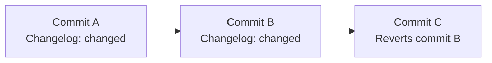
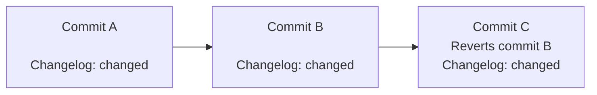



- Édition : Gratuite, GitLab Premium, GitLab Ultimate
- Offre : GitLab.com, GitLab Self-Managed, GitLab Dedicated



Les changelogs sont générés à partir des titres de commit et des Git trailers. Pour être inclus dans un changelog, un commit doit contenir un Git trailer spécifique. Les changelogs sont générés à partir des titres de commit et catégorisés par type de Git trailer. Vous pouvez enrichir les entrées de changelog avec des données supplémentaires, comme un lien vers la merge request ou des informations sur l'auteur du commit. Les formats de changelog [peuvent être personnalisés](#customize-the-changelog-output) à l'aide d'un modèle.

Chaque section du changelog par défaut comporte un titre contenant le numéro de version et la date de release, comme ceci :

```markdown
## 1.0.0 (2021-01-05)

### Features (4 changes)

- [Feature 1](gitlab-org/gitlab@123abc) by @alice ([merge request](gitlab-org/gitlab!123))
- [Feature 2](gitlab-org/gitlab@456abc) ([merge request](gitlab-org/gitlab!456))
- [Feature 3](gitlab-org/gitlab@234abc) by @steve
- [Feature 4](gitlab-org/gitlab@456)
```

Le format de date des sections peut être personnalisé, mais le reste du titre ne peut pas l'être. Lors de l'ajout de nouvelles sections, GitLab analyse ces titres pour déterminer où placer les nouvelles informations dans le fichier. GitLab trie les sections selon leurs versions, et non selon leurs dates.

Chaque section contient des modifications triées par catégorie (comme « Features »), et le format de ces sections peut être modifié. Les noms de section sont dérivés des valeurs du Git trailer utilisé pour inclure ou exclure des commits.

Les commits destinés aux changelogs peuvent être récupérés lors d'une opération sur un miroir. GitLab lui-même utilise cette fonctionnalité, car les patch releases peuvent inclure des modifications provenant à la fois de projets publics et de miroirs de sécurité privés.

## Ajouter un trailer à un commit Git {#add-a-trailer-to-a-git-commit}

Vous pouvez ajouter des trailers manuellement lorsque vous rédigez un message de commit. Pour inclure un commit en utilisant le trailer par défaut `Changelog` et le catégoriser comme une fonctionnalité, ajoutez la chaîne `Changelog: feature` à votre message de commit, comme ceci :

```plaintext
<Commit message subject>

<Commit message description>

Changelog: feature
```

Si votre merge request comporte plusieurs commits, ajoutez l'entrée `Changelog` au premier commit. Cela garantit que la bonne entrée est générée lorsque vous squashez des commits.

Le trailer `Changelog` accepte ces valeurs :

- `added` : nouvelle fonctionnalité
- `fixed` : correction de bug
- `changed` : modification de fonctionnalité
- `deprecated` : nouvelle dépréciation
- `removed` : suppression de fonctionnalité
- `security` : correction de sécurité
- `performance` : amélioration des performances
- `other` : autre

## Créer un changelog {#create-a-changelog}

Les changelogs sont générés depuis la ligne de commande, en utilisant l'API ou la CLI GitLab. La sortie du changelog est formatée en Markdown, et [vous pouvez la personnaliser](#customize-the-changelog-output).

### Depuis l'API {#from-the-api}

Pour utiliser l'API afin de générer des changelogs avec une commande `curl`, consultez [ajouter des données de changelog à un fichier de changelog](../../api/repositories.md#add-changelog-data-to-file) dans la documentation de l'API.

### Depuis la CLI GitLab {#from-the-gitlab-cli}



- [Introduit](https://gitlab.com/gitlab-org/cli/-/merge_requests/1222) dans `glab` version 1.30.0.



Prérequis :

- Vous avez installé et configuré la [CLI GitLab](../../editor_extensions/gitlab_cli/_index.md), version 1.30.0 ou ultérieure.
- Le schéma de nommage des tags de votre dépôt correspond à [le format de nommage de tag attendu](#customize-the-tag-format-when-extracting-versions).
- Les commits incluent des [trailers de changelog](#add-a-trailer-to-a-git-commit).

Pour générer le changelog :

1. Mettez à jour votre copie locale de votre dépôt avec `git fetch`.
1. Pour générer un changelog pour la version actuelle (telle que déterminée par `git describe --tags`) avec les options par défaut :
   - Exécutez la commande `glab changelog generate`.
   - Pour enregistrer la sortie dans un fichier, exécutez la commande `glab changelog generate > <filename>.md`.
1. Pour générer un changelog avec des options personnalisées, exécutez la commande `glab changelog generate` et ajoutez les options souhaitées. Voici quelques options disponibles :

   - `--config-file [string]` : le chemin vers le fichier de configuration du changelog dans le dépôt Git de votre projet. Ce fichier doit exister dans le dépôt Git de votre projet. Par défaut : `.gitlab/changelog_config.yml`.
   - Plage de commits :
     - `--from [string]` : le début de la plage de commits (sous forme de SHA) à utiliser pour générer le changelog. Ce commit lui-même n'est pas inclus dans le changelog.
     - `--to [string]` : la fin de la plage de commits (sous forme de SHA) à utiliser pour générer le changelog. Ce commit est inclus dans la liste. Par défaut : `HEAD` de la branche par défaut du projet.
   - `--date [string]` : la date et l'heure de la release, au format ISO 8601 (`2016-03-11T03:45:40Z`). Par défaut : l'heure actuelle.
   - `--trailer [string]` : le Git trailer à utiliser pour inclure les commits. Par défaut : `Changelog`.
   - `--version [string]` : la version pour laquelle générer le changelog.

Pour en savoir plus sur les paramètres disponibles dans la CLI GitLab, exécutez `glab changelog generate --help`. Pour les définitions et l'utilisation, consultez l'[API repositories](../../api/repositories.md#add-changelog-data-to-file).

## Personnaliser la sortie du changelog {#customize-the-changelog-output}

Pour personnaliser la sortie du changelog, modifiez le fichier de configuration du changelog et committez ces modifications dans le dépôt Git de votre projet. L'emplacement par défaut de cette configuration est `.gitlab/changelog_config.yml`.

Pour des raisons de performances et de sécurité, l'analyse de la configuration du changelog est limitée à `2` secondes. Si l'analyse de la configuration génère des erreurs de délai d'attente, envisagez de réduire la taille de la configuration. Le fichier prend en charge ces variables :

- `date_format` : le format de date, au format `strftime`, utilisé dans le titre des données de changelog nouvellement ajoutées.
- `template` : un modèle personnalisé à utiliser lors de la génération des données de changelog.
- `include_groups` : une liste de chemins complets de groupes contenant des utilisateurs dont les contributions doivent être créditées indépendamment de leur appartenance au projet. L'utilisateur générant le changelog doit avoir accès à chaque groupe pour que le crédit soit accordé.
- `categories` : un hash qui associe les noms de catégorie bruts aux noms à utiliser dans le changelog. Pour modifier les noms affichés dans le changelog, ajoutez ces lignes à votre fichier de configuration et modifiez-les selon vos besoins. Cet exemple affiche les titres de catégorie sous la forme `### Features`, `### Bug fixes` et `### Performance improvements` :

  ```yaml
  ---
  categories:
    feature: Features
    bug: Bug fixes
    performance: Performance improvements
  ```

### Modèles personnalisés {#custom-templates}



- Le modèle par défaut a été [modifié](https://gitlab.com/gitlab-org/gitlab/-/merge_requests/155806) pour utiliser `commit.web_url` et `merge_request.web_url` au lieu de `commit.reference` et `merge_request.reference` dans GitLab 17.1.



Les sections de catégories sont générées à l'aide d'un modèle. Le modèle par défaut :

```plaintext


### {{ title }} (1 change{{ count }} changes)


- [{{ title }}]({{ commit.web_url }})\
 by {{ author.reference }}\
 ([merge request]({{ merge_request.web_url }}))





No changes.

```

Les balises `` sont destinées aux instructions, et `{{ ... }}` est utilisé pour afficher des données. Les instructions doivent être terminées par une balise ``. Les instructions `if` et `each` nécessitent toutes deux un seul argument.

Par exemple, pour une variable appelée `valid`, vous pouvez afficher « yes » lorsque cette valeur est vraie, et afficher « nope » dans le cas contraire, comme suit :

```plaintext

yes

nope

```

L'utilisation de `else` est facultative. Une valeur est considérée comme vraie lorsqu'il s'agit d'une valeur non vide ou d'un booléen `true`. Les tableaux et hashes vides sont considérés comme faux.

Le bouclage est effectué à l'aide de `each`, et les variables à l'intérieur d'une boucle ont une portée limitée à celle-ci. La référence à la valeur actuelle dans une boucle s'effectue à l'aide de la balise de variable `{{ it }}`. Les autres variables lisent leur valeur à partir de la valeur de la boucle actuelle. Prenons ce modèle par exemple :

```plaintext

{{name}}

```

En supposant que `users` est un tableau d'objets, chacun ayant un champ `name`, cela afficherait alors le nom de chaque utilisateur.

En utilisant des balises de variable, vous pouvez accéder à des objets imbriqués. Par exemple, `{{ users.0.name }}` affiche le nom du premier utilisateur dans la variable `users`.

Si une ligne se termine par une barre oblique inverse, le saut de ligne suivant est ignoré. Cela vous permet d'encapsuler du code sur plusieurs lignes, sans introduire de sauts de ligne inutiles dans la sortie Markdown.

Les balises qui utilisent `` (appelées balises d'expression) consomment le saut de ligne qui les suit directement, le cas échéant. Cela signifie que ceci :

```plaintext
---

bar

---
```

Se compile en ceci :

```plaintext
---
bar
---
```

Au lieu de ceci :

```plaintext
---

bar

---
```

Vous pouvez spécifier un modèle personnalisé dans votre configuration, comme ceci :

```yaml
---
template: |
  
  
  ### {{ title }}

  
  - [{{ title }}]({{ commit.web_url }})\
   by {{ author.reference }}

  

  
  
  No changes.
  
```

Lors de la spécification du modèle, vous devez utiliser `template: |` et non `template: >`, car ce dernier ne préserve pas les sauts de ligne dans le modèle.

### Données du modèle {#template-data}



- `commit.web_url` et `merge_request.web_url` [introduits](https://gitlab.com/gitlab-org/gitlab/-/merge_requests/155806) dans GitLab 17.1.



Au niveau supérieur, la variable suivante est disponible :

- `categories` : un tableau d'objets, un pour chaque catégorie de changelog.

Dans une catégorie, les variables suivantes sont disponibles :

- `count` : le nombre d'entrées dans cette catégorie.
- `entries` : les entrées appartenant à cette catégorie.
- `single_change` : un booléen qui indique s'il n'y a qu'une seule modification (`true`), ou plusieurs modifications (`false`).
- `title` : le titre de la catégorie (après remappage).

Dans une entrée, les variables suivantes sont disponibles (ici `foo.bar` signifie que `bar` est un sous-champ de `foo`) :

- `author.contributor` : un booléen défini à `true` lorsque l'auteur n'est pas membre du projet, sinon `false`.
- `author.credit` : un booléen défini à `true` lorsque `author.contributor` est `true` ou lorsque `include_groups` est configuré, et que l'auteur est membre d'un des groupes.
- `author.reference` : une référence à l'auteur du commit (par exemple, `@alice`).
- `commit.reference` : une référence au commit, par exemple, `gitlab-org/gitlab@0a4cdd86ab31748ba6dac0f69a8653f206e5cfc7`.
- `commit.web_url` : une URL vers le commit, par exemple, `https://gitlab.com/gitlab-org/gitlab/-/commit/0a4cdd86ab31748ba6dac0f69a8653f206e5cfc7`.
- `commit.trailers` : un objet contenant tous les Git trailers présents dans le corps du commit.

  Ces trailers peuvent être référencés à l'aide de `commit.trailers.<name>`. Par exemple, en supposant le commit suivant :

  ```plaintext
  Add some impressive new feature

  Changelog: added
  Issue: https://gitlab.com/gitlab-org/gitlab/-/issues/1234
  Status: important
  ```

  Les trailers `Changelog`, `Issue` et `Status` sont accessibles dans le modèle comme suit :

  ```yaml
  
   ([link to issue]({{ commit.trailers.Issue }}))
  Status: {{ commit.trailers.Status }}
  
  ```

- `merge_request.reference` : une référence à la merge request qui a introduit la modification en premier (par exemple, `gitlab-org/gitlab!50063`).
- `merge_request.web_url` : une URL vers la merge request qui a introduit la modification en premier (par exemple, `https://gitlab.com/gitlab-org/gitlab/-/merge_requests/50063`).
- `title` : le titre de l'entrée de changelog (il s'agit du titre du commit).

Les objets `author` et `merge_request` peuvent ne pas être présents si les données n'ont pas pu être déterminées. Par exemple, lorsqu'un commit est créé sans merge request correspondante, aucune merge request n'est affichée.

### Personnaliser le format de tag lors de l'extraction des versions {#customize-the-tag-format-when-extracting-versions}

GitLab utilise une expression régulière (avec le moteur et la syntaxe [re2](https://github.com/google/re2/)) pour extraire une version sémantique à partir des noms de tag. L'expression régulière par défaut est :

```plaintext
^v?(?P<major>0|[1-9]\d*)\.(?P<minor>0|[1-9]\d*)\.(?P<patch>0|[1-9]\d*)(?:-(?P<pre>(?:0|[1-9]\d*|\d*[a-zA-Z-][0-9a-zA-Z-]*)(?:\.(?:0|[1-9]\d*|\d*[a-zA-Z-][0-9a-zA-Z-]*))*))?(?:\+(?P<meta>[0-9a-zA-Z-]+(?:\.[0-9a-zA-Z-]+)*))?$
```

Cette expression régulière est basée sur l'expression régulière officielle de [gestion sémantique de version](https://semver.org/), et inclut également la prise en charge des noms de tag commençant par la lettre `v`.

Si votre projet utilise un format différent pour les tags, vous pouvez spécifier une expression régulière différente. L'expression régulière utilisée doit produire les groupes de capture suivants. Si l'un de ces groupes de capture est manquant, le tag est ignoré :

- `major`
- `minor`
- `patch`

Les groupes de capture suivants sont facultatifs :

- `pre` : si défini, le tag est ignoré. Ignorer les tags `pre` garantit que les tags release candidate et les autres tags de pré-release ne sont pas pris en compte lors de la détermination de la plage de commits pour laquelle générer un changelog.
- `meta` : Facultatif. Spécifie les métadonnées de build.

À partir de ces informations, GitLab construit une carte des tags Git et de leurs versions de release. Il détermine ensuite quel est le dernier tag, en fonction de la version extraite de chaque tag.

Pour spécifier une expression régulière personnalisée, utilisez le paramètre `tag_regex` dans votre fichier YAML de configuration du changelog. Par exemple, ce modèle correspond aux noms de tag tels que `version-1.2.3` mais pas `version-1.2`.

```yaml
---
tag_regex: '^version-(?P<major>\d+)\.(?P<minor>\d+)\.(?P<patch>\d+)$'
```

Pour tester si votre expression régulière fonctionne, vous pouvez utiliser des sites web tels que [regex101](https://regex101.com/). Si la syntaxe de l'expression régulière est invalide, une erreur est générée lors de la création du changelog.

## Gestion des commits annulés {#reverted-commit-handling}

Pour être traité comme un commit de revert, le message du commit doit contenir la chaîne `This reverts commit <SHA>`, où `SHA` est le SHA du commit à annuler.

Lors de la génération d'un changelog pour une plage, GitLab ignore les commits à la fois ajoutés et annulés dans cette plage. Dans cet exemple, le commit C annule le commit B. Comme le commit C n'a pas d'autre trailer, seul le commit A est ajouté au changelog :



Cependant, si le commit de revert (commit C) contient également un trailer de changelog, les commits A et C sont tous deux inclus dans le changelog :



Le commit B est ignoré.

## Sujets connexes {#related-topics}

- [Endpoints liés aux changelogs](../../api/repositories.md) dans l'API Repositories.
- [`glab changelog`](https://gitlab.com/gitlab-org/cli/-/tree/main/docs/source/changelog) dans la documentation de la CLI GitLab.
