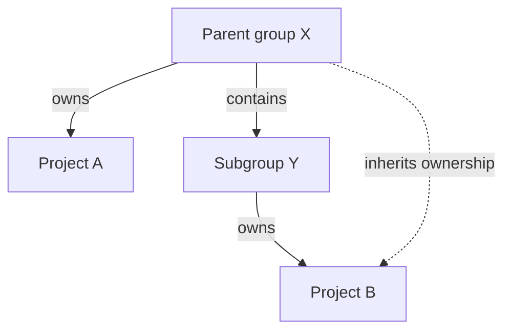



- Édition : GitLab Premium, GitLab Ultimate
- Offre : GitLab.com, GitLab Self-Managed, GitLab Dedicated



Le fichier `CODEOWNERS` vous aide à définir qui est responsable de fichiers et répertoires spécifiques. Vous pouvez utiliser la correspondance de motifs, les sections et les règles d'héritage pour assigner des relecteurs aux merge requests et exiger leur approbation avant la fusion.

## Correspondance de motifs {#pattern-matching}

GitLab utilise `File::fnmatch` avec les flags `File::FNM_DOTMATCH` et `File::FNM_PATHNAME` définis pour la correspondance de motifs :

- La structure du dépôt est traitée comme un système de fichiers isolé.
- Les motifs suivent un sous-ensemble des règles de globbing de noms de fichiers shell et ne sont pas des expressions régulières.
- Le flag `File::FNM_DOTMATCH` permet à `*` de correspondre aux fichiers dotfiles comme `.gitignore`.
- Le flag `File::FNM_PATHNAME` empêche `*` de correspondre au séparateur de chemin `/`.
- `**` correspond aux répertoires de manière récursive. Par exemple, `**/*.rb` correspond à `config/database.rb` et `app/controllers/users/stars_controller.rb`.

## Propriétaires du code par défaut et sections optionnelles {#default-code-owners-and-optional-sections}

Pour combiner la syntaxe des propriétaires par défaut avec les [sections optionnelles](reference.md#optional-sections) et les approbations requises, placez les propriétaires par défaut à la fin :

```plaintext
[Documentation][2] @docs-team
docs/
README.md

^[Database] @database-team
model/db/
config/db/database-setup.md @docs-team
```

## Entrées régulières et sections {#regular-entries-and-sections}

Si vous définissez un propriétaire du code par défaut pour un chemin en dehors d'une section, son approbation est toujours requise. Ces entrées ne sont pas remplacées par les sections. Les entrées sans section sont traitées comme si elles faisaient partie d'une autre section, sans nom :

```plaintext
# Required for all files
* @general-approvers

[Documentation] @docs-team
docs/
README.md
*.txt

[Database] @database-team
model/db/
config/db/database-setup.md @docs-team
```

Dans cet exemple :

- `@general-approvers` possède tous les éléments partout, sans remplacement.
- `@docs-team` possède tous les éléments de la section `Documentation`.
- `@database-team` possède tous les éléments de la section `Database` à l'exception de `config/db/database-setup.md`, qui fait l'objet d'un remplacement l'assignant à `@docs-team`.
- Une merge request qui modifie `model/db/CHANGELOG.txt` nécessiterait trois approbations : une de chacun des groupes `@general-approvers`, `@docs-team` et `@database-team`.

Comparez ce comportement à celui obtenu lorsque vous utilisez uniquement les [propriétaires par défaut pour les sections](reference.md#set-default-code-owner-for-a-section), où les entrées spécifiques d'une section remplacent la valeur par défaut de la section.

## Sections avec des noms en double {#sections-with-duplicate-names}

Si plusieurs sections portent le même nom, elles sont combinées. De plus, les en-têtes de section ne sont pas sensibles à la casse. Par exemple :

```plaintext
[Documentation]
ee/docs/    @docs
docs/       @docs

[Database]
README.md  @database
model/db/   @database

[DOCUMENTATION]
README.md  @docs
```

Ce code génère trois entrées sous l'en-tête de section `Documentation` et deux entrées sous `Database`. Les entrées définies sous les sections `Documentation` et `DOCUMENTATION` sont combinées, en utilisant la casse de la première section.

## Définir des propriétaires du code pour des fichiers ou répertoires spécifiques {#define-code-owners-for-specific-files-or-directories}

Lorsqu'un fichier ou un répertoire correspond à plusieurs entrées dans le fichier `CODEOWNERS`, les utilisateurs correspondant au dernier motif correspondant au fichier ou au répertoire sont utilisés. Cela vous permet de définir des propriétaires plus spécifiques pour des fichiers ou des répertoires définis plus précisément, lorsque vous ordonnez les entrées de manière logique.

Par exemple, dans le fichier `CODEOWNERS` suivant :

```plaintext
# This line would match the file terms.md
*.md @doc-team

# This line would also match the file terms.md
terms.md @legal-team
```

Le propriétaire du code pour `terms.md` serait `@legal-team`.

## Exiger plusieurs approbations de la part des propriétaires du code {#require-multiple-approvals-from-code-owners}

Vous pouvez exiger plusieurs approbations pour les sections des propriétaires du code dans la zone Approbations des merge requests. Ajoutez au nom de la section un nombre `n` entre crochets, par exemple `[2]` ou `[3]`. Cela nécessite `n` approbations de la part des propriétaires du code dans cette section. Les valeurs valides pour `n` sont des entiers `≥ 1`. `[1]` est optionnel car il s'agit de la valeur par défaut. Les valeurs non valides pour `n` sont traitées comme `1`.

> [!warning]
> [Le ticket 384881](https://gitlab.com/gitlab-org/gitlab/-/issues/385881) propose des modifications du comportement de ce paramètre. Ne définissez pas intentionnellement des valeurs non valides. Ces valeurs pourraient devenir valides à l'avenir et provoquer un comportement inattendu.

Pour exiger plusieurs approbations de la part des propriétaires du code :

1. Dans la barre supérieure, sélectionnez **Rechercher ou accéder à**, puis recherchez votre projet.
1. Dans la barre latérale gauche, sélectionnez **Paramètres** > **Dépôt**.
1. Développez **Règles des branches**.
1. À côté de la branche par défaut, sélectionnez **Afficher les détails**.
1. Activez le bouton bascule sous **Approbation du propriétaire du code**.
1. Modifiez le fichier `CODEOWNERS` pour ajouter une règle d'approbations multiples.

Par exemple, pour exiger deux approbations pour la section `[Documentation]` :

```plaintext
[Documentation][2]
*.md @tech-writer-team

[Ruby]
*.rb @dev-team
```

La section des propriétaires du code `Documentation` dans la zone Approbations indique que deux approbations sont requises :


## Héritage de groupe et éligibilité {#group-inheritance-and-eligibility}



Dans cet exemple :

- Le groupe parent X (`group-x`) possède le projet A.
- Le groupe parent X contient également un sous-groupe, le sous-groupe Y (`group-x/subgroup-y`).
- Le sous-groupe Y possède le projet B.

Les propriétaires du code éligibles sont :

- Projet A : les membres du groupe X uniquement, car le projet A n'appartient pas au sous-groupe Y.
- Projet B : les membres du groupe X et du sous-groupe Y.

### Groupes partagés avec des groupes parents {#groups-shared-with-parent-groups}



- [Introduction](https://gitlab.com/gitlab-org/gitlab/-/merge_requests/203298) dans GitLab 18.5 [avec le feature flag](../../../administration/feature_flags/_index.md) `check_inherited_groups_for_codeowners`. Fonctionnalité désactivée par défaut.
- [Activé sur GitLab.com, GitLab Self-Managed et GitLab Dedicated](https://gitlab.com/gitlab-org/gitlab/-/issues/566627) dans GitLab 18.6.
- [Disponibilité générale](https://gitlab.com/gitlab-org/gitlab/-/work_items/579541) dans GitLab 18.8. Le feature flag `check_inherited_groups_for_codeowners` a été supprimé.



Pour rendre les membres d'un groupe éligibles en tant que propriétaires du code pour des projets auxquels ils n'appartiennent pas directement, vous pouvez [inviter le groupe](../members/sharing_projects_groups.md#invite-a-group-to-a-group) dans un groupe parent du projet. Lorsque vous invitez un groupe, ses membres directs deviennent éligibles en tant que propriétaires du code pour tous les projets dans la hiérarchie du groupe parent.

Prérequis :

- Vous devez avoir le rôle Propriétaire pour le groupe dans lequel vous invitez l'autre groupe.
- Lors de l'invitation du groupe, vous devez attribuer le rôle Développeur, Mainteneur ou Propriétaire.

Par exemple, dans cette hiérarchie :

```plaintext
group-x
├── engineering-group
└── product-group
    └── project-a
```

Si vous invitez `engineering-group` dans `product-group`, les membres de `engineering-group` deviennent éligibles en tant que propriétaires du code pour `project-a`. Vous n'avez pas besoin d'inviter directement `engineering-group` dans `project-a`.

Seuls les membres directs du groupe invité sont éligibles en tant que propriétaires du code. Les membres qui héritent de l'appartenance au groupe invité ne sont pas éligibles.

## Gestion des erreurs {#error-handling}

### Entrées avec des espaces {#entries-with-spaces}

Échappez les espaces dans les chemins avec des barres obliques inverses :

```plaintext
path\ with\ spaces/*.md @owner
```

Sans échappement, GitLab analyse `folder with spaces/*.md @group` comme suit : `path: "folder", owners: " with spaces/*.md @group"`.

### Sections non analysables {#unparsable-sections}



- [Modifié](https://gitlab.com/gitlab-org/gitlab/-/merge_requests/185180) dans GitLab 17.11 pour ignorer les en-têtes de section non analysables au lieu de les analyser comme des entrées.



Si un en-tête de section ne peut pas être analysé, GitLab :

- Ignore l'en-tête.
- Ajoute les entrées qui suivent l'en-tête à la section précédente. Si aucune section précédente n'existe, les entrées sont ajoutées à la section par défaut.
- Affiche une erreur `Unparsable sections` lorsque vous [consultez le fichier `CODEOWNERS`](troubleshooting.md#validate-your-codeowners-file).

L'erreur `Unparsable sections` apparaît également pour certains en-têtes mal formés que GitLab peut encore utiliser, comme `[Docs]]` ou `[Docs][ 1]`. GitLab traite ces en-têtes comme des sections, de sorte que l'erreur ne signifie pas toujours que l'en-tête est ignoré.

#### Après la section par défaut {#after-the-default-section}

```plaintext
* @group

[Section name
docs/ @docs_group
```

GitLab ignore l'en-tête `[Section name`. La section par défaut comprend deux règles :

- `*` appartenant à `@group`
- `docs/` appartenant à `@docs_group`

#### Après une section nommée {#after-a-named-section}

```plaintext
[Docs]
docs/**/* @group

[Section name
docs/ @docs_group
```

GitLab ignore l'en-tête `[Section name`. La section `[Docs]` comprend deux règles :

- `docs/**/*` appartenant à `@group`
- `docs/` appartenant à `@docs_group`

### Propriétaires mal formés {#malformed-owners}

Chaque entrée doit contenir un ou plusieurs propriétaires. Les propriétaires mal formés sont invalides et ignorés :

```plaintext
/path/* @group user_without_at_symbol @user_with_at_symbol
```

Cette entrée appartient à `@group` et `@user_with_at_symbol`.

### Propriétaires inaccessibles ou incorrects {#inaccessible-or-incorrect-owners}

GitLab ignore les propriétaires inaccessibles ou incorrects. Par exemple :

```plaintext
* @group @grou @username @i_left @i_dont_exist example@gitlab.com invalid@gitlab.com
```

Si seuls `@group`, `@username` et `example@gitlab.com` sont accessibles, GitLab ignore les autres.

### Zéro propriétaire {#zero-owners}

Si une entrée ne comprend aucun propriétaire, ou si aucun [propriétaire accessible](#inaccessible-or-incorrect-owners) n'existe, l'entrée est invalide. Cette règle ne pouvant jamais être satisfaite, GitLab l'approuve automatiquement dans les merge requests.

> [!note]
> Lorsqu'une branche protégée a `Require code owner approval` activé, les règles avec zéro propriétaire sont toujours respectées.

### Approbations minimales {#minimum-approvals}

Lors de la [définition du nombre d'approbations](#require-multiple-approvals-from-code-owners) pour une section, le nombre minimum d'approbations est `1`. Définir le nombre d'approbations à `0` entraîne GitLab à exiger une approbation.
