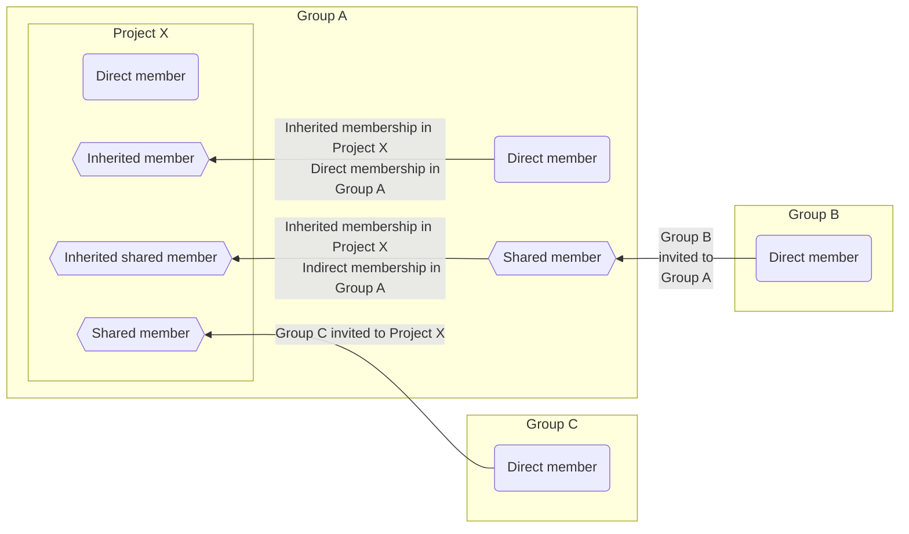
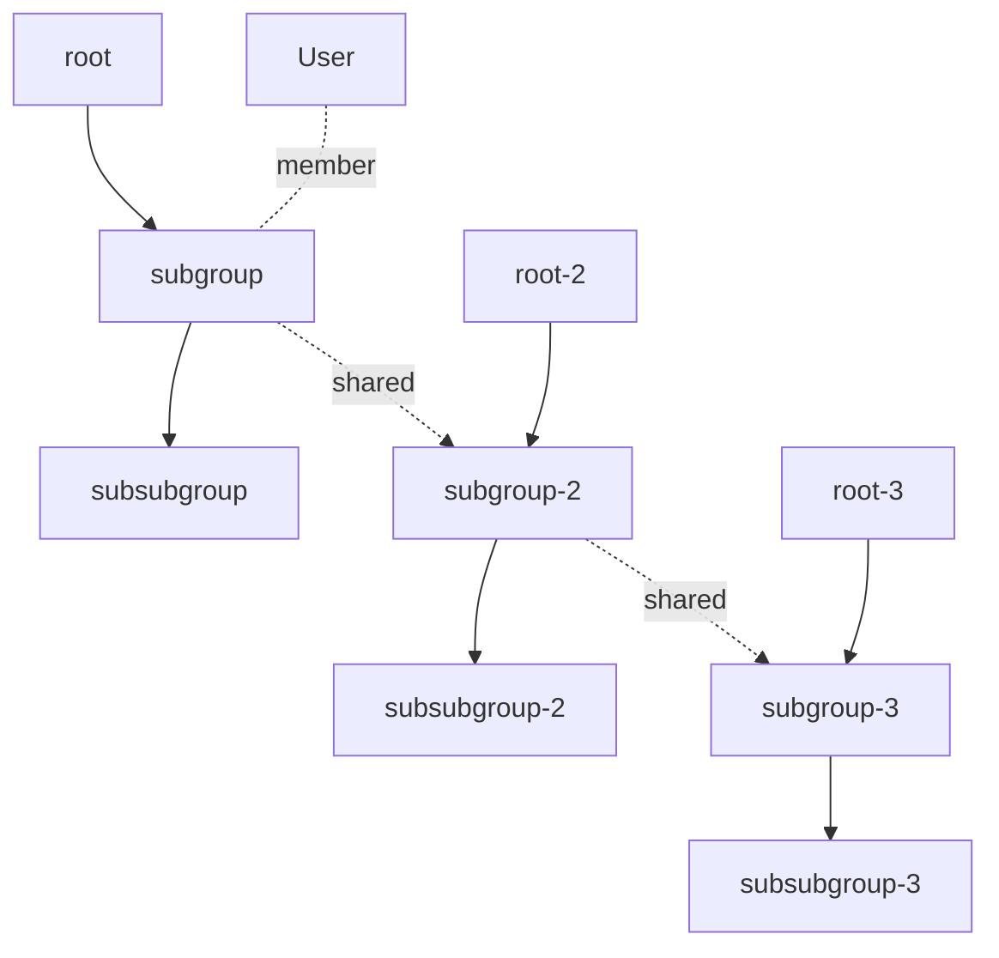



- Édition : Gratuite, GitLab Premium, GitLab Ultimate
- Offre : GitLab.com, GitLab Self-Managed, GitLab Dedicated



Les membres sont les utilisateurs et les groupes qui ont accès à votre projet. Les membres peuvent être ajoutés directement à votre projet ou hériter d'un accès via des groupes.

Chaque membre possède un rôle qui détermine ce qu'il peut faire dans le projet. Les membres du projet disposant du rôle approprié peuvent ajouter des utilisateurs aux projets, supprimer des utilisateurs des projets et gérer les demandes d'accès pour contrôler l'accès aux ressources du projet.

## Types d'appartenance {#membership-types}



- [Modification](https://gitlab.com/gitlab-org/gitlab/-/issues/219230) : affichage des membres du groupe invité dans l'onglet Membres de la page Membres dans GitLab 16.10 [avec un feature flag](../../../administration/feature_flags/_index.md) nommé `webui_members_inherited_users`. Fonctionnalité désactivée par défaut.
- Le feature flag `webui_members_inherited_users` a été [activé sur GitLab.com et GitLab Self-Managed](https://gitlab.com/gitlab-org/gitlab/-/issues/219230) dans GitLab 17.0.
- [Suppression](https://gitlab.com/gitlab-org/gitlab/-/merge_requests/163627) du feature flag `webui_members_inherited_users` dans GitLab 17.4. Les membres des groupes invités sont affichés par défaut.



Les utilisateurs peuvent devenir membres d'un groupe ou d'un projet directement ou indirectement. L'appartenance indirecte peut être héritée, partagée ou héritée partagée.

| Type d'appartenance                               | Processus d'appartenance |
| --------------------------------------------- | ------------------ |
| Directe | L'utilisateur est ajouté directement au groupe ou au projet actuel. |
| Héritée | L'utilisateur est membre d'un groupe parent qui contient le groupe ou le projet actuel. |
| [Partagée](sharing_projects_groups.md) | L'utilisateur est membre d'un groupe invité dans le groupe ou le projet actuel. |
| [Héritée partagée](sharing_projects_groups.md#invite-a-group-to-a-group) | L'utilisateur est membre d'un groupe invité dans un ancêtre du groupe ou du projet actuel. |
| Indirecte | Terme générique désignant les membres hérités, partagés ou hérités partagés. |

Dans l'exemple précédent :

- **Administrateur** est un membre hérité du groupe **demo**.
- **Utilisateur 0** est un membre hérité du groupe **demo**.
- **Utilisateur 1** est un membre partagé du groupe **Acme** invité dans ce projet.
- **Utilisateur 2** est un membre hérité partagé du groupe **Toolbox** invité dans le groupe **demo**.
- **Utilisateur 3** est un membre direct ajouté à ce projet.

## Considérations relatives à la sécurité {#security-considerations}

Git est un système de contrôle de version distribué (DVCS). Toute personne qui travaille avec le code source dispose d'une copie locale du dépôt complet.

Dans GitLab, tout membre de projet disposant du rôle Reporter, Developer, Maintainer ou Owner peut cloner le dépôt pour en créer une copie locale. Les utilisateurs peuvent téléverser le dépôt complet n'importe où après avoir obtenu une copie locale, notamment :

- Un autre projet sous leur contrôle.
- Un serveur différent.
- Des services d'hébergement externes.

Les contrôles d'accès ne peuvent pas empêcher le partage intentionnel du code source par des utilisateurs qui ont déjà accès au dépôt. Toutes les plateformes de gestion Git partagent cette caractéristique inhérente aux systèmes de contrôle de version distribués.

Bien que vous ne puissiez pas empêcher le partage intentionnel par des utilisateurs autorisés, vous pouvez prendre les mesures suivantes pour éviter le partage non intentionnel et la destruction d'informations :

- Contrôler qui peut [ajouter des utilisateurs à un projet](#add-users-to-a-project).
- Utiliser les [branches protégées](../repository/branches/protected.md) pour empêcher les push forcés non autorisés.
- Examiner régulièrement l'appartenance au projet et supprimer les utilisateurs qui n'ont plus besoin d'y accéder.

## Ajouter des utilisateurs à un projet {#add-users-to-a-project}



- La date d'expiration de l'accès pour les membres directs des sous-groupes et des projets a été [supprimée](https://gitlab.com/gitlab-org/gitlab/-/issues/471051) dans GitLab 17.4.



Ajoutez des utilisateurs à un projet pour qu'ils deviennent des membres directs et disposent des autorisations nécessaires pour effectuer des actions.

Prérequis :

- Vous devez disposer du rôle Chargé de maintenance ou Propriétaire.
- Le [verrouillage de l'appartenance au groupe](../../group/access_and_permissions.md#prevent-members-from-being-added-to-projects-in-a-group) doit être désactivé.
- Pour les instances GitLab Self-Managed :
  - Si la [création de nouveaux comptes utilisateurs est désactivée](../../../administration/settings/sign_up_restrictions.md#disable-new-user-account-creation), un administrateur doit ajouter l'utilisateur.
  - Si les [invitations d'utilisateurs ne sont pas autorisées](../../../administration/settings/visibility_and_access_controls.md#prevent-invitations-to-groups-and-projects), un administrateur doit ajouter l'utilisateur.
  - Si l'[approbation par un administrateur est activée](../../../administration/settings/sign_up_restrictions.md#turn-on-administrator-approval-for-role-promotions), un administrateur doit approuver l'invitation.

Pour ajouter un utilisateur à un projet :

1. Dans la barre supérieure, sélectionnez **Rechercher ou accéder à**, puis recherchez votre projet.
1. Dans la barre latérale gauche, sélectionnez **Gérer** > **Membres**.
1. Sélectionnez **Inviter des membres**.
1. Si l'utilisateur :

   - Possède un compte GitLab, saisissez son nom d'utilisateur.
   - Ne possède pas de compte GitLab, saisissez son adresse e-mail.

1. Sélectionnez un [rôle par défaut](../../permissions.md) ou un [rôle personnalisé](../../custom_roles/_index.md).
1. Facultatif. Sélectionnez une **Date d’expiration de l’accès**. À compter de cette date, l'utilisateur ne peut plus accéder au projet.

   Si vous avez sélectionné une date d'expiration de l'accès, le membre du projet reçoit une notification par e-mail sept jours avant l'expiration de son accès.

   > [!warning]
   > Les Maintainers disposent de toutes les autorisations jusqu'à l'expiration de leur rôle, y compris la possibilité de prolonger leur propre date d'expiration d'accès.

1. Sélectionnez **Inviter**. Si vous avez invité l'utilisateur via :

   - Son nom d'utilisateur GitLab, il est ajouté à la liste des membres.
   - Son adresse e-mail, une invitation est envoyée à son adresse e-mail et il est invité à créer un compte. Si l'invitation n'est pas acceptée, GitLab envoie des e-mails de rappel deux, cinq et dix jours plus tard. Les invitations non acceptées sont automatiquement supprimées après 90 jours.

### Rôles que vous pouvez attribuer {#which-roles-you-can-assign}

Le rôle maximal que vous pouvez attribuer dépend de votre rôle Maintainer ou Owner dans le groupe. Par exemple, le rôle maximal que vous pouvez définir est :

- Owner (`50`), si vous disposez du rôle Owner pour le projet.
- Maintainer (`40`), si vous disposez du rôle Maintainer sur le projet.

Le [rôle](../../permissions.md#project-permissions) Owner ne peut être ajouté que pour le groupe.

## Afficher les membres du projet {#view-project-members}

Pour afficher les membres d'un projet :

1. Dans la barre supérieure, sélectionnez **Rechercher ou accéder à**, puis recherchez votre projet.
1. Dans la barre latérale gauche, sélectionnez **Gérer** > **Membres**.

Un tableau affiche les informations suivantes du membre :

- Nom et nom d'utilisateur du **Compte**.
- **Source** de son [appartenance](#membership-types). Par souci de transparence, GitLab affiche toutes les sources d'appartenance des membres du projet. Les membres ayant plusieurs sources d'appartenance sont affichés et comptabilisés en tant que membres distincts. Par exemple, si un membre a été ajouté au projet à la fois directement et par héritage, le membre est affiché deux fois dans le tableau **Membres**, avec des sources différentes, et est comptabilisé comme deux membres individuels du projet.
- [**Rôle**](#which-roles-you-can-assign) dans le projet.
- Date d'**Expiration** de son appartenance au projet.
- **Activité** liée à son compte.

### Afficher les utilisateurs en attente de promotion {#view-users-pending-promotion}

Si l'[approbation par un administrateur pour les promotions de rôles](../../../administration/settings/sign_up_restrictions.md#turn-on-administrator-approval-for-role-promotions) est activée, les demandes d'appartenance qui font passer des utilisateurs existants à un rôle facturable nécessitent l'approbation d'un administrateur.

Pour afficher les utilisateurs en attente de promotion :

1. Dans la barre supérieure, sélectionnez **Rechercher ou accéder à**, puis recherchez votre projet.
1. Dans la barre latérale gauche, sélectionnez **Gérer** > **Membres**.
1. Sélectionnez l'onglet **Promotions de rôle**.

Si l'onglet **Promotions de rôle** ne s'affiche pas, le projet n'a pas de promotions en attente.

## Mise à jour de l'expiration et du rôle {#updating-expiration-and-role}

Si un utilisateur est :

- Membre direct d'un projet, les champs **Expiration** et **Rôle** peuvent être mis à jour directement sur le projet.
- Membre hérité, partagé ou hérité partagé, les champs **Expiration** et **Rôle** doivent être mis à jour dans le groupe dont le membre est issu.

## Partager un projet avec un groupe {#share-a-project-with-a-group}

Au lieu d'ajouter des utilisateurs un par un, vous pouvez [partager un projet avec un groupe entier](sharing_projects_groups.md).

## Importer des membres depuis un autre projet {#import-members-from-another-project}

Vous pouvez importer les membres directs d'un autre projet dans votre propre projet. Les membres du projet importés conservent les mêmes permissions que celles du projet depuis lequel vous les importez.

> [!note]
> Seuls les membres directs d'un projet sont importés. Les membres hérités ou partagés d'un projet ne sont pas importés.

Prérequis :

- Vous devez disposer du rôle Chargé de maintenance ou Propriétaire.

Si le rôle du membre importateur pour le projet cible est :

- Maintainer, les membres disposant du rôle Owner pour le projet source sont importés avec le rôle Maintainer.
- Owner, les membres disposant du rôle Owner pour le projet source sont importés avec le rôle Owner.

Pour importer les membres d'un projet :

1. Dans la barre supérieure, sélectionnez **Rechercher ou accéder à**, puis recherchez votre projet.
1. Dans la barre latérale gauche, sélectionnez **Gérer** > **Membres**.
1. Sélectionnez **Importer depuis un projet**.
1. Sélectionnez le projet. Vous ne pouvez afficher que les projets pour lesquels vous êtes mainteneur.
1. Sélectionnez **Importer les membres du projet**.

Si l'importation réussit, un message de réussite s'affiche. Pour afficher les membres importés dans l'onglet **Membres**, actualisez la page.

## Supprimer un membre d'un projet {#remove-a-member-from-a-project}

Si un utilisateur est :

- Membre direct d'un projet, vous pouvez le supprimer directement du projet.
- Membre hérité d'un groupe parent, vous pouvez uniquement le supprimer du groupe parent lui-même.

Prérequis :

- Le rôle Maintainer ou Owner pour supprimer un membre qui ne dispose pas du rôle Owner.
- Le rôle Owner pour supprimer un membre disposant du rôle Owner.

Pour supprimer un membre d'un projet :

1. Dans la barre supérieure, sélectionnez **Rechercher ou accéder à**, puis recherchez votre projet.
1. Dans la barre latérale gauche, sélectionnez **Gérer** > **Membres**.
1. En regard du membre du projet que vous souhaitez supprimer, sélectionnez **Supprimer le membre**.
1. Facultatif. Dans la boîte de dialogue de confirmation, cochez la case **Supprimer également l'assignation de cet utilisateur aux requêtes de fusion et tickets associés**.
1. Pour éviter les fuites d'informations sensibles des projets privés, vérifiez que le membre n'a pas dupliqué le dépôt privé ou créé des webhooks. Les duplications existantes continuent de recevoir les modifications du projet en amont, et les webhooks continuent de recevoir des mises à jour. Vous pouvez également configurer votre projet pour empêcher les projets d'un groupe [d'être dupliqués en dehors de leur groupe](../../group/access_and_permissions.md#prevent-project-forking-outside-group).
1. Sélectionnez **Supprimer le membre**.

## S'assurer que les utilisateurs supprimés ne peuvent pas s'inviter à nouveau {#ensure-removed-users-cannot-invite-themselves-back}

Les utilisateurs disposant du rôle Maintainer ou Owner pourraient exploiter une condition de concurrence leur permettant de rejoindre à nouveau des groupes ou des projets après qu'un administrateur les ait supprimés.

Pour éviter ce problème, les administrateurs GitLab peuvent :

- Supprimer la session de l'utilisateur malveillant depuis la [console Rails GitLab](../../../administration/operations/rails_console.md).
- Emprunter l'identité de l'utilisateur malveillant pour :
  - Supprimer l'utilisateur du projet.
  - Déconnecter l'utilisateur de GitLab.
- Bloquer le compte de l'utilisateur malveillant.
- Supprimer le compte de l'utilisateur malveillant.
- Modifier le mot de passe du compte de l'utilisateur malveillant.

## Filtrer et trier les membres du projet {#filter-and-sort-project-members}

Vous pouvez filtrer et trier les membres d'un projet.

### Afficher les membres directs {#display-direct-members}

1. Dans la barre supérieure, sélectionnez **Rechercher ou accéder à**, puis recherchez votre projet.
1. Dans la barre latérale gauche, sélectionnez **Gérer** > **Membres**.
1. Dans le champ **Filtrer les membres**, sélectionnez `Membership` `=` `Direct`.
1. Appuyez sur <kbd>Entrée</kbd>.

### Afficher les membres indirects {#display-indirect-members}

1. Dans la barre supérieure, sélectionnez **Rechercher ou accéder à**, puis recherchez votre projet.
1. Dans la barre latérale gauche, sélectionnez **Gérer** > **Membres**.
1. Dans le champ **Filtrer les membres**, sélectionnez `Membership` `=` `Indirect`.
1. Appuyez sur <kbd>Entrée</kbd>.

### Rechercher des membres dans un projet {#search-for-members-in-a-project}

Pour rechercher un membre d'un projet :

1. Dans la barre supérieure, sélectionnez **Rechercher ou accéder à**, puis recherchez votre projet.
1. Dans la barre latérale gauche, sélectionnez **Gérer** > **Membres**.
1. Dans le champ de recherche, saisissez le nom, le nom d'utilisateur ou l'adresse e-mail du membre.
1. Appuyez sur <kbd>Entrée</kbd>.

### Trier les membres dans un projet {#sort-members-in-a-project}

Vous pouvez trier les membres par ordre croissant ou décroissant selon :

- Nom du **Compte**
- Date d'**Accès autorisé**
- **Rôle** des membres dans le projet
- Date de création de l'**Utilisateur créé**
- Date de **Dernière activité**
- Date de **Dernière connexion**

Pour trier les membres :

1. Dans la barre supérieure, sélectionnez **Rechercher ou accéder à**, puis recherchez votre projet.
1. Dans la barre latérale gauche, sélectionnez **Gérer** > **Membres**.
1. En haut de la liste des membres, dans la liste déroulante, sélectionnez l'élément selon lequel vous souhaitez trier.

## Demander l'accès à un projet {#request-access-to-a-project}

Les utilisateurs GitLab peuvent demander à devenir membres d'un projet.

1. Dans la barre supérieure, sélectionnez **Rechercher ou accéder à**.
1. En haut à droite, sélectionnez les points de suspension verticaux () et sélectionnez **Demander l'accès**.

Un e-mail est envoyé aux Maintainers ou Owners du projet les plus récemment actifs. Jusqu'à dix Maintainers ou Owners du projet sont notifiés. Tout Maintainer ou Owner du projet peut approuver ou refuser la demande. Les Maintainers du projet ne peuvent pas approuver les demandes d'accès au rôle Owner.

Si un projet ne dispose d'aucun Owner ou Maintainer direct, les Owners les plus récemment actifs du groupe parent du projet reçoivent la notification.

### Retirer une demande d'accès à un projet {#withdraw-an-access-request-to-a-project}

Vous pouvez retirer une demande d'accès à un projet avant qu'elle soit approuvée. Pour retirer la demande d'accès :

1. Dans la barre supérieure, sélectionnez **Rechercher ou accéder à**.
1. En regard du nom du projet, sélectionnez **Retirer la demande d'accès**.

## Empêcher les utilisateurs de demander l'accès à un projet {#prevent-users-from-requesting-access-to-a-project}

Vous pouvez empêcher les utilisateurs de demander l'accès à un projet.

Prérequis :

- Vous devez avoir le rôle Propriétaire pour le projet.
- Le projet doit être public.

1. Dans la barre supérieure, sélectionnez **Rechercher ou accéder à**, puis recherchez votre projet.
1. Dans la barre latérale gauche, sélectionnez **Paramètres** > **Généralités**.
1. Développez **Visibilité, fonctionnalités du projet, autorisations**.
1. Sous **Visibilité du projet**, assurez-vous que la case **Les utilisateurs peuvent demander l'accès** n'est pas cochée.
1. Sélectionnez **Enregistrer les modifications**.

> [!note]
> La désactivation du paramètre **Autoriser les utilisateurs à demander l'accès** empêche les nouvelles demandes d'accès. Les demandes en attente existantes ne sont pas supprimées et peuvent toujours être approuvées ou refusées.

## Droits d'appartenance et de visibilité {#membership-and-visibility-rights}

Selon leur type d'appartenance, les membres des groupes ou des projets bénéficient de différents [niveaux de visibilité](../../public_access.md) et droits dans le groupe ou le projet.

Le tableau suivant répertorie les droits d'appartenance et de visibilité des membres du projet.

| Action                                    | Membre direct du projet | Membre hérité du projet | Membre partagé direct du projet | Membre partagé hérité du projet |
|-------------------------------------------|-----------------------|--------------------------|------------------------------|---------------------------------|
| Générer des tableaux de bord                           |            |               |                   |                      |
| Afficher les tickets des groupes parents[^users-view-issues] |            |               |                   |                      |
| Afficher les labels des groupes parents              |            |               |                   |                      |
| Afficher les jalons des groupes parents          |            |               |                   |                      |
| Être partagé dans d'autres groupes               |            |                |                    |                       |
| Être importé dans d'autres projets           |            |                |                    |                       |
| Partager le projet avec d'autres membres      |            |               |                   |                      |

[^users-view-issues] : les utilisateurs ne peuvent afficher que les tickets des projets auxquels ils ont accès.

Le tableau suivant répertorie les droits d'appartenance et de visibilité des membres du groupe.

| Action                           | Membre direct du groupe | Membre hérité du groupe | Membre partagé direct du groupe | Membre partagé hérité du groupe |
|----------------------------------|---------------------|------------------------|----------------------------|-------------------------------|
| Générer des tableaux de bord                  |          |             |                 |                    |
| Afficher les tickets des groupes parents     |          |             |                 |                    |
| Afficher les labels des groupes parents     |          |             |                 |                    |
| Afficher les jalons des groupes parents |          |             |                 |                    |

Dans l'exemple suivant, `User` est un :

- Membre direct de `subgroup`.
- Membre hérité de `subsubgroup`.
- Membre indirect de `subgroup-2` et `subgroup-3`.
- Membre hérité indirect de `subsubgroup-2` et `subsubgroup-3`.

