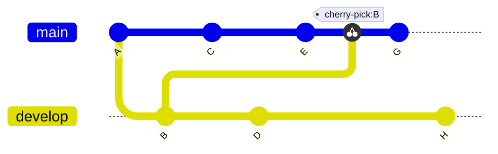



- Édition : Gratuite, GitLab Premium, GitLab Ultimate
- Offre : GitLab.com, GitLab Self-Managed, GitLab Dedicated



Dans Git, le *cherry-picking* consiste à prendre un seul commit d'une branche et à l'ajouter en tant que dernier commit sur une autre branche. Les autres commits de la branche source ne sont pas ajoutés à la cible. Effectuez un cherry-pick d'un commit lorsque vous avez besoin du contenu d'un seul commit, mais pas du contenu de l'ensemble de la branche. Par exemple, lorsque vous :

- Rétroportez des corrections de bugs depuis la branche par défaut vers les branches de releases précédentes.
- Copiez des modifications d'une duplication vers le dépôt en amont.

Utilisez l'interface utilisateur GitLab pour effectuer un cherry-pick d'un seul commit ou du contenu d'une merge request entière depuis un projet ou une duplication de projet.

Dans cet exemple, un dépôt Git comporte deux branches : `develop` et `main`. Le commit `B` est cherry-pické depuis la branche `develop` après le commit `E` dans la branche `main`. Le commit `G` est ajouté après le cherry-pick :

<!-- Diagram reused in `doc/topics/git/cherry_pick.md` -->

## Afficher les notes système pour les commits cherry-pickés {#view-system-notes-for-cherry-picked-commits}

Lorsque vous effectuez un cherry-pick d'un [commit de fusion](methods/_index.md#merge-commit) dans l'interface utilisateur ou l'API GitLab, GitLab ajoute une [note système](../system_notes.md) au fil de discussion de la merge request associée.

Les notes système sont créées uniquement lors du cherry-pick de commits de fusion. Les notes système ne sont pas créées lors de l'utilisation d'une fusion fast-forward. Cela s'applique aussi bien au cherry-pick de commits individuels qu'au cherry-pick de toutes les modifications d'une merge request.

Les commits cherry-pickés en dehors de l'interface utilisateur ou de l'API GitLab ne créent pas non plus de notes système.

Lorsqu'une note système est créée, le format est  `[USER]` **a intégré les modifications dans la branche** `[BRANCHNAME]` avec le commit `[SHA]` `[DATE]` :

La note système crée des liens croisés entre le nouveau commit et la merge request existante. La [liste des merge requests associées](../../../api/deployments.md#list-all-merge-requests-associated-with-a-deployment) de chaque déploiement inclut les commits de fusion cherry-pickés.

## Cherry-pick de toutes les modifications d'une merge request {#cherry-pick-all-changes-from-a-merge-request}

Une fois une merge request fusionnée, vous pouvez effectuer un cherry-pick de toutes les modifications introduites par la merge request. La merge request peut se trouver dans le projet en amont ou dans une duplication en aval.

Prérequis :

- Vous devez disposer d'un rôle pour le projet qui vous permet de modifier les merge requests et d'ajouter du code au dépôt.
- Votre projet doit utiliser la méthode [commit de fusion](methods/_index.md#merge-commit), définie dans les **Paramètres** > **Requêtes de fusion** du projet.

  Les commits fast-forwardés peuvent faire l'objet d'un cherry-pick depuis l'interface utilisateur GitLab uniquement lorsqu'ils sont squashés ou lorsque la merge request contient un seul commit. Vous pouvez toujours [effectuer un cherry-pick de commits individuels](#cherry-pick-a-single-commit).

  > [!note]
  > Les [notes système](#view-system-notes-for-cherry-picked-commits) ne sont pas créées lors de l'utilisation de la méthode de fusion fast-forward.

Pour cela :

1. Dans la barre supérieure, sélectionnez **Rechercher ou accéder à**, puis recherchez votre projet.
1. Dans la barre latérale gauche, sélectionnez **Code** > **Requêtes de fusion**, et trouvez votre merge request.
1. Faites défiler jusqu'à la section des rapports de merge request et trouvez le rapport **Fusionné par**.
1. Dans le coin supérieur droit du rapport, sélectionnez **Effectuer un cherry-pick** :

   
1. Dans la boîte de dialogue, sélectionnez le projet et la branche vers lesquels effectuer le cherry-pick.
1. Facultatif. Sélectionnez **Démarrer une nouvelle merge request avec ces modifications**.
1. Facultatif. Sélectionnez **Copier la description de la merge request** pour démarrer la nouvelle merge request à partir de la description de la merge request sur laquelle vous effectuez le cherry-pick, plutôt qu'à partir des modèles de description. Disponible uniquement lorsque vous démarrez une nouvelle merge request.
1. Sélectionnez **Effectuer un cherry-pick**.

## Cherry-pick d'un seul commit {#cherry-pick-a-single-commit}

Vous pouvez effectuer un cherry-pick d'un seul commit depuis plusieurs emplacements dans votre projet GitLab.

Si vous effectuez un cherry-pick d'un commit de fusion, GitLab crée une [note système](#view-system-notes-for-cherry-picked-commits) dans la merge request associée pour suivre l'opération.

### Depuis la liste des commits d'un projet {#from-a-projects-commit-list}

Pour effectuer un cherry-pick d'un commit depuis la liste de tous les commits d'un projet :

1. Dans la barre supérieure, sélectionnez **Rechercher ou accéder à**, puis recherchez votre projet.
1. Dans la barre latérale gauche, sélectionnez **Code** > **Commits**.
1. Sélectionnez le [titre](https://git-scm.com/docs/git-commit#_discussion) du commit sur lequel vous souhaitez effectuer un cherry-pick.
1. Dans le coin supérieur droit, sélectionnez **Options** > **Effectuer un cherry-pick**.
1. Dans la boîte de dialogue de cherry-pick, sélectionnez le projet et la branche vers lesquels effectuer le cherry-pick.
1. Facultatif. Sélectionnez **Démarrer une nouvelle merge request avec ces modifications**.
1. Sélectionnez **Effectuer un cherry-pick**.

### Depuis la vue fichier d'un dépôt {#from-the-file-view-of-a-repository}

Vous pouvez effectuer un cherry-pick depuis la liste des commits précédents affectant un fichier individuel lorsque vous consultez ce fichier dans le dépôt Git de votre projet :

1. Dans la barre supérieure, sélectionnez **Rechercher ou accéder à**, puis recherchez votre projet.
1. Dans la barre latérale gauche, sélectionnez **Code** > **Dépôt**.
1. Accédez au fichier modifié par le commit. Dans le dernier bloc de commit, sélectionnez **Historique**.
1. Sélectionnez le [titre](https://git-scm.com/docs/git-commit#_discussion) du commit sur lequel vous souhaitez effectuer un cherry-pick.
1. Dans le coin supérieur droit, sélectionnez **Options** > **Effectuer un cherry-pick**.
1. Dans la boîte de dialogue de cherry-pick, sélectionnez le projet et la branche vers lesquels effectuer le cherry-pick.
1. Facultatif. Sélectionnez **Démarrer une nouvelle merge request avec ces modifications**.
1. Sélectionnez **Effectuer un cherry-pick**.

## Sélectionner un commit parent différent {#select-a-different-parent-commit}

Lorsque vous effectuez un cherry-pick d'un commit de fusion dans l'interface utilisateur GitLab, la ligne principale est toujours le premier parent. Utilisez la ligne de commande pour effectuer un cherry-pick avec une ligne principale différente. Pour plus d'informations, consultez [copier le contenu d'une branche entière](../../../topics/git/cherry_pick.md#copy-the-contents-of-an-entire-branch).

## Sujets connexes {#related-topics}

- [API de commits](../../../api/commits.md#cherry-pick-a-commit)
- [Cherry-pick de modifications avec Git](../../../topics/git/cherry_pick.md)
