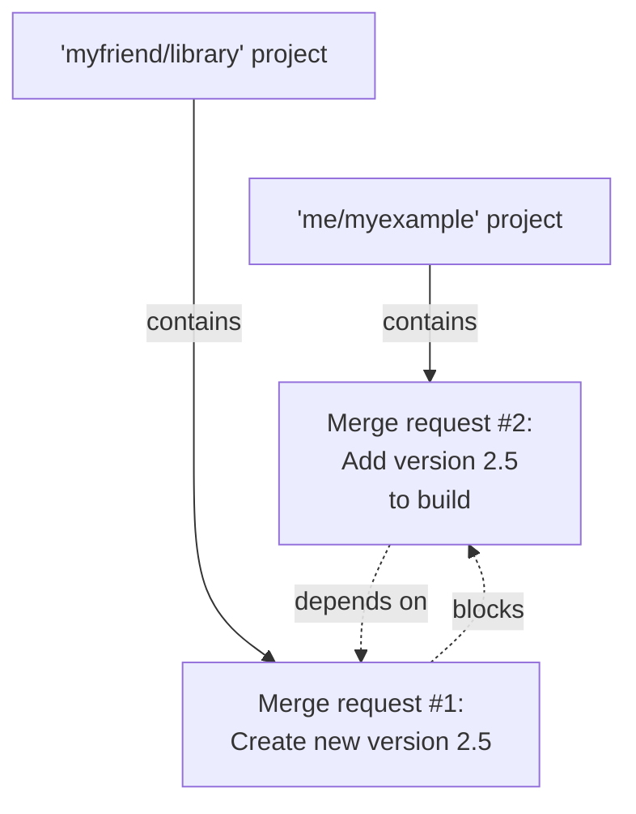
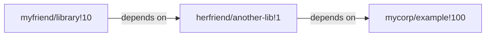



- Édition : GitLab Premium, GitLab Ultimate
- Offre : GitLab.com, GitLab Self-Managed, GitLab Dedicated



Une seule fonctionnalité peut s'étendre sur plusieurs merge requests, réparties dans plusieurs projets, et l'ordre dans lequel les travaux sont fusionnés peut avoir son importance. Lorsque vous définissez une dépendance de merge request, les merge requests dépendantes ne peuvent pas être fusionnées tant que la vérification de fusion **Les dépendances de la merge request doivent être fusionnées** n'est pas satisfaite.

Les dépendances de merge request peuvent vous aider à :

- Vous assurer que les modifications apportées à une bibliothèque requise sont fusionnées avant les modifications apportées à un projet qui importe la bibliothèque.
- Empêcher une merge request portant uniquement sur la documentation d'être fusionnée avant que le travail sur la fonctionnalité ne soit lui-même fusionné.
- Exiger qu'une merge request mettant à jour une matrice de permissions soit fusionnée avant de fusionner le travail d'une personne qui ne dispose pas encore des permissions appropriées.

Si votre projet `me/myexample` importe une bibliothèque depuis `myfriend/library`, vous devez mettre à jour votre projet lorsque `myfriend/library` publie une nouvelle fonctionnalité. Si vous fusionnez vos modifications dans `me/myexample` avant que `myfriend/library` n'ajoute la nouvelle fonctionnalité, vous casseriez la branche par défaut de votre projet. Une dépendance de merge request empêche votre travail d'être fusionné trop tôt :

Il est possible de marquer votre merge request `me/myexample` comme [brouillon](drafts.md) et d'expliquer pourquoi dans les commentaires. Cette approche est manuelle et ne s'adapte pas à grande échelle, surtout si votre merge request dépend de plusieurs autres dans des projets différents. À la place, vous devriez :

- Suivre l'état de préparation d'une merge request individuelle avec le statut **Brouillon** ou **Prêt**.
- Imposer l'ordre de fusion des merge requests grâce à une dépendance de merge request.

Les dépendances de merge request sont une fonctionnalité de GitLab Premium, mais GitLab n'applique cette restriction qu'à la merge request dépendante :

- La merge request d'un projet GitLab Premium peut dépendre de toute autre merge request, même dans un projet GitLab Gratuite.
- La merge request d'un projet GitLab Gratuite ne peut pas dépendre d'autres merge requests.

## Dépendances imbriquées {#nested-dependencies}

Les versions 16.7 et ultérieures de GitLab prennent en charge les dépendances indirectes et imbriquées. Une merge request peut avoir jusqu'à 10 bloqueurs et peut à son tour bloquer jusqu'à 10 autres merge requests. Dans cet exemple, `myfriend/library!10` dépend de `herfriend/another-lib!1`, qui à son tour dépend de `mycorp/example!100` :

Les dépendances imbriquées ne s'affichent pas dans l'interface utilisateur de GitLab, mais la prise en charge dans l'interface est proposée dans l'[epic 5308](https://gitlab.com/groups/gitlab-org/-/epics/5308).

> [!note]
> Une merge request ne peut pas dépendre d'elle-même (auto-référentielle), mais il est possible de créer des dépendances circulaires.

## Afficher les dépendances d'une merge request {#view-dependencies-for-a-merge-request}

Si une merge request dépend d'une autre, la section des rapports de merge request affiche des informations sur la dépendance :

Pour afficher les informations de dépendance d'une merge request :

1. Dans la barre supérieure, sélectionnez **Rechercher ou accéder à**, puis recherchez votre projet.
1. Dans la barre latérale gauche, sélectionnez **Code** > **Requêtes de fusion** et identifiez votre merge request.
1. Faites défiler jusqu'à la zone des rapports de merge request. Les merge requests dépendantes affichent des informations sur le nombre total de dépendances définies, par exemple **Dépend de 1 merge request en cours de fusion**.
1. Sélectionnez **Étendre** pour afficher le titre, le jalon, le responsable et le statut du pipeline de chaque dépendance.

Tant que toutes les dépendances de votre merge request ne sont pas fusionnées, votre merge request ne peut pas être fusionnée.

### Merge requests fermées {#closed-merge-requests}

Les merge requests fermées empêchent toujours leurs dépendantes d'être fusionnées, car une merge request peut être fermée sans que son travail planifié ne soit fusionné. Si une merge request est fermée et que la dépendance n'est plus pertinente, supprimez-la en tant que dépendance pour débloquer la merge request dépendante.

## Créer une nouvelle merge request dépendante {#create-a-new-dependent-merge-request}

Lorsque vous créez une nouvelle merge request, vous pouvez empêcher sa fusion jusqu'à ce qu'un autre travail spécifique soit fusionné. Cette dépendance fonctionne même si la merge request se trouve dans un projet différent.

Prérequis :

- Vous devez disposer du rôle Developer, Maintainer ou Owner, ou avoir la permission de créer des merge requests dans le projet.
- La merge request dépendante doit se trouver dans un projet de l'édition Premium ou Ultimate.

Pour créer une nouvelle merge request et la marquer comme dépendante d'une autre :

1. [Créez une nouvelle merge request](creating_merge_requests.md).
1. Dans **Dépendances de la requête de fusion**, collez la référence ou l'URL complète des merge requests qui doivent être fusionnées avant ce travail. Par exemple :
   - `!1234` (pour une merge request dans le même projet)
   - `gitlab-org/gitlab!1234`
   - `https://gitlab.com/gitlab-org/gitlab/-/merge_requests/1234`
1. Sélectionnez **Créer une requête de fusion**.

## Modifier une merge request pour ajouter une dépendance {#edit-a-merge-request-to-add-a-dependency}

Vous pouvez modifier une merge request existante et la marquer comme dépendante d'une autre.

Prérequis :

- Vous devez disposer du rôle Developer, Maintainer ou Owner, ou avoir la permission de modifier des merge requests dans le projet.

Pour cela :

1. Dans la barre supérieure, sélectionnez **Rechercher ou accéder à**, puis recherchez votre projet.
1. Dans la barre latérale gauche, sélectionnez **Code** > **Requêtes de fusion** et identifiez votre merge request.
1. Sélectionner **Éditer**.
1. Dans **Dépendances de la requête de fusion**, collez la référence ou l'URL complète des merge requests qui doivent être fusionnées avant ce travail. Par exemple :
   - `!1234` (pour une merge request dans le même projet)
   - `gitlab-org/gitlab!1234`
   - `https://gitlab.com/gitlab-org/gitlab/-/merge_requests/1234`

## Supprimer une dépendance d'une merge request {#remove-a-dependency-from-a-merge-request}

Vous pouvez modifier une merge request dépendante et supprimer une dépendance.

Prérequis :

- Vous devez disposer d'un rôle dans le projet vous autorisant à modifier des merge requests.

1. Dans la barre supérieure, sélectionnez **Rechercher ou accéder à**, puis recherchez votre projet.
1. Dans la barre latérale gauche, sélectionnez **Code** > **Requêtes de fusion** et identifiez votre merge request.
1. Sélectionner **Éditer**.
1. Faites défiler jusqu'à **Dépendances de la requête de fusion** et sélectionnez **Supprimer** en regard de la référence pour chaque dépendance que vous souhaitez supprimer.

   > [!note]
   > Les dépendances de merge request pour lesquelles vous n'avez pas la permission d'affichage sont indiquées comme **1 merge request inaccessible**. Vous pouvez tout de même supprimer la dépendance.

1. Sélectionnez **Enregistrer les modifications**.

## Dépannage {#troubleshooting}

### Conserver les dépendances lors de l'importation ou de l'exportation d'un projet {#preserve-dependencies-on-project-import-or-export}

Les dépendances ne sont pas conservées lors de l'importation ou de l'exportation d'un projet. Pour plus d'informations, consultez le [ticket #12549](https://gitlab.com/gitlab-org/gitlab/-/issues/12549).
