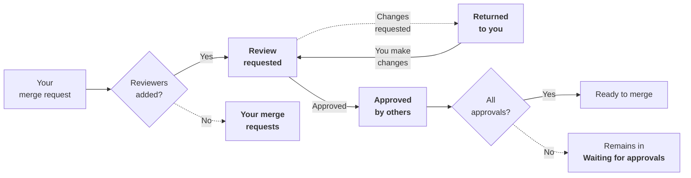



- Édition : Gratuite, GitLab Premium, GitLab Ultimate
- Offre : GitLab.com, GitLab Self-Managed, GitLab Dedicated



Si vous êtes l'auteur, la personne assignée ou le relecteur ou la relectrice d'une merge request, celle-ci apparaît sur votre page d'accueil des merge requests. Cette page trie vos merge requests par **Flux de travail** ou par **Rôle**. La vue **Flux de travail** vous montre quelles merge requests nécessitent votre attention en premier, que ce soit votre travail ou celui d'une autre personne. La vue Flux de travail regroupe les merge requests par étape dans ce processus de révision :

Ce flux de révision suppose que les relecteurs et relectrices utilisent les fonctionnalités **Démarrer une révision** et **Envoyer une révision**.

La vue **Rôle** trie vos merge requests selon votre rôle dans la merge request.

## Accéder à votre page d'accueil des merge requests {#see-your-merge-request-homepage}



- La page d'accueil des merge requests a été [introduite](https://gitlab.com/groups/gitlab-org/-/work_items/13448) dans GitLab 17.9 [avec un feature flag](../../../administration/feature_flags/_index.md) nommé `merge_request_dashboard`. Fonctionnalité désactivée par défaut.
- Le feature flag `merge_request_dashboard` a été [activé](https://gitlab.com/gitlab-org/gitlab/-/issues/480854) sur GitLab.com dans GitLab 17.9.
- Le feature flag `mr_dashboard_list_type_toggle` a été [activé](https://gitlab.com/gitlab-org/gitlab/-/issues/535244) pour GitLab.com dans GitLab 18.1.
- Le feature flag `merge_request_dashboard` a été [activé par défaut](https://gitlab.com/gitlab-org/gitlab/-/merge_requests/194999) dans GitLab 18.2.



> [!flag]
> La disponibilité de cette fonctionnalité est contrôlée par un feature flag. Pour plus d'informations, consultez l'historique.

GitLab affiche le nombre total de merge requests **Actif** dans le coin supérieur droit de toutes les pages. Par exemple, cet utilisateur a :

Cet utilisateur a :

- 8 tickets ouverts ()
- 3 merge requests actives ()
- 6 éléments de la liste de tâches ()

Votre page d'accueil des merge requests affiche plus d'informations sur ces merge requests. Pour y accéder, utilisez l'une des méthodes suivantes :

- Utilisez le [raccourci clavier](../../shortcuts.md) <kbd>Shift</kbd>+<kbd>m</kbd>.
- Dans la barre latérale gauche, sélectionnez **Requêtes de fusion** ().
- Dans la barre supérieure, sélectionnez **Rechercher ou accéder à**, puis, dans la liste déroulante, sélectionnez **Requêtes de fusion**.

Pour vous aider à vous concentrer sur ce qui nécessite votre attention immédiate, GitLab organise votre page d'accueil des merge requests en trois onglets :

- **Actif** : ces merge requests nécessitent votre attention ou celle d'un membre de votre équipe.
- **Fusionnées** : ces merge requests ont été fusionnées au cours des 14 derniers jours. Il s'agit de votre travail ou d'un travail contenant une révision de votre part.
- **Rechercher** : recherchez toutes les merge requests et filtrez-les selon vos besoins.

- **Statut** : le statut actuel de la merge request.
- **Intitulé** : métadonnées importantes sur la merge request, notamment :
  - Le titre de la merge request.
  - L'avatar de la personne assignée.
  - Le nombre de fichiers et de lignes ajoutés et supprimés (`+` / `-`).
  - Jalon.
- **Auteur** : l'avatar de l'auteur.
- **Relecteur** : les avatars des relecteurs et relectrices. Les relecteurs et relectrices dont la case est cochée en vert ont approuvé la merge request.
- **Vérifications** : une évaluation synthétique de la capacité à fusionner.
  - Un avertissement () si des conflits de merge existent.
  - Nombre de fils de discussion non résolus, par exemple `0 of 3`.
  - Le [statut d'approbation](approvals/_index.md#in-the-list-of-merge-requests) requis actuel.
  - Statut du pipeline le plus récent.
  - Date de la dernière mise à jour.

### Définir vos préférences d'affichage {#set-your-display-preferences}



- La préférence **Afficher vos brouillons** a été [introduite](https://gitlab.com/gitlab-org/gitlab/-/issues/551475) dans GitLab 18.6.



En haut à droite de votre page d'accueil des merge requests, sélectionnez **Préférences d'affichage** ():

- Activez ou désactivez **Afficher les labels** pour afficher ou masquer les labels de chaque merge request.
- Préférences de tri : **Flux de travail** ou **Rôle**.
  - **Flux de travail** regroupe les merge requests par statut. GitLab affiche en premier les merge requests nécessitant votre attention, que vous en soyez l'auteur ou le relecteur ou la relectrice.
  - **Rôle** regroupe les merge requests selon que vous êtes le relecteur ou la relectrice ou l'auteur.
- Activez ou désactivez **Afficher vos brouillons** pour afficher ou masquer les merge requests en brouillon dans la liste **Vos requêtes de fusion**.

Les merge requests actives sont comptabilisées dans le total affiché dans la barre latérale gauche. GitLab exclut les merge requests **Inactif** de votre décompte de révisions.

### Vue Flux de travail : statuts actifs {#workflow-view-active-statuses}

Ces merge requests nécessitent votre attention. Elles sont comptabilisées dans le total affiché dans la barre latérale gauche :

- **Vos requêtes de fusion** : vous êtes l'auteur ou la personne assignée de la merge request. Ajoutez des relecteurs et relectrices pour démarrer le processus de révision. Statuts :
  - **Brouillon** : La merge request est en brouillon.
  - **Relecteurs et relectrices nécessaires** : la merge request n'est pas un brouillon, mais n'a pas de relecteurs ou relectrices.
- **Révision demandée** : vous êtes un relecteur ou une relectrice. Relisez la merge request. Fournissez des commentaires. Si vous le souhaitez, approuvez ou demandez des modifications. Statuts :
  - **Modifications demandées** : un relecteur ou une relectrice a demandé des modifications. La demande de modification bloque la merge request, mais [peut être contournée](reviews/_index.md#bypass-a-request-for-changes).
  - **Le relecteur ou la relectrice a posté un commentaire** : un relecteur ou une relectrice a laissé des commentaires mais n'a pas demandé de modifications.
- **Vous a été retourné(e)** : les relecteurs et relectrices ont fourni des commentaires ou demandé des modifications. Traitez les commentaires des relecteurs et relectrices et appliquez les modifications suggérées. Statuts :
  - **Modifications demandées** : un relecteur ou une relectrice a demandé des modifications.
  - **Le relecteur ou la relectrice a posté un commentaire** : un relecteur ou une relectrice a laissé des commentaires mais n'a pas demandé de modifications.

### Vue Flux de travail : statuts inactifs {#workflow-view-inactive-statuses}

GitLab exclut ces merge requests du décompte actif, car aucune action de votre part n'est requise pour le moment :

- **En attente de la personne assignée** : si vous êtes l'auteur, la merge request est en attente de révision. Si vous êtes le relecteur ou la relectrice, vous avez demandé des modifications. Statuts :
  - **Vous avez demandé des modifications** : vous avez terminé votre révision et demandé des modifications.
  - **Vous avez émis des commentaires** : vous avez publié des commentaires, mais n'avez pas terminé votre révision.
- **En attente d’approbations** : vos merge requests assignées qui sont en attente d'approbations, ainsi que les révisions pour lesquelles vous avez demandé des modifications. Statuts :
  - **Approbation requise** : nombre d'approbations requises restantes.
  - **Approuvée** : vous avez approuvé, ou toutes les approbations requises sont satisfaites.
  - **En attente d’approbations**.
- **Approuvé(e) par vous** : Merge requests que vous avez relues et approuvées. Statuts :
  - **Approuvée** : vous avez approuvé et toutes les approbations requises sont satisfaites.
  - **Approbation requise** : vous avez approuvé, mais toutes les approbations requises ne sont pas satisfaites.
- **Approuvé(e) par un tiers** : Merge requests ayant reçu des approbations d'autres membres de l'équipe. Potentiellement prête à être fusionnée, si toutes les conditions sont remplies. Statuts :
  - **Approuvée** : votre merge request a reçu les approbations nécessaires.

### Vue Rôle {#role-view}

La vue **Rôle** regroupe les merge requests pour lesquelles vous êtes la personne assignée ou le relecteur ou la relectrice :

- **Relecteur ou relectrice (Actif)** : en attente de votre révision.
- **Relecteur ou relectrice (Inactif)** : déjà revu(e) par vous.
- **Vos requêtes de fusion (Actif)**
- **Vos requêtes de fusion (Inactif)**

Les merge requests dans les listes **Actif** sont comptabilisées dans le total affiché dans la barre latérale gauche.

## Sujets connexes {#related-topics}

- [Revues de merge request](reviews/_index.md)
