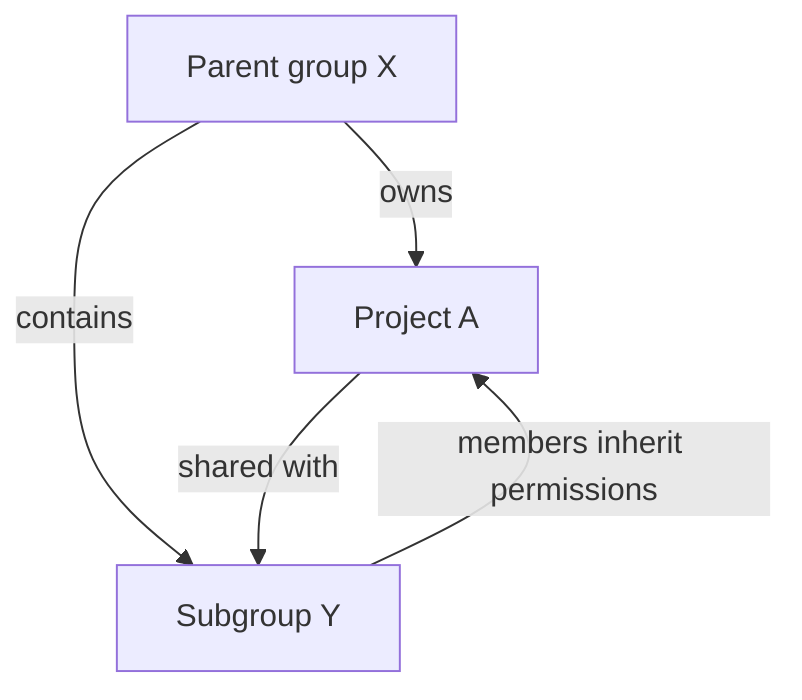
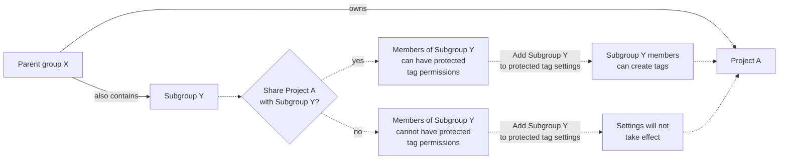



- Édition : Gratuite, GitLab Premium, GitLab Ultimate
- Offre : GitLab.com, GitLab Self-Managed, GitLab Dedicated



[Étiquettes](repository/tags/_index.md) protégées :

- Permettent de contrôler qui a la permission de créer des étiquettes.
- Empêchent les mises à jour ou suppressions accidentelles une fois créées.

Chaque règle vous permet de faire correspondre :

- Un nom d'étiquette individuel.
- Des jokers pour contrôler plusieurs étiquettes à la fois.

Cette fonctionnalité est issue des [branches protégées](repository/branches/protected.md).

> [!note]
> Pour créer ou supprimer une étiquette protégée, vous devez figurer dans la liste **Autorisé à créer** pour cette étiquette protégée.

## Configurer des étiquettes protégées {#configure-protected-tags}

Prérequis :

- Vous devez disposer du rôle Chargé de maintenance ou Propriétaire dans le projet.

1. Dans la barre supérieure, sélectionnez **Rechercher ou accéder à**, puis recherchez votre projet.
1. Dans la barre latérale gauche, sélectionnez **Paramètres** > **Dépôt**.
1. Développez **Étiquettes protégées**.
1. Sélectionnez **Ajouter nouveau**.
1. Pour protéger une seule étiquette, sélectionnez **Étiquette**, puis choisissez votre étiquette dans la liste déroulante.
1. Pour protéger toutes les étiquettes dont les noms correspondent à une chaîne :
   1. Sélectionnez **Étiquette**.
   1. Saisissez la chaîne à utiliser pour la correspondance des étiquettes. Les jokers (`*`) sont pris en charge.
   1. Sélectionnez **Créer un joker**.
1. Dans **Autorisé à créer**, sélectionnez les rôles autorisés à créer des étiquettes protégées.

   > [!note]
   > Dans GitLab Premium et Ultimate, vous pouvez également ajouter des groupes ou des utilisateurs individuels à **Autorisé à créer**.

1. Sélectionnez **Protéger**.

L'étiquette protégée (ou le joker) s'affiche dans la liste **Étiquettes protégées**.

### Ajouter un groupe aux étiquettes protégées {#add-a-group-to-protected-tags}

Pour définir les membres d'un groupe ou d'un sous-groupe comme Autorisé à créer des étiquettes protégées :

1. Dans la barre latérale gauche, sélectionnez **Rechercher ou accéder à** et repérez votre projet.
1. Sélectionnez **Paramètres** > **Dépôt**.
1. Développez **Étiquettes protégées**.
1. Ajoutez des groupes dans le champ suivant :

   ```plaintext
   # Allow group members to create protected tags
   Allowed to create: @group-x
   ```

#### Héritage de groupe et éligibilité {#group-inheritance-and-eligibility}



Dans cet exemple :

- Le groupe parent X (`group-x`) est propriétaire du projet A.
- Le groupe parent X contient également un sous-groupe, le sous-groupe Y. (`group-x/subgroup-y`)
- Le projet A est partagé avec le sous-groupe Y.

Les groupes éligibles aux autorisations d'étiquettes protégées sont :

- Projet A : le groupe X et le sous-groupe Y, car le projet A est partagé avec le sous-groupe Y.

#### Partager des projets avec des groupes {#share-projects-with-groups}

Vous pouvez partager le projet avec un groupe ou un sous-groupe afin que leurs membres soient éligibles aux autorisations d'étiquettes protégées.



Pour accorder l'accès aux membres du sous-groupe Y pour le projet A, vous devez partager le projet avec le sous-groupe. L'ajout du sous-groupe directement dans les paramètres des étiquettes protégées n'est pas efficace et ne s'applique pas aux membres du sous-groupe.

> [!note]
> Pour qu'un groupe dispose des autorisations d'étiquettes protégées, le projet doit être directement partagé avec ce groupe. L'appartenance héritée à un projet depuis des groupes parents n'est pas suffisante pour les autorisations d'étiquettes protégées.

## Étiquettes protégées avec joker {#wildcard-protected-tags}

Vous pouvez spécifier une étiquette protégée avec joker, qui protège toutes les étiquettes correspondant au joker. Par exemple :

| Étiquette protégée avec joker | Étiquettes correspondantes                 |
|------------------------|-------------------------------|
| `v*`                   | `v1.0.0`, `version-9.1`       |
| `*-deploy`             | `march-deploy`, `1.0-deploy`  |
| `*gitlab*`             | `gitlab`, `gitlab/v1`         |
| `*`                    | `v1.0.1rc2`, `accidental-tag` |

Deux jokers différents peuvent potentiellement correspondre à la même étiquette. Par exemple, `*-stable` et `production-*` correspondraient toutes les deux à une étiquette `production-stable`. Dans ce cas, si _l'une quelconque_ de ces étiquettes protégées possède un paramètre tel que **Autorisé à créer**, alors `production-stable` hérite également de ce paramètre.

Si vous sélectionnez le nom d'une étiquette protégée, GitLab affiche la liste de toutes les étiquettes correspondantes.

## Autoriser les clés de déploiement à créer des étiquettes protégées {#allow-deploy-keys-to-create-protected-tags}

Vous pouvez autoriser une [clé de déploiement](deploy_keys/_index.md) à créer des étiquettes protégées.

Prérequis :

- La clé de déploiement doit être activée pour votre projet. Une clé de déploiement de projet est activée par défaut lors de sa création. Cependant, une clé de déploiement publique doit se voir [accorder](deploy_keys/_index.md#grant-project-access-to-a-public-deploy-key) l'accès au projet.
- La clé de déploiement doit disposer d'un [accès en écriture](deploy_keys/_index.md#permissions) au dépôt de votre projet.
- Le propriétaire de la clé de déploiement doit disposer au minimum d'un accès en lecture au projet.
- Le propriétaire de la clé de déploiement doit également être membre du projet.

Pour autoriser une clé de déploiement à créer une étiquette protégée :

1. Dans la barre supérieure, sélectionnez **Rechercher ou accéder à**, puis recherchez votre projet.
1. Dans la barre latérale gauche, sélectionnez **Paramètres** > **Dépôt**.
1. Développez **Étiquettes protégées**.
1. Dans la liste déroulante **Étiquette**, sélectionnez l'étiquette que vous souhaitez protéger.
1. Dans la liste **Autorisé à créer**, sélectionnez la clé de déploiement.
1. Sélectionnez **Protéger**.

## Empêcher la création d'étiquettes avec des noms de branche {#prevent-tag-creation-with-branch-names}

Une étiquette et une branche portant des noms identiques peuvent contenir des commits différents. Si vos étiquettes et vos branches portent les mêmes noms, les utilisateurs exécutant des commandes `git checkout` pourraient extraire l'_étiquette_ `qa` alors qu'ils souhaitaient extraire la _branche_ `qa`. Par mesure de sécurité supplémentaire, évitez de créer des étiquettes portant le même nom que des branches. Confondre les deux pourrait entraîner des problèmes de sécurité ou opérationnels.

Pour éviter ce problème :

1. Identifiez les noms de branche que vous ne souhaitez pas utiliser comme étiquettes.
1. Créez une étiquette protégée comme décrit dans [configurer des étiquettes protégées](#configure-protected-tags) :

   - Pour le champ **Nom**, indiquez un nom, tel que `stable`. Vous pouvez également créer un joker tel que `stable-*` pour faire correspondre plusieurs noms, comme `stable-v1` et `stable-v2`.
   - Pour **Autorisé à créer**, sélectionnez **Personne**.
   - Sélectionnez **Protéger**.

Les utilisateurs peuvent toujours créer des branches, mais pas des étiquettes, avec les noms protégés.

## Exécuter des pipelines sur des étiquettes protégées {#run-pipelines-on-protected-tags}

Les autorisations pour créer des étiquettes protégées définissent si un utilisateur peut :

- Initier et exécuter des pipelines CI/CD.
- Exécuter des actions sur les jobs associés à ces étiquettes.

Ces autorisations garantissent que seuls les utilisateurs autorisés peuvent déclencher et gérer les processus CI/CD pour les étiquettes protégées.

## Déprotéger une étiquette {#unprotect-a-tag}

Vous pouvez déprotéger une étiquette en supprimant sa règle de protection. Cette action supprime la configuration de protection, et non l'étiquette elle-même. L'étiquette reste dans le dépôt, mais n'est plus protégée.

Prérequis :

- Vous devez disposer du rôle Chargé de maintenance ou Propriétaire.

Pour déprotéger une étiquette :

1. Dans la barre supérieure, sélectionnez **Rechercher ou accéder à**, puis recherchez votre projet.
1. Dans la barre latérale gauche, sélectionnez **Paramètres** > **Dépôt**.
1. Développez **Étiquettes protégées**.
1. En regard de la règle d'étiquette protégée que vous souhaitez supprimer, sélectionnez **Déprotéger**.

> [!warning]
> Après avoir déprotégé un modèle d'étiquette, tout utilisateur disposant du rôle Développeur, Chargé de maintenance ou Propriétaire peut supprimer les étiquettes correspondant à ce modèle.

## Supprimer une étiquette protégée {#delete-a-protected-tag}

Vous pouvez supprimer des étiquettes auxquelles des règles de protection sont appliquées. Cette action supprime l'étiquette du dépôt, et non la règle de protection elle-même. Si vous souhaitez supprimer la règle de protection sans supprimer l'étiquette, consultez [déprotéger une étiquette](#unprotect-a-tag).

Prérequis :

- Figurer dans la liste **Autorisé à créer** des rôles ou des utilisateurs pour cette étiquette.
- Le rôle Chargé de maintenance ou Propriétaire dans le projet.

Pour supprimer une étiquette protégée :

1. Dans la barre supérieure, sélectionnez **Rechercher ou accéder à**, puis recherchez votre projet.
1. Dans la barre latérale gauche, sélectionnez **Code** > **Étiquettes**.
1. En regard de l'étiquette que vous souhaitez supprimer, sélectionnez **Supprimer** ().
1. Dans la boîte de dialogue de confirmation, saisissez le nom de l'étiquette et sélectionnez **Oui, supprimer l'étiquette protégée**.

Les étiquettes protégées ne peuvent être supprimées qu'en utilisant GitLab depuis l'interface utilisateur ou l'API. Ces protections vous empêchent de supprimer accidentellement une étiquette via des commandes Git locales ou des clients Git tiers.

## Sujets connexes {#related-topics}

- [API des étiquettes protégées](../../api/protected_tags.md)
- [API de tags](../../api/tags.md)
