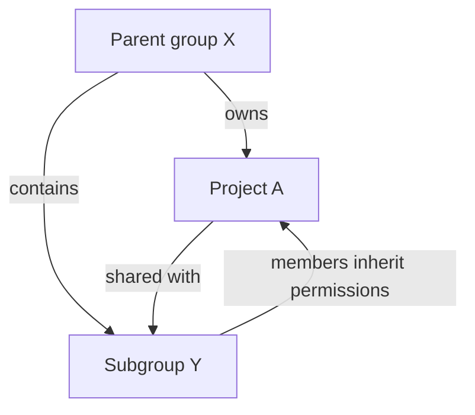
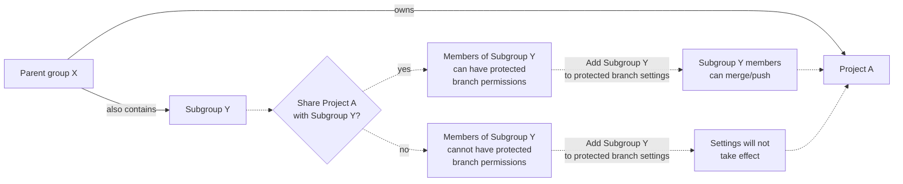



- Édition : Gratuite, GitLab Premium, GitLab Ultimate
- Offre : GitLab.com, GitLab Self-Managed, GitLab Dedicated



> [!note]
> Les paramètres **Branches protégées** pour les projets vont être supprimés. Configurez plutôt les branches protégées depuis **Paramètres** > **Dépôt** > **Règles des branches**.

Les branches protégées appliquent des autorisations spécifiques aux branches dans GitLab afin de garantir la stabilité et la qualité du code. Les branches protégées :

- Contrôlent quels utilisateurs peuvent fusionner et envoyer des modifications de code.
- Empêchent la suppression accidentelle de branches critiques.
- Appliquent les processus de revue de code et d'approbation.
- Gèrent les exigences d'approbation des propriétaires du code.
- Régulent les autorisations de push forcé pour maintenir l'historique des commits.
- Contrôlent l'accès via l'interface utilisateur et l'API des branches protégées.

> [!note]
> La branche par défaut de votre dépôt est protégée par défaut. Pour plus d'informations sur les paramètres de la branche par défaut, consultez [la branche par défaut](default.md).

Pour plus d'informations sur le comportement des règles de protection lorsqu'une branche correspond à plusieurs règles ou présente des exigences d'autorisation complexes, consultez les [règles de protection](protection_rules.md).

## Protéger une branche {#protect-a-branch}

Configurez des branches protégées pour des projets individuels ou pour tous les projets d'un groupe.

> [!note]
> Les règles de groupe ne peuvent pas être modifiées dans un projet, mais un chargé de maintenance du projet peut créer une règle distincte pour le même nom de branche. Lorsque les deux règles s'appliquent à la même branche, GitLab évalue toutes les règles correspondantes ensemble et applique le résultat le plus permissif pour la plupart des paramètres. Pour plus d'informations, consultez les [règles entre groupes et projets](protection_rules.md#rules-across-groups-and-projects).
<!-- -->
> [!tip]
> Lorsque vous protégez un nom de branche ou un schéma, envisagez de protéger également le même nom ou schéma pour les tags. Git permet aux branches et aux tags de partager le même nom. Protéger les deux garantit donc des contrôles d'accès cohérents sur toutes les références. Pour plus d'informations, consultez les [tags protégés](../../protected_tags.md).

### Dans un projet {#in-a-project}

Prérequis :

- Vous devez disposer du rôle Chargé de maintenance ou Propriétaire.
- Lors de l'octroi à un groupe des autorisations **Autorisés à fusionner** ou **Autorisés à pousser et fusionner** sur une branche protégée, le projet doit être accessible et partagé avec le groupe. Pour plus d'informations, consultez les [projets partagés](../../members/sharing_projects_groups.md).

Pour protéger une branche :

1. Dans la barre supérieure, sélectionnez **Rechercher ou accéder à**, puis recherchez votre projet.
1. Dans la barre latérale gauche, sélectionnez **Paramètres** > **Dépôt**.
1. Développez **Règles des branches**.
1. Sélectionnez **Ajouter une règle de branche** > **Schéma ou nom de la branche**.
1. Dans la liste déroulante, recherchez et sélectionnez la branche que vous souhaitez protéger.
1. Pour afficher la page **Détails de la règle de branche**, sélectionnez **Créer une règle de branche**.
1. Dans la section **Protéger la branche**, choisissez l'une des options suivantes :
   - Depuis **Autorisés à fusionner**, sélectionnez **Modifier**.
     1. Sélectionnez les rôles autorisés à fusionner dans cette branche.
     1. Sélectionnez **Enregistrer les modifications**.
   - Depuis **Autorisés à pousser et fusionner**, sélectionnez **Modifier**.
     1. Sélectionnez les rôles autorisés à effectuer un push vers cette branche.
     1. Facultatif. Recherchez et sélectionnez les **Clés de déploiement**.
     1. Sélectionnez **Enregistrer les modifications**.

> [!note]
> Dans GitLab Premium et Ultimate, vous pouvez également ajouter des groupes ou des utilisateurs individuels aux champs **Autorisés à fusionner** et **Autorisés à pousser et fusionner**.

### Dans un groupe {#in-a-group}



- Édition : GitLab Premium, GitLab Ultimate
- Offre : GitLab.com, GitLab Self-Managed, GitLab Dedicated





- [Disponibilité générale](https://gitlab.com/gitlab-org/gitlab/-/issues/500250) dans GitLab 17.6. Suppression du feature flag `group_protected_branches`.



Les propriétaires de groupe peuvent créer des branches protégées pour un groupe. Ces paramètres s'appliquent à tous les projets du groupe et ne peuvent pas être modifiés dans un projet.

Prérequis :

- Vous devez avoir le rôle Propriétaire pour le groupe.
- Le groupe doit être un groupe principal. Les sous-groupes ne sont pas pris en charge.

Pour protéger une branche pour tous les projets d'un groupe :

1. Dans la barre supérieure, sélectionnez **Rechercher ou accéder à**, puis recherchez votre groupe.
1. Dans la barre latérale gauche, sélectionnez **Paramètres** > **Dépôt**.
1. Développez **Branches protégées**.
1. Sélectionnez **Ajouter une branche protégée**.
1. Dans le champ texte **Branche**, saisissez le nom de la branche ou un [joker](#use-wildcard-rules) (`*`). Les noms de branches et les jokers sont sensibles à la casse.
1. Dans la liste **Autorisés à fusionner**, sélectionnez un rôle autorisé à fusionner dans cette branche.
1. Dans la liste **Autorisés à pousser et fusionner**, sélectionnez un rôle autorisé à effectuer un push vers cette branche.
1. Sélectionnez vos préférences pour **Autorisé à forcer les poussées** et **Exiger l'approbation des propriétaires du code**.
1. Sélectionnez **Protéger**.

## Autorisations de push et de fusion {#push-and-merge-permissions}

Les paramètres **Autorisés à fusionner** et **Autorisés à pousser et fusionner** contrôlent différents aspects de la protection des branches :

| Paramètre                       | Objectif                                                                                                        | Comportement par défaut (non configuré) |
|-------------------------------|----------------------------------------------------------------------------------------------------------------|-----------------------------------|
| **Autorisés à fusionner**          | Contrôle qui peut fusionner des modifications via des merge requests et créer de nouvelles branches protégées via l'interface utilisateur et l'API | Personne ne peut fusionner (sauf si les personnes concernées ont l'autorisation **Autorisés à pousser et fusionner**). |
| **Autorisés à pousser et fusionner** | Contrôle qui peut effectuer un push directement vers des branches protégées existantes et fusionner via des merge requests                 | Personne ne peut effectuer de push.                  |

> [!note]
> **Autorisés à pousser et fusionner** accorde à la fois des capacités de push et de fusion. Les utilisateurs disposant de cette autorisation peuvent fusionner via des merge requests même sans l'autorisation **Autorisés à fusionner**.

Lorsque vous sélectionnez **Personne** pour **Autorisés à fusionner** ou **Autorisés à pousser et fusionner**, l'interface utilisateur efface les autres sélections de rôles. Ce comportement diffère de celui de l'API, qui permet de définir plusieurs niveaux d'accès simultanément. Pour plus d'informations sur le comportement de l'API, consultez l'[API des branches protégées](../../../../api/protected_branches.md).

### Stratégies de protection par types de branches {#protection-strategies-by-branch-types}

Les différents types de branches nécessitent des niveaux de protection différents en fonction de leur objectif et de leurs exigences en matière de sécurité.

Pour les branches déployées dans des environnements de production :

- Définissez **Autorisés à fusionner** sur **Chargés de maintenance** uniquement.
- Définissez **Autorisés à pousser et fusionner** sur **Personne** (non vide).
- Activez **Exiger l'approbation des propriétaires du code**.
- Envisagez d'exiger plusieurs approbations.

Avec cette configuration, toutes les modifications nécessitent des merge requests avec l'approbation d'un chargé de maintenance.

Pour les branches de développement actif :

- Définissez **Autorisés à fusionner** sur **Développeurs + Chargés de maintenance**.
- Définissez **Autorisés à pousser et fusionner** sur **Personne** (non vide).

Avec cette configuration, les développeurs peuvent fusionner les merge requests approuvées tout en exigeant que toutes les modifications passent par une revue de code.

> [!note]
> Lorsque **Autorisés à pousser et fusionner** n'est pas configuré, ce paramètre ne limite pas l'accès en push. Pour empêcher les pushs directs, vous devez définir explicitement **Autorisés à pousser et fusionner** sur **Personne**.

### Combinaisons d'autorisations pour le rôle Développeur {#permission-combinations-for-developer-role}

Les exemples suivants montrent ce que les utilisateurs disposant du rôle Développeur peuvent faire avec différentes configurations de protection :

| Autorisés à fusionner         | Autorisés à pousser et fusionner | Push direct | Fusion via MR |
|--------------------------|---------------------------|-------------|------------------|
| Personne                   | Développeurs + Chargés de maintenance  |  |       |
| Non configuré           | Développeurs + Chargés de maintenance  |  |       |
| Développeurs + Chargés de maintenance | Non configuré            |   |       |
| Non configuré           | Non configuré            |   |        |
| Chargés de maintenance              | Non configuré            |   |        |
| Chargés de maintenance              | Chargés de maintenance               |   |        |
| Développeurs + Chargés de maintenance | Chargés de maintenance               |   |       |

## Paramètres de protection de la branche par défaut {#default-branch-protection-settings}

Les administrateurs peuvent [définir un niveau de protection de branche par défaut](default.md#for-all-projects-in-an-instance) dans la zone **Admin**.

## Utiliser des règles avec joker {#use-wildcard-rules}

Lors de l'utilisation de jokers, plusieurs règles peuvent s'appliquer à une seule branche. Si plusieurs règles s'appliquent à une branche, c'est la règle la plus permissive qui contrôle le comportement de la branche. Pour que les contrôles de fusion fonctionnent correctement, définissez **Autorisés à pousser et fusionner** sur un ensemble d'utilisateurs plus large que **Autorisés à fusionner**.

Prérequis :

- Vous devez disposer du rôle Chargé de maintenance ou Propriétaire.

Pour protéger plusieurs branches en même temps :

1. Dans la barre supérieure, sélectionnez **Rechercher ou accéder à**, puis recherchez votre projet.
1. Dans la barre latérale gauche, sélectionnez **Paramètres** > **Dépôt**.
1. Développez **Règles des branches**.
1. Sélectionnez **Ajouter une règle de branche** > **Schéma ou nom de la branche**.
1. Dans la liste déroulante, saisissez le nom de la branche et un joker (`*`). Les noms de branches et les jokers sont sensibles à la casse. Par exemple :

   | Branche protégée avec joker | Branches correspondantes                                      |
   |---------------------------|--------------------------------------------------------|
   | `*-stable`                | `production-stable`, `staging-stable`                  |
   | `production/*`            | `production/app-server`, `production/load-balancer`    |
   | `*gitlab*`                | `gitlab`, `gitlab/staging`, `master/gitlab/production` |

1. Sélectionnez **Créer un joker**.
1. Sélectionnez **Créer une règle de branche**. Vous êtes redirigé vers la page **Détails de la règle de branche**.
1. Dans la section **Protéger la branche**, choisissez l'une des options suivantes :
   - Depuis **Autorisés à fusionner**, sélectionnez **Modifier**.
     1. Sélectionnez les rôles autorisés à fusionner dans cette branche.
     1. Sélectionnez **Enregistrer les modifications**.
   - Depuis **Autorisés à pousser et fusionner**, sélectionnez **Modifier**.
     1. Sélectionnez les rôles autorisés à fusionner dans cette branche.
     1. Si vous le souhaitez, effectuez une recherche pour ajouter des **Clés de déploiement**.
     1. Sélectionnez **Enregistrer les modifications**.

## Configurer les options de protection {#configure-protection-options}

Vous pouvez définir diverses options de protection pour sécuriser vos branches.

### Exiger des merge requests {#require-merge-requests}

Vous pouvez obliger tout le monde à soumettre une merge request, plutôt que de leur permettre de valider directement sur une branche protégée :

1. Dans la barre supérieure, sélectionnez **Rechercher ou accéder à**, puis recherchez votre projet.
1. Dans la barre latérale gauche, sélectionnez **Paramètres** > **Dépôt**.
1. Développez **Règles des branches**.
1. À côté de votre branche, sélectionnez **Afficher les détails**.
1. Dans la section **Autorisés à fusionner**, sélectionnez **Modifier**
1. Sélectionnez **Développeurs + Chargés de maintenance**.
1. Sélectionnez **Enregistrer les modifications**.
1. Dans la section **Autorisés à pousser et fusionner**, sélectionnez **Personne**.
1. Sélectionnez **Enregistrer les modifications**.

### Autoriser le push direct {#allow-direct-push}

Vous pouvez autoriser toute personne disposant d'un accès en écriture à effectuer un push directement vers la branche protégée.

1. Dans la barre supérieure, sélectionnez **Rechercher ou accéder à**, puis recherchez votre projet.
1. Dans la barre latérale gauche, sélectionnez **Paramètres** > **Dépôt**.
1. Développez **Règles des branches**.
1. À côté de votre branche, sélectionnez **Afficher les détails**.
1. Dans la section **Autorisés à pousser et fusionner**, sélectionnez **Développeurs + Chargés de maintenance**.
1. Sélectionnez **Enregistrer les modifications**.

### Avec les autorisations de groupe {#with-group-permissions}



- Édition : GitLab Premium, GitLab Ultimate
- Offre : GitLab.com, GitLab Self-Managed, GitLab Dedicated



Pour définir les membres d'un groupe ou d'un sous-groupe comme **Autorisés à fusionner** ou **Autorisés à pousser et fusionner** sur une branche protégée :

1. Dans la barre supérieure, sélectionnez **Rechercher ou accéder à**, puis recherchez votre projet.
1. Dans la barre latérale gauche, sélectionnez **Paramètres** > **Dépôt**.
1. Développez **Règles des branches**.
1. À côté de votre branche, sélectionnez **Afficher les détails**.
1. Dans les sections **Autorisés à fusionner** ou **Autorisés à pousser et fusionner**, sélectionnez **Modifier**.
1. Sous **Groupes**, effectuez une recherche pour ajouter des groupes. Par exemple :

   ```plaintext
   # Allow group members to merge into this branch
   Allowed to merge: @group-x

   # Allow group members to push and merge into this branch
   Allowed to push and merge: @group-x/subgroup-y
   ```

1. Sélectionnez **Enregistrer les modifications**.

> [!note]
> Lorsque vous attribuez un groupe à une branche protégée, seuls les membres directs de ce groupe sont inclus. Les membres des groupes parents ne reçoivent pas automatiquement les autorisations sur la branche protégée.

#### Exigences d'héritage de groupe {#group-inheritance-requirements}



Dans cet exemple :

- Le groupe parent X (`group-x`) est propriétaire du projet A.
- Le groupe parent X contient également un sous-groupe, le sous-groupe Y. (`group-x/subgroup-y`)
- Le projet A est partagé avec le sous-groupe Y.

Les groupes éligibles aux autorisations de branches protégées sont :

- Projet A : le groupe X et le sous-groupe Y, car le projet A est partagé avec le sous-groupe Y.

#### Partager des projets avec des groupes {#share-projects-with-groups}

Vous pouvez partager le projet avec un groupe ou un sous-groupe afin que leurs membres soient éligibles aux autorisations de branches protégées.



Pour accorder l'accès aux membres du sous-groupe Y pour le projet A, vous devez partager le projet avec le sous-groupe. L'ajout du sous-groupe directement dans les paramètres de la branche protégée n'est pas efficace et ne s'applique pas aux membres du sous-groupe.

> [!note]
> Pour qu'un groupe dispose des autorisations de branches protégées, le projet doit être directement partagé avec le groupe. L'appartenance héritée au projet depuis des groupes parents n'est pas suffisante pour les autorisations de branches protégées.

### Activer l'accès par clé de déploiement {#enable-deploy-key-access}

Vous pouvez effectuer un push vers une branche protégée avec une [clé de déploiement](../../deploy_keys/_index.md).

Prérequis :

- La clé de déploiement doit être activée pour votre projet. Une clé de déploiement de projet est activée par défaut lors de sa création. Cependant, une clé de déploiement publique doit se voir accorder l'accès au projet.
- La clé de déploiement doit disposer d'un accès en écriture au dépôt de votre projet.
- Le propriétaire de la clé de déploiement doit avoir au minimum un accès en lecture au projet.
- Le propriétaire de la clé de déploiement doit également être membre du projet.

Pour autoriser une clé de déploiement à effectuer un push vers une branche protégée :

1. Dans la barre supérieure, sélectionnez **Rechercher ou accéder à**, puis recherchez votre projet.
1. Dans la barre latérale gauche, sélectionnez **Paramètres** > **Dépôt**.
1. Développez **Règles des branches**.
1. À côté de votre branche, sélectionnez **Afficher les détails**.
1. Dans la section **Autorisés à pousser et fusionner**, sélectionnez **Modifier**.
1. Dans **Clés de déploiement**, effectuez une recherche pour ajouter une clé de déploiement.
1. Sélectionnez **Enregistrer les modifications**.

Les clés de déploiement ne sont pas disponibles dans la liste déroulante **Autorisés à fusionner**.

### Autoriser le push forcé {#allow-force-push}

Vous pouvez autoriser les [pushs forcés](../../../../topics/git/git_rebase.md#force-push-to-a-remote-branch) vers des branches protégées.

Pour protéger une branche et activer le push forcé :

1. Dans la barre supérieure, sélectionnez **Rechercher ou accéder à**, puis recherchez votre projet.
1. Dans la barre latérale gauche, sélectionnez **Paramètres** > **Dépôt**.
1. Développez **Règles des branches**.
1. Sélectionnez **Ajouter une règle de branche** > **Schéma ou nom de la branche**.
1. Dans la liste déroulante, recherchez et sélectionnez la branche que vous souhaitez protéger et pour laquelle vous souhaitez activer le push forcé.
1. Sélectionnez **Créer une règle de branche**. Vous êtes redirigé vers la page **Détails de la règle de branche**.
1. Dans les sections **Autorisés à pousser et fusionner** et **Autorisés à fusionner**, sélectionnez les paramètres souhaités.
1. Sélectionnez **Enregistrer les modifications**.
1. Pour autoriser tous les utilisateurs disposant d'un accès en push à effectuer un push forcé, activez le bouton bascule **Autorisé à forcer les poussées**.

Pour activer les pushs forcés sur des branches déjà protégées :

1. Dans la barre supérieure, sélectionnez **Rechercher ou accéder à**, puis recherchez votre projet.
1. Dans la barre latérale gauche, sélectionnez **Paramètres** > **Dépôt**.
1. Développez **Règles des branches**.
1. À côté de votre branche, sélectionnez **Afficher les détails**.
1. Activez le bouton bascule **Autorisé à forcer les poussées**.

### Exiger l'approbation du propriétaire du code {#require-code-owner-approval}



- Édition : GitLab Premium, GitLab Ultimate
- Offre : GitLab.com, GitLab Self-Managed, GitLab Dedicated



Pour une branche protégée, vous pouvez exiger au moins une approbation par un [propriétaire du code](../../codeowners/_index.md). Si une branche est protégée par plusieurs règles, l'approbation du propriétaire du code est requise si **Exiger l'approbation des propriétaires du code** est activé.

Pour protéger une nouvelle branche et activer l'approbation du propriétaire du code :

1. Dans la barre supérieure, sélectionnez **Rechercher ou accéder à**, puis recherchez votre projet.
1. Dans la barre latérale gauche, sélectionnez **Paramètres** > **Dépôt**.
1. Développez **Règles des branches**.
1. Sélectionnez **Ajouter une règle de branche** > **Schéma ou nom de la branche**.
1. Dans la liste déroulante, recherchez et sélectionnez la branche que vous souhaitez protéger et pour laquelle vous souhaitez activer le push forcé.
1. Sélectionnez **Créer une règle de branche**. Vous êtes redirigé vers la page **Détails de la règle de branche**.
1. Dans les sections **Autorisés à pousser et fusionner** et **Autorisés à fusionner**, sélectionnez les paramètres souhaités.
1. Sélectionnez **Enregistrer les modifications**.
1. Activez le bouton bascule **Exiger l'approbation des propriétaires du code**.

Pour activer l'approbation du propriétaire du code sur des branches déjà protégées :

1. Dans la barre supérieure, sélectionnez **Rechercher ou accéder à**, puis recherchez votre projet.
1. Dans la barre latérale gauche, sélectionnez **Paramètres** > **Dépôt**.
1. Développez **Règles des branches**.
1. À côté de votre branche, sélectionnez **Afficher les détails**.
1. Activez le bouton bascule **Approbation du propriétaire du code**.

Lorsqu'elle est activée, toutes les merge requests pour ces branches nécessitent l'approbation d'un propriétaire du code par règle correspondante avant de pouvoir être fusionnées. De plus, les pushs directs vers la branche protégée sont refusés si une règle correspond.

Tout utilisateur non spécifié dans le fichier `CODEOWNERS` ne peut pas envoyer de modifications pour les fichiers ou chemins spécifiés, sauf s'il y est explicitement autorisé. Il n'est pas nécessaire d'empêcher les développeurs d'effectuer des pushs directement vers la branche protégée. Vous pouvez plutôt restreindre les pushs vers certains fichiers pour lesquels une revue par les propriétaires du code est requise.

Les utilisateurs et les groupes autorisés à effectuer des pushs vers des branches protégées n'ont pas besoin d'une merge request pour fusionner leurs branches de fonctionnalité. Ils peuvent ainsi ignorer les règles d'approbation des merge requests, y compris celles des propriétaires du code.

### Contrôler qui peut ôter la protection des branches {#control-who-can-unprotect-branches}



- Édition : GitLab Premium, GitLab Ultimate
- Offre : GitLab.com, GitLab Self-Managed, GitLab Dedicated



Lorsque vous protégez une branche, vous pouvez également contrôler qui peut en retirer la protection ultérieurement. Par défaut, les utilisateurs disposant du rôle Chargé de maintenance ou Propriétaire peuvent ôter la protection des branches protégées.

Pour les organisations soumises à des exigences réglementaires ou de conformité, vous pouvez restreindre ces autorisations à des utilisateurs, des groupes ou des niveaux d'accès spécifiques.

> [!note]
> Pour éviter de verrouiller définitivement les paramètres de protection d'une branche, assurez-vous qu'au moins un utilisateur ou un groupe conserve à tout moment les autorisations pour ôter la protection de la branche.
>
> Les utilisateurs ne peuvent pas créer, modifier ou supprimer les paramètres de branches protégées, à moins de pouvoir eux-mêmes ôter la protection de la branche. Ce mécanisme de sécurité est en place pour éviter les erreurs de configuration.

Vous pouvez configurer ces autorisations uniquement via l'API. Utilisez cette fonctionnalité pour :

- Conformité réglementaire : garantir que seul le personnel autorisé peut modifier les protections des branches.
- Grandes organisations : prévenir la suppression accidentelle des protections dans plusieurs dépôts.
- Gouvernance automatisée : permettre aux scripts de créer des protections réservées aux administrateurs que les équipes de développement ne peuvent pas contourner.

Pour plus d'informations sur les niveaux d'accès valides et les contraintes liées aux autorisations de suppression de protection, consultez les [niveaux d'accès valides](../../../../api/protected_branches.md#valid-access-levels).

#### Autorisations pour ôter la protection {#unprotect-permissions}

Le tableau suivant indique qui peut ôter la protection d'une branche selon votre configuration :

| Configuration                     | Qui peut ôter la protection |
|-----------------------------------|-------------------|
| Comportement par défaut                  | Utilisateurs disposant du rôle Chargé de maintenance ou Propriétaire |
| Utilisateurs spécifiques configurés         | Uniquement les utilisateurs désignés |
| Groupes spécifiques configurés        | Uniquement les membres des groupes désignés |
| Plusieurs niveaux d'accès configurés | Tout utilisateur, groupe ou rôle parmi les niveaux d'accès configurés |

## CI/CD sur les branches protégées {#cicd-on-protected-branches}

L'autorisation de fusionner ou d'effectuer un push vers des branches protégées détermine si un utilisateur peut exécuter des pipelines CI/CD et effectuer des actions sur des jobs.

Les pipelines de merge request s'exécutent sur la branche source ou sur une référence de merge request basée sur la branche source. Un pipeline n'est pas créé si l'utilisateur ne dispose pas de l'autorisation de fusionner ou d'effectuer un push vers la branche source.

Lorsqu'une merge request est effectuée entre des branches protégées, les variables protégées et les runners sont disponibles pour le pipeline si l'utilisateur dispose de l'autorisation de mettre à jour les branches source et cible. Pour plus d'informations, consultez la section [contrôler l'accès aux variables protégées et aux runners](../../../../ci/pipelines/merge_request_pipelines.md#control-access-to-protected-variables-and-runners).

## Créer des branches protégées {#create-protected-branches}

Prérequis :

- Vous devez disposer du rôle Développeur, Chargé de maintenance ou Propriétaire.
- Pour créer une branche protégée, la protection des branches doit être configurée de manière à [exiger de tout le monde qu'il soumette des merge requests pour une branche protégée](#require-merge-requests).

Pour créer une nouvelle branche avec des protections :

1. Dans la barre supérieure, sélectionnez **Rechercher ou accéder à**, puis recherchez votre projet.
1. Dans la barre latérale gauche, sélectionnez **Code** > **Branches**.
1. Sélectionnez **Nouvelle branche**.
1. Renseignez le nom de la branche et sélectionnez une branche, un tag ou un commit existant sur lequel baser la nouvelle branche. Si vous exigez de tout le monde qu'il soumette des merge requests pour une branche protégée, seules les branches protégées existantes et les commits déjà présents dans des branches protégées sont acceptés.

Vous pouvez également utiliser l'API Branches pour créer une branche avec des protections.

Si la protection des branches est configurée pour [autoriser tout le monde à effectuer un push directement vers une branche protégée](#allow-direct-push), une branche avec des protections peut également être créée depuis la ligne de commande ou une application cliente Git.

## Supprimer des branches protégées {#delete-protected-branches}

Les utilisateurs disposant du rôle Chargé de maintenance ou Propriétaire peuvent supprimer manuellement des branches protégées via l'interface web de GitLab :

1. Dans la barre supérieure, sélectionnez **Rechercher ou accéder à**, puis recherchez votre projet.
1. Dans la barre latérale gauche, sélectionnez **Code** > **Branches**.
1. À côté de la branche que vous souhaitez supprimer, sélectionnez **Plus d'actions** ().
1. Sélectionnez **Supprimer cette branche protégée**.
1. Dans la boîte de dialogue de confirmation, saisissez le nom de la branche et sélectionnez **Oui, supprimer la branche protégée**. Les noms de branches sont sensibles à la casse.

Vous pouvez uniquement supprimer des branches protégées via l'interface utilisateur ou l'API de GitLab. Vous ne pouvez pas supprimer des branches protégées avec des commandes Git locales ou des clients Git tiers.

## Application des politiques {#policy-enforcement}

Pour des raisons de sécurité et de conformité, vous pouvez mettre en œuvre une [politique d'approbation des merge requests](../../../application_security/policies/merge_request_approval_policies.md#approval_settings) qui affecte les paramètres autrement définis dans votre instance, votre groupe ou vos projets. Les politiques peuvent affecter la capacité des utilisateurs à ôter la protection ou supprimer des branches, à effectuer des pushs ou des pushs forcés.

## Sujets connexes {#related-topics}

- [Règles de protection et autorisations](protection_rules.md)
- [API des branches protégées](../../../../api/protected_branches.md)
- [Branches](_index.md)
- [API de branches](../../../../api/branches.md)
- [API de commits](../../../../api/commits.md)
- [Propriétaires du code](../../codeowners/_index.md#code-owners-and-protected-branches)

## Dépannage {#troubleshooting}

### Les noms de branches sont sensibles à la casse {#branch-names-are-case-sensitive}

Les noms de branches dans `git` sont sensibles à la casse. Lors de la configuration de votre branche protégée ou de votre [workflow de branche cible](_index.md#configure-workflows-for-target-branches), `dev` n'est pas identique à `DEV` ou `Dev`.
