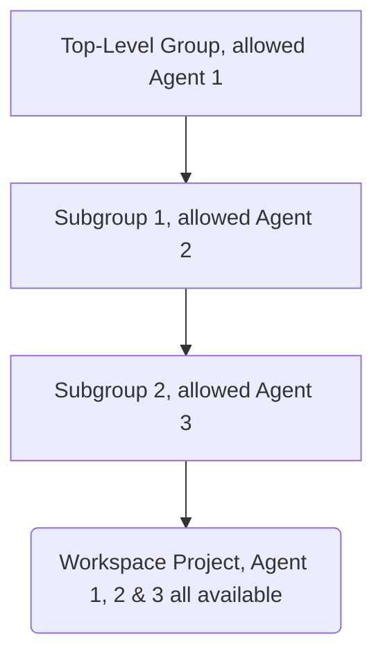



- Édition : GitLab Premium, GitLab Ultimate
- Offre : GitLab.com, GitLab Self-Managed, GitLab Dedicated



Lorsque vous [configurez l'infrastructure de workspace](configuration.md#set-up-workspace-infrastructure), vous devez configurer un agent GitLab pour Kubernetes afin de prendre en charge les workspaces. Ce guide suppose qu'un agent GitLab est déjà installé dans le cluster Kubernetes.

Prérequis :

- Vous devez effectuer les étapes de configuration décrites dans le [tutoriel de configuration de l'agent GitLab pour Kubernetes](set_up_gitlab_agent_and_proxies.md).
- La configuration de l'agent doit avoir le module `remote_development` activé, et les champs requis de ce module doivent être correctement définis.

  > [!note]
  > Si vous désactivez le module `remote_development` sur un agent disposant de workspaces actifs, ces workspaces deviennent inutilisables. Pour plus d'informations, consultez les [paramètres de workspace](settings.md#enabled).
- L'agent doit être autorisé dans un groupe dans le but de créer des workspaces. Lors de la création d'un workspace, les utilisateurs peuvent sélectionner les agents autorisés associés à tout groupe parent du projet de workspace.
- Le créateur du workspace doit disposer du rôle Developer pour le projet de l'agent.

## Autorisation de l'agent dans un groupe pour la création de workspaces {#agent-authorization-in-a-group-for-creating-workspaces}



- Nouvelle stratégie d'autorisation [introduite](https://gitlab.com/groups/gitlab-org/-/epics/14025) dans GitLab 17.2.



La nouvelle stratégie d'autorisation remplace la [stratégie d'autorisation héritée](#legacy-agent-authorization-strategy). Les propriétaires de groupe et les administrateurs peuvent contrôler les agents de cluster qui hébergent des workspaces dans leur groupe.

Par exemple, si le chemin d'accès à votre projet de workspace est `top-level-group/subgroup-1/subgroup-2/workspace-project`, vous pouvez utiliser tout agent configuré pour le groupe `top-level-group`, `subgroup-1` ou `subgroup-2`.

Si vous autorisez un agent de cluster pour un groupe spécifique, par exemple `subgroup-1`, il peut être utilisé pour créer des workspaces dans tous les projets de ce groupe. Évaluez attentivement la portée du groupe autorisé, car elle détermine où l'agent de cluster peut héberger des workspaces.

## Autoriser un agent de cluster pour les workspaces dans un groupe {#allow-a-cluster-agent-for-workspaces-in-a-group}

Prérequis :

- Vous devez [configurer l'infrastructure de workspace](configuration.md#set-up-workspace-infrastructure).
- Vous devez disposer d'un accès administrateur à l'instance ou du rôle Owner pour le groupe.

Pour autoriser un agent de cluster pour les workspaces dans un groupe :

1. Dans la barre supérieure, sélectionnez **Rechercher ou accéder à**, puis recherchez votre groupe.
1. Dans la barre latérale gauche, sélectionnez **Paramètres** > **Espaces de travail**.
1. Dans la section **Agents du groupe**, sélectionnez l'onglet **Tous les agents**.
1. Dans la liste des agents disponibles, trouvez l'agent avec le statut **Bloqué** et sélectionnez **Autoriser**.
1. Dans la boîte de dialogue de confirmation, sélectionnez **Autoriser l'agent**.

GitLab met à jour le statut de l'agent sélectionné sur **Autorisée** et affiche l'agent dans l'onglet **Agents autorisés**.

## Supprimer un agent de cluster autorisé pour les workspaces dans un groupe {#remove-an-allowed-cluster-agent-for-workspaces-in-a-group}

Prérequis :

- Vous devez [configurer l'infrastructure de workspace](configuration.md#set-up-workspace-infrastructure).
- Vous devez disposer d'un accès administrateur à l'instance ou du rôle Owner pour le groupe.

Pour supprimer un agent de cluster autorisé d'un groupe :

1. Dans la barre supérieure, sélectionnez **Rechercher ou accéder à**, puis recherchez votre groupe.
1. Dans la barre latérale gauche, sélectionnez **Paramètres** > **Espaces de travail**.
1. Dans la section **Agents du groupe**, sélectionnez l'onglet **Agents autorisés**.
1. Dans la liste des agents autorisés, trouvez l'agent que vous souhaitez supprimer et sélectionnez **Bloquer**.
1. Dans la boîte de dialogue de confirmation, sélectionnez **Bloquer l'agent**.

GitLab met à jour le statut de l'agent sélectionné sur **Bloqué** et supprime l'agent de l'onglet **Agents autorisés**.

> [!note]
> La suppression d'un agent de cluster autorisé d'un groupe n'arrête pas immédiatement les workspaces en cours d'exécution qui utilisent l'agent. Les workspaces en cours d'exécution s'arrêtent lorsqu'ils sont automatiquement résiliés ou arrêtés manuellement.

## Autoriser un agent de cluster pour les workspaces sur l'instance {#allow-a-cluster-agent-for-workspaces-on-the-instance}



- [Introduction](https://gitlab.com/gitlab-org/gitlab/-/issues/548951) dans GitLab 18.2.



Prérequis :

- Vous devez [configurer l'infrastructure de workspace](configuration.md#set-up-workspace-infrastructure).
- Vous devez disposer d'agents avec le [développement à distance activé](settings.md#enabled).
- Vous devez disposer d'un accès administrateur à l'instance.

Pour autoriser un agent de cluster pour les workspaces sur l'instance :

1. Dans le coin supérieur droit, sélectionnez **Admin**.
1. Dans la barre latérale gauche, sélectionnez **Paramètres** > **Généralités**.
1. Développez **Agents disponibles pour les espaces de travail**.
1. Dans la liste des agents pour lesquels les workspaces sont activés, trouvez l'agent que vous souhaitez autoriser et sélectionnez le bouton de disponibilité.

## Supprimer un agent de cluster autorisé pour les workspaces sur l'instance {#remove-an-allowed-cluster-agent-for-workspaces-on-the-instance}



- [Introduction](https://gitlab.com/gitlab-org/gitlab/-/issues/548951) dans GitLab 18.2.



Prérequis :

- Vous devez disposer d'un accès administrateur à l'instance.

Pour supprimer un agent de cluster autorisé de l'instance :

1. Dans le coin supérieur droit, sélectionnez **Admin**.
1. Dans la barre latérale gauche, sélectionnez **Paramètres** > **Généralités**.
1. Développez **Agents disponibles pour les espaces de travail**.
1. Dans la liste des agents autorisés, trouvez l'agent que vous souhaitez supprimer et désactivez le bouton de disponibilité.

> [!note]
> La suppression d'un agent de cluster autorisé d'une instance n'arrête pas immédiatement les workspaces en cours d'exécution qui utilisent l'agent. Les workspaces en cours d'exécution s'arrêtent lorsqu'ils sont automatiquement résiliés ou arrêtés manuellement.

## Stratégie d'autorisation héritée {#legacy-agent-authorization-strategy}

Dans GitLab 17.1 et les versions antérieures, la disponibilité d'un agent dans un groupe n'était pas une condition préalable à la création de workspaces. Vous pouvez utiliser tout agent dans le groupe principal d'un projet de workspace pour créer un workspace, si les deux conditions suivantes sont remplies :

- Le module de développement à distance est activé.
- Vous disposez du rôle Developer, Maintainer ou Owner pour le groupe principal.

Par exemple, si le chemin d'accès à votre projet de workspace est `top-level-group/subgroup-1/subgroup-2/workspace-project`, vous pouvez utiliser tout agent configuré dans `top-level-group` et dans l'un de ses sous-groupes.

## Configuration de l'accès utilisateur avec le développement à distance {#configuring-user-access-with-remote-development}

Vous pouvez configurer le module `user_access` pour accéder au cluster Kubernetes connecté avec vos identifiants GitLab. Ce module est configuré et s'exécute indépendamment du module `remote_development`.

Soyez vigilant lors de la configuration de `user_access` et de `remote_development` dans le même agent. Les clusters `remote_development` gèrent les identifiants des utilisateurs (tels que les jetons d'accès personnels) en tant que Secrets Kubernetes. Toute mauvaise configuration dans `user_access` peut rendre ces données privées accessibles via l'API Kubernetes.

Pour plus d'informations sur la configuration de `user_access`, consultez [Configurer l'accès à Kubernetes](../clusters/agent/user_access.md#configure-kubernetes-access).

## Sujets connexes {#related-topics}

- [Tutoriel : configurer GitLab pour Kubernetes](set_up_gitlab_agent_and_proxies.md)
- [Paramètres de workspace](settings.md)
- [Configuration de workspace](configuration.md)
- [Dépannage des workspaces](workspaces_troubleshooting.md)
