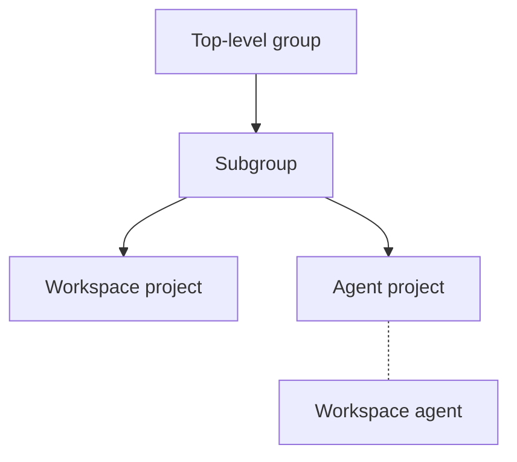

<!-- vale gitlab_base.FutureTense = NO -->

Ce tutoriel vous montre comment :

- Configurer l'[agent GitLab pour Kubernetes](../clusters/agent/_index.md) afin que les utilisateurs puissent créer et gérer des workspaces dans un projet.
- Configurer le proxy de workspaces GitLab pour authentifier et autoriser les [workspaces](_index.md) dans votre cluster.

> [!note]
> Vous devez effectuer les étapes de configuration de ce tutoriel avant de pouvoir configurer un agent GitLab pour Kubernetes afin de prendre en charge les workspaces. Une fois le tutoriel terminé, utilisez la [configuration de l'agent GitLab pour Kubernetes](gitlab_agent_configuration.md) pour configurer votre agent.

## Avant de commencer {#before-you-begin}

Avant de commencer ce tutoriel, vous devez disposer des éléments suivants :

- Un accès administrateur à votre instance GitLab ou le rôle Propriétaire pour votre groupe.
- Un cluster Kubernetes en cours d'exécution.
- `helm` 3.11.0 ou version ultérieure et `kubectl` sur votre machine locale.
- Accès à la configuration d'un domaine générique auprès de votre fournisseur DNS. Par exemple, `*.workspaces.example.dev` est requis pour accéder aux workspaces.

Pour ce tutoriel, la hiérarchie suivante est utilisée :



## Installer un contrôleur Ingress {#install-an-ingress-controller}

Installez un [contrôleur Ingress](https://kubernetes.io/docs/concepts/services-networking/ingress-controllers/) de votre choix dans votre cluster Kubernetes pour router le trafic externe vers vos workspaces. Le contrôleur Ingress doit prendre en charge les WebSockets. L'exemple suivant utilise le [contrôleur Ingress NGINX](https://github.com/kubernetes/ingress-nginx).

1. Dans votre cluster Kubernetes, installez le contrôleur Ingress.

   ```shell
   helm repo add ingress-nginx https://kubernetes.github.io/ingress-nginx
   helm repo update
   helm install ingress-nginx ingress-nginx/ingress-nginx \
     --namespace gitlab-ingress-controller \
     --create-namespace
   ```

1. Obtenez l'adresse IP externe du Load Balancer. Vous en aurez besoin lors de la mise à jour des [enregistrements DNS](#update-your-dns-records).

   ```shell
   kubectl get svc -n gitlab-ingress-controller ingress-nginx-controller
   ```

## Installer l'agent GitLab pour Kubernetes {#install-the-gitlab-agent-for-kubernetes}

Installez l'[agent GitLab pour Kubernetes](../clusters/agent/_index.md#kubernetes-integration-glossary) dans votre cluster Kubernetes pour connecter votre cluster à GitLab :

1. Effectuez l'une des options d'installation décrites dans [l'installation de l'agent pour Kubernetes](../clusters/agent/install/_index.md).
1. Notez le `agentName` que vous avez configuré. Il est requis lorsque vous configurez l'agent pour les workspaces.

## Installer GitLab Relay (KAS) {#install-gitlab-relay-kas}

GitLab Relay (KAS) est le composant qui communique avec l'agent dans votre cluster.

- Sur GitLab.com, GitLab Relay (KAS) est disponible par défaut à l'adresse `grpcs://kas.gitlab.com`.
- Sur GitLab Self-Managed, un administrateur doit [configurer GitLab Relay (KAS)](../../administration/clusters/kas.md). Il est alors disponible à l'adresse `grpcs://gitlab.example.com`, ou à l'adresse `wss://gitlab.example.com/-/kubernetes-agent/` sur les instances sans HTTPS ou avec une URL racine relative.

## Configurer l'agent GitLab pour Kubernetes {#configure-the-gitlab-agent-for-kubernetes}

Pour configurer le module `remote_development` dans le projet de l'agent :

1. Dans la barre supérieure, sélectionnez **Rechercher ou accéder à**, puis recherchez votre projet.
1. Dans votre projet, créez un fichier `.gitlab/agents/<agentName>/config.yaml`. `agentName` est le nom de l'agent que vous avez configuré lors de la mise en place de l'infrastructure des workspaces.
1. Dans `config.yaml`, utilisez la configuration suivante pour les paramètres des workspaces :

   ```yaml
   remote_development:
     enabled: true
     dns_zone: "<workspaces.example.dev>" # DNS zone of the URL where workspaces are available
   ```

Pour obtenir la liste complète des options de configuration, consultez la [référence de configuration](settings.md#configuration-reference) des workspaces.

> [!note]
> L'agent GitLab pour Kubernetes est configuré dans un projet, mais vous pouvez l'utiliser dans les workspaces d'autres projets. Un agent distinct n'est pas requis pour chaque projet.
>
> L'agent configuré n'est pas visible tant que vous n'avez pas [autorisé l'agent dans votre groupe](#allow-the-gitlab-agent-for-kubernetes-in-your-group).

## Autoriser l'agent GitLab pour Kubernetes dans votre groupe {#allow-the-gitlab-agent-for-kubernetes-in-your-group}

Lorsque vous autorisez un agent dans un groupe, le groupe, ses sous-groupes et tous les projets de ces groupes peuvent utiliser cet agent.

> [!note]
> Un seul agent est requis. Vous pouvez créer des workspaces à partir de tous les projets d'un groupe avec le même agent.

Pour autoriser votre agent GitLab pour Kubernetes dans un groupe et le rendre disponible à tous les projets de ce groupe :

1. Dans la barre supérieure, sélectionnez **Rechercher ou accéder à**, puis recherchez votre groupe.
1. Dans la barre latérale gauche, sélectionnez **Paramètres** > **Espaces de travail**.
1. Dans la section **Agents du groupe**, sélectionnez l'onglet **Tous les agents**.
1. Pour l'agent GitLab pour Kubernetes, sélectionnez **Autoriser**.
1. Dans la boîte de dialogue de confirmation, sélectionnez **Autoriser l'agent**.

## Accorder des autorisations sur les workspaces {#grant-workspace-permissions}

Accordez aux utilisateurs disposant du rôle Développeur, Mainteneur ou Propriétaire pour les projets de workspace et d'agent les autorisations nécessaires pour créer et gérer des workspaces. Vous pouvez :

- [Ajouter des utilisateurs à un projet](../project/members/_index.md#add-users-to-a-project)
- [Ajouter des utilisateurs à un groupe](../group/_index.md#add-users-to-a-group)

## Générer des certificats TLS {#generate-tls-certificates}

Un domaine générique est requis pour accéder aux workspaces, car chaque workspace obtient son propre sous-domaine. Vous devez générer des certificats TLS pour :

- Le domaine sur lequel `gitlab-workspaces-proxy` écoute (`GITLAB_WORKSPACES_PROXY_DOMAIN`).
- Le domaine générique sur lequel les workspaces sont disponibles (`GITLAB_WORKSPACES_WILDCARD_DOMAIN`).

Par exemple, si votre domaine de base est `workspaces.example.dev` :

- Le `GITLAB_WORKSPACES_PROXY_DOMAIN` est `workspaces.example.dev`.
- Le `GITLAB_WORKSPACES_WILDCARD_DOMAIN` est `*.workspaces.example.dev`.
- Les workspaces individuels sont disponibles aux URL du type `workspace-1.workspaces.example.dev`.

Vous pouvez générer des certificats auprès de n'importe quelle autorité de certification. Si [`cert-manager`](https://cert-manager.io/docs/) est configuré pour votre cluster Kubernetes, vous pouvez l'utiliser pour créer et renouveler automatiquement les certificats TLS.

Pour générer des certificats manuellement :

1. Installez [Certbot](https://certbot.eff.org/) pour activer HTTPS :

   ```shell
   brew install certbot
   ```

1. Générez des certificats Let's Encrypt avec ACME DNS et créez des enregistrements `TXT` dans votre fournisseur DNS :

   ```shell
   export EMAIL="YOUR_EMAIL@example.dev"
   export GITLAB_WORKSPACES_PROXY_DOMAIN="workspaces.example.dev"
   export GITLAB_WORKSPACES_WILDCARD_DOMAIN="*.workspaces.example.dev"

   certbot -d "${GITLAB_WORKSPACES_PROXY_DOMAIN}" \
     -m "${EMAIL}" \
     --config-dir ~/.certbot/config \
     --logs-dir ~/.certbot/logs \
     --work-dir ~/.certbot/work \
     --manual \
     --preferred-challenges dns certonly

   certbot -d "${GITLAB_WORKSPACES_WILDCARD_DOMAIN}" \
     -m "${EMAIL}" \
     --config-dir ~/.certbot/config \
     --logs-dir ~/.certbot/logs \
     --work-dir ~/.certbot/work \
     --manual \
     --preferred-challenges dns certonly
   ```

1. Définissez les variables d'environnement suivantes avec les répertoires de certificats issus de la sortie :

   ```shell
   export WORKSPACES_DOMAIN_CERT="${HOME}/.certbot/config/live/${GITLAB_WORKSPACES_PROXY_DOMAIN}/fullchain.pem"
   export WORKSPACES_DOMAIN_KEY="${HOME}/.certbot/config/live/${GITLAB_WORKSPACES_PROXY_DOMAIN}/privkey.pem"
   export WILDCARD_DOMAIN_CERT="${HOME}/.certbot/config/live/${GITLAB_WORKSPACES_PROXY_DOMAIN}-0001/fullchain.pem"
   export WILDCARD_DOMAIN_KEY="${HOME}/.certbot/config/live/${GITLAB_WORKSPACES_PROXY_DOMAIN}-0001/privkey.pem"
   ```

   Selon votre environnement, la commande `certbot` peut enregistrer le certificat et la clé dans un chemin différent. Pour obtenir le chemin exact, exécutez :

   ```shell
   certbot certificates \
     --config-dir ~/.certbot/config \
     --logs-dir ~/.certbot/logs \
     --work-dir ~/.certbot/work
   ```

> [!note]
> Vous devez renouveler vos certificats lorsqu'ils expirent. Par exemple, les certificats Let's Encrypt expirent après trois mois. Pour renouveler automatiquement les certificats, consultez [`cert-manager`](https://cert-manager.io/docs/).

## Enregistrer une application OAuth GitLab {#register-a-gitlab-oauth-application}

Pour enregistrer une application OAuth sur votre instance GitLab :

1. [Créez une application OAuth](../../integration/oauth_provider.md) dans GitLab. Vous pouvez créer :
   - Une application appartenant à un utilisateur
   - Une application appartenant à un groupe
   - Une application à l'échelle de l'instance depuis la zone d'administration
1. Définissez l'URI de redirection sur `https://${GITLAB_WORKSPACES_PROXY_DOMAIN}/auth/callback`.
1. Assurez-vous que la case **Confidentiel** est cochée. Elle doit être cochée par défaut.
1. Si vous créez une application à l'échelle de l'instance, cochez également la case **Fiables**.
1. Définissez les portées sur `api`, `read_user`, `openid` et `profile`.
1. Exportez vos valeurs de configuration :

   ```shell
   export GITLAB_URL="https://gitlab.com"
   export CLIENT_ID="your_application_id"
   export CLIENT_SECRET="your_application_secret"
   export REDIRECT_URI="https://${GITLAB_WORKSPACES_PROXY_DOMAIN}/auth/callback"
   export SIGNING_KEY="make_up_a_random_key_consisting_of_letters_numbers_and_special_chars"
   ```

1. Stockez l'ID client et le secret généré de manière sécurisée, par exemple dans 1Password.

## Générer une clé d'hôte SSH {#generate-an-ssh-host-key}

Pour générer une clé RSA :

```shell
ssh-keygen -f ssh-host-key -N '' -t rsa
export SSH_HOST_KEY=$(pwd)/ssh-host-key
```

À titre d'alternative, vous pouvez également générer une clé ECDSA.

## Créer des secrets Kubernetes {#create-kubernetes-secrets}

Pour créer des secrets Kubernetes :

```shell
kubectl create namespace gitlab-workspaces

kubectl create secret generic gitlab-workspaces-proxy-config \
  --namespace="gitlab-workspaces" \
  --from-literal="auth.client_id=${CLIENT_ID}" \
  --from-literal="auth.client_secret=${CLIENT_SECRET}" \
  --from-literal="auth.host=${GITLAB_URL}" \
  --from-literal="auth.redirect_uri=${REDIRECT_URI}" \
  --from-literal="auth.signing_key=${SIGNING_KEY}" \
  --from-literal="ssh.host_key=$(cat ${SSH_HOST_KEY})"

kubectl create secret tls gitlab-workspace-proxy-tls \
  --namespace="gitlab-workspaces" \
  --cert="${WORKSPACES_DOMAIN_CERT}" \
  --key="${WORKSPACES_DOMAIN_KEY}"

kubectl create secret tls gitlab-workspace-proxy-wildcard-tls \
  --namespace="gitlab-workspaces" \
  --cert="${WILDCARD_DOMAIN_CERT}" \
  --key="${WILDCARD_DOMAIN_KEY}"
```

## Installer le chart Helm du proxy de workspaces GitLab {#install-the-gitlab-workspaces-proxy-helm-chart}

Pour installer le chart Helm pour le proxy de workspaces GitLab :

1. Ajoutez le dépôt `helm` :

   ```shell
   helm repo add gitlab-workspaces-proxy \
     https://gitlab.com/api/v4/projects/gitlab-org%2fworkspaces%2fgitlab-workspaces-proxy/packages/helm/devel
   ```

   Pour le chart Helm 0.1.13 et versions antérieures, utilisez la commande suivante :

   ```shell
   helm repo add gitlab-workspaces-proxy \
     https://gitlab.com/api/v4/projects/gitlab-org%2fremote-development%2fgitlab-workspaces-proxy/packages/helm/devel
   ```

1. Installez et mettez à niveau le chart :

   > [!warning]
   > Les versions 0.1.22 et antérieures du chart contiennent une vulnérabilité de sécurité qui expose des informations sensibles via des arguments de ligne de commande. Pour plus d'informations, consultez la [vulnérabilité](https://gitlab.com/gitlab-org/gitlab/-/issues/567267).
   >
   > Les versions 0.1.20 et antérieures du chart contiennent également une vulnérabilité de sécurité qui définit des cookies sur un domaine générique. Pour plus d'informations, consultez le [correctif de la vulnérabilité](https://gitlab.com/gitlab-org/workspaces/gitlab-workspaces-proxy/-/merge_requests/34).
   >
   > Vous devriez mettre à niveau vers la version 0.1.23 ou ultérieure du chart pour corriger les deux vulnérabilités.
   >
   > Avant la version 0.1.16 du chart, l'installation du chart Helm créait automatiquement les secrets. Si vous effectuez une mise à niveau depuis une version antérieure à 0.1.16, [créez les secrets Kubernetes requis](#create-kubernetes-secrets) avant d'exécuter la commande de mise à niveau.

   ```shell
   helm repo update

   helm upgrade --install gitlab-workspaces-proxy \
     gitlab-workspaces-proxy/gitlab-workspaces-proxy \
     --version=0.1.25 \
     --namespace="gitlab-workspaces" \
     --set="ingress.enabled=true" \
     --set="ingress.hosts[0].host=${GITLAB_WORKSPACES_PROXY_DOMAIN}" \
     --set="ingress.hosts[0].paths[0].path=/" \
     --set="ingress.hosts[0].paths[0].pathType=ImplementationSpecific" \
     --set="ingress.hosts[1].host=${GITLAB_WORKSPACES_WILDCARD_DOMAIN}" \
     --set="ingress.hosts[1].paths[0].path=/" \
     --set="ingress.hosts[1].paths[0].pathType=ImplementationSpecific" \
     --set="ingress.tls[0].hosts[0]=${GITLAB_WORKSPACES_PROXY_DOMAIN}" \
     --set="ingress.tls[0].secretName=gitlab-workspace-proxy-tls" \
     --set="ingress.tls[1].hosts[0]=${GITLAB_WORKSPACES_WILDCARD_DOMAIN}" \
     --set="ingress.tls[1].secretName=gitlab-workspace-proxy-wildcard-tls" \
     --set="ingress.className=nginx"
   ```

   Si vous utilisez une classe Ingress différente, modifiez le paramètre `ingress.className`.

## Vérifier votre configuration {#verify-your-setup}

1. Vérifiez la configuration Ingress pour l'espace de nommage `gitlab-workspaces` :

   ```shell
   kubectl -n gitlab-workspaces get ingress
   ```

1. Vérifiez que les pods sont en cours d'exécution :

   ```shell
   kubectl -n gitlab-workspaces get pods
   ```

## Mettre à jour vos enregistrements DNS {#update-your-dns-records}

Pour mettre à jour vos enregistrements DNS :

1. Faites pointer `${GITLAB_WORKSPACES_PROXY_DOMAIN}` et `${GITLAB_WORKSPACES_WILDCARD_DOMAIN}` vers l'adresse IP externe du load balancer exposée par le [contrôleur Ingress](#install-an-ingress-controller).
1. Vérifiez si `gitlab-workspaces-proxy` est accessible :

   ```shell
   curl --verbose --location ${GITLAB_WORKSPACES_PROXY_DOMAIN}
   ```

   Cette commande renvoie une erreur `400 Bad Request` jusqu'à ce que vous créiez un workspace.

1. Depuis un autre terminal, vérifiez les journaux du proxy :

   ```shell
   kubectl -n gitlab-workspaces logs -f -l app.kubernetes.io/name=gitlab-workspaces-proxy
   ```

   Cette commande renvoie une erreur `could not find upstream workspace upstream not found` jusqu'à ce que vous créiez un workspace.

## Mettre à jour la configuration de l'agent GitLab pour Kubernetes {#update-the-gitlab-agent-for-kubernetes-configuration}

Si vous déployez le chart Helm pour le proxy dans un espace de nommage autre que `gitlab-workspaces`, mettez à jour votre [configuration de l'agent GitLab pour Kubernetes](gitlab_agent_configuration.md) :

```yaml
remote_development:
  gitlab_workspaces_proxy:
    namespace: "<custom-gitlab-workspaces-proxy-namespace>"
```

## Sujets connexes {#related-topics}

- [Configurer les workspaces](configuration.md)
- [Configuration de l'agent GitLab pour Kubernetes](gitlab_agent_configuration.md)
