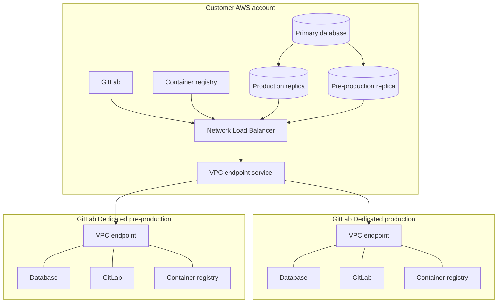



- 티어: Ultimate
- 제공 서비스: GitLab Dedicated



GitLab Dedicated 인스턴스가 생성될 때 마이그레이션이 시작됩니다. 거기서부터 준비 기간, 복제 기간, 그리고 두 가지 전환 작업(사전 프로덕션, 그 다음 프로덕션)을 거칩니다. 사전 프로덕션 전환은 프로세스를 리허설하고 프로덕션 전환이 마이그레이션을 완료하기 전에 통합을 테스트할 환경을 제공합니다.

## 마이그레이션 아키텍처 {#migration-architecture}

마이그레이션 중에 두 개의 GitLab Dedicated 테넌트(사전 프로덕션 테넌트와 프로덕션 테넌트)가 단일 소스 인스턴스에 연결됩니다. 두 개의 데이터베이스 읽기 복제본과 AWS 연결을 제공하며, 두 테넌트 모두 동일한 경로를 사용합니다.

> [!note]
> 다이어그램에는 두 개의 GitLab Dedicated 테넌트가 표시되지만 단일 프로덕션 인스턴스만 제공합니다. GitLab은 두 테넌트를 프로비저닝하고 유지합니다. 자세한 내용은 [마이그레이션 단계](_index.md#migration-phases)를 참조하세요.

다이어그램은 소스가 AWS에서 실행 중인 경우인 AWS RDS 읽기 복제본을 보여줍니다. 소스가 다른 클라우드 또는 온프레미스에서 실행되는 경우, 자신의 환경에서 읽기 복제본을 만들고 인터넷 또는 IPsec 사이트 간 VPN을 통해 연결을 제공합니다.

## 검색, 계획, 및 인스턴스 생성 {#discovery-planning-and-instance-creation}

GitLab Dedicated 구매를 최종화하기 전에, 솔루션 아키텍트 또는 계정 담당자가 [GitLab Discovery Toolkit](https://gitlab.com/gitlab-com/gl-infra/gitlab-dedicated/customer-tools/gitlab-discovery-toolkit), [GitLab Evaluate](https://gitlab.com/gitlab-org/professional-services-automation/tools/utilities/evaluate), 및 [GitLabSOS](https://gitlab.com/gitlab-com/support/toolbox/gitlabsos)와 같은 로그 번들을 사용하여 현재 환경에 대한 정보를 수집하는 것을 도와줍니다. GitLab은 출력에서 마이그레이션 타당성, 크기 조정, 및 타임라인을 평가하고 충족해야 할 요구 사항을 식별합니다.

구매가 완료된 후, GitLab Dedicated 인스턴스를 직접 생성하거나 선호하는 경우 GitLab Professional Services가 함께 생성합니다. AWS 지역 및 액세스 방법과 같이 생성 중에 내리는 결정은 마이그레이션에 영향을 미치므로, 먼저 마이그레이션 팀과 해결하세요. 자세한 내용은 [GitLab Dedicated 인스턴스 만들기](../create_instance/_index.md) 및 [Geo 마이그레이션 요구 사항](requirements.md#instance-decisions)을 참조하세요.

## 준비 {#preparation}

준비는 복제가 의존하는 모든 것을 구축하는 단계입니다. 이 작업을 직접 수행하거나 GitLab Professional Services와 함께 수행할 수 있습니다. 자세한 내용은 [Geo 마이그레이션 요구 사항](requirements.md)을 참조하세요.

복제가 시작되기 전에 다음 항목을 완료해야 합니다:

1. GitLab Self-Managed 인스턴스를 Geo 기본 사이트로 구성하여 검증이 기존 데이터에 대한 체크섬 생성을 시작할 수 있도록 합니다.
1. 사용 중인 모든 데이터 유형을 객체 스토리지로 이동합니다.
1. Gitaly 스토리지 이름을 GitLab Dedicated에서 지원하는 이름과 정렬합니다.
1. 두 개의 데이터베이스 읽기 복제본을 만들고 GitLab Dedicated에서 해당 복제본 및 GitLab 인스턴스로의 연결을 제공합니다. 소스가 AWS에 있는 경우, 하나의 Terraform 모듈이 둘 다를 수행합니다.

다음 항목은 병렬로 완료할 수 있으며, 복제 전이 아니라 사전 프로덕션 전환 전에 완료합니다:

- 10개 이상의 엔드포인트가 필요한 경우 아웃바운드 프록시를 포함하여 프라이빗 대상에 도달하는 통합을 위한 아웃바운드 연결입니다.
- GitLab Dedicated에서 지원하지 않는 기능의 대체입니다. 해당되는 경우 LDAP에서 조기에 이동을 시작합니다.

이 단계는 일반적으로 가장 오래 걸리며, 그 기간은 데이터 볼륨보다 환경에 훨씬 더 많이 달려 있습니다.

## Geo 복제 {#geo-replication}

연결이 구성되고 인스턴스가 Geo 기본 사이트로 구성된 후, GitLab Dedicated 보조 사이트로의 복제가 시작됩니다.

소스 인스턴스는 계속해서 사용자를 전체적으로 제공합니다. 복제 중에는 가동 중지 시간이 발생하지 않습니다. GitLab Self-Managed 인스턴스의 관리자 영역의 Geo 사이트 섹션에서 진행 상황을 모니터링합니다. 자세한 내용은 [Geo](../../geo/_index.md)를 참조하세요.

복제는 보수적인 동시성 제한으로 시작됩니다. 관리자 영역의 보조 사이트 항목에서 기본 사이트의 부하를 감시하고 안정성을 확인하면서 튜닝 설정을 사용하여 제한을 늘립니다. 자세한 내용은 [동기화 및 검증 동시성 값 변경](../../geo/replication/tuning.md#changing-the-syncverification-concurrency-values)을 참조하세요.

기간은 주로 객체 스토리지의 데이터 양에 의해 결정됩니다. 초기 계획을 위해 주당 약 10TB의 객체 스토리지 데이터의 대략적인 속도를 가정한 후, 복제가 실행되면 관찰된 속도를 사용합니다. 네트워크 대역폭, 객체 수, 및 구성된 속도 제한도 기간에 영향을 미치므로, 마이그레이션 팀이 데이터에 대한 추정을 확인합니다.

대부분의 일시적인 동기화 오류는 복제가 계속되면서 해결됩니다.

모든 데이터 유형이 관리자 영역의 Geo 사이트 섹션에서 최소 99.9% 동기화되고 검증되었을 때 복제가 사전 프로덕션 전환에 준비됩니다. 완전한 동기화를 목표로 하는 프로덕션 전환 전에 GitLab Professional Services와 함께 남은 항목을 조사하고 해결합니다. 자세한 내용은 [동기화 및 검증 문제 해결](../../geo/replication/troubleshooting/synchronization_verification.md)을 참조하세요.

## 버전 정렬 {#version-alignment}

복제가 시작될 때쯤 소스 인스턴스와 두 GitLab Dedicated 테넌트는 동일한 GitLab 버전을 실행합니다.

복제 중에, 마이그레이션 팀은 업그레이드를 함께 조정하여 소스 인스턴스와 GitLab Dedicated 테넌트가 함께 이동하고 정렬된 상태로 유지됩니다. 일반적으로 이 기간 동안 하나의 조정된 업그레이드가 발생합니다.

사전 프로덕션 전환부터 프로덕션 전환까지 업그레이드는 양쪽 모두에서 동결되므로 테스트 중에 아무것도 변경되지 않습니다.

프로덕션 전환 후, 남은 업그레이드는 인스턴스를 GitLab Dedicated 플릿의 나머지 버전으로 가져옵니다. 자세한 내용은 [버전 따라잡기](post_cutover.md#version-catch-up)를 참조하세요. GitLab Dedicated는 현재 GitLab 릴리스와 관련하여 이전 마이너 버전을 실행합니다. 자세한 내용은 [버전 관리 모델](../releases.md#versioning-model)을 참조하세요. 계획된 업그레이드 날짜는 [GitLab Dedicated 정보 포털](https://gitlab-com.gitlab.io/cs-tools/gitlab-cs-tools/dedicated-info-portal/)을 참조하세요.

## 사전 프로덕션 전환 {#pre-production-cutover}

사전 프로덕션 전환은 GitLab Dedicated 사전 프로덕션 테넌트에 대해 실행되는 프로덕션 전환의 전체 리허설입니다.

리허설은 두 가지 목적을 제공합니다. 프로세스를 처음부터 끝까지 검증하고 실제 전환이 걸리는 시간을 측정하여 프로덕션 전환에 놀라움이 없습니다. 또한 프로덕션 전환 전에 통합을 테스트할 수 있는 작동하는 인스턴스를 제공합니다.

리허설은 사전 프로덕션 테넌트에 대해 프로덕션 전환과 동일한 순서를 따르므로 소스 인스턴스는 계속해서 사용자에게 제공되고 프로덕션 DNS는 건드려지지 않습니다. 마이그레이션 팀은 사전 프로덕션 테넌트에 도달하기 위해 사용할 호스트 이름과 필요한 ID 공급자 구성을 확인합니다.

사전 프로덕션 전환은 프로덕션 전환을 위해 목표로 한 100% 대신 99.9% 데이터 완전성을 목표로 합니다. 따라서 경미한 동기화 실패는 리허설 중에 설정할 수 있으며 프로덕션 전환 전에 해결됩니다.

업그레이드 동결은 이 시점에서 시작되고 프로덕션 전환까지 계속됩니다.

## 테스트 기간 {#testing-period}

사전 프로덕션 전환 후, 마이그레이션된 인스턴스를 검증합니다. 이 기간은 일반적으로 수 주 동안 실행됩니다.

다음 항목을 검증합니다:

- ID 공급자를 통한 로그인
- 프로젝트 탐색 및 생성
- HTTPS 및 SSH를 통해 복제 및 푸시
- CI/CD 파이프라인 실행
- 컨테이너 레지스트리 액세스(즉, `docker login`, 풀 및 푸시)
- 내부 대상으로의 웹후크 전달
- 이메일 전달
- 프라이빗 대상에 도달하는 통합
- 다양한 온사이트 또는 VPN 위치에서의 연결

전환 날짜 전에 마이그레이션 팀과 함께 프로덕션 전환에 대한 진행 또는 미진행 기준에 동의합니다.

인스턴스가 해당 기간 동안 업그레이드를 수신하지 않으므로 동결 기간을 실질적으로 가능한 한 짧게 유지합니다.

## 프로덕션 전환 {#production-cutover}

프로덕션 전환은 함께 예약되며 해당 기간 동안 데이터를 쓸 수 없으므로 가동 중지 시간이 필요합니다.

전환은 다음 순서로 실행됩니다:

1. 소스 인스턴스를 유지 보수 모드로 전환하여 새 데이터가 기록되지 않도록 합니다.
1. 복제가 남은 항목을 완료합니다.
1. GitLab은 소스 데이터베이스를 GitLab Dedicated 데이터베이스로 복사합니다. 기간은 데이터베이스 볼륨에 따라 다르며 사전 프로덕션 리허설 중에 측정됩니다.
1. GitLab은 테넌트를 다시 구성하고 기본 사이트로 승격합니다.
1. [사용자 정의 도메인](../configure_instance/network_security.md#custom-domains)을 사용하는 경우, DNS 레코드를 업데이트하여 GitLab Dedicated를 가리킵니다.
1. GitLab은 사이트를 다시 구성하여 사용자 정의 도메인에 대한 인증서 발급을 완료합니다.
1. 사이트에 연결하고 ID 공급자를 통해 로그인합니다. 인스턴스는 여전히 유지 보수 모드에 있으므로 데이터를 쓸 수 있기 전에 액세스를 확인하고 프로젝트 및 리포지토리를 읽을 수 있습니다.
1. 유지 보수 모드를 비활성화합니다.
1. 리포지토리 푸시, 파이프라인 실행, 컨테이너 레지스트리로 푸시와 같은 쓰기 점검을 수행합니다.

> [!warning]
> 유지 보수 모드가 해제되면 인스턴스는 쓰기가 활성화됩니다. 소스 인스턴스로 돌아가면 그 시점 이후에 작성된 모든 데이터가 손실됩니다. 이러한 이유로 진행 또는 미진행 결정은 전환 전에 발생합니다.

## 마이그레이션 후 관리 {#administration-after-migration}

마이그레이션 후, 애플리케이션 관리를 유지합니다:

- GitLab UI를 통한 관리자 액세스
- 사용자 및 그룹 관리
- 프로젝트 및 리포지토리 관리
- CI/CD 구성

GitLab은 인프라 관리를 인수합니다:

- 기본 인프라를 관리합니다. 서버에 셸 액세스가 없습니다.
- 업그레이드. 인스턴스는 할당된 유지 보수 창 중에 업그레이드되며 업그레이드 날짜를 선택할 수 없습니다. 자세한 내용은 [유지 보수](../maintenance.md) 및 [릴리스](../releases.md)를 참조하세요.
- 일부 설정은 관리자 영역이 아닌 Switchboard에서 관리됩니다. 자세한 내용은 [테넌트 개요](../tenant_overview.md)를 참조하세요.

## 관련 항목 {#related-topics}

- [GitLab Dedicated로의 Geo 마이그레이션](_index.md)
- [Geo 마이그레이션 요구 사항](requirements.md)
- [Geo 마이그레이션 비밀 수집](secrets.md)
- [마이그레이션 후 활동](post_cutover.md)
