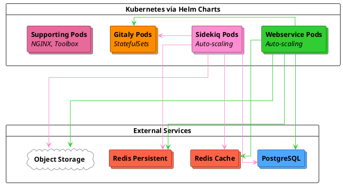



- 티어: Free, Premium, Ultimate
- 제공 서비스: GitLab Self-Managed



Cloud Native 참조 아키텍처는 4가지 표준화된 크기(S/M/L/XL)를 기반으로 하여 최신 클라우드 기본 배포 패턴에 맞게 설계되었습니다. 이러한 아키텍처는 Kubernetes에서 모든 GitLab 구성 요소를 배포하며, PostgreSQL, Redis, 객체 스토리지는 관리형 서비스 또는 온프레미스 옵션을 포함한 외부 타사 솔루션을 사용합니다.

## 아키텍처 개요 {#architecture-overview}

Cloud Native 아키텍처는 Kubernetes 및 외부 서비스 전체에 GitLab 구성 요소를 배포합니다:

**Kubernetes 구성 요소:**

- **웹서비스** \- 웹 요청 처리
- **Sidekiq** \- 백그라운드 작업 처리
- **Gitaly** \- StatefulSet 및 영구 볼륨을 사용하여 Git 리포지토리 관리
- **지원 서비스** \- Envoy Gateway, Toolbox 및 모니터링 구성 요소

> [!note]
> Gitaly를 Kubernetes에 배포할 때 Gitaly는 샤딩된(비클러스터) 구성만 지원합니다. [클라이언트 재시도](../settings/gitaly_timeouts.md)를 통해 Gitaly를 중단 없이 업그레이드할 수 있습니다. 각 Gitaly Pod는 이를 지원하는 리포지토리의 단일 실패 지점입니다. Gitaly Cluster(Praefect)는 Kubernetes에서 베타 버전([Gitaly Cluster on Kubernetes](../gitaly/praefect/_index.md#gitaly-cluster-on-kubernetes) 참조)이며 이 참조 아키텍처에는 포함되지 않습니다.
>
> Gitaly 고가용성 및 자동 페일오버가 필요한 경우 [Cloud Native 하이브리드 아키텍처](_index.md#cloud-native-hybrid)를 고려하세요. 이 아키텍처는 가상 머신에서 Gitaly Cluster를 배포하면서 Kubernetes에서 상태 비저장 구성 요소를 실행합니다. Gitaly on Kubernetes의 요구사항 및 제한사항은 [Gitaly on Kubernetes](../gitaly/kubernetes.md#requirements)를 참조하세요.

**외부 서비스:**

- **PostgreSQL** \- 고가용성을 위한 선택적 대기 복제본과 추가 안정성 및 성능을 위한 읽기 복제본을 지원하는 관리형 데이터베이스 서비스
- **Redis** \- 각각 고가용성을 위해 선택적으로 대기 복제본을 지원하는 별도의 캐시 및 영구 인스턴스
- **객체 스토리지** \- 아티팩트 및 패키지를 위한 S3, Google Cloud Storage 또는 Azure Blob Storage 같은 객체 스토리지 서비스

권장되는 관리형 서비스 제공자(GCP Cloud SQL, AWS RDS, Azure Database 등)는 [인프라 및 서비스](_index.md#infrastructure-and-services)를 참조하세요.

## 사용 가능한 아키텍처 {#available-architectures}

이러한 아키텍처는 일반적인 프로덕션 워크로드 패턴을 나타내는 대상 RPS 범위를 중심으로 설계되었습니다. RPS 대상은 시작점으로 사용됩니다. 구체적인 용량 필요성은 워크로드 구성 및 사용 패턴에 따라 달라집니다. RPS 구성 및 조정이 필요한 시점에 대한 지침은 [RPS 구성 이해하기](../../install/sizing.md#understanding-rps-composition-and-workload-patterns)를 참조하세요.

| 크기 | 대상 RPS | 의도된 워크로드 |
|------|------------|-------------------|
| S | ≤100 | 개발 활동이 적고 자동화가 최소인 팀 |
| M | ≤200 | 개발 속도가 중간 수준이고 표준 CI/CD 사용량이 있는 조직 |
| L | ≤500 | 개발 활동이 많고 상당한 자동화가 있는 대규모 팀 |
| XL | ≤1000 | 집약적인 워크로드와 광범위한 통합이 있는 엔터프라이즈 배포 |

> [!note]
> 이러한 RPS 대상은 일반적인 워크로드 구성을 가정합니다. [GitLab Duo Agent Platform](#scaling-for-gitlab-duo-agent-platform) 같은 AI 기반 사용량은 사용자 수에 따라 확장되지 않으며 실제 부하를 이러한 대상 위로 밀어올릴 수 있습니다. 의미 있는 에이전트 활동이 있는 환경의 경우 사용자 수만으로 크기를 조정하기보다는 실제 사용량을 모니터링하세요.

예상 부하를 결정하고 적절한 크기를 선택하기 위한 자세한 지침은 [참조 아키텍처 크기 조정 가이드](../../install/sizing.md)를 참조하세요.

## 주요 이점 {#key-benefits}

Cloud Native 아키텍처는 다음을 제공합니다:

- **자체 복구 인프라** \- Kubernetes가 실패한 Pod를 자동으로 다시 시작하고 건강한 노드 전체에서 워크로드를 다시 스케줄합니다.
- **동적 리소스 스케일링** \- Horizontal Pod Autoscaler와 Cluster Autoscaler가 실제 수요에 따라 용량을 조정합니다.
- **간소화된 배포** \- GitLab 구성 요소에 대한 기존 VM 관리 없음, 모두 Kubernetes를 통해 오케스트레이션됩니다.
- **운영 오버헤드 감소** \- PostgreSQL, Redis 및 객체 스토리지에 대한 외부 서비스가 데이터베이스 및 캐시 유지 관리를 제거합니다.
- **기본 제공 고가용성** \- 모든 구성 요소에 대한 자동 페일오버가 포함된 다중 영역 배포
- **향상된 비용 효율성** \- 리소스는 수요가 낮은 기간에 축소되면서 피크 시 용량을 유지합니다.

## 요구사항 {#requirements}

Cloud Native 아키텍처를 배포하기 전에 다음을 확인하세요:

- 지원되는 [Kubernetes 클러스터](https://docs.gitlab.com/charts/installation/cloud/) 및 기타 [Charts 필수 구성 요소](https://docs.gitlab.com/charts/installation/tools/)가 준비되어 있습니다.
- 데이터베이스, 사용자 및 확장을 구성한 외부 PostgreSQL 인스턴스
- 외부 Redis 인스턴스
- 객체 스토리지 서비스(S3, Google Cloud Storage, Azure Blob Storage 또는 기타)

네트워킹, 머신 유형 및 클라우드 공급자 서비스를 포함한 전체 요구사항은 [참조 아키텍처 요구사항](_index.md#requirements)을 참조하세요.

Gitaly on Kubernetes의 특정 요구사항 및 제한사항은 [Gitaly on Kubernetes 요구사항](../gitaly/kubernetes.md#requirements)을 참조하세요.

## 소형(S) {#small-s}

**대상 부하:** ≤100 RPS \| 경량 전체 부하

**워크로드 특성:**

- **총 RPS 범위:** ≤100 요청/초
- **Git 작업:** 경량 Git 푸시 및 풀 활동
- **리포지토리 크기:** 활발하게 사용되는 모노레포에는 적합하지 않습니다.
- **CI/CD 사용:** 경량 동시 파이프라인 실행
- **API 트래픽:** 자동화된 워크로드에 대한 경량 용량
- **사용자 패턴:** 사용량 스파이크에 대한 약간의 복원력

### Kubernetes 구성 요소 {#kubernetes-components}

| 구성 요소 | Pod당 리소스 | 최소 Pod/작업자 | 최대 Pod/작업자 | 예시 노드 구성 |
|-----------|------------------|------------------|------------------|---------------------------|
| 웹서비스 | 4 vCPU, 5 GB(요청), 7 GB(제한) | 6개 Pod(24개 작업자) | 9개 Pod(36개 작업자) | GCP: 3 × n2-standard-16(16 vCPU, 64 GB) AWS: 3 × c6i.4xlarge(16 vCPU, 32 GB) |
| Sidekiq | 900m vCPU, 2 GB(요청), 4 GB(제한) | 8명의 작업자 | 12명의 작업자 | GCP: 3 × n2-standard-4(4 vCPU, 16 GB) AWS: 3 × m6i.xlarge(4 vCPU, 16 GB) |
| Gitaly | 7 vCPU, 30 GB(요청 및 제한) | 3개 Pod | 3개 Pod | GCP: 3 × n2-standard-8(8 vCPU, 32 GB) AWS: 3 × m6i.2xlarge(8 vCPU, 32 GB) |
| 지원 | 서비스당 변수 | 12 vCPU, 48 GB | 12 vCPU, 48 GB | GCP: 3 × n2-standard-4(4 vCPU, 16 GB) AWS: 3 × c6i.xlarge(4 vCPU, 8 GB) |

### Pod 스케일링 구성 {#pod-scaling-configuration}

| 구성 요소 | 최소 → 최대 Pod | 최소 → 최대 작업자 | Pod당 리소스 | Pod당 작업자 |
|-----------|----------------|-------------------|-------------------|-----------------|
| 웹서비스 | 6 → 9 | 24 → 36 | 4 vCPU, 5 GB(요청), 7 GB(제한) | 4 |
| Sidekiq | 8 → 12 | 8 → 12 | 900m vCPU, 2 GB(요청), 4 GB(제한) | 1 |
| Gitaly | 3(자동 스케일링 없음) | 해당 없음 | 7 vCPU, 30 GB(요청 및 제한) | 해당 없음 |

**Gitaly 참고:** Git cgroups: 27 GB, 버퍼: 3 GB. 리포지토리 cgroups를 1로 설정합니다. 튜닝 지침은 [Gitaly cgroups 구성](#gitaly-cgroups-configuration)을 참조하세요.

### 외부 서비스 {#external-services}

| 서비스 | 구성 | GCP 동등물 | AWS 동등물 |
|---------|---------------|----------------|----------------|
| PostgreSQL | 8 vCPU, 32 GB | n2-standard-8 | m6i.2xlarge |
| Redis - 캐시 | 2 vCPU, 8 GB | n2-standard-2 | m6g.large |
| Redis - 영구 | 2 vCPU, 8 GB | n2-standard-2 | m6g.large |
| 객체 스토리지 | 클라우드 공급자 서비스 | Google Cloud Storage | Amazon S3 |

## 중형(M) {#medium-m}

**대상 부하:** ≤200 RPS \| 중간 전체 부하

**워크로드 특성:**

- **총 RPS 범위:** ≤200 요청/초
- **Git 작업:** 중간 수준의 Git 푸시 및 풀 활동
- **리포지토리 크기:** 약간 사용된 모노레포가 지원됩니다. 더 크거나 많이 사용되는 모노레포는 더 큰 아키텍처 크기가 필요할 수 있습니다.
- **CI/CD 사용:** 중간 파이프라인 동시성
- **API 트래픽:** 표준 자동화 워크로드가 지원됩니다.
- **사용자 패턴:** 사용량 변동에 대한 좋은 복원력

### Kubernetes 구성 요소 {#kubernetes-components-1}

| 구성 요소 | Pod당 리소스 | 최소 Pod/작업자 | 최대 Pod/작업자 | 예시 노드 구성 |
|-----------|------------------|------------------|------------------|---------------------------|
| 웹서비스 | 4 vCPU, 5 GB(요청), 7 GB(제한) | 14개 Pod(56개 작업자) | 21개 Pod(84개 작업자) | GCP: 3 × n2-standard-32(32 vCPU, 128 GB) AWS: 3 × c6i.8xlarge(32 vCPU, 64 GB) |
| Sidekiq | 900m vCPU, 2 GB(요청), 4 GB(제한) | 16명의 작업자 | 24명의 작업자 | GCP: 3 × n2-standard-8(8 vCPU, 32 GB) AWS: 3 × m6i.2xlarge(8 vCPU, 32 GB) |
| Gitaly | 15 vCPU, 62 GB(요청 및 제한) | 3개 Pod | 3개 Pod | GCP: 3 × n2-standard-16(16 vCPU, 64 GB) AWS: 3 × m6i.4xlarge(16 vCPU, 64 GB) |
| 지원 | 서비스당 변수 | 12 vCPU, 48 GB | 12 vCPU, 48 GB | GCP: 3 × n2-standard-4(4 vCPU, 16 GB) AWS: 3 × c6i.xlarge(4 vCPU, 8 GB) |

### Pod 스케일링 구성 {#pod-scaling-configuration-1}

| 구성 요소 | 최소 → 최대 Pod | 최소 → 최대 작업자 | Pod당 리소스 | Pod당 작업자 |
|-----------|----------------|-------------------|-------------------|-----------------|
| 웹서비스 | 14 → 21 | 56 → 84 | 4 vCPU, 5 GB(요청), 7 GB(제한) | 4 |
| Sidekiq | 16 → 24 | 16 → 24 | 900m vCPU, 2 GB(요청), 4 GB(제한) | 1 |
| Gitaly | 3(자동 스케일링 없음) | 해당 없음 | 15 vCPU, 62 GB(요청 및 제한) | 해당 없음 |

**Gitaly 참고:** Git cgroups: 56 GB, 버퍼: 6 GB. 리포지토리 cgroups를 1로 설정합니다. 튜닝 지침은 [Gitaly cgroups 구성](#gitaly-cgroups-configuration)을 참조하세요.

### 외부 서비스 {#external-services-1}

| 서비스 | 구성 | GCP 동등물 | AWS 동등물 |
|---------|---------------|----------------|----------------|
| PostgreSQL | 16 vCPU, 64 GB | n2-standard-16 | m6i.4xlarge |
| Redis - 캐시 | 2 vCPU, 8 GB | n2-standard-2 | m6g.large |
| Redis - 영구 | 2 vCPU, 8 GB | n2-standard-2 | m6g.large |
| 객체 스토리지 | 클라우드 공급자 서비스 | Google Cloud Storage | Amazon S3 |

## 대형(L) {#large-l}

**대상 부하:** ≤500 RPS \| 높은 전체 부하

**워크로드 특성:**

- **총 RPS 범위:** ≤500 요청/초
- **Git 작업:** 높은 Git 푸시 및 풀 활동
- **리포지토리 크기:** 중간 정도로 사용되는 모노레포가 지원됩니다. 더 크거나 많이 사용되는 모노레포는 더 큰 아키텍처 크기가 필요할 수 있습니다.
- **CI/CD 사용:** 적절한 Sidekiq 스케일링을 통한 높은 파이프라인 사용
- **API 트래픽:** 상당한 자동화 워크로드가 지원됩니다.
- **사용자 패턴:** 사용량 변동에 대한 강한 복원력

### Kubernetes 구성 요소 {#kubernetes-components-2}

| 구성 요소 | Pod당 리소스 | 최소 Pod/작업자 | 최대 Pod/작업자 | 예시 노드 구성 |
|-----------|------------------|------------------|------------------|---------------------------|
| 웹서비스 | 4 vCPU, 5 GB(요청), 7 GB(제한) | 28개 Pod(112개 작업자) | 42개 Pod(168개 작업자) | GCP: 6 × n2-standard-32(32 vCPU, 128 GB) AWS: 6 × c6i.8xlarge(32 vCPU, 64 GB) |
| Sidekiq | 900m vCPU, 2 GB(요청), 4 GB(제한) | 32명의 작업자 | 48명의 작업자 | GCP: 6 × n2-standard-8(8 vCPU, 32 GB) AWS: 6 × m6i.2xlarge(8 vCPU, 32 GB) |
| Gitaly | 31 vCPU, 126 GB(요청 및 제한) | 3개 Pod | 3개 Pod | GCP: 3 × n2-standard-32(32 vCPU, 128 GB) AWS: 3 × m6i.8xlarge(32 vCPU, 128 GB) |
| 지원 | 서비스당 변수 | 12 vCPU, 48 GB | 12 vCPU, 48 GB | GCP: 3 × n2-standard-4(4 vCPU, 16 GB) AWS: 3 × c6i.xlarge(4 vCPU, 8 GB) |

### Pod 스케일링 구성 {#pod-scaling-configuration-2}

| 구성 요소 | 최소 → 최대 Pod | 최소 → 최대 작업자 | Pod당 리소스 | Pod당 작업자 |
|-----------|----------------|-------------------|-------------------|-----------------|
| 웹서비스 | 28 → 42 | 112 → 168 | 4 vCPU, 5 GB(요청), 7 GB(제한) | 4 |
| Sidekiq | 32 → 48 | 32 → 48 | 900m vCPU, 2 GB(요청), 4 GB(제한) | 1 |
| Gitaly | 3(자동 스케일링 없음) | 해당 없음 | 31 vCPU, 126 GB(요청 및 제한) | 해당 없음 |

**Gitaly 참고:** Git cgroups: 120 GB, 버퍼: 6 GB. 리포지토리 cgroups를 1로 설정합니다. 튜닝 지침은 [Gitaly cgroups 구성](#gitaly-cgroups-configuration)을 참조하세요.

### 외부 서비스 {#external-services-2}

| 서비스 | 구성 | GCP 동등물 | AWS 동등물 |
|---------|---------------|----------------|----------------|
| PostgreSQL | 32 vCPU, 128 GB | n2-standard-32 | m6i.8xlarge |
| Redis - 캐시 | 2 vCPU, 16 GB | n2-highmem-2 | r6g.large |
| Redis - 영구 | 2 vCPU, 16 GB | n2-highmem-2 | r6g.large |
| 객체 스토리지 | 클라우드 공급자 서비스 | Google Cloud Storage | Amazon S3 |

## 초대형(XL) {#extra-large-xl}

**대상 부하:** ≤1000 RPS \| 집약적인 전체 부하

**워크로드 특성:**

- **총 RPS 범위:** ≤1000 요청/초
- **Git 작업:** 집약적인 Git 푸시 및 풀 활동
- **리포지토리 크기:** 많이 사용되는 모노레포가 지원됩니다. 집약적으로 사용되는 모노레포는 더 큰 아키텍처 크기가 필요할 수 있습니다.
- **CI/CD 사용:** 집약적인 CI/CD 워크로드
- **API 트래픽:** 높은 자동화 및 통합 트래픽
- **사용자 패턴:** 다양한 액세스 패턴을 위해 설계됨

### Kubernetes 구성 요소 {#kubernetes-components-3}

| 구성 요소 | Pod당 리소스 | 최소 Pod/작업자 | 최대 Pod/작업자 | 예시 노드 구성 |
|-----------|------------------|------------------|------------------|---------------------------|
| 웹서비스 | 4 vCPU, 5 GB(요청), 7 GB(제한) | 56개 Pod(224개 작업자) | 84개 Pod(336개 작업자) | GCP: 6 × n2-standard-64(64 vCPU, 256 GB) AWS: 6 × c6i.16xlarge(64 vCPU, 128 GB) |
| Sidekiq | 900m vCPU, 2 GB(요청), 4 GB(제한) | 64명의 작업자 | 96명의 작업자 | GCP: 6 × n2-standard-16(16 vCPU, 64 GB) AWS: 6 × m6i.4xlarge(16 vCPU, 64 GB) |
| Gitaly | 63 vCPU, 254 GB(요청 및 제한) | 3개 Pod | 3개 Pod | GCP: 3 × n2-standard-64(64 vCPU, 256 GB) AWS: 3 × m6i.16xlarge(64 vCPU, 256 GB) |
| 지원 | 서비스당 변수 | 24 vCPU, 96 GB | 24 vCPU, 96 GB | GCP: 3 × n2-standard-8(8 vCPU, 32 GB) AWS: 3 × c6i.2xlarge(8 vCPU, 16 GB) |

### Pod 스케일링 구성 {#pod-scaling-configuration-3}

| 구성 요소 | 최소 → 최대 Pod | 최소 → 최대 작업자 | Pod당 리소스 | Pod당 작업자 |
|-----------|----------------|-------------------|-------------------|-----------------|
| 웹서비스 | 56 → 84 | 224 → 336 | 4 vCPU, 5 GB(요청), 7 GB(제한) | 4 |
| Sidekiq | 64 → 96 | 64 → 96 | 900m vCPU, 2 GB(요청), 4 GB(제한) | 1 |
| Gitaly | 3(자동 스케일링 없음) | 해당 없음 | 63 vCPU, 254 GB(요청 및 제한) | 해당 없음 |

**Gitaly 참고:** Git cgroups: 248 GB, 버퍼: 6 GB. 리포지토리 cgroups를 1로 설정합니다. 튜닝 지침은 [Gitaly cgroups 구성](#gitaly-cgroups-configuration)을 참조하세요.

### 외부 서비스 {#external-services-3}

| 서비스 | 구성 | GCP 동등물 | AWS 동등물 |
|---------|---------------|----------------|----------------|
| PostgreSQL | 64 vCPU, 256 GB | n2-standard-64 | m6i.16xlarge |
| Redis - 캐시 | 2 vCPU, 16 GB | n2-highmem-2 | r6g.large |
| Redis - 영구 | 2 vCPU, 16 GB | n2-highmem-2 | r6g.large |
| 객체 스토리지 | 클라우드 공급자 서비스 | Google Cloud Storage | Amazon S3 |

## 추가 정보 {#additional-information}

이 섹션에서는 머신 유형 선택, 구성 요소별 고려사항 및 스케일링 전략을 포함하여 Cloud Native 아키텍처를 배포하고 운영하기 위한 보충 지침을 제공합니다.

### 머신 유형 지침 {#machine-type-guidance}

표시된 머신 유형은 검증 및 테스트에 사용된 예시입니다. 다음을 사용할 수 있습니다.

- 최신 세대 머신 유형
- ARM 기반 인스턴스(AWS Graviton)
- 사양을 충족하거나 초과하는 다양한 머신 제품군
- 특정 요구에 맞게 크기 조정된 사용자 정의 머신 유형

일관되지 않은 성능으로 인해 버스트 가능한 인스턴스 유형을 사용하지 마세요.

자세한 내용은 [사양 도출 방법](_index.md#how-specifications-are-derived)을 참조하세요.

### 노드 풀 구성 {#node-pool-configuration}

각 크기에 대해 표시된 노드 구성은 [GitLab Charts 참조 예시](https://gitlab.com/gitlab-org/charts/gitlab/-/tree/master/examples/ref)와 일치하는 구성 요소 유형당 하나의 전용 풀을 사용합니다. Webservice, Sidekiq 및 Supporting을 단일 공유 풀로 결합하는 것도 지원되며, 노드가 세 가지 워크로드를 모두 호스팅하도록 크기가 조정되어 있다면 가능합니다. Gitaly는 다른 구성 요소가 어떻게 그룹화되는지에 관계없이 항상 자신의 전용 노드가 필요합니다.

### Gitaly 고려사항 {#gitaly-considerations}

Cloud Native 아키텍처를 사용하는 Kubernetes의 Gitaly는 다음 사양을 사용하는 StatefulSet을 사용합니다:

- **배타적 노드 배치** \- Gitaly Pod은 시끄러운 이웃 문제를 피하기 위해 전용 노드에 배포됩니다.
- **리소스 할당** \- Pod 요청 및 제한은 노드 용량에서 오버헤드(Kubernetes 시스템 프로세스를 위해 예약된 2GB 메모리, 1vCPU)를 뺀 값으로 설정됩니다.
- **Git cgroups 메모리** \- 기본적으로 10% 버퍼로 할당되며, 더 큰 Pod의 경우 6GB 최대로 제한됩니다. 예를 들어 Small은 3GB 버퍼를 포함한 27GB를 Git cgroups에 할당하고, Medium 이상의 크기는 6GB 상한을 사용합니다(Medium의 경우 6GB 버퍼가 있는 56GB cgroups).

**Gitaly 배포 모드:**

설계상 Kubernetes의 Gitaly(비클러스터)는 각 Pod에 저장된 리포지토리에 대한 단일 실패 지점 서비스입니다. 데이터는 Pod당 단일 인스턴스에서 소싱되고 제공됩니다. 각 Gitaly Pod은 자신의 리포지토리 세트를 관리하여 리포지토리 분배를 통해 Git 스토리지의 수평 스케일링을 제공합니다.

Gitaly Cluster(Praefect)는 Kubernetes에서 베타 버전이며 Cloud Native 아키텍처에 포함되지 않습니다. 자세한 내용은 [Gitaly Cluster on Kubernetes](../gitaly/praefect/_index.md#gitaly-cluster-on-kubernetes) 및 [Gitaly on Kubernetes](../gitaly/kubernetes.md)를 참조하세요.

**리포지토리 분배:**

여러 Gitaly 스토리지가 구성된 경우(예: `default`, `storage1`, `storage2`) GitLab은 기본적으로 `default` 스토리지에 모든 새 리포지토리를 생성합니다. 모든 Gitaly Pod에 리포지토리를 분배하려면 스토리지 가중치를 구성하여 부하를 균형 있게 합니다.

리포지토리 스토리지 가중치 구성에 대한 지침은 [새 리포지토리를 저장할 위치 구성](../repository_storage_paths.md#configure-where-new-repositories-are-stored)을 참조하세요.

#### Gitaly cgroups 구성 {#gitaly-cgroups-configuration}

Gitaly는 [cgroups](../gitaly/cgroups.md)를 사용하여 개별 Git 작업으로 인한 리소스 고갈을 방지합니다. 기본 구성은 리포지토리 cgroup 수를 1로 설정하며, 이는 모든 단일 리포지토리가 오버서브스크립션을 통해 전체 Pod 리소스를 사용할 수 있는 시작점을 제공합니다.

그러나 이 구성이 모든 워크로드에 최적이 아닐 수 있습니다. 많은 활성 리포지토리 또는 특정 리소스 격리 요구사항이 있는 환경의 경우 관찰된 사용 패턴에 따라 cgroups 구성을 조정해야 합니다. 여기에는 리포지토리 cgroup 수 및 메모리 할당 조정이 포함됩니다.

Gitaly cgroups 측정, 조정 및 구성에 대한 자세한 지침은 [Gitaly cgroups](../gitaly/cgroups.md)를 참조하세요.

대규모 모노레포(2GB 이상) 또는 집약적인 Git 워크로드의 경우 추가 Gitaly 조정이 필요할 수 있습니다. 자세한 지침은 [참조 아키텍처 크기 조정 가이드](../../install/sizing.md)를 참조하세요.

### 외부 서비스 참고 {#external-service-notes}

- PostgreSQL은 고가용성을 위해 대기 복제본을 사용하여 배포할 수 있습니다. 추가 안정성 및 성능을 위해 읽기 복제본을 추가할 수 있습니다. 더 큰 환경(L, XL)은 데이터베이스 부하를 분산시키기 위해 읽기 복제본의 이점을 더 많이 얻습니다.
- Redis 인스턴스는 고가용성을 위해 대기 복제본을 사용하여 배포할 수 있습니다. GCP에서 Memorystore 인스턴스는 메모리만으로 구성됩니다. 표시된 머신 사양은 참고용입니다.
- 인스턴스 구성을 포함하는 모든 클라우드 공급자 서비스의 경우 복원력 있는 클라우드 아키텍처 관행과 일치하도록 3개의 서로 다른 가용성 영역에 최소 3개의 노드를 구현하는 것이 좋습니다.

### 자동 스케일링 및 최소 Pod 수 {#autoscaling-and-minimum-pod-counts}

모든 아키텍처는 용량을 관리하기 위해 Kubernetes Horizontal Pod Autoscaler(HPA) 및 Cluster Autoscaler를 사용합니다:

- **웹서비스** \- CPU 사용률에 따라 스케일링되며 보수적인 최소 Pod 수
- **Sidekiq** \- CPU 사용률에 따라 스케일링
- **Cluster Autoscaler** \- Pod 리소스 요청에 따라 노드를 자동으로 프로비저닝하고 제거합니다.

최소 Pod 수는 다음 목표를 달성하기 위한 내부 테스트를 기반으로 비용 효율성과 성능 안정성의 균형을 맞추기 위해 최대의 약 2/3로 설정됩니다:

- 수요 증가 중 빠른 응답 스케일링
- 노드 실패 또는 업그레이드 중 충분한 용량
- 수요가 낮은 기간 동안 비용 최적화

잘 이해한 부하 패턴이 있으면 필요에 따라 최소값을 조정할 수 있습니다:

- **최소값 증가** \- 급격한 트래픽 스파이크 또는 엄격한 성능 SLA가 있는 환경의 경우
- **최소값 감소** \- 모니터링 결과 지속적인 부하가 기본값보다 훨씬 낮은 경우

### 고급 스케일링 {#advanced-scaling}

Cloud Native 아키텍처는 기본 사양을 초과하여 스케일링되도록 설계되었습니다. 환경에 다음이 있는 경우 용량을 조정해야 할 수 있습니다:

- 나열된 RPS 대상보다 지속적으로 높은 처리량
- 비정형 워크로드 구성([RPS 구성 이해하기](../../install/sizing.md#understanding-rps-composition-and-workload-patterns) 참조)
- 대규모 모노레포(2GB 이상)
- 상당한 추가 워크로드
- 광범위한 GitLab Duo Agent Platform 사용

스케일링 전략은 구성 요소 유형에 따라 다릅니다.

#### 수평 스케일링(Webservice 및 Sidekiq) {#horizontal-scaling-webservice-and-sidekiq}

용량을 늘리려면 최대 복제본 수와 노드 풀 용량을 조정하여 수평으로 스케일링합니다:

- **Webservice** \- Helm 값의 `maxReplicas`를 늘리고 Webservice 노드 풀에 해당 노드를 추가합니다
- **Sidekiq** \- 더 높은 작업 처리량을 처리하도록 `maxReplicas`를 늘리고 Sidekiq 노드 풀에 노드를 추가합니다

수평 스케일링은 이러한 상태 비저장 구성 요소에 권장되는 방식입니다.

#### 수직 스케일링(PostgreSQL, Redis, Gitaly) {#vertical-scaling-postgresql-redis-gitaly}

상태 저장 구성 요소의 경우 인스턴스 또는 포드 사양을 늘립니다:

- **PostgreSQL 및 Redis** \- 서비스 제공자를 통해 더 큰 인스턴스 유형으로 업그레이드합니다.
- **Gitaly** \- 포드별 CPU 및 메모리 사양을 늘립니다. 이를 위해서는 Gitaly 노드 풀에서 더 큰 노드 유형이 필요하며 Git cgroups 메모리 할당에 대한 해당 조정이 필요합니다.

#### Sidekiq 큐 최적화 {#sidekiq-queue-optimization}

기본적으로 Sidekiq는 모든 작업 유형을 단일 큐에서 처리합니다. 다양한 워크로드 패턴이 있는 환경의 경우 작업 특성을 기반으로 별도의 큐를 구성할 수 있습니다:

- **긴급도가 높은 큐** \- CI 파이프라인 처리 및 웹후크 전달과 같은 시간이 중요한 작업의 경우
- **CPU 바운드 큐** \- 동시성 설정이 조정된 계산 집약적 작업의 경우
- **기본 큐** \- 표준 백그라운드 처리의 경우

큐 분리는 작업 처리 안정성을 개선하고 우선순위가 낮은 작업이 시간이 중요한 작업을 차단하는 것을 방지할 수 있으며, 특히 자동화 워크로드가 많은 더 큰 환경(L, XL)에서 유용합니다.

Sidekiq 큐 구성에 대한 자세한 내용은 [특정 작업 클래스 처리](../sidekiq/processing_specific_job_classes.md)를 참조하세요.

#### GitLab Duo Agent Platform을 위한 스케일링 {#scaling-for-gitlab-duo-agent-platform}

GitLab Duo Agent Platform은 표준 GitLab 워크로드를 초과하는 추가 인프라 요구 사항을 도입합니다. Agent Platform 도입에 대한 모니터링 및 스케일링에 대한 자세한 지침은 [GitLab Duo Agent Platform을 위한 스케일링](_index.md#scaling-for-gitlab-duo-agent-platform)을 참조하세요.

#### 스케일링 고려 사항 {#scaling-considerations}

구성 요소를 크게 스케일링할 때:

- 리소스 포화 상태의 종속 구성 요소를 모니터링합니다. Webservice 또는 Sidekiq의 로드 증가는 PostgreSQL 및 Gitaly에 영향을 미칠 수 있습니다.
- 먼저 비프로덕션 환경에서 스케일링 변경 사항을 테스트합니다.
- 서비스 간 병목 현상이 이동하는 것을 피하기 위해 상호 종속적인 구성 요소를 함께 스케일링합니다.

포괄적인 스케일링 지침은 [환경 스케일링](_index.md#scaling-an-environment)을 참조하세요.

## 배포 {#deployment}

전제 조건:

- 필수 데이터베이스, 사용자 및 권한이 설정된 외부 PostgreSQL
- 구성되고 액세스할 수 있는 외부 Redis 인스턴스
- 생성된 Object Storage 버킷
- 필요에 따라 인증을 위해 생성된 Kubernetes 시크릿(PostgreSQL 암호, Redis 암호, Object Storage 자격 증명, GitLab 시크릿)

자세한 필수 조건 및 시크릿 구성은 [GitLab 차트 필수 조건](https://docs.gitlab.com/charts/installation/tools/)과 [시크릿 구성](https://docs.gitlab.com/charts/installation/secrets/)을 참조하세요.

Helm 차트를 사용하여 배포하려면:

1. 필수 조건에 설명된 대로 필요한 외부 서비스 및 시크릿을 설정합니다
1. 적절한 노드 풀 및 자동 크기 조정기를 사용하여 Kubernetes 클러스터를 구성합니다
1. [Helm 차트 구성](#helm-chart-configurations) 섹션에 표시된 Helm 값 구성을 적용합니다
1. `helm install`을(를) 사용하여 GitLab을 배포합니다

자세한 배포 단계는 [Kubernetes에 GitLab 설치](https://docs.gitlab.com/charts/installation/)를 참조하세요.

## Helm 차트 구성 {#helm-chart-configurations}

완전한 Helm 차트 구성 예시 및 자세한 배포 지침은 [GitLab 차트 리포지토리](https://gitlab.com/gitlab-org/charts/gitlab/-/tree/master/examples/ref)를 참조하세요.

Cloud Native 아키텍처를 위한 주요 구성 영역:

- **리소스 사양** \- 포드 CPU 및 메모리 제한이 위의 각 아키텍처 크기의 사양과 일치합니다
- **자동 크기 조정** \- HPA 구성이 CPU 기반 스케일링 목표로 최대의 2/3에서 최소 포드 수를 설정합니다
- **노드 배치** \- 노드 선택기가 워크로드를 적절한 노드 풀에 배포하도록 보장합니다(예: `webservice`, `sidekiq`, `gitaly`, `support`)
- **외부 서비스** \- PostgreSQL, Redis 및 Object Storage 연결 세부 정보
- **Gitaly** \- cgroups, 지속성 및 저장소 분배를 포함한 StatefulSet 구성

아키텍처별 복제본 수 및 리소스 값은 위의 각 크기 섹션의 사양을 참조하세요.

## 다음 단계 {#next-steps}

배포 후 환경은 일반적으로 실제 워크로드 패턴과 일치하도록 모니터링 및 튜닝이 필요합니다.

### 모니터링 및 검증 {#monitor-and-validate}

1. **리소스 사용률 모니터링** - [Prometheus](../monitoring/prometheus/_index.md)를 사용하여 모든 구성 요소 전반의 CPU, 메모리 및 큐 깊이를 추적합니다
1. **RPS 가정 검증** \- 실제 [RPS 분석](../../install/sizing.md#extract-peak-traffic-metrics)을 가정된 80/10/10 구성과 비교합니다
1. **잠재적 조정 식별** \- 지속적으로 70% 이상의 사용률을 보이는 구성 요소를 찾습니다
1. **Gitaly cgroups 검토** \- 리포지토리 액세스 패턴에 따라 [리포지토리 cgroup 수](../gitaly/cgroups.md) 튜닝을 고려합니다

### 필요에 따라 조정 {#adjust-as-needed}

참조 아키텍처는 시작점입니다. 많은 환경이 다음 사항을 기반으로 조정의 이점을 얻습니다:

- **실제 워크로드 구성** \- API/Web/Git 분할이 일반적인 패턴과 크게 다르면 [RPS 구성 이해](../../install/sizing.md#understanding-rps-composition-and-workload-patterns)를 참조하세요
- **리포지토리 특성** \- Monorepo 크기, 복제 빈도 및 액세스 패턴에는 [구성 요소별 조정](../../install/sizing.md#identify-component-adjustments)이 필요할 수 있습니다
- **성장 패턴** \- 사용자 수 증가, CI/CD 확장 또는 자동화 스케일링

구성 요소별 조정 지침은 [고급 스케일링](#advanced-scaling)을 참조하세요.

### 선택적 기능 구성 {#configure-optional-features}

요구 사항에 따라 GitLab의 추가 선택적 기능을 구성하려고 할 수 있습니다. 자세한 내용은 [GitLab 설치 후 단계](../../install/next_steps.md)를 참조하세요.

> [!note]
> 선택적 기능에는 추가 용량이 필요할 수 있습니다. 요구 사항에 대해서는 기능별 설명서를 참조하세요.
