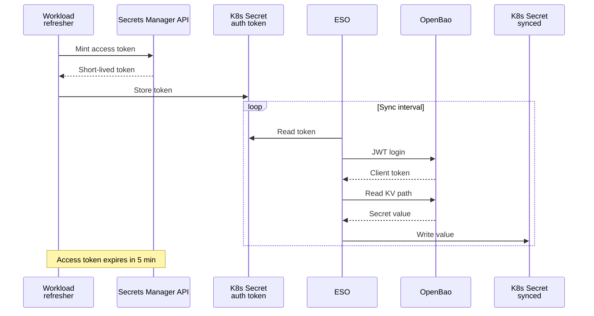



- 티어: Premium, Ultimate
- 제공 서비스: GitLab.com, GitLab Self-Managed
- 상태: 베타





- [GitLab 19.2에서 도입됨](https://gitlab.com/gitlab-org/gitlab/-/issues/594090) [플래그](../../../administration/feature_flags/_index.md) `secrets_manager_api_access`과 함께. 기본적으로 비활성화되었습니다.



CI/CD 작업은 GitLab Runner를 통해 [GitLab Secrets Manager](_index.md) 시크릿을 읽습니다. 다른 워크로드는 [Secrets Manager API](../../../api/secrets_manager.md)를 통해 시크릿을 읽습니다. 예를 들어 Kubernetes 애플리케이션과 코드 기반 인프라 도구가 있습니다.

읽기는 OpenBao 백엔드로 직접 이동하므로 시크릿 가용성은 GitLab 애플리케이션에 따라 달라지지 않습니다.

## 액세스 토큰 흐름 {#access-token-flow}

1. 클라이언트는 `api` 범위를 가진 개인 액세스 토큰, 서비스 계정 토큰 또는 프로젝트 또는 그룹 액세스 토큰을 사용하여 GitLab에 인증합니다.
1. 클라이언트는 Secrets Manager API를 호출하여 수명이 짧은 액세스 토큰을 생성합니다. 응답에는 토큰과 OpenBao 연결 세부 정보가 포함됩니다.
1. 클라이언트는 토큰을 OpenBao 백엔드에 제시하여 시크릿 값을 읽습니다.

액세스 토큰은 5분 후에 만료됩니다. OpenBao가 Vault API를 구현하므로 [HashiCorp Vault](https://developer.hashicorp.com/vault) 호환 클라이언트로 토큰을 제시할 수 있습니다.

모든 OpenBao 연결 세부 정보는 토큰 생성 응답에서 나오므로 네임스페이스, 마운트 또는 인증 경로를 직접 구성할 필요가 없습니다.

## 전제 조건 {#prerequisites}

- GitLab Secrets Manager가 활성화됩니다.
- Secrets Manager는 GitLab 19.2 이상에서 프로비저닝되었습니다.
- 개인 액세스 토큰, 프로젝트 또는 그룹 액세스 토큰 또는 [서비스 계정](#authenticate-with-a-service-account) 토큰을 사용하여 인증하며 `api` 범위를 가집니다.
- 역할은 최소 리포터 이상입니다.
- 읽기 값 권한을 가집니다. 프로젝트 소유자(또는 그룹 시크릿의 경우 그룹 소유자)가 이 권한을 부여할 수 있습니다. [시크릿 권한 관리](_index.md#manage-secrets-permissions)를 참조하세요.

> [!note]
> GitLab 19.2 이전에 프로비저닝된 Secrets Manager는 외부 요청 또는 서비스의 액세스를 지원하지 않습니다. 외부 액세스를 활성화하려면 [외부 요청에서 시크릿 액세스 활성화](../../../administration/secrets_manager/maintenance.md#enable-secrets-access-from-external-requests)를 참조하세요.

## 서비스 계정으로 인증 {#authenticate-with-a-service-account}

전제 조건:

- [서비스 계정](../../../user/profile/service_accounts.md#types-of-service-accounts)을 생성할 수 있는 권한.
- 시크릿 권한을 부여하기 위해 프로젝트 또는 그룹에 대한 소유자 역할.

서비스 계정으로 인증하려면:

1. [서비스 계정 생성](../../../user/profile/service_accounts.md#create-a-service-account).
1. [개인 액세스 토큰 생성](../../../user/profile/service_accounts.md#create-a-personal-access-token-for-a-service-account) 서비스 계정용 `api` 범위 포함.
1. [서비스 계정 추가](../../../user/profile/service_accounts.md#add-a-service-account-to-a-group-or-project) 최소 리포터 역할이 있는 프로젝트 또는 그룹으로.
1. [서비스 계정에 읽기 값 권한 부여](_index.md#manage-secrets-permissions).

## 시크릿 읽기 {#read-a-secret}

이 예제는 프로젝트에 대한 액세스 토큰을 생성하고 OpenBao에 인증한 후 시크릿 값을 읽습니다.

1. 액세스 토큰을 생성합니다. 인증하는 데 사용하는 토큰은 `api` 범위를 가져야 합니다:

   ```shell
   RESPONSE=$(curl --silent --request POST \
     --header "PRIVATE-TOKEN: <your_access_token>" \
     --url "https://gitlab.example.com/api/v4/projects/<project_id>/secrets_manager/access_token")
   ```

   응답에는 `provider.vault` 객체가 `server`, `namespace`, `path`, `secrets_path` 및 `auth.jwt` 세부 정보와 함께 포함되며 수명이 짧은 `token`이 포함됩니다.

1. 반환된 토큰을 사용하여 OpenBao에 인증한 후 값을 읽습니다:

   ```shell
   SERVER=$(echo "$RESPONSE" | jq --raw-output .provider.vault.server)
   NAMESPACE=$(echo "$RESPONSE" | jq --raw-output .provider.vault.namespace)
   MOUNT=$(echo "$RESPONSE" | jq --raw-output .provider.vault.path)
   SECRETS_PATH=$(echo "$RESPONSE" | jq --raw-output .provider.vault.secrets_path)
   AUTH_PATH=$(echo "$RESPONSE" | jq --raw-output .provider.vault.auth.jwt.path)
   ROLE=$(echo "$RESPONSE" | jq --raw-output .provider.vault.auth.jwt.role)
   JWT=$(echo "$RESPONSE" | jq --raw-output .provider.vault.auth.jwt.token)

   # Exchange the JWT for a short-lived OpenBao token.
   VAULT_TOKEN=$(curl --silent --request POST \
     --header "X-Vault-Namespace: $NAMESPACE" \
     --data "{\"role\":\"$ROLE\",\"jwt\":\"$JWT\"}" \
     "$SERVER/v1/auth/$AUTH_PATH/login" | jq --raw-output .auth.client_token)

   # Read the secret value.
   curl --silent \
     --header "X-Vault-Token: $VAULT_TOKEN" \
     --header "X-Vault-Namespace: $NAMESPACE" \
     "$SERVER/v1/$MOUNT/data/$SECRETS_PATH/<secret_name>"
   ```

GitLab.com에서 `server`은 `https://secrets.gitlab.com`입니다. GitLab Self-Managed에서 `server`은 인스턴스에 구성된 OpenBao URL입니다.

전체 요청 및 응답 형식은 [Secrets Manager API](../../../api/secrets_manager.md)를 참조하세요.

## Vault CLI와 함께 사용 {#use-with-the-vault-cli}

OpenBao가 Vault API를 구현하므로 응답의 값과 함께 [Vault CLI](https://developer.hashicorp.com/vault/docs/commands)를 사용할 수 있습니다:

```shell
export VAULT_ADDR="<server>"
export VAULT_NAMESPACE="<namespace>"

# Exchange the minted JWT for an OpenBao token, then export it.
vault write "auth/<auth_jwt_path>/login" role=<role> jwt=<token>
export VAULT_TOKEN="<client_token>"

# Read the secret value.
vault kv get -mount=<path> "<secrets_path>/<secret_name>"
```

## External Secrets Operator와 함께 사용 {#use-with-the-external-secrets-operator}

[External Secrets Operator](https://external-secrets.io)는 HashiCorp Vault 공급자를 통해 GitLab 시크릿을 Kubernetes 시크릿과 동기화합니다. 클러스터의 [CronJob](https://kubernetes.io/docs/concepts/workloads/controllers/cron-jobs/)과 같은 워크로드는 Kubernetes 시크릿에 새로운 액세스 토큰을 유지하고 운영자가 해당 토큰을 읽어 OpenBao에 인증합니다.

토큰 생성 응답을 `SecretStore`로 매핑하고 각 시크릿을 `<secrets_path>/<secret_name>`로 참조합니다:

```yaml
apiVersion: external-secrets.io/v1
kind: SecretStore
metadata:
  name: gitlab-secrets-manager
  namespace: my-app
spec:
  provider:
    vault:
      server: https://secrets.gitlab.com     # provider.vault.server
      path: secrets/kv                        # provider.vault.path
      version: v2
      namespace: org_5/group_42/project_99    # provider.vault.namespace
      auth:
        jwt:
          path: api_jwt/cel                   # provider.vault.auth.jwt.path
          role: all_api                       # provider.vault.auth.jwt.role
          secretRef:
            name: gitlab-access-token         # Kubernetes secret holding the minted token
            key: token
---
apiVersion: external-secrets.io/v1
kind: ExternalSecret
metadata:
  name: my-secret
  namespace: my-app
spec:
  refreshInterval: 1m
  secretStoreRef:
    name: gitlab-secrets-manager
    kind: SecretStore
  target:
    name: synced-secret
  data:
    - secretKey: value
      remoteRef:
        key: explicit/<secret_name>           # <secrets_path>/<secret_name>
        property: value
```

액세스 토큰은 5분 후에 만료되므로 워크로드는 만료되기 전에 `gitlab-access-token` Kubernetes 시크릿을 새로 고쳐야 합니다.

네이티브 Kubernetes 통합은 [에픽 20382](https://gitlab.com/groups/gitlab-org/-/epics/20382)에서 제안됩니다.

### 인증 흐름 {#authentication-flow}

이 다이어그램에서 External Secrets Operator를 사용한 인증 흐름을 볼 수 있습니다:



## Terraform과 함께 사용 {#use-with-terraform}

Terraform 또는 OpenTofu 구성은 GitLab 시크릿을 데이터 소스로 읽을 수 있습니다. Terraform은 액세스 토큰 자체를 생성할 수 없으므로 [`external` 데이터 소스](https://registry.terraform.io/providers/hashicorp/external/latest/docs/data-sources/external)는 Secrets Manager API를 호출하는 스크립트를 실행하고 `provider.vault` 연결 세부 정보를 반환합니다. [Vault 공급자](https://registry.terraform.io/providers/hashicorp/vault/latest/docs)는 생성된 JWT로 인증하고 시크릿을 읽습니다.

스크립트는 토큰을 생성하고 연결 세부 정보를 JSON으로 인쇄합니다. `GITLAB_TOKEN` 환경 변수에서 GitLab 토큰을 읽습니다:

```shell
#!/usr/bin/env bash
# scripts/mint_token.sh
set -euo pipefail
eval "$(jq --raw-output '@sh "PROJECT_ID=\(.project_id)"')"

curl --silent --request POST \
  --header "PRIVATE-TOKEN: ${GITLAB_TOKEN}" \
  --url "https://gitlab.example.com/api/v4/projects/${PROJECT_ID}/secrets_manager/access_token" \
  | jq '{
      server:       .provider.vault.server,
      namespace:    .provider.vault.namespace,
      mount:        .provider.vault.path,
      secrets_path: .provider.vault.secrets_path,
      auth_path:    .provider.vault.auth.jwt.path,
      role:         .provider.vault.auth.jwt.role,
      jwt:          .provider.vault.auth.jwt.token
    }'
```

`external` 데이터 소스에서 스크립트를 참조하고 Vault 공급자를 구성한 후 시크릿을 읽습니다:

```hcl
data "external" "gitlab_secrets_token" {
  program = ["bash", "${path.module}/scripts/mint_token.sh"]

  query = {
    project_id = var.gitlab_project_id
  }
}

provider "vault" {
  address   = data.external.gitlab_secrets_token.result.server
  namespace = data.external.gitlab_secrets_token.result.namespace

  auth_login_jwt {
    mount = data.external.gitlab_secrets_token.result.auth_path
    role  = data.external.gitlab_secrets_token.result.role
    jwt   = data.external.gitlab_secrets_token.result.jwt
  }
}

data "vault_kv_secret_v2" "my_secret" {
  mount = data.external.gitlab_secrets_token.result.mount
  name  = "${data.external.gitlab_secrets_token.result.secrets_path}/<secret_name>"
}

output "secret_value" {
  value     = data.vault_kv_secret_v2.my_secret.data["value"]
  sensitive = true
}
```

생성된 토큰은 5분 동안 유효하므로 `terraform apply`이 해당 기간 내에 실행되어야 합니다.

네이티브 GitLab Terraform 공급자 통합은 [에픽 21177](https://gitlab.com/groups/gitlab-org/-/epics/21177)에서 제안됩니다.
