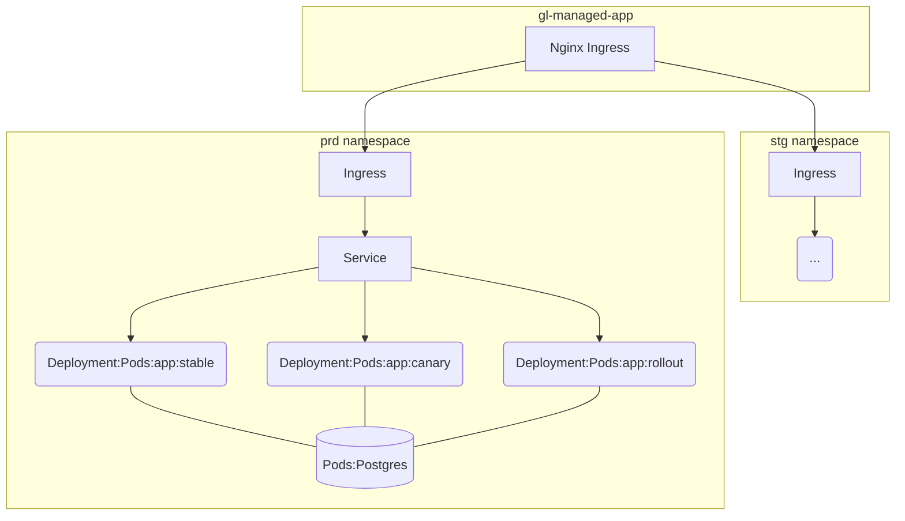
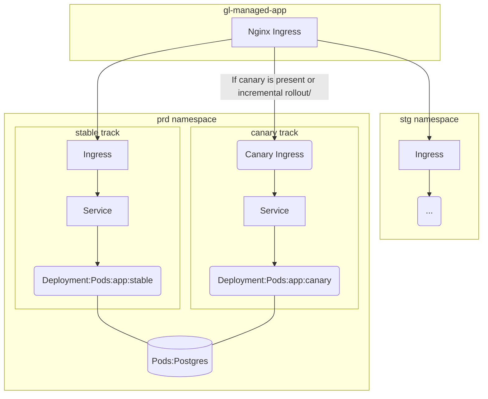



- 티어: Free, Premium, Ultimate
- 제공 서비스: GitLab.com, GitLab Self-Managed, GitLab Dedicated



[Auto Deploy](stages.md#auto-deploy)는 애플리케이션을 Kubernetes 클러스터에 배포하는 기능입니다. 여러 종속성으로 구성되어 있습니다:

- [Auto Deploy 템플릿](https://gitlab.com/gitlab-org/gitlab/-/blob/master/lib/gitlab/ci/templates/Jobs/Deploy.gitlab-ci.yml)은 `auto-deploy-image`을 사용하는 파이프라인 작업 및 스크립트 집합입니다.
- [`auto-deploy-image`](https://gitlab.com/gitlab-org/cluster-integration/auto-deploy-image)는 Kubernetes 클러스터와 통신하는 실행 가능한 이미지입니다.
- [`auto-deploy-app chart`](https://gitlab.com/gitlab-org/cluster-integration/auto-deploy-image/-/tree/master/assets/auto-deploy-app)는 애플리케이션을 배포하기 위한 Helm 차트입니다.

`auto-deploy-image` 및 `auto-deploy-app` 차트는 [시멘틱 버전 관리](https://semver.org/)를 사용합니다. 기본적으로 Auto DevOps 프로젝트는 안정적이고 호환되는 버전을 계속 사용합니다. 그러나 이러한 종속성은 GitLab의 주요 버전 릴리스에서 업그레이드될 수 있으며, 배포를 업그레이드해야 하는 주요 변경 사항이 필요할 수 있습니다.

이 가이드는 최신 또는 다른 주요 버전의 Auto Deploy 종속성으로 배포를 업그레이드하는 방법을 설명합니다.

## 종속성 버전 확인 {#verify-dependency-versions}

현재 버전을 확인하는 프로세스는 사용 중인 템플릿에 따라 다릅니다. 먼저 사용 중인 템플릿을 확인하세요:

- GitLab Self-Managed 인스턴스의 경우 [GitLab 패키지에 번들된 안정적인 Auto Deploy 템플릿](https://gitlab.com/gitlab-org/gitlab/-/blob/master/lib/gitlab/ci/templates/Jobs/Deploy.gitlab-ci.yml)이 사용됩니다.
- [GitLab.com 안정적인 Auto Deploy 템플릿](https://gitlab.com/gitlab-org/gitlab/-/blob/master/lib/gitlab/ci/templates/Jobs/Deploy.gitlab-ci.yml)은 다음 중 하나가 참인 경우에 사용됩니다:
  - Auto DevOps 프로젝트에 `.gitlab-ci.yml` 파일이 없습니다.
  - Auto DevOps 프로젝트에 `.gitlab-ci.yml`이(가) 있고 [포함](../../ci/yaml/_index.md#includetemplate)하며 `Auto-DevOps.gitlab-ci.yml` 템플릿을 포함합니다.
- [최신 Auto Deploy 템플릿](https://gitlab.com/gitlab-org/gitlab/-/blob/master/lib/gitlab/ci/templates/Jobs/Deploy.latest.gitlab-ci.yml)은 다음 두 조건이 모두 참인 경우에 사용됩니다:
  - Auto DevOps 프로젝트에 `.gitlab-ci.yml` 파일이 있고 [포함](../../ci/yaml/_index.md#includetemplate)하며 `Auto-DevOps.gitlab-ci.yml` 템플릿을 포함합니다.
  - 또한 [최신 Auto Deploy 템플릿](#early-adopters)을 포함합니다

사용 중인 템플릿을 알면:

- `auto-deploy-image` 버전은 템플릿에 있습니다(예: `auto-deploy-image:v1.0.3`).
- `auto-deploy-app` 차트 버전은 [auto-deploy-image 리포지토리에](https://gitlab.com/gitlab-org/cluster-integration/auto-deploy-image/-/blob/v1.0.3/assets/auto-deploy-app/Chart.yaml) 있습니다(예: `version: 1.0.3`).

## 호환성 {#compatibility}

다음 표는 GitLab과 Auto Deploy 종속성 간의 버전 호환성을 설명합니다:

| GitLab 버전   | `auto-deploy-image` 버전 | 참고 |
|------------------|-----------------------------|-------|
| v10.0~v14.0   | v0.1.0~v2.0.0            | v0 및 v1 auto-deploy-image는 이전 버전과 호환됩니다. |
| v13.4 이상  | v2.0.0 이상            | v2 auto-deploy-image는 [업그레이드 가이드](#upgrade-deployments-to-the-v2-auto-deploy-image)에서 설명한 대로 주요 변경 사항을 포함합니다. |

[Auto Deploy 안정적인 템플릿](https://gitlab.com/gitlab-org/gitlab/-/blob/master/lib/gitlab/ci/templates/Jobs/Deploy.gitlab-ci.yml)에서 auto-deploy-image의 현재 안정적인 버전을 찾을 수 있습니다.

## 업그레이드 가이드 {#upgrade-guide}

Auto DevOps를 사용하는 프로젝트는 GitLab에서 관리하는 수정되지 않은 차트를 사용해야 합니다. [사용자 정의 차트](customize.md#custom-helm-chart)는 지원되지 않습니다.

### v1 `auto-deploy-image`로 배포 업그레이드 {#upgrade-deployments-to-the-v1-auto-deploy-image}

v1 차트는 v0 차트와 이전 버전이 호환되므로 구성 변경이 필요하지 않습니다.

### v2 `auto-deploy-image`로 배포 업그레이드 {#upgrade-deployments-to-the-v2-auto-deploy-image}

v2 auto-deploy-image는 여러 종속성 및 아키텍처 변경 사항을 포함합니다. Auto DevOps 프로젝트에 v1 `auto-deploy-image`로 배포된 활성 환경이 있는 경우 다음 업그레이드 가이드를 진행하세요. 그렇지 않으면 이 프로세스를 건너뛸 수 있습니다.

#### Kubernetes 1.16+ {#kubernetes-116}

v2 auto-deploy-image는 Kubernetes 1.15 이상의 지원을 중단했습니다. Kubernetes 클러스터를 업그레이드해야 하는 경우 클라우드 제공자의 지침을 따르세요. [GKE의 예](https://docs.cloud.google.com/kubernetes-engine/docs/how-to/upgrading-a-cluster)를 참조하세요.

#### Helm v3 {#helm-v3}

`auto-deploy-image`은 Helm 바이너리를 사용하여 릴리스를 조작합니다. 이전에는 `auto-deploy-image`이 클러스터에서 Tiller를 사용하는 Helm v2를 사용했습니다. v2 `auto-deploy-image`에서는 Tiller를 더 이상 필요로 하지 않는 Helm v3을 사용합니다.

Auto DevOps 프로젝트에 v1 `auto-deploy-image`로 배포된 활성 환경이 있는 경우 다음 단계를 사용하여 Helm v3을 사용하는 v2로 업그레이드하세요:

1. 다음 CI/CD 변수를 설정합니다:

   - `MIGRATE_HELM_2TO3`을 `true`로 설정합니다. 이 변수가 없으면 마이그레이션 작업이 실행되지 않습니다.
   - `AUTO_DEVOPS_FORCE_DEPLOY_V2`을 `1`로 설정합니다.
   - **옵션**: `BACKUP_HELM2_RELEASES`을 `1`로 설정합니다. 이 변수를 설정하면 마이그레이션 작업이 `helm-2-release-backups`이라는 작업 아티팩트에 1주일 동안 백업을 저장합니다. 실수로 Helm v2 릴리스를 삭제하기 전에 이 백업을 복원할 수 있습니다. `kubectl apply -f $backup`을 사용하여 Kubernetes 매니페스트 파일에서 복원할 수 있습니다.

     > [!warning]
     > 공개 파이프라인이 있는 경우 이를 사용하지 마세요. 이 아티팩트는 비밀을 포함할 수 있으며 작업을 볼 수 있는 모든 사용자에게 표시됩니다.

1. 파이프라인을 실행하고 `<environment-name>:helm-2to3:migrate` 작업을 트리거합니다.
1. 평소대로 환경을 배포합니다. 이 배포는 Helm v3을 사용합니다.
1. 배포가 성공하면 안전하게 `<environment-name>:helm-2to3:cleanup`을 실행할 수 있습니다. 이것은 네임스페이스에서 모든 Helm v2 릴리스 데이터를 삭제합니다.
1. `MIGRATE_HELM_2TO3` CI/CD 변수를 제거하거나 `false`로 설정합니다. [환경 범위](../../ci/environments/_index.md#limit-the-environment-scope-of-a-cicd-variable)를 사용하여 한 번에 하나의 환경에서 이를 수행할 수 있습니다.

#### 클러스터 내 PostgreSQL 채널 2 {#in-cluster-postgresql-channel-2}

v2 auto-deploy-image는 [레거시 클러스터 내 PostgreSQL](upgrading_postgresql.md) 지원을 중단했습니다. Kubernetes 클러스터가 여전히 이를 사용하는 경우 [데이터 업그레이드 및 마이그레이션](upgrading_postgresql.md)을 [v1 auto-deploy-image](#use-a-specific-version-of-auto-deploy-dependencies)로 수행합니다.

#### 카나리 배포 및 점진적 롤아웃을 위한 트래픽 라우팅 변경 {#traffic-routing-change-for-canary-deployments-and-incremental-rollouts}

Auto Deploy는 [카나리 배포](cicd_variables.md#deploy-policy-for-canary-environments) 및 [점진적 롤아웃](../../ci/environments/incremental_rollouts.md)과 같은 고급 배포 전략을 지원합니다.

이전에 `auto-deploy-image`은 레플리카 비율을 변경하여 불안정한 트랙과 안정적인 트랙 간의 트래픽을 분산하는 하나의 서비스를 생성했습니다. v2 `auto-deploy-image`에서는 [Canary Ingress](https://kubernetes.github.io/ingress-nginx/user-guide/nginx-configuration/annotations/#canary)로 트래픽을 제어합니다.

자세한 내용은 [v2 `auto-deploy-app` 차트 리소스 아키텍처](#v2-chart-resource-architecture)를 참조하세요.

Auto DevOps 프로젝트에 v1 `auto-deploy-image`로 배포된 `production` 환경에 활성 `canary` 또는 `rollout` 트랙 릴리스가 있는 경우 다음 단계를 사용하여 v2로 업그레이드하세요:

1. 프로젝트가 [v1 `auto-deploy-image`를 사용 중](#verify-dependency-versions)인지 확인합니다. 그렇지 않으면 [버전을 지정](#use-a-specific-version-of-auto-deploy-dependencies)합니다.
1. `canary` 또는 `rollout` 배포를 진행 중인 경우 불안정한 트랙을 삭제하려면 먼저 `production`로 승격합니다.
1. 프로젝트가 [v2 `auto-deploy-image`를 사용 중](#verify-dependency-versions)인지 확인합니다. 그렇지 않으면 [버전을 지정](#use-a-specific-version-of-auto-deploy-dependencies)합니다.
1. `AUTO_DEVOPS_FORCE_DEPLOY_V2` CI/CD 변수를 `true`의 값으로 GitLab CI/CD 설정에 추가합니다.
1. 새 파이프라인을 만들고 `production` 작업을 실행하여 v2 `auto-deploy-app chart`로 리소스 아키텍처를 갱신합니다.
1. `AUTO_DEVOPS_FORCE_DEPLOY_V2` 변수를 제거합니다.

### Auto Deploy 종속성의 특정 버전 사용 {#use-a-specific-version-of-auto-deploy-dependencies}

Auto Deploy 종속성의 특정 버전을 사용하려면 [`auto-deploy-image` 및 `auto-deploy-app`의 원하는 버전](#verify-dependency-versions)을 포함하는 이전 Auto Deploy 안정적인 템플릿을 지정하세요.

예를 들어 템플릿이 GitLab 19.2에 번들되어 있는 경우 `.gitlab-ci.yml`을 다음으로 변경하세요:

```yaml
include:
  - template: Auto-DevOps.gitlab-ci.yml
  - remote: https://gitlab.com/gitlab-org/gitlab/-/raw/v19.2.0-ee/lib/gitlab/ci/templates/Jobs/Deploy.gitlab-ci.yml
```

### 경고 무시 및 배포 계속 {#ignore-warnings-and-continue-deploying}

새 차트 버전을 안전하게 배포할 수 있다고 확신하면 `AUTO_DEVOPS_FORCE_DEPLOY_V<major-version-number>` [CI/CD 변수](cicd_variables.md#build-and-deployment-variables)를 추가하여 배포를 계속할 수 있습니다.

예를 들어 이전에 `v0.17.0` 차트를 사용한 배포에 `v2.0.0` 차트를 배포하려면 `AUTO_DEVOPS_FORCE_DEPLOY_V2`를 추가합니다.

## 초기 도입자 {#early-adopters}

최신 [베타](../../policy/development_stages_support.md#beta) 또는 불안정한 버전의 `auto-deploy-image`를 사용하려면 최신 Auto Deploy 템플릿을 `.gitlab-ci.yml`에 포함하세요:

```yaml
include:
  - template: Auto-DevOps.gitlab-ci.yml
  - template: Jobs/Deploy.latest.gitlab-ci.yml
```

> [!warning]
> [베타](../../policy/development_stages_support.md#beta) 또는 불안정한 `auto-deploy-image`를 사용하면 환경에 복구 불가능한 손상을 일으킬 수 있습니다. 중요한 프로젝트 또는 환경으로 테스트하지 마세요.

## `auto-deploy-app` 차트의 리소스 아키텍처 {#resource-architectures-of-the-auto-deploy-app-chart}

### v0 및 v1 차트 리소스 아키텍처 {#v0-and-v1-chart-resource-architecture}



### v2 차트 리소스 아키텍처 {#v2-chart-resource-architecture}



## 문제 해결 {#troubleshooting}

### 주요 버전 불일치 경고 {#major-version-mismatch-warning}

이전 버전과 다른 주요 버전을 가진 차트를 배포하는 경우 새 차트가 올바르게 배포되지 않을 수 있습니다. 이는 아키텍처 변경으로 인한 것일 수 있습니다. 이 경우 배포 작업이 다음과 같은 메시지로 실패합니다:

```plaintext
*************************************************************************************
                                   [WARNING]
Detected a major version difference between the chart that is currently deploying (auto-deploy-app-v0.7.0), and the previously deployed chart (auto-deploy-app-v1.0.0).
A new major version might not be backward compatible with the current release (production). The deployment could fail or be stuck in an unrecoverable status.
...
```

이 오류 메시지를 지우고 배포를 다시 시작하려면 다음 중 하나를 수행해야 합니다:

- 수동으로 [차트 버전을 업그레이드](#upgrade-guide)합니다.
- [특정 차트 버전을 사용](#use-a-specific-version-of-auto-deploy-dependencies)합니다.

### 오류: `missing key "app.kubernetes.io/managed-by": must be set to "Helm"` {#error-missing-key-appkubernetesiomanaged-by-must-be-set-to-helm}

클러스터에 v1 `auto-deploy-image`로 배포된 배포가 있는 경우 다음 오류가 발생할 수 있습니다:

- `Error: rendered manifests contain a resource that already exists. Unable to continue with install: Secret "production-postgresql" in namespace "<project-name>-production" exists and cannot be imported into the current release: invalid ownership metadata; label validation error: missing key "app.kubernetes.io/managed-by": must be set to "Helm"; annotation validation error: missing key "meta.helm.sh/release-name": must be set to "production-postgresql"; annotation validation error: missing key "meta.helm.sh/release-namespace": must be set to "<project-name>-production"`

이는 이전 배포가 Helm2로 배포되었기 때문이며, 이는 Helm3과 호환되지 않습니다. 문제를 해결하려면 [업그레이드 가이드](#upgrade-deployments-to-the-v2-auto-deploy-image)를 따르세요.
