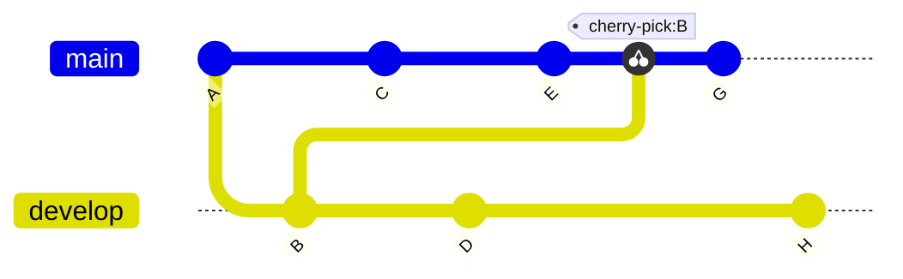



- 티어: Free, Premium, Ultimate
- 제공 서비스: GitLab.com, GitLab Self-Managed, GitLab Dedicated



명령줄에서 `git cherry-pick`을 사용하면 기존 브랜치에서 현재 브랜치로 특정 변경 사항을 복사합니다. Cherry-pick은 다음을 원할 때 도움이 됩니다:

- 새로운 기능을 포함하지 않고 버그 수정을 이전 릴리스 브랜치로 백포트합니다.
- 병합될 수 없는 브랜치의 작업을 재사용합니다.
- 실험적 변경 사항을 포함하지 않고 이전 릴리스에 작은 기능을 백포트합니다.
- 긴급 프로덕션 수정(핫픽스)을 개발 브랜치에 적용합니다.
- 포크에서 업스트림 리포지토리로 변경 사항을 복사합니다.

GitLab UI에서 cherry-picking에 대한 자세한 내용은 [cherry-pick 변경 사항](../../user/project/merge_requests/cherry_pick_changes.md)을 참조하세요.

커밋을 cherry-pick하면 Git은 다음을 수행합니다:

- 현재 브랜치에서 동일한 변경 사항으로 새 커밋을 생성합니다.
- 원본 커밋 메시지 및 작성자 정보를 보존합니다.
- 새 커밋 SHA를 생성합니다. (원본 커밋은 변경되지 않습니다.)

<!-- Diagram reused in doc/user/projects/merge_requests/cherry_pick_changes.md -->



`git cherry-pick`을 주의해서 사용하세요. 동일한 변경 사항이지만 다른 SHA(Secure Hash Algorithms)를 가진 중복 커밋을 만들 수 있습니다. 이는 프로젝트 히스토리를 복잡하게 만들 수 있습니다. 먼저 이러한 대안을 검토하세요:

- 브랜치의 대부분의 변경 사항이 필요하고 브랜치 히스토리가 깔끔하면 전체 브랜치를 현재 브랜치에 병합하세요.
- 원본 커밋에 새 브랜치에서 필요하지 않은 복잡한 종속성이 포함된 경우 이전 커밋을 cherry-pick하는 대신 새 커밋을 생성하세요.

## 한 커밋을 다른 브랜치에 적용 {#apply-one-commit-to-another-branch}

단일 커밋을 현재 작업 브랜치로 cherry-pick하려면:

1. cherry-pick하려는 커밋의 SHA를 식별하세요. 이를 찾으려면 커밋 히스토리를 확인하거나 `git log` 명령을 사용하세요. 예를 들어:

   ```shell
   $ git log

   commit abc123f
   Merge: 88888999999 aaaaabbbbbb
   Author: user@example.com
   Date:   Tue Aug 31 21:19:41 2021 +0000

       Fixes a regression we found yesterday
   ```

1. cherry-pick하려는 브랜치를 체크아웃하세요:

   ```shell
   git checkout release
   ```

1. `git cherry-pick` 명령을 사용하여 기능 브랜치에서 `release` 브랜치로 커밋 `abc123f`을 복사하세요. `abc123f`을 식별한 커밋의 SHA로 바꾸세요:

   ```shell
   git cherry-pick abc123f
   ```

Git은 커밋 `abc123f`에서 `release` 브랜치로 변경 사항을 복사하고, 충돌이 발생하면 알림을 표시합니다. 충돌을 해결하고 cherry-pick 프로세스를 계속하세요. 커밋 `abc123f`의 내용이 필요한 각 브랜치에 대해 반복하세요.

## 여러 커밋을 다른 브랜치에 적용 {#apply-multiple-commits-to-another-branch}

필요한 코드가 여러 커밋에 걸쳐 추가된 경우 각 커밋을 원하는 대상 브랜치로 cherry-pick하세요:

1. cherry-pick하려는 커밋의 SHA를 식별하세요. 이를 찾으려면 커밋 히스토리를 확인하거나 `git log` 명령을 사용하세요. 예를 들어 코드 변경이 한 커밋에 있고 개선된 테스트 커버리지가 다음 커밋에 있는 경우:

   ```shell
   $ git log

   commit abc123f
   Merge: 88888999999 aaaaabbbbbb
   Author: user@example.com
   Date:   Tue Aug 31 21:19:41 2021 +0000

       Fixes a regression we found yesterday

   commit ghi456j
   Merge: 44444666666 cccccdddddd
   Author: user@example.com
   Date:   Tue Aug 31 21:19:41 2021 +0000

       Adds tests to ensure the problem does not happen again
   ```

1. cherry-pick하려는 브랜치(`release`)를 체크아웃하세요:

   ```shell
   git checkout release
   ```

1. `release` 브랜치로 커밋을 복사하세요.

   - 각 커밋을 `release` 브랜치로 개별적으로 복사하려면 각 커밋에 대해 `git cherry-pick` 명령을 사용하세요. `abc123f`과 `ghi456j`을 원하는 커밋의 SHA로 바꾸세요:

     ```shell
     git cherry-pick abc123f
     git cherry-pick ghi456j
     ...
     ```

   - 커밋 범위를 `release` 브랜치로 cherry-pick하려면 SHA를 사용하여 시작과 끝을 표시하고 `..` 표기법을 사용하세요. 이 명령은 `abc123f`과 `ghi456j` 사이의 모든 커밋을 적용합니다:

     ```shell
     git cherry-pick abc123f..ghi456j
     ```

## 전체 브랜치의 내용을 복사 {#copy-the-contents-of-an-entire-branch}

브랜치의 병합 커밋을 cherry-pick하면 cherry-pick이 브랜치의 모든 변경 사항을 현재 작업 브랜치로 복사합니다. 병합 커밋을 cherry-pick하려면 `-m` 플래그가 필요합니다. 이 플래그는 Git에 사용할 부모 커밋을 알려줍니다. 병합 커밋은 작성 방식에 따라 여러 부모 커밋을 가질 수 있습니다.

단순한 경우 `-m 1`은 첫 번째 부모를 사용하며, 이는 브랜치의 병합 커밋입니다. 기능 브랜치가 병합되기 전의 마지막 커밋인 두 번째 부모를 지정하려면 `-m 2`을 사용하세요. 이러한 플래그는 Git이 현재 브랜치에 적용할 변경 사항을 결정합니다.

브랜치 `feature-1`에서 병합 커밋을 현재 작업 브랜치로 cherry-pick하려면:

1. cherry-pick하려는 커밋의 SHA를 식별하세요. 이를 찾으려면 커밋 히스토리를 확인하거나 `git log` 명령을 사용하세요. 예를 들어:

   ```shell
   $ git log

   commit 987pqr6
   Merge: 88888999999 aaaaabbbbbb
   Author: user@example.com
   Date:   Tue Aug 31 21:19:41 2021 +0000

       Merges feature-1 into main
   ```

1. cherry-pick하려는 브랜치를 체크아웃하세요:

   ```shell
   git checkout feature-2
   ```

1. `git cherry-pick` 명령을 `-m` 옵션과 함께 사용하고 메인라인으로 사용할 부모 커밋의 인덱스를 지정하세요. `<merge-commit-hash>`을 병합 커밋의 SHA로 바꾸고 `<parent_index>`를 부모 커밋의 인덱스로 바꾸세요. 인덱스는 `1`부터 시작합니다. 예를 들어:

   ```shell
   # git cherry-pick -m <parent_index> <merge-commit-hash>
   git cherry-pick -m 1 987pqr6
   ```

이 명령을 실행하면 Git은 `987pqr6` 병합 커밋의 내용을 `feature-2` 브랜치로 복사합니다. 병합 커밋 `987pqr6` 대신 `feature-1` 브랜치에서 마지막 커밋을 사용하려는 경우 `-m 2`을 대신 사용하세요.

## 관련 항목 {#related-topics}

- [GitLab UI로 cherry-pick 변경 사항](../../user/project/merge_requests/cherry_pick_changes.md).
- [커밋 API](../../api/commits.md#cherry-pick-a-commit)

## 문제 해결 {#troubleshooting}

cherry-picking 중에 충돌이 발생하면:

1. 영향을 받은 파일에서 충돌을 수동으로 해결하세요.
1. 해결된 파일을 스테이징하세요:

   ```shell
   git add <resolved_file>
   ```

1. cherry-pick 프로세스를 계속하세요:

   ```shell
   git cherry-pick --continue
   ```

cherry-pick 프로세스를 중단하고 이전 상태로 돌아가려면 다음 명령을 사용하세요:

```shell
git cherry-pick --abort
```

이는 cherry-pick 프로세스 중에 수행된 모든 변경 사항을 실행 취소합니다.
