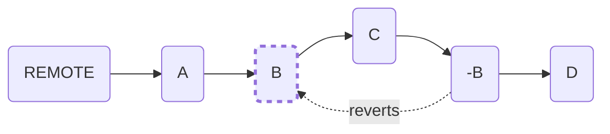

Git으로 작업하려면 실험과 반복이 필요합니다. 개발 중에 실수가 발생할 수 있으며 때때로 변경 사항을 역으로 진행해야 합니다. Git은 코드 이력을 제어할 수 있으며 [Git 워크플로](get_started.md#understand-the-git-workflow)의 어느 지점에서나 변경 사항을 실행 취소하는 기능을 제공합니다.

실수로 커밋된 변경 사항에서 복구하고, 민감한 데이터를 제거하고, 잘못된 병합을 수정하고, 깨끗한 리포지토리 이력을 유지합니다. 다른 사람과 협업할 때 새로운 복구 커밋으로 투명성을 유지하거나 공유하기 전에 로컬에서 작업을 리셋합니다. 사용할 방법은 변경 사항의 위치에 따라 다릅니다:

- 로컬 컴퓨터에만 있습니다.
- GitLab.com과 같은 Git 서버에 원격으로 저장됩니다.

## 로컬 변경 사항 실행 취소 {#undo-local-changes}

원격 리포지토리에 변경 사항을 푸시할 때까지 Git에서 수행한 변경 사항은 로컬 개발 환경에만 있습니다.

Git에서 파일을 _스테이징_하면 Git에 커밋 준비를 위해 파일의 변경 사항을 추적하도록 지시합니다. 파일의 변경 사항을 무시하고 다음 커밋에 포함하지 않으려면 파일을 _언스테이징_합니다.

### 스테이징되지 않은 로컬 변경 사항 복구 {#revert-unstaged-local-changes}

아직 스테이징되지 않은 로컬 변경 사항을 실행 취소하려면:

1. 파일이 언스테이징 상태인지 확인합니다(즉, `git add <file>`을 사용하지 않았는지 확인). `git status`을 실행하여 확인합니다:

   ```shell
   git status
   ```

   출력 예시:

   ```shell
   On branch main
   Your branch is up-to-date with 'origin/main'.
   Changes not staged for commit:
     (use "git add <file>..." to update what will be committed)
     (use "git checkout -- <file>..." to discard changes in working directory)

       modified:   <file>
   no changes added to commit (use "git add" and/or "git commit -a")
   ```

1. 옵션을 선택하고 변경 사항을 실행 취소합니다:

   - 로컬 변경 사항을 덮어쓰려면:

     ```shell
     git checkout -- <file>
     ```

   - 모든 파일의 로컬 변경 사항을 영구적으로 폐기하려면:

     ```shell
     git reset --hard
     ```

### 스테이징된 로컬 변경 사항 복구 {#revert-staged-local-changes}

이미 스테이징된 로컬 변경 사항을 실행 취소할 수 있습니다. 다음 예시에서는 파일이 스테이징 영역에 추가되었지만 커밋되지 않았습니다:

1. `git status`을 사용하여 파일이 스테이징 상태인지 확인합니다:

   ```shell
   git status
   ```

   출력 예시:

   ```shell
   On branch main
   Your branch is up-to-date with 'origin/main'.
   Changes to be committed:
     (use "git restore --staged <file>..." to unstage)

     new file:   <file>
   ```

1. 옵션을 선택하고 변경 사항을 실행 취소합니다:

   - 파일을 언스테이징하되 변경 사항을 유지하려면:

     ```shell
     git restore --staged <file>
     ```

   - 모든 것을 언스테이징하되 변경 사항을 유지하려면:

     ```shell
     git reset
     ```

   - 파일을 현재 커밋(HEAD)으로 언스테이징하려면:

     ```shell
     git reset HEAD <file>
     ```

   - 모든 것을 영구적으로 폐기하려면:

     ```shell
     git reset --hard
     ```

## 로컬 커밋 실행 취소 {#undo-local-commits}

`git commit`을 사용하여 로컬 리포지토리에 커밋하면 Git은 변경 사항을 기록합니다. 아직 원격 리포지토리에 푸시하지 않았으므로 변경 사항이 공개되거나 다른 사람과 공유되지 않습니다. 이 시점에서 변경 사항을 실행 취소할 수 있습니다.

### 이력을 변경하지 않고 커밋 복구 {#revert-commits-without-altering-history}

커밋 이력을 유지하면서 커밋을 복구할 수 있습니다.

이 예시에서는 5개의 커밋 `A`, `B`, `C`, `D`, `E`를 사용하며, 이들은 `A-B-C-D-E` 순서로 커밋되었습니다. 실행 취소하려는 커밋은 `B`입니다.

1. 복구하려는 커밋의 커밋 SHA를 찾습니다. 커밋 로그를 조회하려면 `git log` 명령을 사용합니다.
1. 옵션을 선택하고 변경 사항을 실행 취소합니다:

   - 커밋 `B`에서 도입된 변경 사항을 복구하려면:

     ```shell
     git revert <commit-B-SHA>
     ```

   - 커밋 `B`에서 단일 파일 또는 디렉터리에 대한 변경 사항을 실행 취소하되 스테이징 상태로 유지하려면:

     ```shell
     git checkout <commit-B-SHA> <file>
     ```

   - 커밋 `B`에서 단일 파일 또는 디렉터리에 대한 변경 사항을 실행 취소하되 언스테이징 상태로 유지하려면:

     ```shell
     git reset <commit-B-SHA> <file>
     ```

### 커밋 복구 및 이력 수정 {#revert-commits-and-modify-history}

다음 섹션은 Git 이력을 다시 쓰는 작업을 설명합니다. 자세한 내용은 [리베이스 및 충돌 해결](git_rebase.md)을 참조하세요.

#### 특정 커밋 삭제 {#delete-a-specific-commit}

특정 커밋을 삭제할 수 있습니다. 예를 들어, 커밋 `A-B-C-D`이 있고 커밋 `B`를 삭제하려는 경우입니다.

1. 현재 커밋 `D`에서 `B`까지의 범위를 리베이스합니다:

   ```shell
   git rebase -i A
   ```

   커밋 목록이 편집기에 표시됩니다.
1. 커밋 `B` 앞에서 `pick`를 `drop`으로 바꿉니다.
1. 다른 모든 커밋은 기본값인 `pick`으로 유지합니다.
1. 편집기를 저장하고 종료합니다.

#### 특정 커밋 편집 {#edit-a-specific-commit}

특정 커밋을 수정할 수 있습니다. 예를 들어, 커밋 `A-B-C-D`이 있고 커밋 `B`에 도입된 내용을 수정하려는 경우입니다.

1. 현재 커밋 `D`에서 `B`까지의 범위를 리베이스합니다:

   ```shell
   git rebase -i A
   ```

   커밋 목록이 편집기에 표시됩니다.
1. 커밋 `B` 앞에서 `pick`를 `edit`으로 바꿉니다.
1. 다른 모든 커밋은 기본값인 `pick`으로 유지합니다.
1. 편집기를 저장하고 종료합니다.
1. 편집기에서 파일을 열고 편집을 수행한 후 변경 사항을 커밋합니다:

   ```shell
   git commit -a
   ```

### 여러 커밋 실행 취소 {#undo-multiple-commits}

브랜치에서 여러 커밋(`A-B-C-D`)을 생성한 후 커밋 `C`와 `D`이 잘못되었음을 깨닫게 되면 두 커밋을 모두 실행 취소합니다:

1. 마지막 올바른 커밋을 확인합니다. 이 예시에서는 `B`입니다.

   ```shell
   git checkout <commit-B-SHA>
   ```

1. 새 브랜치를 생성합니다.

   ```shell
   git checkout -b new-path-of-feature
   ```

1. 변경 사항을 추가, 푸시 및 커밋합니다.

   ```shell
   git add .
   git commit -m "Undo commits C and D"
   git push --set-upstream origin new-path-of-feature
   ```

커밋은 이제 `A-B-C-D-E`입니다.

또는 해당 커밋을 새 머지 리퀘스트로 [체리픽](../../user/project/merge_requests/cherry_pick_changes.md#cherry-pick-a-single-commit)합니다.

> [!note]
> 다른 솔루션은 `B`으로 리셋한 후 `E`을 커밋하는 것입니다. 하지만 이 솔루션은 `A-B-E`를 생성하므로 다른 사람이 로컬에서 가진 것과 충돌합니다. 브랜치가 공유되는 경우 이 솔루션을 사용하지 마세요.

### 실행 취소된 커밋 복구 {#recover-undone-commits}

이전 로컬 커밋을 다시 호출할 수 있습니다. 하지만 Git이 정기적으로 [브랜치 또는 태그로 도달할 수 없는 커밋을 정리하기](https://git-scm.com/book/en/v2/Git-Internals-Maintenance-and-Data-Recovery) 때문에 모든 이전 커밋을 사용할 수는 없습니다.

리포지토리 이력을 확인하고 이전 커밋을 추적하려면 `git reflog show`을 실행합니다. 예를 들어:

```shell
$ git reflog show

# Example output:
b673187 HEAD@{4}: merge 6e43d5987921bde189640cc1e37661f7f75c9c0b: Merge made by the 'recursive' strategy.
eb37e74 HEAD@{5}: rebase -i (finish): returning to refs/heads/master
eb37e74 HEAD@{6}: rebase -i (pick): Commit C
97436c6 HEAD@{7}: rebase -i (start): checkout 97436c6eec6396c63856c19b6a96372705b08b1b
...
88f1867 HEAD@{12}: commit: Commit D
97436c6 HEAD@{13}: checkout: moving from 97436c6eec6396c63856c19b6a96372705b08b1b to test
97436c6 HEAD@{14}: checkout: moving from master to 97436c6
05cc326 HEAD@{15}: commit: Commit C
6e43d59 HEAD@{16}: commit: Commit B
```

이 출력은 다음을 포함하여 리포지토리 이력을 보여줍니다:

- 커밋 SHA입니다.
- `HEAD`-변경 작업이 몇 개 전에 커밋이 생성되었는지(`HEAD@{12}`는 12개 `HEAD`-변경 작업 전)입니다.
- 수행된 작업입니다(예: 커밋, 리베이스, 병합).
- `HEAD`을 변경한 작업에 대한 설명입니다.

## 원격 변경 사항 실행 취소 {#undo-remote-changes}

브랜치에서 원격 변경 사항을 실행 취소할 수 있습니다. 하지만 브랜치로 병합된 브랜치의 변경 사항은 실행 취소할 수 없습니다. 이 경우 원격 브랜치에서 변경 사항을 복구해야 합니다.

### 이력을 변경하지 않고 원격 변경 사항 복구 {#revert-remote-changes-without-altering-history}

원격 리포지토리의 변경 사항을 실행 취소하려면 실행 취소하려는 변경 사항이 포함된 새 커밋을 생성할 수 있습니다. 이 프로세스는 이력을 유지하고 명확한 시간대와 개발 구조를 제공합니다:



특정 커밋 `B`에서 도입된 변경 사항을 복구하려면:

```shell
git revert B
```

### 원격 변경 사항 복구 및 이력 수정 {#revert-remote-changes-and-modify-history}

원격 변경 사항을 실행 취소하고 이력을 변경할 수 있습니다.

업데이트된 이력이 있어도 모든 자동 고아 커밋 정리가 수행되거나 수동으로 정리가 실행될 때까지 커밋 SHA로 이전 커밋에 계속 액세스할 수 있습니다. 여전히 이전 커밋을 가리키는 참조가 있으면 정리도 이전 커밋을 제거하지 않을 수 있습니다.


공개 브랜치 또는 다른 사람이 사용할 수 있는 브랜치에서 작업할 때 이력을 변경하면 안 됩니다.

> [!note]
> [기본 브랜치](../../user/project/repository/branches/default.md) 또는 공유 브랜치의 커밋 이력을 절대 수정하지 마세요.

### `git rebase` 사용하여 이력 수정 {#modify-history-with-git-rebase}

머지 리퀘스트의 브랜치는 공개 브랜치이며 다른 개발자가 사용할 수 있습니다. 하지만 프로젝트 규칙에서는 검토 후 대상 브랜치에 표시되는 커밋 수를 줄이기 위해 `git rebase`을 사용하도록 요구할 수 있습니다.

`git rebase -i`을 사용하여 이력을 수정할 수 있습니다. 이 명령을 사용하여 커밋을 수정, 스쿼시 및 삭제합니다.

```shell
#
# Commands:
# p, pick = use commit
# r, reword = use commit, but edit the commit message
# e, edit = use commit, but stop for amending
# s, squash = use commit, but meld into previous commit
# f, fixup = like "squash", but discard this commit's log message
# x, exec = run command (the rest of the line) using shell
# d, drop = remove commit
#
# These lines can be re-ordered; they are executed from top to bottom.
#
# If you remove a line THAT COMMIT WILL BE LOST.
#
# However, if you remove everything, the rebase will be aborted.
#
# Empty commits are commented out
```

> [!note]
> 리베이스를 중지하기로 결정했으면 편집기를 닫지 마세요. 대신 주석이 없는 모든 줄을 제거하고 저장합니다.

공유 및 원격 브랜치에서 `git rebase`을 주의 깊게 사용합니다. 원격 리포지토리에 푸시하기 전에 로컬에서 실험합니다.

```shell
# Modify history from commit-id to HEAD (current commit)
git rebase -i commit-id
```

### `git merge --squash` 사용하여 이력 수정 {#modify-history-with-git-merge---squash}

규모가 큰 오픈 소스 리포지토리에 기여할 때 커밋을 단일 커밋으로 스쿼시하는 것을 고려합니다. 이 방법:

- 깨끗하고 선형 프로젝트 이력을 유지하는 데 도움이 됩니다.
- 모든 변경 사항이 하나의 커밋으로 압축되므로 변경 사항 복구 프로세스를 단순화합니다.

브랜치의 커밋을 병합 시 대상 브랜치의 단일 커밋으로 스쿼시하려면 `git merge --squash`을 사용합니다. 예를 들어:

1. 기본 브랜치를 확인합니다. 이 예시에서 기본 브랜치는 `main`입니다:

   ```shell
   git checkout main
   ```

1. `--squash`을 사용하여 대상 브랜치를 병합합니다:

   ```shell
   git merge --squash <target-branch>
   ```

1. 변경 사항을 커밋합니다:

   ```shell
   git commit -m "Squash commit from feature-branch"
   ```

GitLab UI에서 커밋을 스쿼시하는 방법에 대한 자세한 내용은 [스쿼시 및 병합](../../user/project/merge_requests/squash_and_merge.md)을 참조하세요.

### 다른 부모로 병합 커밋 복구 {#revert-a-merge-commit-to-a-different-parent}

병합 커밋을 복구할 때 병합한 브랜치는 항상 첫 번째 부모입니다. 예를 들어, [기본 브랜치](../../user/project/repository/branches/default.md) 또는 `main`입니다. 병합 커밋을 다른 부모로 복구하려면 명령줄에서 커밋을 복구해야 합니다:

1. 복구하려는 부모 커밋의 SHA를 확인합니다.
1. 복구하려는 커밋의 부모 번호를 확인합니다. (`1`으로 기본값이 지정되고, 첫 번째 부모)
1. 이 명령을 실행하여 `2`을 부모 번호로, `7a39eb0`을 커밋 SHA로 바꿉니다:

   ```shell
   git revert -m 2 7a39eb0
   ```

GitLab UI에서 변경 사항 복구에 대한 자세한 내용은 [변경 사항 복구](../../user/project/merge_requests/revert_changes.md)를 참조하세요.

## 민감한 정보 처리 {#handle-sensitive-information}

암호 및 API 키와 같은 민감한 정보가 실수로 Git 리포지토리에 커밋될 수 있습니다. 이 섹션에서는 이 상황을 처리하는 방법을 설명합니다.

### 정보 수정 {#redact-information}

실수로 커밋된 민감하거나 기밀 정보를 영구적으로 삭제하고 리포지토리 이력에서 더 이상 액세스할 수 없도록 합니다. 이 프로세스는 문자열 목록을 `***REMOVED***`로 바꿉니다.

또는 리포지토리에서 특정 파일을 완전히 삭제하려면 [blob 제거](../../user/project/repository/repository_size.md#remove-blobs)를 참조하세요.

리포지토리에서 텍스트를 수정하려면 [리포지토리에서 텍스트 수정](../../user/project/repository/repository_size.md#redact-text-from-repository)을 참조하세요.

### 커밋에서 정보 제거 {#remove-information-from-commits}

Git을 사용하여 이전 커밋에서 민감한 정보를 삭제할 수 있습니다. 하지만 이 프로세스에서는 이력이 수정됩니다.

[특정 필터](https://git-scm.com/docs/git-filter-branch#_options)를 사용하여 이력을 다시 쓰려면 `git filter-branch`을 실행합니다.

이력에서 파일을 완전히 제거하려면 다음을 사용합니다:

```shell
git filter-branch --tree-filter 'rm filename' HEAD
```

`git filter-branch` 명령은 대규모 리포지토리에서 느릴 수 있습니다. Git 명령을 더 빠르게 실행할 수 있는 도구를 사용할 수 있습니다. 이러한 도구는 `git filter-branch`과(와) 동일한 기능 세트를 제공하지 않기 때문에 더 빠르지만 특정 사용 사례에 중점을 둡니다.

리포지토리 이력 및 GitLab 저장소에서 파일 제거에 대한 자세한 내용은 [리포지토리 크기 줄이기](../../user/project/repository/repository_size.md#methods-to-reduce-repository-size)를 참조하세요.

## 커밋 실행 취소 및 제거 {#undo-and-remove-commits}

- 마지막 커밋을 실행 취소하고 모든 것을 스테이징 영역으로 다시 돌립니다:

  ```shell
  git reset --soft HEAD^
  ```

- 파일을 추가하고 커밋 메시지를 변경합니다:

  ```shell
  git commit --amend -m "New Message"
  ```

- 마지막 변경 사항을 실행 취소하고 아직 푸시하지 않은 경우 다른 모든 변경 사항을 제거합니다:

  ```shell
  git reset --hard HEAD^
  ```

- 마지막 변경 사항을 실행 취소하고 아직 푸시하지 않은 경우 마지막 두 커밋을 제거합니다:

  ```shell
  git reset --hard HEAD^^
  ```

### `git reset` 워크플로 예시 {#example-git-reset-workflow}

다음은 일반적인 Git 리셋 워크플로입니다:

1. 파일을 편집합니다.
1. 브랜치의 상태를 확인합니다:

   ```shell
   git status
   ```

1. 잘못된 커밋 메시지로 브랜치에 변경 사항을 커밋합니다:

   ```shell
   git commit -am "kjkfjkg"
   ```

1. Git 로그를 확인합니다:

   ```shell
   git log
   ```

1. 올바른 커밋 메시지로 커밋을 수정합니다:

   ```shell
   git commit --amend -m "New comment added"
   ```

1. Git 로그를 다시 확인합니다:

   ```shell
   git log
   ```

1. 브랜치를 소프트 리셋합니다:

   ```shell
   git reset --soft HEAD^
   ```

1. Git 로그를 다시 확인합니다:

   ```shell
   git log
   ```

1. 원격에서 브랜치의 업데이트를 끌어옵니다:

   ```shell
   git pull origin <branch>
   ```

1. 원격에 브랜치의 변경 사항을 푸시합니다:

   ```shell
   git push origin <branch>
   ```

## 새 커밋으로 커밋 실행 취소 {#undo-commits-with-a-new-commit}

파일이 커밋에서 변경되었으며 이전 커밋의 상태로 되돌리고 싶지만 커밋 이력을 유지하려면 `git revert`을 사용할 수 있습니다. 이 명령은 원본 커밋에서 수행된 모든 작업을 역으로 하는 새 커밋을 생성합니다.

예를 들어, 커밋 `B`에서 파일의 변경 사항을 제거하고 커밋 `A`에서 내용을 복구하려면 다음을 실행합니다:

```shell
git revert <commit-sha>
```

## 리포지토리에서 파일 제거 {#remove-a-file-from-a-repository}

- 디스크 및 리포지토리에서 파일을 제거하려면 `git rm`을 사용합니다. 디렉터리를 제거하려면 `-r` 플래그를 사용합니다:

  ```shell
  git rm '*.txt'
  git rm -r <dirname>
  ```

- 파일을 디스크에 유지하지만 리포지토리에서 제거하려면(`.gitignore`에 추가하려는 파일과 같이) `rm` 명령을 `--cache` 플래그와 함께 사용합니다:

  ```shell
  git rm <filename> --cache
  ```

이러한 명령은 현재 브랜치에서 파일을 제거하지만 리포지토리 이력에서 제거하지 않습니다. 리포지토리에서 파일의 모든 흔적(과거와 현재)을 완전히 제거하려면 [blob 제거](../../user/project/repository/repository_size.md#remove-blobs)를 참조하세요.

## `git revert` 및 `git reset` 비교 {#compare-git-revert-and-git-reset}

- `git reset` 명령은 커밋을 완전히 제거합니다.
- `git revert` 명령은 변경 사항을 제거하지만 커밋은 그대로 둡니다. 복구를 복구할 수 있기 때문에 더 안전합니다.

```shell
# Changed file
git commit -am "bug introduced"
git revert HEAD
# New commit created reverting changes
# Next, reapply the reverted commit
git log # take hash from the revert commit
git revert <rev commit hash>
# reverted commit is back (new commit created again)
```

## 관련 항목 {#related-topics}

- [`git blame`](../../user/project/repository/files/git_blame.md)
- [체리픽](../../user/project/merge_requests/cherry_pick_changes.md)
- [Git 이력](../../user/project/repository/files/git_history.md)
- [기존 커밋 복구](../../user/project/merge_requests/revert_changes.md#revert-a-commit)
- [스쿼시 및 머지](../../user/project/merge_requests/squash_and_merge.md)
