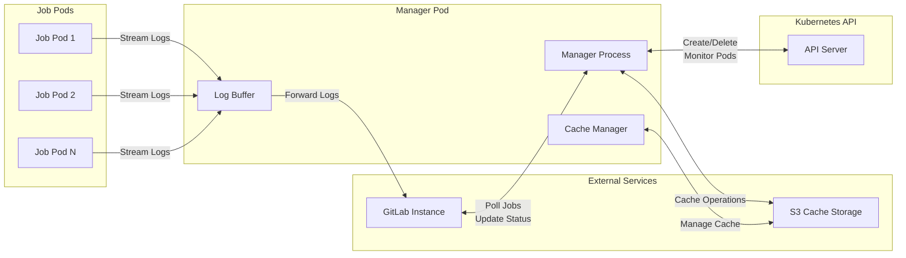
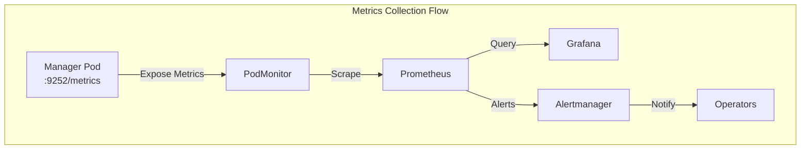
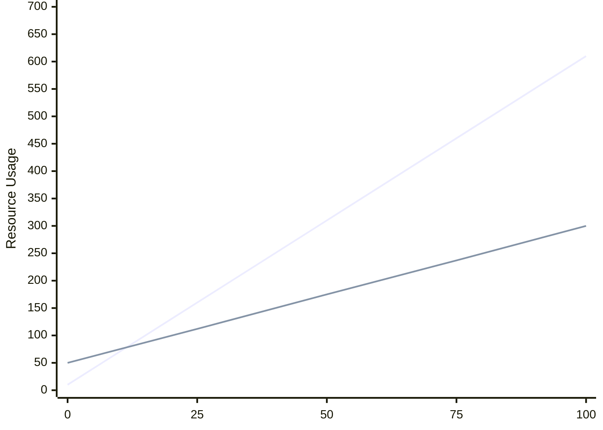
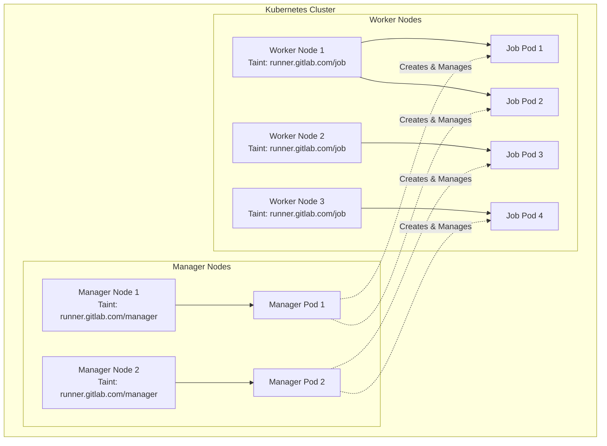



- 티어: Free, Premium, Ultimate
- 제공 서비스: GitLab.com, GitLab Self-Managed, GitLab Dedicated



Kubernetes 환경에서 GitLab Runner Manager Pod 성능을 모니터링하고 최적화하려면 GitLab에서는 다음과 같은 모범 사례를 권장합니다. 이러한 사례를 적용하여 성능 병목 현상을 파악하고 최적의 CI/CD 파이프라인 실행을 위한 솔루션을 구현하세요.

## 전제 조건 {#prerequisites}

이러한 권장 사항을 구현하기 전에:

- [Kubernetes 실행기](https://docs.gitlab.com/runner/executors/kubernetes/)를 사용하여 Kubernetes에 GitLab Runner를 배포합니다
- Kubernetes 클러스터에 대한 관리자 액세스 권한이 필요합니다
- GitLab Runner에 대해 [Prometheus 모니터링](../../administration/monitoring/_index.md)을 구성합니다
- Kubernetes 리소스 관리에 대한 기본 이해가 필요합니다

## GitLab Runner Manager Pod 책임 {#gitlab-runner-manager-pod-responsibilities}

GitLab Runner Manager Pod는 Kubernetes에서 모든 CI/CD 작업 실행을 조정합니다. 이의 성능은 파이프라인 효율성에 직접 영향을 미칩니다.

이는 다음을 처리합니다:

- **로그 처리**: 작업자 Pod에서 GitLab로 작업 로그를 수집하고 전달합니다
- **캐시 관리**: 로컬 및 클라우드 기반 캐싱 작업을 조정합니다
- **Kubernetes API 요청**: 작업자 Pod를 생성, 모니터링 및 삭제합니다
- **GitLab API 통신**: 작업을 폴링하고 상태 업데이트를 보고합니다
- **Pod 수명 주기 관리**: 작업자 Pod 프로비저닝 및 정리를 관리합니다



각 책임은 성능에 다르게 영향을 미칩니다:

- **CPU 집약적**: Kubernetes API 작업, 로그 처리
- **메모리 집약적**: 로그 버퍼링, 작업 큐 관리
- **네트워크 집약적**: GitLab API 통신, 로그 스트리밍

## Kubernetes에 GitLab Runner 배포 {#deploy-gitlab-runner-in-kubernetes}

[GitLab Runner Operator](https://gitlab.com/gitlab-org/gl-openshift/gitlab-runner-operator)를 통해 GitLab Runner를 설치합니다. 이 Operator는 적극적으로 새로운 기능과 개선 사항을 받습니다. GitLab Runner 팀은 [Experimental GRIT 프레임워크](https://gitlab.com/gitlab-org/ci-cd/runner-tools/grit/-/tree/main/scenarios/google/gke/operator?ref_type=heads)를 통해 Operator를 설치합니다.

Kubernetes에 GitLab Runner를 설치하는 가장 간단한 방법은 최신 릴리스에서 [`operator.k8s.yaml` 매니페스트를 적용](https://gitlab.com/gitlab-org/gl-openshift/gitlab-runner-operator/-/releases)한 다음 [Operator 설치 설명서](https://docs.gitlab.com/runner/install/operator/#install-on-kubernetes)의 지침을 따르는 것입니다.

## 모니터링 구성 {#configure-monitoring}

Pod가 일시적이고 메트릭이 기본 운영 가시성을 제공하기 때문에 관찰성은 Kubernetes에서 GitLab Runner 관리에 매우 중요합니다.

모니터링을 위해 [`kube-prometheus-stack`](https://github.com/prometheus-community/helm-charts/blob/main/charts/kube-prometheus-stack/README.md)를 설치합니다.

Operator에 대한 모니터링을 구성하려면 [Monitor GitLab Runner Operator](https://docs.gitlab.com/runner/monitoring#monitor-gitlab-runner-operator)를 참조하세요.

## 성능 모니터링 {#performance-monitoring}

효과적인 모니터링은 최적의 Manager Pod 성능을 유지하는 데 중요합니다.



### 주요 성능 메트릭 {#key-performance-metrics}

이러한 필수 메트릭을 모니터링하세요:

| 메트릭                                             | 설명                      | 성능 표시기 |
| -------------------------------------------------- | -------------------------------- | --------------------- |
| `gitlab_runner_jobs`                               | 현재 실행 중인 작업             | 작업 큐 포화도  |
| `gitlab_runner_limit`                              | 구성된 작업 동시성 제한 | 용량 활용률  |
| `gitlab_runner_request_concurrency_exceeded_total` | 동시성 제한을 초과하는 요청 | API 스로틀링        |
| `gitlab_runner_errors_total`                       | 총 포착된 오류              | 시스템 안정성      |
| `container_cpu_usage_seconds_total`                | 컨테이너 CPU 사용량              | 리소스 소비  |
| `container_memory_working_set_bytes`               | 컨테이너 메모리 사용량           | 메모리 압박       |

### Prometheus 쿼리 {#prometheus-queries}

이러한 쿼리로 Manager Pod 성능을 추적하세요:

```prometheus
# Manager pod memory usage in MB
container_memory_working_set_bytes{pod=~"gitlab-runner.*"} / 1024 / 1024

# Manager pod CPU utilization in Millicores
rate(container_cpu_usage_seconds_total{pod=~"gitlab-runner.*"}[5m]) * 1000

# Job queue saturation
gitlab_runner_jobs / gitlab_runner_limit

# Jobs per runner
gitlab_runner_jobs

# API request rate
sum(rate(apiserver_request_total[5m]))
```

### 대시보드 예시 {#example-dashboard}

다음 대시보드는 이전에 설명한 Prometheus 쿼리를 사용하여 모든 Pod의 Manager Pod 활용률을 표시합니다:


이 대시보드는 다음을 시각화하는 데 도움이 될 수 있습니다:

- Manager Pod 전체의 메모리 사용량 트렌드
- 작업 실행 중 CPU 활용률 패턴
- 작업 큐 포화도 레벨
- 개별 Pod 리소스 소비

## 과부하 Manager Pod 식별 {#identify-overloaded-manager-pods}

파이프라인에 영향을 미치기 전에 성능 저하를 인식하세요.

### 리소스 활용률 표시기 {#resource-utilization-indicators}

기본적으로 GitLab Runner Operator는 Manager Pod에 CPU 또는 메모리 제한을 적용하지 않습니다.

리소스 제한을 설정하려면:

```shell
kubectl patch deployment gitlab-runner -p '{"spec":{"template":{"spec":{"containers":[{"name":"gitlab-runner","resources":{"requests":{"cpu":"500m","memory":"256Mi"},"limits":{"cpu":"1000m","memory":"512Mi"}}}]}}}}'
```

> [!note]
> Operator 구성에서 배포 패칭을 허용하는 기능은 개발 중입니다. 자세한 내용은 [머지 리퀘스트 197](https://gitlab.com/gitlab-org/gl-openshift/gitlab-runner-operator/-/merge_requests/197)을 참조하세요.

**높은 CPU 사용량 패턴:**

- 표준 작업 중 CPU가 70% 이상으로 지속적으로 유지
- 작업 생성 중 CPU 급증이 90%를 초과
- 해당 작업 활동 없이 높은 CPU 지속

**메모리 소비 트렌드:**

- 할당된 제한의 80% 이상의 메모리 사용량
- 워크로드 증가 없는 지속적인 메모리 성장
- Manager Pod 로그의 메모리 부족(OOM) 이벤트

### 성능 저하 신호 {#performance-degradation-signs}

이러한 운영 증상을 주시하세요:

- 작업이 평상시보다 더 오래 대기 중인 상태
- 30초를 초과하는 Pod 생성 시간
- GitLab 작업 인터페이스의 지연된 로그 출력
- `etcdserver: request timed out` 오류가 로그에 나타남

### 진단 명령 {#diagnostic-commands}

```shell
# Current resource usage
kubectl top pods --containers

> POD                                                 NAME              CPU(cores)   MEMORY(bytes)
> gitlab-runner-runner-86cd68d899-m6qqm               runner            7m           32Mi

# Check for performance errors
kubectl logs gitlab-runner-runner-86cd68d899-m6qqm --since=2h | grep -E "(error|timeout|failed)"
```

## 리소스 구성 {#resource-configuration}

적절한 리소스 구성은 최적의 성능을 위해 필수적입니다.

### 성능 테스트 방법론 {#performance-testing-methodology}

GitLab Runner Manager Pod 성능은 로그 출력을 최대화하는 작업을 사용하여 테스트됩니다:

<details>
<summary>성능 테스트 작업 정의</summary>

```yaml
performance_test:
  stage: build
  timeout: 30m
  tags:
    - kubernetes_runner
  image: alpine:latest
  parallel: 100
  variables:
    FILE_SIZE_MB: 4
    CHUNK_SIZE_BYTES: 1024
    FILE_NAME: "test_file_${CI_JOB_ID}_${FILE_SIZE_MB}MB.dat"
    KUBERNETES_CPU_REQUEST: "200m"
    KUBERNETES_CPU_LIMIT: "200m"
    KUBERNETES_MEMORY_REQUEST: "200Mi"
    KUBERNETES_MEMORY_LIMIT: "200Mi"
  script:
    - echo "Starting performance test job ${CI_PARALLEL_ID}/${CI_PARALLEL_TOTAL} with ${FILE_SIZE_MB}MB file size, ${CHUNK_SIZE_BYTES} bytes chunk size"
    - dd if=/dev/urandom of="${FILE_NAME}" bs=1M count=${FILE_SIZE_MB}
    - echo "File generated successfully. Size:"
    - ls -lh "${FILE_NAME}"
    - echo "Reading file in ${CHUNK_SIZE_BYTES} byte chunks"
    - |
      TOTAL_SIZE=$(stat -c%s "${FILE_NAME}")
      BLOCKS=$((TOTAL_SIZE / CHUNK_SIZE_BYTES))
      echo "Processing $BLOCKS blocks of $CHUNK_SIZE_BYTES bytes each"
      for i in $(seq 0 99 $BLOCKS); do
        echo "Processing blocks $i to $((i+99))"
        dd if="${FILE_NAME}" bs=${CHUNK_SIZE_BYTES} skip=$i count=100 2>/dev/null | xxd -l $((CHUNK_SIZE_BYTES * 100)) -c 16
        sleep 0.5
      done
```

</details>

이 테스트는 작업당 4MB의 로그 출력을 생성하며, 이는 기본값 [`output_limit`](https://docs.gitlab.com/runner/configuration/advanced-configuration/#the-runners-section)에 도달하여 Manager Pod의 로그 처리 기능을 스트레스 테스트합니다.

**테스트 결과:**

| 병렬 작업 | 최대 CPU 사용량 | 최대 메모리 사용량 |
| ------------- | -------------- | ----------------- |
| 50            | 308m           | 261 MB            |
| 100           | 657m           | 369 MB            |



**주요 발견 사항:**

- CPU 사용량은 동시 작업과 거의 선형적으로 확장됩니다
- 메모리 사용량은 작업 수에 따라 증가하지만 선형적이지는 않습니다
- 모든 작업이 큐잉 없이 동시에 실행됩니다

### CPU 요구 사항 {#cpu-requirements}

GitLab 성능 테스트를 기반으로 Manager Pod CPU 요구 사항을 계산하세요:

Manager Pod CPU = 기본 CPU + (동시 작업 × 작업당 CPU 계수)

여기서:

- 기본 CPU: 10m(기본 오버헤드)
- 작업당 CPU 계수: ~동시 작업당 6m(테스트 기반)

**테스트 결과를 기반으로 한 예시:**

50개의 동시 작업인 경우:

```yaml
resources:
  requests:
    cpu: "310m" # 10m + (50 × 6m) = 310m
  limits:
    cpu: "465m" # 50% headroom for burst traffic
```

100개의 동시 작업인 경우:

```yaml
resources:
  requests:
    cpu: "610m" # 10m + (100 × 6m) = 610m
  limits:
    cpu: "915m" # 50% headroom
```

### 메모리 요구 사항 {#memory-requirements}

GitLab 테스트를 기반으로 메모리 요구 사항을 계산하세요:

Manager Pod 메모리 = 기본 메모리 + (동시 작업 × 작업당 메모리)

여기서:

- 기본 메모리: 50MB(기본 오버헤드)
- 작업당 메모리: ~동시 작업당 2.5MB(4MB 로그 출력 포함)

**테스트 결과를 기반으로 한 예시:**

50개의 동시 작업인 경우:

```yaml
resources:
  requests:
    memory: "175Mi" # 50 + (50 × 2.5) = 175 MB
  limits:
    memory: "350Mi" # 100% headroom
```

100개의 동시 작업인 경우:

```yaml
resources:
  requests:
    memory: "300Mi" # 50 + (100 × 2.5) = 300 MB
  limits:
    memory: "600Mi" # 100% headroom
```

> [!note]
> 메모리 사용량은 로그 볼륨에 따라 크게 다릅니다. 4MB 이상의 로그를 생성하는 작업은 비례적으로 더 많은 메모리가 필요합니다.

### 구성 예 {#configuration-examples}

**소규모(1-20개의 동시 작업):**

```yaml
resources:
  limits:
    cpu: 300m
    memory: 256Mi
  requests:
    cpu: 150m
    memory: 128Mi

runners:
  config: |
    concurrent = 20

    [[runners]]
      limit = 20
      request_concurrency = 5
```

**대규모(75개 이상의 동시 작업):**

```yaml
resources:
  limits:
    cpu: 1000m
    memory: 1Gi
  requests:
    cpu: 600m
    memory: 600Mi

runners:
  config: |
    concurrent = 150

    [[runners]]
      limit = 150
      request_concurrency = 20
```

### 수평 Pod 자동 스케일러 {#horizontal-pod-autoscaler}

자동 스케일링을 구성하세요:

```yaml
apiVersion: autoscaling/v2
kind: HorizontalPodAutoscaler
metadata:
  name: gitlab-runner-hpa
spec:
  scaleTargetRef:
    apiVersion: apps/v1
    kind: Deployment
    name: gitlab-runner
  minReplicas: 2
  maxReplicas: 5
  metrics:
    - type: Resource
      resource:
        name: cpu
        target:
          type: Utilization
          averageUtilization: 70
    - type: Resource
      resource:
        name: memory
        target:
          type: Utilization
          averageUtilization: 80
```

## 성능 문제 해결 {#troubleshoot-performance-issues}

이러한 솔루션으로 일반적인 Manager Pod 성능 문제를 해결하세요.

### API 속도 제한 {#api-rate-limiting}

**문제:** Manager Pod이 Kubernetes API 속도 제한을 초과합니다.

**솔루션:** API 폴링을 최적화하세요:

```toml
[[runners]]
  [runners.kubernetes]
    poll_interval = "5s"  # Increase from default 3s
    poll_timeout = "180s"
```

## 성능 최적화 {#performance-optimization}

어려운 시나리오에 이러한 성능 최적화 전략을 적용하세요.

### 캐시 최적화 {#cache-optimization}

Manager Pod 부하를 줄이기 위해 분산 캐싱을 구성하세요. 이 작업은 캐시된 파일을 공유하여 작업 Pod에 필요한 계산을 줄입니다:

```toml
[runners.cache]
  Type = "s3"
  Shared = true

  [runners.cache.s3]
    ServerAddress = "cache.example.com"
    BucketName = "gitlab-runner-cache"
    PreSignedURLDisabled = false
```

## 노드 분리 {#node-segregation}

전용 노드를 사용하여 Manager Pod를 작업 Pod에서 분리하여 안정적인 성능을 보장하고 리소스 경합을 방지합니다. 이러한 격리는 작업 Pod이 중요한 Manager Pod 작업을 방해하는 것을 방지합니다.



### 노드 Taint 구성 {#configure-node-taints}

**Manager 노드의 경우:**

```shell
# Taint nodes dedicated to Manager Pods
kubectl taint nodes <manager-node-name> runner.gitlab.com/manager=:NoExecute

# Label nodes for easier selection
kubectl label nodes <manager-node-name> runner.gitlab.com/workload-type=manager
```

**작업자 노드의 경우:**

```shell
# Taint nodes dedicated to job pods
kubectl taint nodes <worker-node-name> runner.gitlab.com/job=:NoExecute

# Label nodes for job scheduling
kubectl label nodes <worker-node-name> runner.gitlab.com/workload-type=job
```

### Manager Pod 스케줄링 구성 {#configure-manager-pod-scheduling}

GitLab Runner Operator 구성을 업데이트하여 Manager Pod를 전용 노드에만 스케줄합니다:

```yaml
apiVersion: apps.gitlab.com/v1beta2
kind: Runner
metadata:
  name: gitlab-runner
spec:
  gitlabUrl: https://gitlab.example.com
  token: gitlab-runner-secret
  buildImage: alpine
  podSpec:
    name: "manager-node-affinity"
    patch: |
      {
        "spec": {
          "nodeSelector": {
            "runner.gitlab.com/workload-type": "manager"
          },
          "tolerations": [
            {
              "key": "runner.gitlab.com/manager",
              "operator": "Exists",
              "effect": "NoExecute"
            }
          ]
        }
      }
    patchType: "strategic"
```

### 작업 Pod 스케줄링 구성 {#configure-job-pod-scheduling}

`config.toml`을 업데이트하여 작업 Pod가 작업자 노드에서만 실행되도록 합니다.

```toml
[runners.kubernetes.node_selector]
"runner.gitlab.com/workload-type" = "job"

[runners.kubernetes.node_tolerations]
"runner.gitlab.com/job=" = "NoExecute"
```

**노드 분리의 이점:**

- 작업 간섭 없이 Manager Pod에 전용 리소스
- 리소스 경합 없는 예측 가능한 성능
- 전용 노드 사용 시 리소스 제한 없이 실행할 수 있는 옵션
- 노드 기반 스케일링을 통한 간소화된 용량 계획

### 긴급 절차 {#emergency-procedures}

**정상 재시작:**

```shell
# Scale down to stop accepting new jobs
kubectl scale deployment gitlab-runner --replicas=0

# Wait for active jobs to complete (max 10 minutes)
timeout 600 bash -c 'while kubectl get pods -l job-type=user-job | grep Running; do sleep 10; done'

# Scale back up
kubectl scale deployment gitlab-runner --replicas=1
```

## 용량 계획 {#capacity-planning}

이러한 계산은 작업당 4MB 로그 출력에 대한 테스트를 기반으로 합니다. 리소스 요구 사항은 다음 사항에 따라 다를 수 있습니다:

- 작업당 로그 볼륨
- 작업 실행 패턴
- 캐시 사용
- GitLab에 대한 네트워크 지연

이 Python 함수를 사용하여 최적의 리소스를 계산하세요:

```python
def calculate_manager_resources(concurrent_jobs, avg_log_mb_per_job=4):
    """Calculate Manager Pod resources based on performance testing."""
    # CPU: ~6m per concurrent job + 10m base
    base_cpu = 0.01  # 10m
    cpu_per_job = 0.006  # 6m per job
    total_cpu = base_cpu + (concurrent_jobs * cpu_per_job)

    # Memory: ~2.5MB per job + 50MB base (for 4MB log output)
    base_memory = 50
    memory_per_job = 2.5 * (avg_log_mb_per_job / 4)  # Scale with log size
    total_memory = base_memory + (concurrent_jobs * memory_per_job)

    return {
        'cpu_request': f"{int(total_cpu * 1000)}m",
        'cpu_limit': f"{int(total_cpu * 1.5 * 1000)}m",  # 50% headroom
        'memory_request': f"{int(total_memory)}Mi",
        'memory_limit': f"{int(total_memory * 2.0)}Mi"  # 100% headroom
    }
```

## 성능 임계값 {#performance-thresholds}

적극적인 개입을 위한 임계값을 설정하세요:

| 메트릭         | 경고        | 긴급       | 필요한 작업         |
| -------------- | -------------- | -------------- | ----------------------- |
| CPU 사용량      | 70% 지속  | 85% 지속  | 스케일 또는 최적화       |
| 메모리 사용량   | 제한의 80%   | 제한의 90%   | 제한 증가         |
| API 오류율 | 요청의 2% | 요청의 5% | 병목 현상 조사 |
| 작업 큐 시간 | 30초     | 2분      | 용량 검토         |

## 관련 항목 {#related-topics}

- [GitLab Runner 플릿 구성 및 모범 사례](gitlab_runner_fleet_config_and_best_practices.md) \- 작업 Pod 성능 최적화
- [GitLab Runner 실행기](https://docs.gitlab.com/runner/executors/) \- 실행 환경 성능 특성
- [GitLab Runner 모니터링](../../administration/monitoring/_index.md) \- 일반 모니터링 설정
- [러너 플릿 계획 및 운영](https://docs.gitlab.com/runner/fleet_scaling/) \- 전략적 플릿 배포

## 요약 {#summary}

GitLab Runner Manager Pod 성능 최적화에는 체계적인 모니터링, 적절한 리소스 할당 및 적극적인 문제 해결이 필요합니다.

주요 전략은 다음과 같습니다:

- **적극적인 모니터링** \- Prometheus 메트릭 및 Grafana 대시보드 사용
- **리소스 계획** \- 동시 작업 용량 및 로그 볼륨 기반
- **다중 Manager 아키텍처** \- 장애 허용 및 로드 분산
- **긴급 절차** \- 빠른 문제 해결

이러한 전략을 구현하여 최적의 리소스 활용을 유지하면서 신뢰할 수 있는 CI/CD 파이프라인 실행을 보장하세요.
