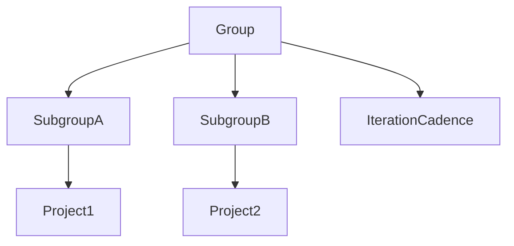

<!-- vale gitlab_base.FutureTense = NO -->

GitLab에서 애자일 개발 반복을 실행하려면 함께 작동하는 여러 GitLab 기능을 사용합니다.

GitLab에서 애자일 반복을 실행하려면:

1. 그룹을 생성합니다.
1. 프로젝트를 생성합니다.
1. 반복 주기를 설정합니다.
1. 범위 지정 레이블을 생성합니다.
1. 에픽 및 이슈를 생성합니다.
1. 이슈 보드를 생성합니다.

이러한 핵심 구성 요소를 생성한 후 반복 실행을 시작할 수 있습니다.

## 그룹 생성 {#create-a-group}

반복 주기는 그룹을 위해 생성되므로 아직 그룹이 없다면 [생성을 시작](../../user/group/_index.md#create-a-group)합니다.

그룹을 사용하여 동시에 하나 이상의 관련 프로젝트를 관리합니다. 사용자를 그룹의 구성원으로 추가하고 역할을 할당합니다. 역할은 각 사용자가 그룹의 프로젝트에 대해 가진 [권한 수준](../../user/permissions.md)을 결정합니다. 멤버십은 모든 하위 그룹 및 프로젝트로 자동으로 계단식으로 내려옵니다.

## 프로젝트 생성 {#create-a-project}

이제 그룹에서 [하나 이상의 프로젝트를 생성](../../user/project/_index.md)합니다. 프로젝트를 생성하는 방법은 여러 가지입니다. 프로젝트에는 코드 및 파이프라인뿐만 아니라 향후 코드 변경을 계획하는 데 사용되는 이슈가 포함됩니다.

## 반복 주기 설정 {#set-up-an-iteration-cadence}

에픽 또는 이슈 생성을 시작하기 전에 [반복 주기](../../user/group/iterations/_index.md#iteration-cadences)를 생성합니다. 반복 주기는 이슈를 계획하고 보고하기 위한 개별, 순차적 반복 타임박스를 포함합니다.

반복 주기를 생성할 때 반복을 자동으로 관리할지 또는 자동화된 스케줄링을 해제하여 [반복을 수동으로 관리](../../user/group/iterations/_index.md#create-an-iteration-manually)할지 결정할 수 있습니다.

멤버십과 유사하게 반복은 그룹, 하위 그룹 및 프로젝트 계층 구조로 계단식으로 내려옵니다. 팀에 여러 그룹 및 프로젝트가 있는 경우 최상위 공유 그룹에서 반복 주기를 생성합니다:

## 범위 지정 레이블 생성 {#create-scoped-labels}

또한 반복 주기를 생성한 동일한 그룹에서 [범위 지정 레이블을 생성](../../user/project/labels.md)해야 합니다. 레이블은 에픽, 이슈 및 머지 리퀘스트를 구성하고 보드의 이슈 흐름을 시각화하는 데 도움이 됩니다. 예를 들어 `workflow::planning`, `workflow::ready for development`, `workflow::in development` 및 `workflow::complete`와 같은 범위 지정 레이블을 사용하여 이슈 상태를 표시할 수 있습니다. 또한 범위 지정 레이블을 활용하여 `type::feature`, `type::defect` 및 `type::maintenance`과 같은 이슈 또는 에픽의 유형을 나타낼 수 있습니다.

## 에픽 및 이슈 생성 {#create-your-epics-and-issues}

이제 반복 계획을 시작할 수 있습니다. 반복 주기를 생성한 그룹에서 [에픽](../../user/group/epics/_index.md)을 생성한 다음 하나 이상의 프로젝트에서 자식 [이슈](../../user/project/issues/_index.md)를 생성합니다. 필요에 따라 각 항목에 레이블을 추가합니다.

## 이슈 보드 생성 {#create-an-issue-board}

[이슈 보드](../../user/project/issue_board.md)는 향후 반복을 계획하거나 진행 중인 반복의 워크플로우를 시각화하는 데 도움이 됩니다. 목록 열은 레이블, 담당자, 반복 또는 마일스톤을 기반으로 생성할 수 있습니다. 여러 속성으로 보드를 필터링하고 에픽별로 이슈를 그룹화할 수도 있습니다.

반복 주기 및 레이블을 생성한 그룹에서 [이슈 보드를 생성](../../user/project/issue_board.md#create-an-issue-board)하고 "반복 계획"으로 이름을 지정합니다. 그런 다음 각 반복에 대한 목록을 생성합니다. 그런 다음 "열림" 목록에서 반복 목록으로 이슈를 드래그하여 향후 반복에 대해 예약합니다.

현재 반복의 이슈에 대한 워크플로우를 시각화하려면 "현재 반복"이라고 불리는 다른 이슈 보드를 생성합니다. 보드를 생성할 때:

1. **보드 구성**()을 선택합니다.
1. **이터레이션** 옆에서 **편집**을 선택합니다.
1. 드롭다운 목록에서 **현재 이터레이션**을 선택합니다.
1. **변경 사항 저장**을 선택합니다.

보드는 이제 현재 반복에 있는 이슈만 항상 표시합니다. 이전에 생성한 각 `workflow::...` 레이블에 대한 목록을 추가하기 시작할 수 있습니다.

이제 개발을 시작할 준비가 되었습니다.
