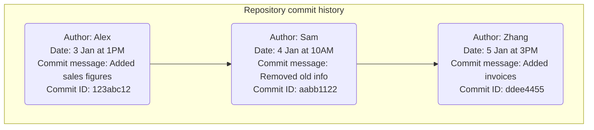
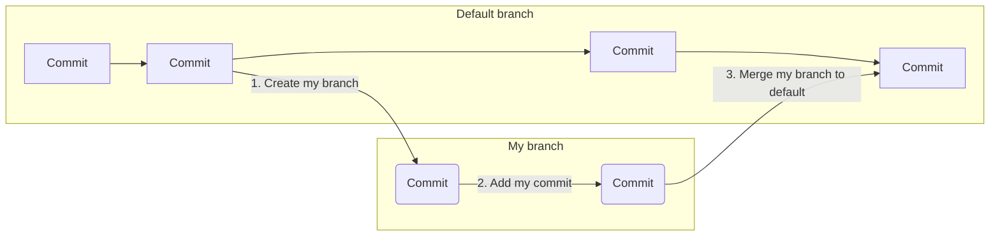

<!-- vale gitlab_base.FutureTense = NO -->

이 튜토리얼은 Git이 어떻게 작동하는지에 대해 조금 알려줍니다. 프로젝트를 생성하고, 파일을 편집하고, 커밋을 통해 Git 리포지토리에 변경 사항을 저장하는 단계를 안내합니다.

완료되면 Git을 사용하여 연습할 수 있는 프로젝트가 준비됩니다.

## 시작하기 전에 {#before-you-begin}

- [로컬 머신에 Git 설치](../../topics/git/how_to_install_git/_index.md)하기.
- GitLab 인스턴스에 로그인할 수 있는지 확인합니다. 조직에 GitLab이 없으면 GitLab.com에서 계정을 생성합니다.
- [SSH 키를 생성하고 GitLab에 추가](../../user/ssh.md)합니다. SSH 키는 컴퓨터와 GitLab 사이의 안전한 통신 방법입니다.

## Git이란? {#what-is-git}

단계를 진행하기 전에 몇 가지 기본 Git 개념을 살펴보겠습니다.

Git은 버전 관리 시스템입니다. 파일의 변경 사항을 추적하는 데 사용됩니다.

코드나 문서와 같은 파일을 Git *리포지토리*에 저장합니다. 파일을 편집하려면 *clone*으로 리포지토리를 컴퓨터에 다운로드하고, 변경 사항을 만들고, *push*하여 변경 사항을 다시 리포지토리로 전송합니다. GitLab에서 Git 리포지토리는 *프로젝트* 내에 위치합니다.

변경 사항을 push할 때마다 Git은 이를 고유한 *커밋*으로 기록합니다. 이러한 커밋은 파일이 언제, 어떻게 변경되었는지, 누가 변경했는지에 대한 기록을 구성합니다.



Git 리포지토리에서 작업할 때는 *브랜치*에서 작업합니다. 기본적으로 리포지토리의 내용은 기본 브랜치에 있습니다. 변경 사항을 만들려면:

1. 기본 브랜치의 스냅샷인 자신의 브랜치를 생성합니다.
1. 변경 사항을 만들고 브랜치로 push합니다. 각 push마다 커밋이 생성됩니다.
1. 준비되면 브랜치를 기본 브랜치로 *merge*합니다.



이 모든 것이 압도적으로 느껴지면 걱정하지 마세요. 이제 이러한 개념들이 실제로 작동하는 것을 볼 수 있습니다.

## 단계 {#steps}

다음은 우리가 할 작업의 개요입니다:

1. [샘플 프로젝트 생성](#create-a-sample-project).
1. [리포지토리 clone](#clone-the-repository).
1. [브랜치를 생성하고 변경 사항 만들기](#create-a-branch-and-make-changes).
1. [커밋 및 변경 사항 push](#commit-and-push-your-changes).
1. [변경 사항 merge](#merge-your-changes).
1. [GitLab에서 변경 사항 보기](#view-your-changes-in-gitlab).

### 샘플 프로젝트 생성 {#create-a-sample-project}

시작하려면 GitLab에서 샘플 프로젝트를 생성합니다.

1. GitLab의 오른쪽 위 모서리에서 **새로 만들기**() 및 **새 프로젝트/리포지토리**를 선택합니다.
1. **프로젝트 이름**의 경우 `My sample project`을 입력합니다. 프로젝트 슬러그는 자동으로 생성됩니다. 이 슬러그는 프로젝트 생성 후 프로젝트에 액세스하는 데 사용할 수 있는 URL입니다.
1. **README 파일을 포함하여 리포지토리 초기화**가 선택되어 있는지 확인합니다. 다른 필드를 완료하는 방식은 사용자가 결정합니다.
1. **프로젝트 생성**을 선택합니다.

### 리포지토리 clone {#clone-the-repository}

이제 프로젝트의 리포지토리를 clone할 수 있습니다. *Clone*은 리포지토리의 복사본을 컴퓨터에 또는 파일을 저장하고 작업하려는 다른 위치에 생성하는 것을 의미합니다.

1. 프로젝트의 개요 페이지에서 오른쪽 위 모서리에 있는 **코드**를 선택한 후 **SSH로 clone**의 URL을 복사합니다.

   
1. 컴퓨터에서 터미널을 열고 파일을 clone할 디렉터리로 이동합니다.
1. `git clone`을(를) 입력한 다음 URL을 붙여넣습니다:

   ```shell
   git clone git@gitlab.com:gitlab-example/my-sample-project.git
   ```

1. 디렉터리로 이동합니다:

   ```shell
   cd my-sample-project
   ```

1. 기본적으로 리포지토리의 기본 브랜치를 clone했습니다. 일반적으로 이 브랜치는 `main`입니다. 확인하려면 기본 브랜치의 이름을 가져옵니다:

   ```shell
   git branch
   ```

   현재 있는 브랜치는 별표로 표시됩니다. 키보드에서 `Q`을(를) 눌러 주 터미널 창으로 돌아갑니다.

### 브랜치를 생성하고 변경 사항 만들기 {#create-a-branch-and-make-changes}

이제 리포지토리의 복사본이 있으므로 변경 사항을 독립적으로 작업할 수 있도록 자신의 브랜치를 생성합니다.

1. `example-tutorial-branch`이라는 새로운 브랜치를 생성합니다.

   ```shell
   git checkout -b example-tutorial-branch
   ```

1. Visual Studio Code, Sublime, `vi` 또는 다른 편집기와 같은 텍스트 편집기에서 README.md 파일을 열고 다음 텍스트를 추가합니다:

   ```plaintext
   Hello world! I'm using Git!
   ```

1. 파일을 저장합니다.
1. Git은 변경된 파일을 추적합니다. 어떤 파일이 변경되었는지 확인하려면 상태를 확인합니다.

   ```shell
   git status
   ```

   다음과 유사한 출력을 받아야 합니다:

   ```shell
   On branch example-tutorial-branch
   Changes not staged for commit:
   (use "git add <file>..." to update what will be committed)
   (use "git restore <file>..." to discard changes in working directory)
   modified:   README.md

   no changes added to commit (use "git add" and/or "git commit -a")
   ```

### 커밋 및 변경 사항 push {#commit-and-push-your-changes}

리포지토리의 파일에 변경 사항을 만들었습니다. 이제 첫 번째 커밋을 수행하여 이러한 변경 사항을 기록할 시간입니다.

1. `README.md` 파일을 *스테이징* 영역에 추가합니다. 스테이징 영역은 파일을 커밋하기 전에 저장하는 위치입니다.

   ```shell
   git add README.md
   ```

1. 파일이 스테이징되었는지 확인합니다:

   ```shell
   git status
   ```

   다음과 유사한 출력을 받아야 하며, 파일 이름은 녹색 텍스트로 표시됩니다.

   ```shell
   On branch example-tutorial-branch
   Changes to be committed:
   (use "git restore --staged <file>..." to unstage)
   modified:   README.md
   ```

1. 이제 스테이징된 파일을 커밋하고 수행한 변경 사항을 설명하는 메시지를 포함합니다. 메시지를 큰따옴표(")로 묶어야 합니다.

   ```shell
   git commit -m "I added text to the README file"
   ```

1. 변경 사항이 브랜치에 커밋되었지만 브랜치와 그 커밋은 여전히 컴퓨터에만 있습니다. 다른 사람은 아직 접근할 수 없습니다. GitLab에 브랜치를 push합니다:

   ```shell
   git push origin example-tutorial-branch
   ```

브랜치는 이제 GitLab에서 사용 가능하며 프로젝트의 다른 사용자에게 표시됩니다.


### 변경 사항 merge {#merge-your-changes}

이제 `example-tutorial-branch` 브랜치에서 기본 브랜치(`main`)로 변경 사항을 merge할 준비가 되었습니다.

1. 리포지토리의 기본 브랜치를 확인합니다.

   ```shell
   git checkout main
   ```

1. 브랜치를 기본 브랜치로 merge합니다.

   ```shell
   git merge example-tutorial-branch
   ```

1. 변경 사항을 push합니다.

   ```shell
   git push
   ```

> [!note]
> 이 튜토리얼에서는 브랜치를 리포지토리의 기본 브랜치로 직접 merge합니다. GitLab에서는 일반적으로 [머지 리퀘스트](../../user/project/merge_requests/_index.md)를 사용하여 브랜치를 merge합니다.

### GitLab에서 변경 사항 보기 {#view-your-changes-in-gitlab}

완료했습니다! 브랜치에서 `README.md` 파일을 업데이트했으며, 이러한 변경 사항을 `main` 브랜치에 merge했습니다.

UI에서 변경 사항을 확인해봅시다. 프로젝트로 이동합니다.

- `README.md` 파일의 내용을 스크롤하여 봅니다. 변경 사항이 표시되어야 합니다.
- `README.md` 파일 위에서 **최근 커밋** 열의 텍스트를 봅니다. 커밋 메시지가 이 열에 표시됩니다:

  

이제 명령줄로 돌아가서 개인 브랜치(`git checkout example-tutorial-branch`)로 변경할 수 있습니다. 파일을 계속 업데이트하거나 새 파일을 만들 수 있습니다. `git status`을(를) 입력하여 변경 사항의 상태를 확인하고 임의로 커밋합니다.

작업을 잘못하더라도 걱정하지 마세요. Git의 모든 것을 되돌릴 수 있으며, 복구할 수 없으면 새 브랜치를 만들고 다시 시작할 수 있습니다.

훌륭한 작업입니다.

## 더 많은 Git 학습 리소스 찾기 {#find-more-git-learning-resources}

- <i class="fa-youtube-play" aria-hidden="true"></i> [Git for GitLab](https://www.youtube.com/watch?v=4lxvVj7wlZw) 초급자 코스(1시간 33분)에서 Git에 대한 완전한 소개를 받습니다.
- [튜토리얼 페이지](../_index.md)에서 Git 및 GitLab에 대한 다른 튜토리얼을 찾습니다.
- PDF 다운로드: [Git Cheat Sheet](https://gitlab.com/gitlab-com/www-gitlab-com/-/blob/master/source/images/press/git-cheat-sheet.pdf).
- 블로그 게시물: [Git Tips & Tricks](https://about.gitlab.com/blog/git-tips-and-tricks/).
- 블로그 게시물: [Git을 더 잘 사용하는 8가지 팁](https://about.gitlab.com/blog/8-tips-to-help-you-work-better-with-git/).
- 공식 [Git 문서](https://git-scm.com)(포함 [Git on the Server - GitLab](https://git-scm.com/book/en/v2/Git-on-the-Server-GitLab))
