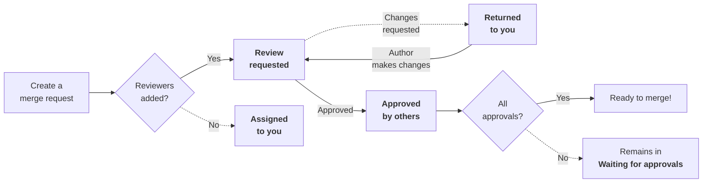



- 티어: Free, Premium, Ultimate
- 제공 서비스: GitLab.com, GitLab Self-Managed, GitLab Dedicated





- GitLab 17.9에서 `merge_request_dashboard` [기능 플래그](../../administration/feature_flags/_index.md)로 [도입](https://gitlab.com/groups/gitlab-org/-/work_items/13448)되었습니다. 기본적으로 비활성화되었습니다.
- 기능 플래그 `merge_request_dashboard` GitLab.com에서 GitLab 17.9에 [활성화됨](https://gitlab.com/gitlab-org/gitlab/-/issues/480854).
- 기능 플래그 `mr_dashboard_list_type_toggle` GitLab.com에서 GitLab 18.1에 [활성화됨](https://gitlab.com/gitlab-org/gitlab/-/issues/535244).
- 기능 플래그 `merge_request_dashboard` GitLab 18.2에서 [기본적으로 활성화됨](https://gitlab.com/gitlab-org/gitlab/-/merge_requests/194999).



> [!flag]
> 이 기능의 가용성은 기능 플래그로 제어됩니다. 자세한 내용은 기록을 참조하세요.

이 자습서는 머지 리퀘스트를 관리하기 위한 새로운 사용자 인터페이스를 소개합니다.

리뷰를 기다리는 작성자이든, 피드백을 제공하는 검토자이든 이 페이지는 작업을 추적하는 데 도움이 됩니다. 작업을 명확한 범주로 정렬하여 다음을 수행할 수 있습니다:

- 주의가 필요한 머지 리퀘스트 추적에 드는 시간을 줄입니다.
- 가장 긴급한 작업부터 먼저 집중합니다.
- 기여한 작업의 상태를 확인합니다.
- 진행 중인 작업이 잊히지 않도록 방지합니다.
- 코드 검토 속도를 향상합니다.

## 실제로 보기 {#see-it-in-action}

GitLab.com에서 머지 리퀘스트 홈페이지를 보려면 다음 중 하나를 수행합니다:

- <kbd>Shift</kbd>+<kbd>m</kbd> [키보드 단축키](../../user/shortcuts.md)를 사용합니다.
- 왼쪽 사이드바에서 **머지 리퀘스트**를 선택합니다.

세 개의 탭으로 구성되어 있으며, 지금 필요한 것에 집중하면서도 다른 최근 작업에 접근할 수 있습니다:

- **활성**: 이 머지 리퀘스트들은 당신 또는 팀의 다른 멤버의 주의가 필요합니다.
- **머지됨**: 이 머지 리퀘스트들은 지난 14일 동안 머지되었으며 담당자 또는 검토자였습니다.
- **검색**: 모든 머지 리퀘스트를 검색하고 필요에 따라 필터링합니다.

GitLab은 모든 페이지의 오른쪽 상단에 **활성** 머지 리퀘스트의 총 개수를 표시합니다. 예를 들어, 이 사용자는 다음을 보유하고 있습니다:

- 8개의 열린 이슈 ()
- 3개의 활성 머지 리퀘스트 ()
- 6개의 할 일 항목 ()

각 테이블 행은 머지 리퀘스트에 대한 관련 정보를 열로 그룹화합니다:

- **상태** \- 머지 리퀘스트의 현재 상태입니다.
- **제목** \- 이슈에 대한 중요한 메타데이터입니다:
  - 머지 리퀘스트 제목입니다.
  - 담당자의 아바타입니다.
  - 추가되고 제거된 파일 및 라인의 개수 (`+` / `-`).
  - 마일스톤입니다.
- **작성자** \- 작성자의 아바타입니다.
- **검토자** \- 검토자의 아바타입니다. 녹색 체크 표시가 있는 검토자는 머지 리퀘스트를 승인했습니다.
- **점검** \- 병합 가능성에 대한 간단한 평가입니다.
  - 열린 스레드의 개수입니다 (예: `0 of 3`).
  - 현재 필요한 [승인 상태](../../user/project/merge_requests/approvals/_index.md#in-the-list-of-merge-requests)입니다.
  - 가장 최근의 파이프라인 상태입니다.
  - 마지막 업데이트 날짜입니다.

## 표시 설정 지정 {#set-your-display-preferences}

오른쪽 상단에서 **표시 설정** ()을 선택하여 머지 리퀘스트를 다음으로 정렬합니다:

- **워크플로**. 이 보기는 머지 리퀘스트를 상태별로 그룹화합니다. 주의가 필요한 머지 리퀘스트는 작성자인지 검토자인지에 관계없이 먼저 표시됩니다.
- **역할**. 이 보기는 검토자 또는 작성자인지 여부에 따라 머지 리퀘스트를 그룹화합니다.





**워크플로** 보기에서 **활성** 탭은 다음 순서로 머지 리퀘스트를 정렬합니다:

- **당신에게 반환되었습니다**
- **검토가 요청됨**
- **당신의 머지 리퀘스트**

이 상태의 머지 리퀘스트는 **활성** 개수에서 제외됩니다:

- **담당자 대기 중**
- **승인 대기중**
- **당신이 승인함**
- **다른 사람이 승인함**





**역할** 보기에서 **활성** 탭은 다음 순서로 머지 리퀘스트를 정렬합니다:

- **검토자 (활성)**
- **검토자 (비활성)**
- **당신의 머지 리퀘스트 (활성)**
- **당신의 머지 리퀘스트 (비활성)**





## 역할 보기 이해 {#understand-the-role-view}

**역할** 보기는 당신이 담당자 또는 검토자인 머지 리퀘스트를 그룹화합니다:

- **검토자 (활성)**: 당신의 검토를 기다리는 중입니다.
- **검토자 (비활성)**: 이미 당신이 검토했습니다.
- **당신의 머지 리퀘스트 (활성)**
- **당신의 머지 리퀘스트 (비활성)**

**활성** 목록의 머지 리퀘스트는 왼쪽 사이드바에 표시된 총계에 포함됩니다.

## 워크플로 보기 이해 {#understand-the-workflow-view}

**워크플로** 보기는 머지 리퀘스트가 [검토 프로세스](../../user/project/merge_requests/reviews/_index.md)에서 어디에 있는지로 그룹화합니다. 이 보기는 다음에 수행할 작업을 이해하는 데 도움이 됩니다:

이 검토 흐름은 다음을 가정합니다:

1. **담당자**는 머지 리퀘스트의 작성자입니다.
1. **검토자**는 머지 리퀘스트의 작업을 검토하는 사용자입니다.
1. 검토자는 [**리뷰 시작**](../../user/project/merge_requests/reviews/_index.md#start-a-review) 및 [**리뷰 제출**](../../user/project/merge_requests/reviews/_index.md#submit-a-review) 기능을 사용합니다.

**활성** 상태 중 하나의 머지 리퀘스트는 왼쪽 사이드바에 표시된 총계에 포함됩니다:

- 활성 상태: **당신에게 반환되었습니다**, **검토가 요청됨**, **당신의 머지 리퀘스트**
- 비활성 상태: **담당자 대기 중**, **승인 대기중**, **당신이 승인함**, **다른 사람이 승인함**

## 워크플로 보기: 활성 상태 {#workflow-view-active-statuses}

이 머지 리퀘스트들은 당신 또는 팀의 다른 멤버의 주의가 필요합니다.

### 당신에게 반환되었습니다 {#returned-to-you}

검토자가 피드백을 제공했거나 변경을 요청했습니다.

- 다음 단계: 검토자 의견을 처리하고 제안된 변경 사항을 구현합니다.
- 상태:
  - **변경 요청됨**: 검토자가 변경을 요청했습니다.
  - **검토자가 코멘트함**: 검토자가 댓글을 남겼지만 변경을 요청하지 않았습니다.

### 검토 요청 {#review-requested}

당신은 이 머지 리퀘스트의 검토자입니다.

- 다음 단계: 머지 리퀘스트를 검토합니다. 승인 및 피드백을 제공합니다. 필요할 때 변경을 요청합니다.
- 상태:
  - **요청됨**: 검토를 아직 시작하지 않았습니다.
  - **리뷰 시작됨**: 검토를 시작했지만 아직 완료하지 않았습니다.

### 당신의 머지 리퀘스트 {#your-merge-requests}

당신은 머지 리퀘스트 작성자 또는 담당자입니다. 아직 검토자를 추가하지 않았습니다.

- 다음 단계: 검토자를 추가하여 검토 프로세스를 시작합니다.
- 상태:
  - **초안**: 머지 리퀘스트가 초안으로 표시되어 있습니다.
  - **검토자가 필요합니다**: 머지 리퀘스트가 초안이 아니지만 검토자가 없습니다.

## 워크플로 보기: 비활성 상태 {#workflow-view-inactive-statuses}

**활성** 탭은 상태별로 정렬된 모든 진행 중인 머지 리퀘스트를 표시합니다. 이 머지 리퀘스트들은 활성 개수에서 제외됩니다. 당신이 지금 수행해야 할 조치가 없기 때문입니다:

### 담당자 대기 중 {#waiting-for-assignee}

승인을 기다리는 당신의 할당된 머지 리퀘스트 및 변경을 요청한 검토입니다.

- 다음 단계: 검토 및 승인을 기다립니다.
- 상태:
  - **변경을 요청 하였습니다**: 검토를 완료하고 변경을 요청했습니다.
  - **당신이 댓글을 달았습니다**: 댓글을 남겼지만 검토를 완료하지 않았습니다.

### 승인 대기중 {#waiting-for-approvals}

승인을 기다리는 당신의 할당된 머지 리퀘스트 및 변경을 요청한 검토입니다.

- 다음 단계: 모든 승인 요구 사항이 충족될 때까지 기다립니다.
- 상태:
  - **승인 필요** \- 필요한 승인의 나머지 개수입니다.
  - **승인됨** \- 당신이 승인했거나 모든 필요한 승인이 충족되었습니다.
  - **승인 대기중**.

### 당신이 승인함 {#approved-by-you}

당신이 검토하고 승인한 머지 리퀘스트입니다.

- 다음 단계: 다른 승인 및 기타 병합 요구 사항이 충족될 때까지 기다립니다.
- 상태:
  - **승인됨** \- 당신이 승인했고, 필요한 승인이 충족되었습니다.
  - **승인 필요** \- 당신이 승인했지만 필요한 모든 승인이 충족되지 않았습니다.

### 다른 사람이 승인함 {#approved-by-others}

팀의 다른 멤버로부터 승인을 받은 머지 리퀘스트입니다.

- 다음 단계: 모든 요구 사항이 충족되면 병합할 준비가 된 상태입니다.
- 상태:
  - **승인됨** \- 당신의 머지 리퀘스트가 필요한 승인을 받았습니다.
