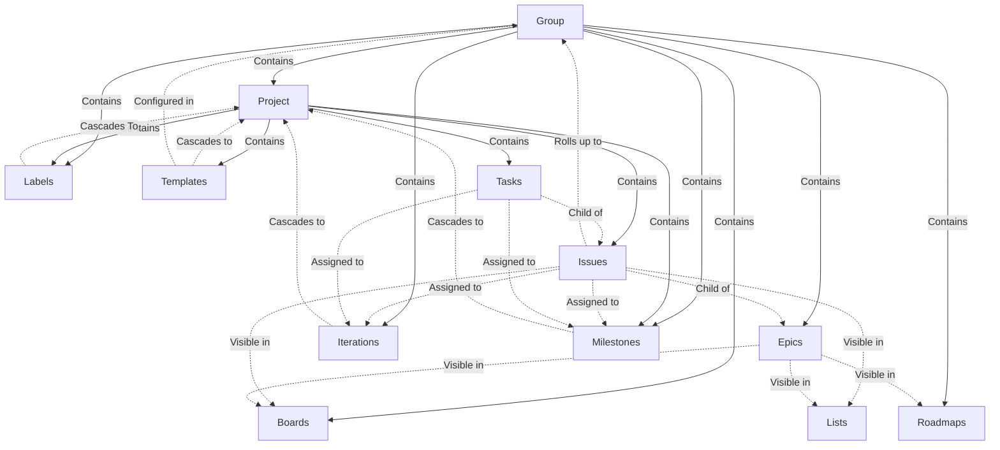
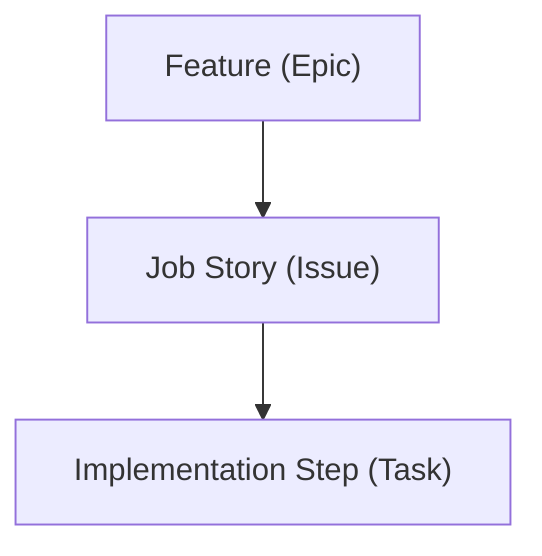
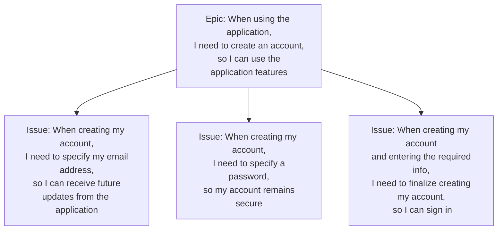
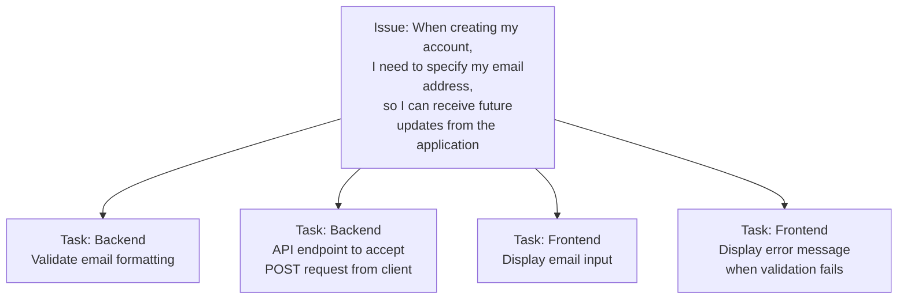

<!-- vale gitlab_base.FutureTense = NO -->

이 튜토리얼에서는 GitLab의 애자일 계획 수립 및 추적 기능을 사용하여 핵심 Scrum 의식 및 워크플로를 용이하게 하기 위한 단계별 지침을 제공합니다. 그룹, 프로젝트, 보드 및 기타 기능을 의도적인 방식으로 설정하면 팀은 향상된 투명성, 협업 및 배포 주기를 실현할 수 있습니다.

Martin Fowler의 [Agile Fluency Model](https://martinfowler.com/articles/agileFluency.html)에 따르면 [Scrum](https://scrumguides.org/scrum-guide.html)을 실행하는 팀:

> …후원자, 고객 및 사용자가 소프트웨어에서 볼 수 있는 이점 관점에서 생각하고 계획합니다.

월별로 진행 상황을 시연하고 더 많은 비즈니스 및 고객 가치를 제공하기 위해 프로세스 및 작업 습관 개선을 정기적으로 반영함으로써 이를 달성합니다.

이 튜토리얼에서는 다음 항목을 다룹니다:

- [그룹 및 프로젝트 설정](#setting-up-your-groups-and-projects)
- [기능 백로그 관리](#managing-your-feature-backlog)
- [스토리 백로그 관리](#managing-your-story-backlog)
- [스프린트 진행 상황 추적](#tracking-sprint-progress)

## 그룹 및 프로젝트 설정 {#setting-up-your-groups-and-projects}

GitLab에서 Scrum 실무를 용이하게 하려면 먼저 그룹 및 프로젝트의 기초 구조를 설정해야 합니다. 그룹을 사용하여 해당 그룹 아래에 중첩된 프로젝트에서 상속할 수 있는 보드 및 레이블을 생성합니다. 프로젝트에는 각 스프린트의 실제 작업 항목을 구성하는 이슈 및 작업이 포함됩니다.

### GitLab의 상속 모델 이해 {#understanding-the-inheritance-model-in-gitlab}

GitLab은 그룹에 프로젝트가 포함된 계층 구조를 갖습니다. 그룹에 적용된 설정 및 구성은 자식 프로젝트로 계단식으로 내려가므로 여러 프로젝트에 걸쳐 레이블, 보드 및 반복을 표준화할 수 있습니다:



- 그룹에는 하나 이상의 프로젝트, 에픽, 보드, 레이블 및 반복이 포함됩니다. 그룹의 사용자 멤버십은 그룹의 프로젝트로 계단식으로 내려갑니다.
- 그룹 또는 프로젝트에서 보드 및 레이블을 생성할 수 있습니다. 이 튜토리얼의 경우 단일 그룹의 여러 프로젝트에서 표준화된 계획 워크플로 및 보고를 용이하게 하기 위해 그룹에서 생성해야 합니다.
- 프로젝트로 계단식으로 내려오는 모든 객체는 해당 프로젝트의 이슈와 연결될 수 있습니다. 예를 들어 그룹의 레이블을 이슈에 적용할 수 있습니다.

### 그룹 생성 {#create-your-group}

Scrum 활동을 위한 전담 그룹을 생성합니다. 이것은 프로젝트 전체에서 표준화하려는 보드 및 레이블과 같은 프로젝트 및 구성을 위한 상위 컨테이너입니다.

이 그룹은 일반적인 Scrum 주기 동안 다양한 활동을 위한 주요 위치입니다. 보드, 기능(에픽), 스토리(이슈) 롤업 및 레이블이 포함됩니다.

그룹을 만들려면 다음을 수행하세요:

1. 오른쪽 위 모서리에서 **새로 만들기** () 및 **새 그룹**을 선택합니다.
1. **그룹 생성**를 선택합니다.
1. **그룹 이름** 텍스트 상자에 그룹의 이름을 입력합니다. 그룹 이름으로 사용할 수 없는 단어 목록은 [예약된 이름](../../user/reserved_names.md)을 참조하세요.
1. **그룹 URL** 텍스트 상자에 [네임스페이스](../../user/namespace/_index.md)에 사용할 그룹의 경로를 입력합니다.
1. 그룹의 [**공개 수준**](../../user/public_access.md)을 선택합니다.
1. 선택사항. GitLab 경험을 개인화하려면:
   - **역할** 드롭다운 목록에서 역할을 선택합니다.
   - **누가 이 그룹을 사용하게 됩니까?**에 대해 옵션을 선택합니다.
   - **이 그룹을 무엇에 사용할 것입니까?** 드롭다운 목록에서 옵션을 선택합니다.
1. 선택사항. 그룹에 멤버를 초대하려면 **이메일 1** 텍스트 상자에 초대하려는 사용자의 이메일 주소를 입력합니다. 더 많은 사용자를 초대하려면 **다른 멤버 초대**를 선택하고 사용자의 이메일 주소를 입력합니다.
1. **그룹 생성**를 선택합니다.

### 프로젝트 생성 {#create-your-projects}

생성한 그룹에서 하나 이상의 프로젝트를 생성합니다. 프로젝트에는 상위 그룹으로 롤업되는 스토리가 포함됩니다.

빈 프로젝트를 생성하려면:

1. 오른쪽 위 모서리에서 **새로 만들기**() 및 **새 프로젝트/리포지토리**를 선택합니다.
1. **빈 프로젝트 생성**을 선택합니다.
1. 프로젝트 세부 정보를 입력합니다:
   - **프로젝트 이름** 텍스트 상자에 프로젝트 이름을 입력합니다. [프로젝트 이름 제한사항](../../user/reserved_names.md)을 참조하세요.
   - **프로젝트 슬러그** 텍스트 상자에 프로젝트 경로를 입력합니다. GitLab 인스턴스는 슬러그를 프로젝트의 URL 경로로 사용합니다. 슬러그를 변경하려면 먼저 프로젝트 이름을 입력한 다음 슬러그를 변경합니다.
   - 프로젝트의 [보기 및 액세스 권한](../../user/public_access.md)을 수정하려면 **공개 수준**을 변경합니다.
   - Git 리포지토리가 초기화되고 기본 브랜치가 있으며 복제할 수 있도록 README 파일을 생성하려면 **README 파일을 포함하여 리포지토리 초기화**를 선택합니다.
1. **프로젝트 생성**을 선택합니다.

### Scrum 수명 주기의 다양한 단계를 지원하는 범위 지정 레이블 생성 {#create-scoped-labels-to-support-different-phases-of-the-scrum-lifecycle}

다음으로, 생성한 그룹에서 레이블을 생성하여 이슈에 추가하여 분류합니다.

이를 위한 최고의 도구는 [범위 지정 레이블](../../user/project/labels.md#scoped-labels)로, 이를 사용하여 서로 배타적인 특성을 설정할 수 있습니다.

범위 지정 레이블의 이름에서 이중 콜론(`::`)은 동일한 범위의 두 레이블이 함께 사용되는 것을 방지합니다. 예를 들어, 이미 `status::ready`이(가) 있는 이슈에 `status::in progress` 레이블을 추가하면 이전 레이블이 제거됩니다.

각 레이블을 생성하려면:

1. 상단 바에서 **검색 또는 이동**을 선택하고 그룹을 찾습니다.
1. 왼쪽 사이드바에서 **관리** > **라벨**을 선택합니다.
1. **새 라벨**을 선택합니다.
1. **제목** 텍스트 상자에 레이블의 이름을 입력합니다. `priority::now`으로 시작하세요.
1. 선택사항. 사용 가능한 색상에서 선택하여 색상을 선택하거나 **배경 색** 텍스트 상자에 특정 색상을 위한 16진수 색상 값을 입력하세요.
1. **라벨 생성**을 선택합니다.

필요한 모든 레이블을 생성하려면 이 단계를 반복합니다:

- **우선 순위**: 에픽 보드에서 이를 사용하여 기능 수준 릴리스 우선 순위를 지정합니다.
  - `priority::now`
  - `priority::next`
  - `priority::later`
- **상태**: 이슈 보드에서 이 레이블을 사용하여 스토리의 전체 개발 수명 주기에서 현재 단계를 이해합니다.
  - `status::triage`
  - `status::refine`
  - `status::ready`
  - `status::in progress`
  - `status::in review`
  - `status::acceptance`
  - `status::done`
- **유형**: 일반적으로 단일 반복으로 가져오는 다양한 작업 유형을 나타내기 위해 이 레이블을 사용합니다:
  - `type::story`
  - `type::bug`
  - `type::maintenance`

### 반복 주기 생성 {#create-an-iteration-cadence}

GitLab에서는 스프린트를 반복이라고 합니다. 반복 주기는 이슈를 계획하고 보고하기 위한 개별, 순차적 반복 타임박스를 포함합니다. 레이블과 유사하게 반복은 그룹, 하위 그룹 및 프로젝트 계층 구조로 계단식으로 내려갑니다. 이것이 생성한 그룹에서 반복 주기를 생성하는 이유입니다.

전제 조건:

- 그룹에 대해 기자, 개발자, 유지관리자 또는 소유자 역할이 있어야 합니다.

반복 주기를 생성하려면:

1. 상단 바에서 **검색 또는 이동**을 선택하고 그룹을 찾습니다.
1. 왼쪽 사이드바에서 **계획** > **이터레이션**을 선택합니다.
1. **새 이터레이션 케이던스**를 선택합니다.
1. 반복 주기의 제목과 설명을 입력합니다.
1. **자동 스케줄링 활성화** 확인란이 선택되어 있는지 확인합니다.
1. 자동 스케줄링을 사용하기 위해 필수 필드를 완료합니다.
   - 반복 주기의 자동화 시작 날짜를 선택합니다. 반복은 시작 날짜의 요일과 동일한 요일에 시작되도록 예약됩니다.
   - **기간** 드롭다운 목록에서 **2**를 선택합니다.
   - **다가오는 이터레이션** 드롭다운 목록에서 **4**를 선택합니다.
   - **롤오버 활성화** 확인란을 선택합니다.
1. **케이던스 만들기**를 선택합니다. 케이던스 목록 페이지가 열립니다.

반복 주기가 이렇게 구성된 경우:

- 각 스프린트는 2주 길이입니다.
- GitLab은 자동으로 향후 4개의 스프린트를 생성합니다.
- 한 스프린트의 미완료 이슈는 현재 스프린트가 종료될 때 자동으로 다음 스프린트로 재할당됩니다.

**자동 스케줄링**을 꺼도 되고 [반복을 수동으로 생성 및 관리](../../user/group/iterations/_index.md#create-an-iteration-manually)할 수 있습니다.

## 기능 백로그 관리 {#managing-your-feature-backlog}

기능 백로그는 에픽 형태로 아이디어와 원하는 기능을 캡처합니다. 이 백로그를 개선함에 따라 에픽은 향후 스프린트로 흘러갈 우선순위가 지정됩니다. 이 섹션에서는 백로그 관리를 용이하게 하고 첫 번째 기능 에픽을 작성하기 위한 에픽 보드 생성을 다룹니다.

### 작업 구조 방식 결정 {#decide-on-a-way-to-structure-your-work}

GitLab은 다양한 백로그 관리 방식을 지원하도록 확장 가능합니다. 이 튜토리얼은 다음과 같은 방식으로 성과물을 구조화합니다:



- 에픽은 팀이 단일 반복으로 제공할 수 있는 기능을 나타냅니다.
- 각 에픽에는 많은 [작업 스토리](https://medium.com/@umang.soni/moving-from-user-role-based-approach-to-problem-statement-based-approach-for-product-development-18b2d2395e5)가 포함됩니다.
  - 스토리는 명백한 수용 기준을 포함하는 실질적인 고객 가치를 제공하고 개인이 1~2일 내에 완료할 수 있을 만큼 작아야 합니다.
  - 팀으로서 스프린트당 4개에서 10개의 스토리를 완료해야 합니다.
- 기능을 분할하는 많은 전략이 있지만 좋은 전략은 스토리를 [수직으로 분할](https://www.agilerant.info/vertical-slicing-to-boost-software-value/)하여 사용자가 목표를 달성하기 위해 수행해야 하는 이산적이고 독립형 스토리로 분할하는 것입니다.

  단일 스토리를 고객에게 제공하지 않을 수도 있지만 팀은 프로덕션 또는 스테이징 환경에서 기능 플래그를 사용하여 각 스토리를 테스트하고 상호작용할 수 있습니다. 이는 이해관계자에게 스토리 진행 상황에 대한 가시성을 제공할 뿐만 아니라 더 복잡한 기능을 접근 가능한 개발 목표로 분해하는 메커니즘이 됩니다.
- 스토리의 복잡성에 따라 작업을 사용하여 스토리를 개발자가 스토리를 완료하기 위해 취해야 하는 이산적인 구현 단계로 분해할 수 있습니다.

시간 범위 측면에서 작업 항목의 크기 및 범위 지정을 위해 다음 지침을 목표로 합니다:

- **기능**은 단일 반복으로 완료될 수 있습니다.
- **스토리**는 며칠 내에 완료될 수 있습니다.
- **작업**은 몇 시간에서 하루 내에 완료될 수 있습니다.

#### 예: 기능 수직 분할 {#example-vertically-slicing-a-feature}

최종 사용자의 여정을 기반으로 기능을 수직으로 분할된 작업 스토리로 분해하는 예는 다음과 같습니다:



애플리케이션에 대한 수정되지 않은 계정 생성 기능을 3개의 이산적인 스토리로 분해했습니다:

1. 이메일 주소 입력.
1. 비밀번호 입력.
1. 계정 생성을 실행하는 버튼 선택.

기능을 스토리로 분해한 후 스토리를 이산적인 구현 단계로 추가로 분해할 수 있습니다:



### 릴리스 계획 보드 설정 {#set-up-a-release-planning-board}

성과물 구조를 정의했습니다. 다음 단계는 기능 백로그를 개발하고 유지관리하는 데 사용할 에픽 보드를 생성하는 것입니다.

새로운 에픽 보드를 생성하려면:

1. 상단 바에서 **검색 또는 이동**을 선택하고 그룹을 찾습니다.
1. 왼쪽 사이드바에서 **계획** > **에픽 보드**를 선택합니다.
1. 왼쪽 위 모서리에서 현재 보드 이름이 있는 드롭다운 목록을 선택합니다.
1. **새 보드 생성**을 선택합니다.
1. 새 보드의 제목을 입력합니다: `Release Planning`.
1. **보드 생성**을 선택합니다.

다음으로 [목록 생성](../../user/group/epics/epic_boards.md#create-a-new-list)`priority::later`, `priority::next` 및 `priority::now` 레이블을 위해 생성합니다.

새 목록을 생성하려면:

1. 보드의 오른쪽 위 모서리에서 **목록 생성**을 선택합니다.
1. **새 목록** 열에서 **라벨 선택** 드롭다운 목록을 확장하고 목록 범위로 사용할 레이블을 선택합니다.
1. **보드에 추가**를 선택합니다.

이 목록을 사용하여 기능을 보드를 통해 왼쪽에서 오른쪽으로 이동시킵니다.

릴리스 계획 보드의 각 목록을 사용하여 다음 시간 범위를 나타냅니다:

- **열기**: 아직 우선 순위를 정할 준비가 되지 않은 기능.
- **나중**: 나중의 릴리스로 우선 순위가 정해질 기능.
- **다음**: 다음 릴리스를 위해 임시로 계획된 기능.
- **지금**: 현재 릴리스를 위해 우선 순위가 정해진 기능.
- **닫힘**: 완료되었거나 취소된 기능.

### 첫 번째 에픽 생성 {#create-your-first-epic}

다음으로, `priority::now` 목록에서 새로운 에픽을 생성합니다:

1. **`priority::now`** 목록의 상단에서 **새로운 에픽** () 아이콘을 선택합니다.
1. 새로운 에픽의 제목을 입력합니다:

   ```plaintext
   When using the application, I need to create an account, so that I can use the application features.
   ```

1. **에픽 생성**을 선택합니다.

이 단계를 완료하면 보드는 다음과 같이 표시됩니다:


**릴리스 계획** 보드를 사용하여 백로그를 빠르게 구축할 수 있습니다.

많은 기능을 스텁 아웃하고 **지금**, **다음**, **나중** 목록으로 우선순위를 지정합니다. 다음으로, 각 스토리를 스토리 및 작업으로 분해하기 위해 시간을 할애합니다.

목록 또는 목록 전체에서 기능 에픽을 재정렬하려면 에픽 카드를 드래그합니다. 또한 [카드를 목록 상단 또는 하단으로 이동](../../user/group/epics/epic_boards.md#move-an-epic-to-the-start-of-the-list)할 수도 있습니다.

## 스토리 백로그 관리 {#managing-your-story-backlog}

에픽으로 정의된 기능이 있으면 다음 단계는 이러한 기능을 이산적인 수직 분할로 분해하여 이슈로 만드는 것입니다. 그러면 전담 백로그 보드의 반복 전체에서 해당 이슈를 개선하고 순서를 지정합니다.

### 기능을 스토리로 분해 {#break-down-features-into-stories}

효율적인 스프린트 계획 회의를 갖기 위해 미리 기능을 수직으로 분할된 스토리로 분해합니다. 이전 단계에서 첫 번째 기능을 생성했습니다. 이를 스토리로 분해해 봅시다.

첫 번째 스토리를 생성하려면:

1. 상단 바에서 **검색 또는 이동**을 선택하고 그룹을 찾습니다.
1. 왼쪽 사이드바에서 **계획** > **에픽 보드**를 선택합니다.
1. 왼쪽 위 모서리에서 현재 보드 이름이 있는 드롭다운 목록에 **릴리스 계획**이 표시되는지 확인합니다. 그렇지 않으면 드롭다운 목록에서 해당 보드를 선택합니다.
1. 에픽 카드의 제목을 클릭하여 에픽을 엽니다.
1. **자식 이슈 및 에픽** 섹션에서 **추가** > **새 이슈 추가**를 선택합니다.
1. 이슈의 다음 제목을 입력합니다:

   ```plaintext
   When creating my account, I need to specify my email address so that I can receive future updates from the application
   ```

1. **프로젝트** 드롭다운 목록에서 이슈를 생성할 프로젝트를 선택합니다.
1. **이슈 만들기**를 선택합니다.
1. 다른 두 수직 분할에 대해 이 프로세스를 반복합니다:

   ```plaintext
   When creating my account, I need to specify a password so that my account remains secure
   ```

   ```plaintext
   When creating my account and entering the required information, I need to finalize creating my account so that I can sign in
   ```

### 스토리 백로그 개선 {#refine-your-story-backlog}

이전 단계에서 기능을 완료하는 데 필요한 사용자 스토리로 분해했습니다. 다음으로, 스토리 백로그를 관리하고 개선하기 위한 정규 위치로 사용할 이슈 보드를 설정합니다.

그룹에서 **백로그**라는 새로운 이슈 보드를 생성합니다. 이 보드를 사용하여 스토리를 향후 스프린트(반복)로 순서를 지정하고 예약합니다:

1. 상단 바에서 **검색 또는 이동**을 선택하고 그룹을 찾습니다.
1. 왼쪽 사이드바에서 **계획** > **이슈 보드**를 선택합니다.
1. 왼쪽 위 모서리에서 현재 보드 이름이 있는 드롭다운 목록을 선택합니다.
1. **새 보드 생성**을 선택합니다.
1. 새 보드의 제목을 입력합니다: `Backlog`.
1. **보드 생성**을 선택합니다.

보드를 생성한 후 각 향후 반복에 대해 새 목록을 생성합니다:

1. 이슈 보드 페이지의 오른쪽 위 모서리에서 **목록 생성**을 선택합니다.
1. 나타나는 열에서 **범위** 아래에 **이터레이션**을 선택합니다.
1. **값** 드롭다운 목록에서 반복 중 하나를 선택합니다.
1. **보드에 추가**를 선택합니다.
1. 다른 향후 반복에 대해 이전 단계를 반복합니다.

그러면 반복이 끝나면 [완료된 반복 목록 제거](../../user/project/issue_board.md#remove-a-list)하고 케이던스 설정에 따라 자동으로 생성된 새로운 향후 반복을 위해 새 목록을 추가해야 합니다.

이 시점에서 스토리는 아직 추정되거나 작업으로 개선되지 않았습니다. 개선을 위해 표시합니다:

1. 보드에서 [각 이슈의 카드 선택](../../user/project/issue_board.md#edit-an-issue)하고 `status::refine` 레이블을 적용합니다:
   1. 사이드바의 **라벨** 섹션에서 **편집**을 선택합니다.
   1. **라벨 선택** 목록에서 `status::refine` 레이블을 선택합니다.
   1. 레이블 섹션 외부의 영역을 선택합니다.
1. 세 가지 스토리를 원하는 향후 스프린트로 드래그하여 스토리를 해당 스프린트 타임박스로 할당합니다.

이 시점에서 튜토리얼의 **백로그** 보드는 다음과 같이 표시되어야 합니다:


실제로는 이 보드를 사용하여 많은 스토리를 향후 반복으로 순서를 지정합니다. 백로그가 증가하고 여러 기능에 걸쳐 수십 개의 스토리가 있을 때 [**에픽별로 그룹화**](../../user/project/issue_board.md#group-issues-in-swimlanes)를 켜는 것이 도움이 될 수 있습니다. 해당 기능 에픽과 관련된 스토리를 볼 수 있습니다. 스토리가 그룹화되면 향후 스프린트로 순서를 지정하기가 더 쉬워집니다.

### 스프린트 계획 의식 {#sprint-planning-ceremony}

백로그가 준비되면 이제 향후 스프린트를 계획할 시간입니다. GitLab에서 스프린트 계획 회의를 용이하게 하기 위해 동기식 및 비동기식 방식을 사용할 수 있습니다.

#### 동기식 계획 {#synchronous-planning}

스프린트 계획 의식 시간이 되면 팀과 함께 **백로그** 보드를 불러 각 스토리를 검토합니다. 현재 스프린트의 마지막 날에 다음 스프린트에 대한 계획을 시작해야 합니다. 각 이슈를 논의하는 동안:

- 수용 기준을 검토하고 협업합니다. 체크리스트 또는 목록 항목을 사용하여 이슈 설명에 이를 캡처할 수 있습니다.
- 각 구현 단계에 대해 스토리를 [작업으로 분해](../../user/tasks.md#create-a-task)합니다.
- 이슈의 스토리 포인트 노력 또는 복잡성을 추정하고 이슈의 **가중치** 텍스트 상자에 이 값을 설정합니다.
- 팀이 이슈의 범위에 만족하고 스토리 포인트 값에 동의한 후 이슈에 `status::ready` 레이블을 적용합니다:

  1. 사이드바의 **라벨** 섹션에서 **편집**을 선택합니다.
  1. **라벨 선택** 목록에서 `status::ready` 레이블을 선택합니다.
  1. 레이블 섹션 외부의 영역을 선택합니다.

향후 반복의 모든 이슈를 검토한 후 스프린트 계획이 완료됩니다!

팀의 속도를 스프린트 약정에 반영해야 합니다. 각 반복 목록의 상단에 할당된 총 스토리 포인트(가중치) 수를 찾을 수 있습니다. 이전 스프린트에서 넘어갈 가능성이 있는 스토리 포인트도 고려할 가치가 있습니다.

#### 비동기식 계획 {#asynchronous-planning}

동기식 회의를 개최하는 대신 이슈를 사용하여 스프린트 계획을 실행합니다.

비동기식 스프린트 계획의 특성상 현재 스프린트 종료 며칠 전에 이를 시작해야 합니다. 모든 팀 멤버에게 적절한 기여 및 협업 시간을 제공합니다.

1. **백로그** 이슈 보드를 엽니다:
   1. 상단 바에서 **검색 또는 이동**을 선택하고 그룹을 찾습니다.
   1. **계획** > **이슈 보드**를 선택합니다.
   1. 왼쪽 위 모서리에서 현재 보드 이름이 있는 드롭다운 목록을 선택합니다.
   1. **백로그**를 선택합니다.
1. 향후 스프린트 목록에서 **새 이슈 생성** ()을 선택합니다.
1. 이슈의 제목을 입력합니다: `Release Planning`.
1. **이슈 만들기**를 선택합니다.
1. 이슈를 열고 향후 스프린트에 할당된 각 스토리에 대한 토론 스레드를 생성합니다.

   `+`을 이슈 URL에 추가하여 제목을 자동으로 표시합니다. `+s`을 이슈 URL에 추가하여 제목, 마일스톤 및 담당자를 자동으로 표시합니다. 체크박스를 생성하기 위해 이 스레드에 다음 템플릿을 사용할 수 있습니다:

   ```markdown
   ## https://gitlab.example.com/my-group/application-b/-/issues/5+

   - [ ] Acceptance criteria defined
   - [ ] Weight set
   - [ ] Implementation steps (tasks) created
   ```

   예를 들어:

   
1. 모든 스토리에 스레드가 있은 후 이슈 설명을 편집하고 [각 팀 멤버를 언급](../../user/discussions/_index.md#mentions)합니다. 팀 멤버를 언급하면 각각의 [할 일 목록](../../user/todos.md)에서 할 일 항목이 자동으로 생성됩니다.
1. 그러면 비동기식으로 향후 스프린트 시작 전에 팀 멤버는 다음을 수행해야 합니다:

   - 각 이슈를 논의하고 질문하며 계획된 각 이슈의 수용 기준에 대해 정렬하기 위해 협업합니다.
   - `:one:`, `:two:` 및 `:three:`와 같은 반응 이모지를 사용하여 스토리 포인트(가중치)가 무엇이어야 하는지에 대해 투표합니다. 팀 멤버가 다른 스토리 포인트 값을 설정한 경우 합의가 될 때까지 추가로 논의할 수 있는 좋은 기회입니다. 또한 스토리 포인트가 무엇이 될지에 대해 정렬하기 위해 다양한 반응의 평균을 낼 수 있습니다.
   - 수직 분할(이슈)을 구현 단계(작업)로 분해합니다.

1. 각 스토리 토론이 끝나면 이슈를 수용 기준의 변경사항으로 업데이트하고 **가중치** 텍스트 상자에 스토리 포인트 값을 설정합니다.
1. 스토리를 업데이트한 후 각 이슈에 `status::ready` 레이블을 추가합니다.
1. 그러면 계획 이슈의 해당 수직 분할이 완료되었음을 알리기 위해 [각 토론 스레드를 해결](../../user/discussions/_index.md#resolve-a-thread)합니다.

## 스프린트 진행 상황 추적 {#tracking-sprint-progress}

스프린트 중 작업을 시각화하고 관리하기 위해 팀은 현재 스프린트의 범위를 나타내는 전담 이슈 보드를 생성할 수 있습니다. 이 보드는 팀의 진행 상황 및 잠재적 차단자에 대한 투명성을 제공합니다. 팀은 또한 번다운 차트를 통해 추가 가시성을 위해 반복 분석을 사용할 수 있습니다.

### 현재 스프린트를 위한 보드 생성 {#create-a-board-for-your-current-sprint}

그룹에서 **현재 스프린트**라는 새로운 이슈 보드를 생성합니다:

1. 상단 바에서 **검색 또는 이동**을 선택하고 그룹을 찾습니다.
1. 왼쪽 사이드바에서 **계획** > **이슈 보드**를 선택합니다.
1. 왼쪽 위 모서리에서 현재 보드 이름이 있는 드롭다운 목록을 선택합니다.
1. **새 보드 생성**을 선택합니다.
1. 새 보드의 제목을 입력합니다: `Current Sprint`.
1. **범위** 옆에 **펼침**을 선택합니다.
1. **이터레이션** 옆에서 **편집**을 선택합니다.
1. 반복 주기 아래에서 **현재**를 선택합니다.
1. **보드 생성**을 선택합니다.

보드는 현재 반복에 할당된 이슈만 표시하도록 필터링됩니다. 이를 사용하여 활성 스프린트의 팀 진행 상황을 시각화합니다.

다음으로 모든 상태에 대한 레이블 목록을 생성합니다:

1. 이슈 보드 페이지의 오른쪽 위 모서리에서 **목록 생성**을 선택합니다.
1. 나타나는 열에서 **범위** 아래에 **라벨**을 선택합니다.
1. **값** 드롭다운 목록에서 레이블 중 하나를 선택합니다:

   - `status::refine`: 이슈는 개발되기 전에 추가 개선이 필요합니다.
   - `status::ready`: 이슈는 개발할 준비가 되었습니다.
   - `status::in progress`: 이슈는 개발 중입니다.
   - `status::review`: 이슈의 해당 MR은 코드 검토를 진행 중입니다.
   - `status::acceptance`: 이슈는 이해관계자 승인 및 QA 테스트를 준비하고 있습니다.
   - `status::done`: 이슈의 수용 기준이 충족되었습니다.

1. **보드에 추가**를 선택합니다.
1. 다른 레이블에 대해 이전 단계를 반복합니다.

그러면 스프린트가 진행됨에 따라 이슈를 다양한 목록으로 드래그하여 `status::` 레이블을 변경합니다.

### 스프린트를 위한 번다운 및 번업 차트 보기 {#view-burndown-and-burnup-charts-for-your-sprint}

스프린트 중에 반복 보고서를 검토하는 것이 도움이 될 수 있습니다. 반복 보고서는 진행 메트릭 및 번다운 및 번업 차트를 제공합니다.

반복 보고서를 보려면:

1. 상단 바에서 **검색 또는 이동**을 선택하고 그룹을 찾습니다.
1. 왼쪽 사이드바에서 **계획** > **이터레이션**을 선택하고 반복 주기를 선택합니다.
1. 반복을 선택합니다.
