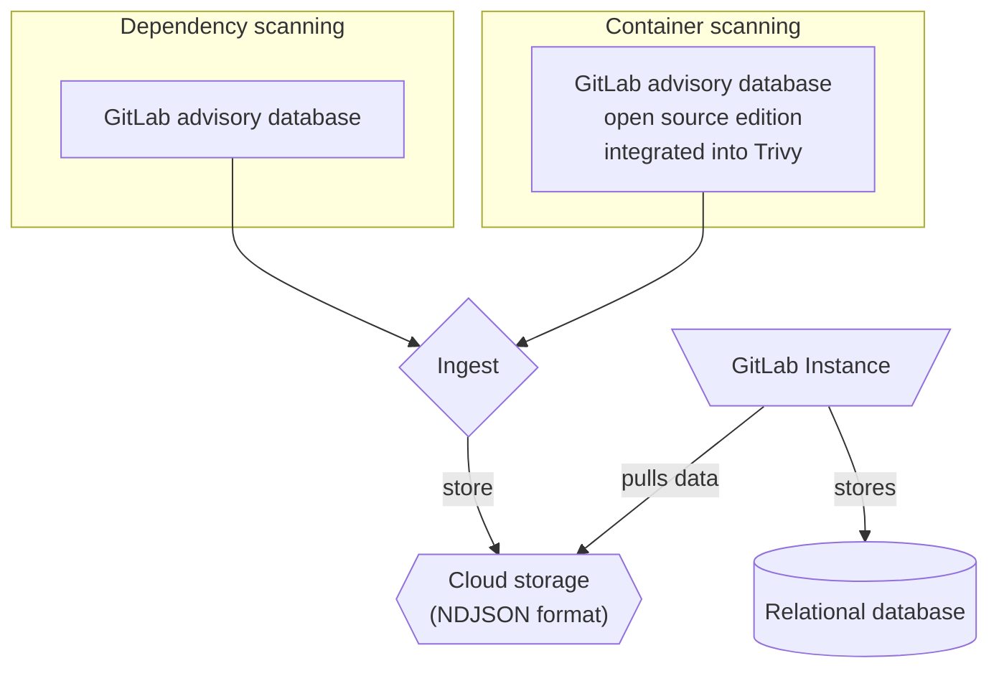

[GitLab 권고 데이터베이스](https://gitlab.com/gitlab-org/security-products/gemnasium-db)(GLAD)는 소프트웨어 종속성과 관련된 보안 권고의 저장소 역할을 합니다. 시간 단위로 최신 보안 권고로 업데이트됩니다.

데이터베이스는 [종속성 검사](../dependency_scanning/_index.md)와 [컨테이너 검사](../container_scanning/_index.md) 모두의 필수 구성 요소입니다.

GitLab 권고 데이터베이스의 무료 오픈 소스 버전은 [GitLab 권고 데이터베이스(오픈 소스 에디션)](https://gitlab.com/gitlab-org/advisories-community)로도 제공됩니다. 오픈 소스 에디션은 동일한 업데이트를 받지만 30일 지연됩니다.

## GitLab 악성 소프트웨어 권고 {#gitlab-malware-advisories}



- 티어: Ultimate
- 제공 서비스: GitLab.com, GitLab Self-Managed, GitLab Dedicated
- 상태:  베타





- GitLab 19.3에서 [도입](https://gitlab.com/groups/gitlab-org/-/epics/20876)되었으며 `sync_malware_advisories` 및 `ingest_malware_advisories`라는 [플래그](../../../administration/feature_flags/_index.md)가 있습니다. 기본적으로 비활성화되었습니다.
- GitLab 19.3에서 [GitLab.com, GitLab Self-Managed 및 GitLab Dedicated에 사용](https://gitlab.com/gitlab-org/gitlab/-/merge_requests/249740)으로 설정되었습니다.



> [!flag]
> 이 기능의 사용 가능성은 기능 플래그로 제어합니다. 자세한 내용은 기록을 참조하세요.

GitLab은 패키지 레지스트리에서 발견된 알려진 악성 패키지에 대한 권고의 비공개 데이터베이스를 유지합니다. GitLab 악성 소프트웨어 권고(GLAM)는 이 페이지의 다른 곳에서 설명하는 GLAD 권고와 별개입니다. GitLab은 이러한 권고를 자동으로 GitLab 인스턴스에 동기화합니다.

GitLab은 다음 세 가지 소스에서 이러한 권고를 얻습니다:

- 악성 패키지 보고서의 오픈 소스 저장소인 [OpenSSF 악성 패키지 프로젝트](https://github.com/ossf/malicious-packages).
- GitLab에서 실행하는 공개 패키지 레지스트리의 스캔.
- 패키지 레지스트리의 권고 데이터 업스트림 피드.

각 악성 소프트웨어 권고에는 `GLAM-`로 시작하는 ID가 있으며, `GLAM-<year>-<month>-<sequence>` 형식이고 예를 들어 `GLAM-2026-09-00138`입니다. 이러한 권고에서 생성된 취약성은 해당 ID를 식별자로 포함하며 CVE 식별자가 없습니다.

> [!note]
> [오프라인 환경](../offline_deployments/_index.md)에서 GitLab은 이러한 권고를 자동으로 동기화할 수 없습니다. 대신 [인터넷이 연결된 머신에서 다운로드](../../../topics/offline/quick_start_guide.md#download-gitlab-v3-malware-advisories)하여 인스턴스에 복사합니다.

이러한 권고는 세 가지 목적을 제공합니다:

- [종속성 검사](../dependency_scanning/_index.md#dependency-scanning-using-sbom)는 이를 사용하여 파이프라인이 악성 패키지를 감지할 때 취약성을 생성합니다.
- [지속적 취약성 검사](../continuous_vulnerability_scanning/_index.md#malicious-packages)는 이를 사용하여 파이프라인을 실행할 필요 없이 취약성을 생성합니다.
- [머지 리퀘스트 승인 정책](../policies/merge_request_approval_policies.md#block-malicious-packages-with-the-malware-rule)은 이를 사용하여 악성 패키지를 도입하는 머지 리퀘스트를 차단합니다.

### 지원되는 패키지 유형 {#supported-package-types}

악성 소프트웨어 권고는 다음 [PURL 유형](https://github.com/package-url/purl-spec/blob/346589846130317464b677bc4eab30bf5040183a/PURL-TYPES.rst)의 구성 요소에 대해 사용 가능합니다:

- `cargo`
- `go`
- `maven`
- `npm`
- `nuget`
- `pypi`
- `rubygem`

이는 [정규 권고](../dependency_scanning/continuous_dependency_scanning/_index.md#supported-package-types)에 대해 지원되는 PURL 유형의 부분집합입니다. `conan`, `packagist`, `pub` 또는 `swift`에 대한 악성 소프트웨어 권고가 없으므로 해당 PURL 유형의 구성 요소는 악성으로 플래그되지 않습니다. `apk` 및 `deb`와 같은 컨테이너 검사 PURL 유형에 대한 악성 소프트웨어 권고도 없습니다.

## 표준화 {#standardization}

GitLab 권고는 취약성 및 영향을 전달하기 위해 표준화된 방법을 사용합니다.

- [CVE](../terminology/_index.md#cve)
- [CVSS](../terminology/_index.md#cvss)
- [CWE](../terminology/_index.md#cwe)

## 데이터베이스 탐색 {#explore-the-database}

데이터베이스 콘텐츠를 보려면 [GitLab 권고 데이터베이스](https://advisories.gitlab.com) 홈 페이지로 이동하세요. 홈 페이지에서 다음 작업을 수행할 수 있습니다:

- 식별자, 패키지 이름 및 설명으로 데이터베이스를 검색합니다.
- 최근에 추가된 권고를 봅니다.
- 범위 및 업데이트 빈도를 포함한 통계 정보를 봅니다.

### 검색 {#search}

각 권고에는 다음 세부 정보가 있는 페이지가 있습니다:

- **식별자**: 공개 식별자. 예를 들어 CVE ID, GHSA ID 또는 GitLab 내부 ID(`GMS-<year>-<nr>`).
- **패키지 슬러그**: 슬래시로 구분된 패키지 유형 및 패키지 이름.
- **취약점**: 보안 결함에 대한 간단한 설명.
- **Description (설명)**: 보안 결함 및 잠재적 위험에 대한 자세한 설명.
- **영향을 받는 버전**: 영향을 받는 버전.
- **해결 방법**: 취약성을 완화하는 방법.
- **마지막 수정**: 권고가 마지막으로 수정된 날짜.

### GraphQL API {#graphql-api}



- 티어: Ultimate
- 제공 서비스: GitLab.com, GitLab Self-Managed
- 상태:  실험적 기능





- `pm_advisory_graphql`라는 이름의 [기능 플래그](../../../administration/feature_flags/_index.md)와 함께 GitLab 18.11에 [도입](https://gitlab.com/gitlab-org/gitlab/-/work_items/503307)되었습니다. 기본적으로 비활성화되었습니다. 이 기능은 [실험](../../../policy/development_stages_support.md)입니다.



> [!flag]
> 이 기능의 사용 가능성은 기능 플래그로 제어합니다. 자세한 내용은 기록을 참조하세요. 이 기능은 테스트 가능하지만 프로덕션 사용은 준비되지 않았습니다.

다음 GraphQL 엔드포인트를 사용하여 식별자로 개별 또는 여러 권고를 검색합니다:

- 단일 권고를 검색하려면 [`Query.packageMetadataAdvisory`](../../../api/graphql/reference/_index.md#querypackagemetadataadvisory)
- 여러 권고를 검색하려면 [`Query.packageMetadataAdvisories`](../../../api/graphql/reference/_index.md#querypackagemetadataadvisories)

#### 예제 {#examples}

##### 단일 권고 {#single-advisory}

식별자로 단일 권고를 검색하려면:

```graphql
{
  packageMetadataAdvisory(identifier: "CVE-2026-34598") {
    id,
    title,
    description,
    publishedDate
    identifiers {
      name
      url
    }
  }
}
```

다음과 같은 반환:

```json
{
  "data": {
    "packageMetadataAdvisory": {
      "id": "gid://gitlab/PackageMetadata::Advisory/8295281",
      "title": "YesWiki has Persistent Blind XSS at \"/?BazaR&vue=consulter\"",
      "description": "A stored and blind XSS vulnerability exists in the form title field. A malicious attacker can inject JavaScript without any authentication via a form title that is saved in the backend database. When any user visits that injected page, the JavaScript payload gets executed.\n\nType: Stored and Blind Cross-Site Scripting (XSS)\nAffected Component: form title input field\nAuthentication Required: No (Unauthenticated attack possible)\nImpact: Arbitrary JavaScript execution in victim's browser",
      "publishedDate": "2026-04-01",
      "identifiers": [
        {
          "name": "CVE-2026-34598",
          "url": "https://cve.mitre.org/cgi-bin/cvename.cgi?name=CVE-2026-34598"
        },
        {
          "name": "GHSA-37fq-47qj-6j5j",
          "url": "https://github.com/advisories/GHSA-37fq-47qj-6j5j"
        },
        {
          "name": "CWE-79",
          "url": "https://cwe.mitre.org/data/definitions/79.html"
        },
        {
          "name": "CWE-87",
          "url": "https://cwe.mitre.org/data/definitions/87.html"
        },
        {
          "name": "CWE-937",
          "url": "https://cwe.mitre.org/data/definitions/937.html"
        },
        {
          "name": "CWE-1035",
          "url": "https://cwe.mitre.org/data/definitions/1035.html"
        }
      ]
    }
  },
  "correlationId": "9f10f45bdb871a6e-MEL"
}
```

##### 여러 권고 {#multiple-advisories}

식별자로 여러 권고를 검색하려면:

```graphql
{
  packageMetadataAdvisories(identifiers: ["CVE-2026-34598", "CVE-2026-34601"]) {
    nodes {
      id
      title
      description
      publishedDate
      identifiers {
        name
        url
      }
    }
  }
}
```

다음과 같은 반환:

```json
{
  "data": {
    "packageMetadataAdvisories": {
      "nodes": [
        {
          "id": "gid://gitlab/PackageMetadata::Advisory/8295281",
          "title": "YesWiki has Persistent Blind XSS at \"/?BazaR&vue=consulter\"",
          "description": "A stored and blind XSS vulnerability exists in the form title field. A malicious attacker can inject JavaScript without any authentication via a form title that is saved in the backend database. When any user visits that injected page, the JavaScript payload gets executed.\n\nType: Stored and Blind Cross-Site Scripting (XSS)\nAffected Component: form title input field\nAuthentication Required: No (Unauthenticated attack possible)\nImpact: Arbitrary JavaScript execution in victim's browser",
          "publishedDate": "2026-04-01",
          "identifiers": [
            {
              "name": "CVE-2026-34598",
              "url": "https://cve.mitre.org/cgi-bin/cvename.cgi?name=CVE-2026-34598"
            },
            {
              "name": "GHSA-37fq-47qj-6j5j",
              "url": "https://github.com/advisories/GHSA-37fq-47qj-6j5j"
            },
            {
              "name": "CWE-79",
              "url": "https://cwe.mitre.org/data/definitions/79.html"
            },
            {
              "name": "CWE-87",
              "url": "https://cwe.mitre.org/data/definitions/87.html"
            },
            {
              "name": "CWE-937",
              "url": "https://cwe.mitre.org/data/definitions/937.html"
            },
            {
              "name": "CWE-1035",
              "url": "https://cwe.mitre.org/data/definitions/1035.html"
            }
          ]
        },
        {
          "id": "gid://gitlab/PackageMetadata::Advisory/8295301",
          "title": "xmldom: XML injection via unsafe CDATA serialization allows attacker-controlled markup insertion",
          "description": "`@xmldom/xmldom` allows attacker-controlled strings containing the CDATA terminator `]]>` to be inserted into a `CDATASection` node. During serialization, `XMLSerializer` emitted the CDATA content verbatim without rejecting or safely splitting the terminator. As a result, data intended to remain text-only became **active XML markup** in the serialized output, enabling XML structure\ninjection and downstream business-logic manipulation.\n\nThe sequence `]]>` is not allowed inside CDATA content and must be rejected or safely handled during serialization. ([MDN Web Docs](https://developer.mozilla.org/))",
          "publishedDate": "2026-04-01",
          "identifiers": [
            {
              "name": "CVE-2026-34601",
              "url": "https://cve.mitre.org/cgi-bin/cvename.cgi?name=CVE-2026-34601"
            },
            {
              "name": "GHSA-wh4c-j3r5-mjhp",
              "url": "https://github.com/advisories/GHSA-wh4c-j3r5-mjhp"
            },
            {
              "name": "CWE-91",
              "url": "https://cwe.mitre.org/data/definitions/91.html"
            },
            {
              "name": "CWE-937",
              "url": "https://cwe.mitre.org/data/definitions/937.html"
            },
            {
              "name": "CWE-1035",
              "url": "https://cwe.mitre.org/data/definitions/1035.html"
            }
          ]
        },
        {
          "id": "gid://gitlab/PackageMetadata::Advisory/8295310",
          "title": "xmldom: XML injection via unsafe CDATA serialization allows attacker-controlled markup insertion",
          "description": "`@xmldom/xmldom` allows attacker-controlled strings containing the CDATA terminator `]]>` to be inserted into a `CDATASection` node. During serialization, `XMLSerializer` emitted the CDATA content verbatim without rejecting or safely splitting the terminator. As a result, data intended to remain text-only became **active XML markup** in the serialized output, enabling XML structure\ninjection and downstream business-logic manipulation.\n\nThe sequence `]]>` is not allowed inside CDATA content and must be rejected or safely handled during serialization. ([MDN Web Docs](https://developer.mozilla.org/))",
          "publishedDate": "2026-04-01",
          "identifiers": [
            {
              "name": "CVE-2026-34601",
              "url": "https://cve.mitre.org/cgi-bin/cvename.cgi?name=CVE-2026-34601"
            },
            {
              "name": "GHSA-wh4c-j3r5-mjhp",
              "url": "https://github.com/advisories/GHSA-wh4c-j3r5-mjhp"
            },
            {
              "name": "CWE-91",
              "url": "https://cwe.mitre.org/data/definitions/91.html"
            },
            {
              "name": "CWE-937",
              "url": "https://cwe.mitre.org/data/definitions/937.html"
            },
            {
              "name": "CWE-1035",
              "url": "https://cwe.mitre.org/data/definitions/1035.html"
            }
          ]
        },
        {
          "id": "gid://gitlab/PackageMetadata::Advisory/9800476",
          "title": "xmldom: xmldom: XML structure injection via CDATA terminator",
          "description": "xmldom is a pure JavaScript W3C standard-based (XML DOM Level 2 Core) `DOMParser` and `XMLSerializer` module. In xmldom versions 0.6.0 and prior and @xmldom/xmldom prior to versions 0.8.12 and 0.9.9, xmldom/xmldom allows attacker-controlled strings containing the CDATA terminator ]]> to be inserted into a CDATASection node. During serialization, XMLSerializer emitted the CDATA content verbatim without rejecting or safely splitting the terminator. As a result, data intended to remain text-only became active XML markup in the serialized output, enabling XML structure injection and downstream business-logic manipulation. This issue has been patched in xmldom version 0.6.0 and @xmldom/xmldom versions 0.8.12 and 0.9.9.",
          "publishedDate": "2026-04-02",
          "identifiers": [
            {
              "name": "CVE-2026-34601",
              "url": "https://cve.mitre.org/cgi-bin/cvename.cgi?name=CVE-2026-34601"
            },
            {
              "name": "CWE-91",
              "url": "https://cwe.mitre.org/data/definitions/91.html"
            }
          ]
        }
      ]
    }
  },
  "correlationId": "9f10f5072e0f1a6e-MEL"
}
```

## 오픈 소스 에디션 {#open-source-edition}

GitLab은 데이터베이스의 무료 오픈 소스 버전인 [GitLab 권고 데이터베이스(오픈 소스 에디션)](https://gitlab.com/gitlab-org/advisories-community)을 제공합니다.

오픈 소스 버전은 GitLab 권고 데이터베이스의 시간 지연된 복제본이며 MIT 라이센스이고 30일보다 오래되었거나 `community-sync` 플래그가 있는 GitLab 권고 데이터베이스의 모든 권고를 포함합니다.

## 통합 {#integrations}

- [종속성 검사](../dependency_scanning/_index.md)
- [컨테이너 검사](../container_scanning/_index.md)
- 타사 도구

> [!note]
> GitLab 권고 데이터베이스 약관은 타사 도구에서 GitLab 권고 데이터베이스에 포함된 데이터의 사용을 금지합니다. 타사 통합자는 MIT 라이센스가 있는 시간 지연된 [리포지토리 복제본](https://gitlab.com/gitlab-org/advisories-community)을 대신 사용할 수 있습니다.

### 데이터베이스를 사용하는 방법 {#how-the-database-can-be-used}

다음 예제는 지속적 취약성 스캔의 일부로 권고 수집 프로세스의 소스로 데이터베이스를 사용합니다.



## 유지 관리 {#maintenance}

취약성 연구 팀은 GitLab 권고 데이터베이스 및 GitLab 권고 데이터베이스(오픈 소스 에디션)의 유지 관리 및 정기적 업데이트를 담당합니다.

커뮤니티 기여는 `community-sync` 플래그를 통해 [advisories-community](https://gitlab.com/gitlab-org/advisories-community)에서 액세스할 수 있습니다.

## 데이터베이스에 기여 {#contributing-to-the-vulnerability-database}

나열되지 않은 취약성을 알고 있는 경우 이슈를 열거나 취약성을 제출하여 GitLab 권고 데이터베이스에 기여할 수 있습니다.

자세한 내용은 [기여 지침](https://gitlab.com/gitlab-org/security-products/gemnasium-db/-/blob/master/CONTRIBUTING.md)을 참조하세요.

## 라이선스 {#license}

GitLab 권고 데이터베이스는 [GitLab 권고 데이터베이스 약관](https://gitlab.com/gitlab-org/security-products/gemnasium-db/-/blob/master/LICENSE.md#gitlab-advisory-database-term)에 따라 자유롭게 액세스할 수 있습니다.
