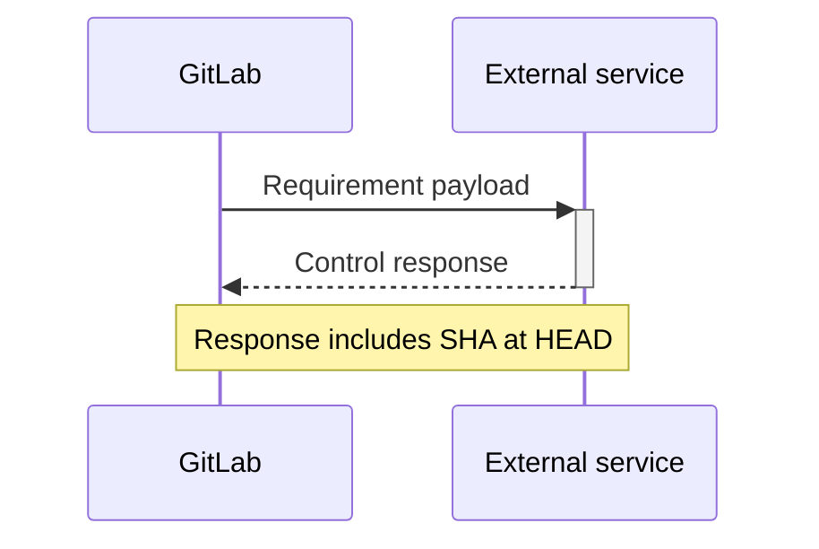



- 티어: Premium, Ultimate
- 제공 서비스: GitLab.com, GitLab Self-Managed, GitLab Dedicated



규정준수 프레임워크를 만들어서 프로젝트에 특정 규정준수 요구 사항이 있거나 추가 감시가 필요함을 식별할 수 있습니다.

Ultimate 티어에서는 규정준수 프레임워크가 적용된 프로젝트에 [규정준수 파이프라인 구성](../compliance_pipelines.md) 및 [보안 정책](../../application_security/policies/enforcement/_index.md#scope)을 선택적으로 적용할 수 있습니다.

규정준수 프레임워크는 최상위 그룹에서 만들어집니다. 프로젝트가 기존 최상위 그룹 외부로 이동되면 프레임워크가 제거됩니다.

각 프로젝트에 최대 20개의 규정준수 프레임워크를 적용할 수 있습니다.

[사용자 지정 규정준수 프레임워크](https://gitlab.navattic.com/custom-compliance) 데모를 보려면 참조하세요.
<!-- Demo published on 2025-10-09 -->

## 사전 요구 사항 {#prerequisites}

- 규정준수 프레임워크를 만들고, 편집하고, 삭제하려면 사용자는 다음 중 하나를 보유해야 합니다:
  - 최상위 그룹에 대한 소유자 또는 보안 관리자 역할입니다.
  - [사용자 지정 역할](../../custom_roles/_index.md)이 `admin_compliance_framework` [사용자 지정 권한](../../custom_roles/abilities.md#compliance-management)으로 할당되었습니다.
- 프로젝트에 규정준수 프레임워크를 추가하거나 제거하려면 프로젝트가 속한 그룹에 규정준수 프레임워크가 있어야 합니다.

## 템플릿으로부터 규정준수 프레임워크 만들기 {#create-a-compliance-framework-from-a-template}



- 티어: Ultimate
- 제공 서비스: GitLab.com, GitLab Self-Managed, GitLab Dedicated





- `compliance_framework_templates`라는 [기능 플래그](../../../administration/feature_flags/_index.md)로 GitLab 19.0에서 [도입](https://gitlab.com/groups/gitlab-org/-/work_items/16808)되었습니다. 기본적으로 비활성화되었습니다.
- GitLab 19.1에서 [일반적으로 사용 가능](https://gitlab.com/gitlab-org/gitlab/-/merge_requests/239045)합니다. 기능 플래그 `compliance_framework_templates`이 제거되었습니다.



규정준수 프레임워크를 처음부터 구축하는 대신 미리 정의된 기본 제공(OOTB) 템플릿에서 만들 수 있습니다. 템플릿에는 일반적인 규정준수 표준에 정렬된 사전 구성된 요구 사항 및 제어가 포함되어 있어 수동 설정 없이 빠르게 시작할 수 있습니다.

다음 템플릿을 사용할 수 있습니다:

| 템플릿 | 설명 |
|----------|-------------|
| CIS CSC v8.1 | 기초, 기초 및 조직 보안 제어를 다루는 Center for Internet Security Controls v8.1 프레임워크입니다. |
| CSA CCM v4 | 클라우드 보안 보증을 위한 Cloud Security Alliance Cloud Controls Matrix v4 프레임워크입니다. |
| Cyber Essentials | 5가지 주요 기술 제어를 다루는 영국 정부 지원 Cyber Essentials 계획입니다. |
| DORA | 금융 부문 ICT 위험 관리를 위한 Digital Operational Resilience Act 프레임워크입니다. |
| FedRAMP High | 미국 연방 클라우드 서비스를 위한 Federal Risk and Authorization Management Program High 기준입니다. |
| FedRAMP Low | 미국 연방 클라우드 서비스를 위한 Federal Risk and Authorization Management Program Low 기준입니다. |
| FedRAMP Moderate | 미국 연방 클라우드 서비스를 위한 Federal Risk and Authorization Management Program Moderate 기준입니다. |
| IRAP Official | Australian Information Security Registered Assessors Program Official 분류 프레임워크입니다. |
| IRAP Protected | Australian Information Security Registered Assessors Program Protected 분류 프레임워크입니다. |
| IRAP Secret | Australian Information Security Registered Assessors Program Secret 분류 프레임워크입니다. |
| IRAP Top Secret | Australian Information Security Registered Assessors Program Top Secret 분류 프레임워크입니다. |
| ISMAP | Japanese Information System Security Management and Assessment Program 프레임워크입니다. |
| ISO 27001:2022 | 정보 보안 관리 시스템의 국제 표준입니다. |
| NIS 2 | 중요 인프라를 위한 EU Network and Information Security Directive 2 프레임워크입니다. |
| NIST 800-171 Rev. 3 CMMC | NIST SP 800-171 Revision 3 Cybersecurity Maturity Model Certification 프레임워크입니다. |
| NIST SP 800-218 | NIST Secure Software Development Framework (SSDF) v1.1입니다. |
| NIST 800-53 Revision 5 | 정보 시스템에 대한 NIST SP 800-53 Rev. 5 보안 및 개인 정보 보호 제어입니다. |
| SOC 2 | COSO 원칙에 매핑된 요구 사항이 있는 System and Organization Controls 2 프레임워크(취약성 검사, 액세스 제어 및 변경 관리 포함). |
| TISAX | 자동차 산업 정보 보안 요구 사항을 위한 Trusted Information Security Assessment Exchange 프레임워크입니다. |

### UI를 사용하여 템플릿으로부터 프레임워크 만들기 {#create-a-framework-from-a-template-by-using-the-ui}

템플릿으로부터 규정준수 프레임워크를 만들려면:

1. 상단 표시줄에서 **검색 또는 이동**을 선택하고 그룹을 찾습니다.
1. 왼쪽 사이드바에서 **안전함** > **규정준수 센터**를 선택합니다.
1. 페이지에서 **프레임워크** 탭을 선택합니다.
1. **새 프레임워크**를 선택합니다.
1. **템플릿으로 부터 생성**을 선택합니다.
1. 사용 가능한 템플릿을 찾아보고 하나를 선택하여 요구 사항 및 제어를 미리 봅니다.
1. 선택 사항. **이름**, **설명** 또는 **색상**을 재정의하여 프레임워크를 사용자 지정합니다.
1. 선택 사항. **기본값으로 설정**을 선택하여 이 프레임워크를 그룹의 기본 프레임워크로 만듭니다.
1. **프레임워크 생성**을 선택합니다.

프레임워크는 템플릿의 모든 요구 사항 및 제어로 미리 채워져 생성됩니다. 그러면 프레임워크를 편집하여 필요에 따라 요구 사항을 추가, 제거 또는 수정할 수 있습니다.

API 기반 생성의 경우 [템플릿으로부터 규정준수 프레임워크 만들기](../../../api/graphql/compliance_frameworks.md#create-a-compliance-framework-from-a-template)를 참조하세요.

## 규정준수 프레임워크 가져오기 {#import-a-compliance-framework}



- GitLab 17.11에서 [도입](https://gitlab.com/groups/gitlab-org/-/work_items/16499)되었습니다.



이 기능을 사용하면 공유되거나 백업된 규정준수 프레임워크를 사용할 수 있습니다. JSON 파일의 이름은 기존 규정준수 프레임워크와 동일하지 않아야 합니다.

JSON 템플릿 라이브러리는 [규정준수 준수 템플릿](https://gitlab.com/gitlab-org/software-supply-chain-security/compliance/engineering/compliance-adherence-templates) 프로젝트에서 사용할 수 있습니다. 이러한 사전 정의된 템플릿은 완전한 프레임워크를 제공합니다. 수동 설정이 필요하지 않으며 빠르게 시작할 수 있습니다.

### 사전 구축된 규정준수 프레임워크 가져오기 {#import-a-predefined-compliance-framework}

사전 구축된 규정준수 프레임워크를 가져오려면:

1. [규정준수 준수 템플릿](https://gitlab.com/gitlab-org/software-supply-chain-security/compliance/engineering/compliance-adherence-templates) 프로젝트로 이동합니다.
1. 사용 가능한 프레임워크 템플릿을 찾아보고 프레임워크에 대한 JSON 파일을 다운로드합니다.
1. 상단 표시줄에서 **검색 또는 이동**을 선택하고 그룹을 찾습니다.
1. 왼쪽 사이드바에서 **안전함** > **규정준수 센터**를 선택합니다.
1. 페이지에서 **프레임워크** 탭을 선택합니다.
1. **새 프레임워크**를 선택합니다.
1. **프레임워크 가져오기**를 선택합니다.
1. 나타나는 대화 상자에서 로컬 시스템의 JSON 파일을 선택합니다.
1. 가져오기가 성공하면 새 규정준수 프레임워크가 목록에 표시됩니다.

프레임워크는 이제 프로젝트에 적용할 준비가 되었습니다. [프로젝트에 규정준수 프레임워크 적용](#apply-a-compliance-framework-to-a-project)을 참조하세요.

### JSON 파일에서 규정준수 프레임워크 가져오기 {#import-a-compliance-framework-from-a-json-file}

JSON 템플릿을 사용하여 규정준수 프레임워크를 가져오려면:

1. 상단 표시줄에서 **검색 또는 이동**을 선택하고 그룹을 찾습니다.
1. 왼쪽 사이드바에서 **안전함** > **규정준수 센터**를 선택합니다.
1. 페이지에서 **프레임워크** 탭을 선택합니다.
1. **새 프레임워크**를 선택합니다.
1. **프레임워크 가져오기**를 선택합니다.
1. 나타나는 대화 상자에서 로컬 시스템의 JSON 파일을 선택합니다.

가져오기가 성공하면 새 규정준수 프레임워크가 목록에 표시됩니다. 오류가 있으면 수정을 위해 표시됩니다.

## 규정준수 프레임워크 만들기, 편집 또는 삭제 {#create-edit-or-delete-a-compliance-framework}

규정준수 프레임워크 보고서 또는 규정준수 프로젝트 보고서를 사용하여 규정준수 프레임워크를 만들고, 편집하고, 삭제할 수 있습니다.

규정준수 프레임워크 보고서 사용에 대한 자세한 내용은 다음을 참조하세요:

- [새 규정준수 프레임워크 만들기](../compliance_center/compliance_frameworks_report.md#create-a-new-compliance-framework).
- [규정준수 프레임워크 편집](../compliance_center/compliance_frameworks_report.md#edit-a-compliance-framework).
- [규정준수 프레임워크 삭제](../compliance_center/compliance_frameworks_report.md#delete-a-compliance-framework).

규정준수 프로젝트 보고서 사용에 대한 자세한 내용은 다음을 참조하세요:

- [새 규정준수 프레임워크 만들기](../compliance_center/compliance_projects_report.md#create-a-new-compliance-framework).
- [규정준수 프레임워크 편집](../compliance_center/compliance_projects_report.md#edit-a-compliance-framework).
- [규정준수 프레임워크 삭제](../compliance_center/compliance_projects_report.md#delete-a-compliance-framework). 하위 그룹과 프로젝트는 최상위 그룹에서 만들어진 모든 규정준수 프레임워크에 액세스할 수 있습니다. 그러나 규정준수 프레임워크는 하위 그룹이나 프로젝트를 사용하여 만들고, 편집하고, 삭제할 수 없습니다. 프로젝트 소유자는 프로젝트에 적용할 프레임워크를 선택할 수 있습니다.

## 프로젝트에 규정준수 프레임워크 적용 {#apply-a-compliance-framework-to-a-project}



- 여러 규정준수 프레임워크 적용은 GitLab 17.3에서 [도입](https://gitlab.com/groups/gitlab-org/-/epics/13294)되었습니다.
- 규정준수 프레임워크를 통해 프로젝트에 규정준수 프레임워크를 적용하는 것은 GitLab 17.11에서 [도입](https://gitlab.com/groups/gitlab-org/-/epics/16747)되었습니다.



여러 규정준수 프레임워크를 프로젝트에 적용할 수 있지만 개인 네임스페이스의 프로젝트에는 규정준수 프레임워크를 적용할 수 없습니다.

프로젝트에 규정준수 프레임워크를 적용하려면 [규정준수 프로젝트 보고서](../compliance_center/compliance_projects_report.md#apply-a-compliance-framework-to-projects-in-a-group)를 통해 규정준수 프레임워크를 적용합니다.

[GraphQL API](../../../api/graphql/reference/_index.md#mutationprojectupdatecomplianceframeworks)를 사용하여 프로젝트에 하나 이상의 규정준수 프레임워크를 적용할 수 있습니다.

GraphQL을 사용하여 하위 그룹에 규정준수 프레임워크를 만들면 사용자가 올바른 권한을 가진 경우 프레임워크가 루트 상위 항목에 생성됩니다. GitLab UI는 이 동작을 방지하기 위해 읽기 전용 보기를 표시합니다.

규정준수 프레임워크를 통해 프로젝트에 규정준수 프레임워크를 적용하려면:

1. 상단 표시줄에서 **검색 또는 이동**을 선택하고 그룹을 찾습니다.
1. 왼쪽 사이드바에서 **안전함** > **규정준수 센터**를 선택합니다.
1. 페이지에서 **프로젝트** 탭을 선택합니다.
1. 규정준수 프레임워크 위로 마우스를 가져가면 **프레임워크 편집** 탭을 선택합니다.
1. **프로젝트** 섹션을 선택합니다.
1. 목록에서 프로젝트를 선택합니다.
1. **프레임워크 업데이트**를 선택합니다.

## 기본 규정준수 프레임워크 {#default-compliance-frameworks}

그룹 소유자는 기본 규정준수 프레임워크를 설정할 수 있습니다. 기본 프레임워크는 해당 그룹에서 생성된 모든 새로운 프로젝트 및 가져온 프로젝트에 적용됩니다. 기존 프로젝트에 적용된 프레임워크에는 영향을 미치지 않습니다. 기본 프레임워크는 삭제할 수 없습니다.

기본값으로 설정된 규정준수 프레임워크는 `default` 레이블을 가집니다.

### 규정준수 센터를 사용하여 기본값 설정 및 제거 {#set-and-remove-a-default-by-using-the-compliance-center}

[규정준수 프로젝트 보고서](../compliance_center/compliance_projects_report.md)에서 기본값으로 설정(또는 기본값 제거)하려면:

1. 상단 표시줄에서 **검색 또는 이동**을 선택하고 그룹을 찾습니다.
1. 왼쪽 사이드바에서 **안전함** > **규정준수 센터**를 선택합니다.
1. 페이지에서 **프로젝트** 탭을 선택합니다.
1. 규정준수 프레임워크 위로 마우스를 가져가면 **프레임워크 편집** 탭을 선택합니다.
1. **기본값으로 설정**을 선택합니다.
1. **변경 사항 저장**을 선택합니다.

[규정준수 프레임워크 보고서](../compliance_center/compliance_frameworks_report.md)에서 기본값으로 설정(또는 기본값 제거)하려면:

1. 상단 표시줄에서 **검색 또는 이동**을 선택하고 그룹을 찾습니다.
1. 왼쪽 사이드바에서 **안전함** > **규정준수 센터**를 선택합니다.
1. 페이지에서 **프레임워크** 탭을 선택합니다.
1. 규정준수 프레임워크 위로 마우스를 가져가면 **프레임워크 편집** 탭을 선택합니다.
1. **기본값으로 설정**을 선택합니다.
1. **변경 사항 저장**을 선택합니다.

## 프로젝트에서 규정준수 프레임워크 제거 {#remove-a-compliance-framework-from-a-project}

그룹의 하나 이상의 프로젝트에서 규정준수 프레임워크를 제거하려면 [규정준수 프로젝트 보고서](../compliance_center/compliance_projects_report.md#remove-a-compliance-framework-from-projects-in-a-group)를 통해 규정준수 프레임워크를 제거합니다.

## 규정준수 프레임워크를 JSON 파일로 내보내기 {#export-a-compliance-framework-as-a-json-file}



- GitLab 17.11에서 [도입](https://gitlab.com/groups/gitlab-org/-/work_items/16499)되었습니다.



이 기능을 사용하면 규정준수 프레임워크를 공유하고 백업할 수 있습니다.

규정준수 센터에서 규정준수 프레임워크를 내보내려면:

1. 상단 표시줄에서 **검색 또는 이동**을 선택하고 그룹을 찾습니다.
1. 왼쪽 사이드바에서 **안전함** > **규정준수 센터**를 선택합니다.
1. 페이지에서 **프레임워크** 탭을 선택합니다.
1. 내보낼 규정준수 프레임워크를 찾습니다.
1. 수직 줄임표()를 선택합니다.
1. **JSON 파일로 내보내기**를 선택합니다.

JSON 파일이 로컬 시스템에 다운로드됩니다.

### JSON 템플릿 구조 및 스키마 {#json-template-structure-and-schema}

규정준수 프레임워크 JSON 템플릿은 프레임워크 메타데이터, 요구 사항 및 관련 제어를 정의하는 특정 스키마 구조를 따릅니다. 이 구조를 이해하면 조직의 특정 규정준수 요구 사항을 충족하기 위해 사용자 지정 템플릿을 만들거나 기존 템플릿을 수정할 수 있습니다.

#### 프레임워크 속성 {#framework-properties}

각 JSON 템플릿에는 다음과 같은 최상위 속성이 포함되어 있습니다:

| 속성 | 형식 | 필수 | 설명 |
|----------|------|----------|-------------|
| `name` | 문자열 | 예 | 규정준수 프레임워크의 표시 이름입니다. |
| `description` | 문자열 | 예 | 프레임워크 목적에 대한 상세 설명입니다. |
| `color` | 문자열 | 예 | 프레임워크에 대한 16진수 색상 코드(예: `#1f75cb`). |
| `requirements` | 배열 | 아니요 | 규정준수 제어를 정의하는 요구 사항 개체의 배열입니다. |

#### 요구 사항 구조 {#requirements-structure}

`requirements` 배열의 각 요구 사항에는 다음이 포함됩니다:

| 속성 | 형식 | 필수 | 설명 |
|----------|------|----------|-------------|
| `name` | 문자열 | 예 | 규정준수 요구 사항의 이름입니다. |
| `description` | 문자열 | 예 | 요구 사항이 적용하는 내용에 대한 상세 설명입니다. |
| `controls` | 배열 | 예 | 요구 사항을 구현하는 제어 개체의 배열입니다. |

#### 제어 구조 {#control-structure}

`controls` 배열의 각 제어는 특정 검사를 정의합니다:

| 속성 | 형식 | 필수 | 설명 |
|----------|------|----------|-------------|
| `name` | 문자열 | 예 | GitLab 제어 ID(예: `scanner_sast_running`). |
| `control_type` | 문자열 | 예 | GitLab 제어의 경우 항상 `"internal"`입니다. |
| `expression` | 개체 | 예 | 제어에 대한 평가 로직을 정의합니다. |

#### 식 개체 {#expression-object}

`expression` 개체는 제어가 평가되는 방식을 정의합니다:

| 속성 | 형식 | 필수 | 설명 |
|----------|------|----------|-------------|
| `field` | 문자열 | 예 | 평가할 필드 이름(제어 이름과 일치). |
| `operator` | 문자열 | 예 | 비교 연산자(`=`, `>=`, `<=`, `>`, `<`). |
| `value` | 혼합 | 예 | 예상 값(부울, 숫자 또는 문자열). |

#### JSON 템플릿 구조의 예 {#example-json-template-structure}

전체 구조를 보여주는 간단한 예제는 다음과 같습니다:

```json
{
  "name": "Example Compliance Framework",
  "description": "Example framework demonstrating JSON structure",
  "color": "#1f75cb",
  "requirements": [
    {
      "name": "Security Scanning Requirement",
      "description": "Ensure security scanning is enabled for all projects",
      "controls": [
        {
          "name": "scanner_sast_running",
          "control_type": "internal",
          "expression": {
            "field": "scanner_sast_running",
            "operator": "=",
            "value": true
          }
        },
        {
          "name": "minimum_approvals_required_2",
          "control_type": "internal",
          "expression": {
            "field": "minimum_approvals_required",
            "operator": ">=",
            "value": 2
          }
        }
      ]
    }
  ]
}
```

## 요구사항 {#requirements}



- 티어: Ultimate
- 제공 서비스: GitLab.com, GitLab Self-Managed, GitLab Dedicated





- [GitLab 17.11에서 도입됨](https://gitlab.com/gitlab-org/gitlab/-/merge_requests/186525) [기능 플래그](../../../administration/feature_flags/_index.md) `enable_standards_adherence_dashboard_v2`로 명명됨. 기본적으로 활성화됩니다.
- GitLab 18.3에서 [일반 공급](https://gitlab.com/gitlab-org/gitlab/-/issues/535563)입니다. 기능 플래그 `enable_standards_adherence_dashboard_v2`이 제거되었습니다.



GitLab Ultimate에서는 규정준수 프레임워크에 대한 특정 **요구 사항**을 정의할 수 있습니다. 요구 사항은 프레임워크가 할당된 프로젝트의 구성 또는 동작에 대한 검사인 하나 이상의 제어로 구성됩니다. 각 요구 사항의 최대 제어 개수는 5개입니다.

각 제어에는 GitLab이 예약된 스캔 또는 트리거된 스캔 중에 프로젝트의 준수를 평가하기 위해 사용하는 로직이 포함되어 있습니다. 준수 추적 방식에 대한 자세한 내용은 [규정준수 상태 보고서](../compliance_center/compliance_status_report.md)를 참조하세요.

프레임워크 요구 사항에 GitLab 규정준수 제어 또는 외부 제어를 사용할 수 있습니다.

### GitLab 규정준수 제어 {#gitlab-compliance-controls}



- GitLab 18.7 이상에서는 [보안 검사 제어가 더 이상 성공한 파이프라인이 필요하지 않습니다](https://gitlab.com/gitlab-org/gitlab/-/work_items/579849).



GitLab 규정준수 제어는 GitLab 규정준수 프레임워크에서 사용할 수 있습니다. 제어는 규정준수 프레임워크가 할당된 프로젝트의 구성 또는 동작에 대한 검사입니다.

[규정준수 표준](compliance_standards.md)을 충족하도록 GitLab 규정준수 제어를 결합합니다.

> [!note]
> 실행 중인 검사기를 확인하는 보안 검사 제어는 [하위 파이프라인](../../../ci/pipelines/downstream_pipelines.md#parent-child-pipelines)에서 구성된 검사기를 감지하지 못합니다. 이러한 제어가 통과하려면 부모 파이프라인에서 보안 검사기를 구성해야 합니다. 자세한 내용은 [문제 595632](https://gitlab.com/gitlab-org/gitlab/-/work_items/595632)를 참조하세요.

<!-- Updates to control names must be reflected also in compliance_standards.md -->

| 제어 이름                                             | 제어 ID                                                 | 설명 |
|:---------------------------------------------------------|:-----------------------------------------------------------|:------------|
| API 보안 실행                                     | `scanner_api_security_running`                             | [API 보안 검사](../../application_security/api_security/_index.md)가 프로젝트의 기본 분기 파이프라인에서 구성되고 실행되는지 확인합니다. |
| 최소 1개 승인                                    | `minimum_approvals_required_1`                             | 병합 요청이 병합되기 전에 [최소 1개의 승인이 필요](../../project/merge_requests/approvals/_index.md)한지 확인합니다. |
| 최소 2개 승인                                   | `minimum_approvals_required_2`                             | 병합 요청이 병합되기 전에 [최소 2개의 승인이 필요](../../project/merge_requests/approvals/_index.md)한지 확인합니다. |
| Auth SSO 활성화됨                                         | `auth_sso_enabled`                                         | 프로젝트에 대해 [Single Sign-On (SSO) 인증](../../group/saml_sso/_index.md)이 활성화되는지 확인합니다. |
| 작성자 승인 병합 요청은 금지됨               | `merge_request_prevent_author_approval`                    | 병합 요청의 작성자가 [자신의 변경 사항을 승인할 수 없다](../../project/merge_requests/approvals/_index.md)는 것을 확인합니다. |
| 분기 삭제 비활성화됨                                 | `branch_deletion_disabled`                                 | [분기를 삭제할 수 없다](../../project/repository/branches/protected.md)는 것을 확인합니다. |
| CI/CD 작업 토큰 범위 활성화됨                            | `cicd_job_token_scope_enabled`                             | [CI/CD 작업 토큰](../../../ci/jobs/ci_job_token.md) 범위 제한이 활성화되는지 확인합니다. |
| 코드 변경 시 코드 소유자 필요                         | `code_changes_requires_code_owners`                        | 코드 변경 사항이 [코드 소유자](../../project/codeowners/_index.md)의 승인이 필요한지 확인합니다. |
| 코드 소유자 승인 필요                             | `code_owner_approval_required`                             | [코드 소유자 파일](../../project/codeowners/_index.md)이 구성되는지 확인합니다. |
| 코드 품질 실행 중                                     | `scanner_code_quality_running`                             | [코드 품질 검사](../../../ci/testing/code_quality.md)가 프로젝트의 기본 분기 파이프라인에서 구성되고 실행되는지 확인합니다. |
| 커미터 승인 병합 요청은 금지됨           | `merge_request_prevent_committers_approval`                | 병합 요청에 [커밋한 사용자가 이를 승인할 수 없다](../../project/merge_requests/approvals/_index.md)는 것을 확인합니다. |
| 컨테이너 검사 실행 중                               | `scanner_container_scanning_running`                       | [컨테이너 검사](../../application_security/container_scanning/_index.md)가 프로젝트의 기본 분기 파이프라인에서 구성되고 실행되는지 확인합니다. |
| DAST 실행 중                                             | `scanner_dast_running`                                     | [동적 애플리케이션 보안 테스트(DAST)](../../application_security/dast/_index.md)가 프로젝트의 기본 분기 파이프라인에서 구성되고 실행되는지 확인합니다. |
| 기본 분기 보호됨                                 | `default_branch_protected`                                 | 기본 분기에 [보호 규칙](../../project/repository/branches/protected.md)이 활성화되는지 확인합니다. |
| 기본 분기는 직접 푸시로부터 보호됨                | `default_branch_protected_from_direct_push`                | [기본 분기에 대한 직접 푸시를 방지](../../project/repository/branches/protected.md)합니다. |
| 기본 분기 사용자가 병합할 수 있음                           | `default_branch_users_can_merge`                           | [사용자가 기본 분기에 변경 사항을 병합할 수 있는지](../../project/repository/branches/protected.md) 제어합니다. |
| 기본 분기 사용자가 푸시할 수 있음                            | `default_branch_users_can_push`                            | [사용자가 기본 분기에 직접 푸시할 수 있는지](../../project/repository/branches/protected.md) 제어합니다. |
| Duo Agentic Flow 감사 이벤트 스트리밍                  | `duo_agentic_flow_audit_events_streaming`                  | 활성 [감사 이벤트 스트리밍 대상](../audit_event_streaming.md)이 그룹 수준에서 GitLab Duo Agent Platform 이벤트를 캡처하는지 확인합니다. Agent Platform이 그룹에 대해 비활성화되면 통과합니다. |
| 종속성 검사 실행 중                              | `scanner_dep_scanning_running`                             | [종속성 검사](../../application_security/dependency_scanning/_index.md)가 프로젝트의 기본 분기 파이프라인에서 구성되고 실행되는지 확인합니다. **노트**: GitLab Self-Managed 인스턴스(18.4 이상)에서는 [SBOM 기반 종속성 검사](../../application_security/dependency_scanning/dependency_scanning_sbom/_index.md) 사용 시 아티팩트 차이로 인해 이 제어가 실패할 수 있습니다. [호환성 고려 사항](../../application_security/dependency_scanning/dependency_scanning_sbom/troubleshooting_ds_sbom_analyzer.md#compliance-framework-compatibility)을 참조하세요. |
| 저장소당 2명 이상의 관리자 확보                 | `ensure_2_admins_per_repo`                                 | [최소 2명의 소유자](../../project/members/_index.md)가 각 프로젝트에 할당되는지 확인합니다. |
| 오류 추적 활성화됨                                   | `error_tracking_enabled`                                   | 프로젝트에 대해 [오류 추적](../../../operations/error_tracking.md)이 활성화되는지 확인합니다. |
| 강제 푸시 비활성화됨                                      | `force_push_disabled`                                      | 리포지토리에 [강제 푸시](../../project/repository/branches/protected.md)를 방지합니다. |
| 프로젝트에 포크 존재                              | `has_forks`                                                | 프로젝트가 [포크](../../project/repository/forking_workflow.md)되었는지 확인합니다. |
| GitLab 라이선스 수준 Ultimate                            | `gitlab_license_level_ultimate`                            | GitLab 인스턴스가 [Ultimate 라이선스](https://about.gitlab.com/pricing/feature-comparison/)를 사용하고 있는지 확인합니다. |
| 유효한 CI/CD 구성 보유                            | `has_valid_ci_config`                                      | 프로젝트에 [유효한 CI/CD 구성](../../../ci/yaml/_index.md)이 있는지 확인합니다. |
| IaC 검사 실행 중                                     | `scanner_iac_running`                                      | [코드 기반 인프라(IaC) 검사](../../application_security/iac_scanning/_index.md)가 프로젝트의 기본 분기 파이프라인에서 구성되고 실행되는지 확인합니다. |
| 내부 가시성 금지됨                         | `project_visibility_not_internal`                          | 프로젝트가 [내부 가시성](../../public_access.md)으로 설정되지 않는지 확인합니다. |
| 이슈 추적 활성화됨                                   | `issue_tracking_enabled`                                   | 프로젝트에 대해 [이슈 추적](../../project/issues/_index.md)이 활성화되는지 확인합니다. |
| 라이선스 규정준수 실행 중                               | `scanner_license_compliance_running`                       | [라이선스 규정준수 검사](../license_approval_policies.md)가 프로젝트의 기본 분기 파이프라인에서 구성되고 실행되는지 확인합니다. |
| 병합 요청 커밋 초기화 승인                    | `merge_request_commit_reset_approvals`                     | [병합 요청에 새 커밋이 승인을 초기화](../../project/merge_requests/approvals/settings.md)하는지 확인합니다. |
| 병합 요청 승인 규칙 편집 방지            | `merge_requests_approval_rules_prevent_editing`            | [병합 요청 승인 규칙](../../project/merge_requests/approvals/settings.md)을 편집할 수 없는지 확인합니다. |
| 병합 요청에 코드 소유자 승인 필요               | `merge_requests_require_code_owner_approval`               | 병합 요청이 [코드 소유자](../../project/codeowners/_index.md)의 승인이 필요한지 확인합니다. |
| 모델 실험 액세스 수준 구성됨                | `model_experiments_access_level_configured`                | [ML 모델 실험](../../project/ml/experiment_tracking/_index.md)이 프로젝트 멤버만 액세스 가능하도록 제한되는지 확인합니다. |
| 모델 레지스트리 액세스 수준 구성됨                   | `model_registry_access_level_configured`                   | [ML 모델 레지스트리](../../project/ml/model_registry/_index.md)가 프로젝트 멤버만 액세스 가능하도록 제한되는지 확인합니다. |
| 관리자보다 많은 멤버                                 | `more_members_than_admins`                                 | 총 멤버보다 더 적은 관리자 [(소유자 또는 유지 관리자)](../../project/members/_index.md)가 프로젝트에 할당되는지 확인합니다. |
| Package Hunter 발견사항 미분류 없음                     | `package_hunter_no_findings_untriaged`                     | 모든 [Package Hunter](../../application_security/triage/_index.md) 발견사항이 분류되는지 확인합니다. |
| 프로젝트 보관되지 않음                                     | `project_archived`                                         | [프로젝트가 보관되는지](../../project/settings/_index.md) 확인합니다. 일반적으로 `false`은 규정준수 상태입니다. |
| 프로젝트 삭제 대상이 아님                          | `project_marked_for_deletion`                              | [프로젝트가 삭제 대상으로 표시되는지](../../project/settings/_index.md) 확인합니다. `false`는 규정준수 상태입니다. |
| 프로젝트 파이프라인 공개 아님                             | `project_pipelines_not_public`                             | [프로젝트 파이프라인이 공개적으로 표시되지 않는지](../../../ci/pipelines/settings.md) 확인합니다. [프로젝트 가시성](../../public_access.md)을 고려하지 않습니다. |
| 프로젝트 리포지토리 존재                                | `project_repo_exists`                                      | 프로젝트에 대해 [Git 리포지토리](../../../topics/git/_index.md)가 존재하는지 확인합니다. |
| 프로젝트 가시성 공개 아님                            | `project_visibility_not_public`                            | 프로젝트가 [공개 가시성](../../public_access.md)으로 설정되지 않는지 확인합니다. |
| 보호된 분기 존재                                 | `protected_branches_set`                                   | 프로젝트에 [보호된 분기](../../project/repository/branches/protected.md)가 포함되어 있는지 확인합니다. |
| 푸시 보호 활성화됨                                  | `push_protection_enabled`                                  | 프로젝트에 대해 [시크릿 푸시 보호](../../application_security/secret_detection/secret_push_protection/_index.md)가 활성화되는지 확인합니다. |
| 분기가 최신 상태여야 함                                | `require_branch_up_to_date`                                | [소스 분기가 병합 전에 대상 분기와 최신 상태](../../project/merge_requests/methods/_index.md)인지 확인합니다. |
| 선형 이력 필요                                   | `require_linear_history`                                   | 병합 커밋을 금지하여 [선형 커밋 이력](../../project/merge_requests/methods/_index.md#fast-forward-merge)을 확인합니다. |
| 조직 수준에서 MFA 필요                        | `require_mfa_at_org_level`                                 | [다중 인수 인증](../../profile/account/two_factor_authentication.md)이 조직 수준에서 필요한지 확인합니다. |
| 기여자에게 MFA 필요                             | `require_mfa_for_contributors`                             | [기여자가 다중 인수 인증을 활성화했는지](../../profile/account/two_factor_authentication.md) 확인합니다. |
| 서명된 커밋 필요                                  | `require_signed_commits`                                   | [서명된 커밋](../../project/repository/signed_commits)이 필요한지 확인합니다. |
| 푸시 시 승인 초기화                                  | `reset_approvals_on_push`                                  | 병합 요청에 [새 커밋이 푸시될 때 승인이 초기화](../../project/merge_requests/approvals/settings.md)되는지 확인합니다. |
| 토론 해결 필요                             | `resolve_discussions_required`                             | 병합이 허용되기 전에 모든 [토론이 해결되어야](../../discussions/_index.md) 하는지 확인합니다. |
| 푸시/병합 액세스 제한                               | `restrict_push_merge_access`                               | [보호된 분기](../../project/repository/branches/protected.md)에 푸시하거나 병합할 수 있는 사용자를 제한합니다. |
| 제한된 빌드 액세스                                  | `restricted_build_access`                                  | [빌드 아티팩트 및 파이프라인 출력에 대한 제한된 액세스](../../../ci/pipelines/settings.md)를 확인합니다. |
| 오래된 리포지토리 검토 및 보관                    | `review_and_archive_stale_repos`                           | 오래된 리포지토리를 검토하고 [보관](../../project/settings/_index.md)하는지 확인합니다. |
| 비활성 사용자 검토 및 제거                         | `review_and_remove_inactive_users`                         | [비활성 사용자](../../../administration/admin_area.md)를 검토하고 제거하는지 확인합니다. |
| SAST 실행 중                                             | `scanner_sast_running`                                     | [정적 애플리케이션 보안 테스트](../../application_security/sast/_index.md)(SAST)가 프로젝트의 기본 분기 파이프라인에서 구성되고 실행되는지 확인합니다. |
| 시크릿 검사 실행 중                                 | `scanner_secret_detection_running`                         | [시크릿 검사 검사](../../application_security/secret_detection/_index.md)가 프로젝트의 기본 분기 파이프라인에서 구성되고 실행되는지 확인합니다. |
| 안전한 웹후크                                          | `secure_webhooks`                                          | [웹후크](../../project/integrations/webhooks.md)가 안전하게 구성되는지 확인합니다. |
| 오래된 분기 정리 활성화됨                             | `stale_branch_cleanup_enabled`                             | [오래된 분기의 자동 정리](../../project/repository/branches/_index.md)가 활성화되는지 확인합니다. |
| 상태 검사 필요                                   | `status_checks_required`                                   | [상태 검사](../../project/merge_requests/status_checks.md)가 병합이 허용되기 전에 통과해야 하는지 확인합니다. |
| 상태 페이지 구성됨                                   | `status_page_configured`                                   | 프로젝트에 대해 [상태 페이지](../../../operations/incident_management/status_page.md)가 구성되는지 확인합니다. |
| 저장소에 대한 엄격한 권한                         | `strict_permissions_for_repo`                              | 리포지토리 액세스에 대해 [엄격한 권한](../../permissions.md)이 설정되는지 확인합니다. |
| Terraform 활성화됨                                        | `terraform_enabled`                                        | 프로젝트에 대해 [Terraform 통합](../../../administration/terraform_state.md)이 활성화되는지 확인합니다. |
| 사용자 정의 CI/CD 변수가 유지 관리자로 제한됨   | `project_user_defined_variables_restricted_to_maintainers` | 유지 관리자 역할 이상의 권한을 가진 사용자만 파이프라인 트리거 시 [사용자 정의 변수를 전달](../../../ci/variables/_index.md)할 수 있는지 확인합니다. |
| 취약성 SLO 일 초과 임계값                  | `vulnerabilities_slo_days_over_threshold`                  | [취약성이 해결](../../application_security/vulnerabilities/_index.md)되는지 SLO 임계값(180일) 내에 확인합니다. |

### 외부 제어 {#external-controls}



- 외부 제어 이름은 GitLab 18.1에서 [도입](https://gitlab.com/gitlab-org/gitlab/-/merge_requests/192177)되었습니다.



외부 제어는 외부 시스템에 대한 API 호출로서 외부 제어 또는 요구 사항의 상태를 요청합니다.

타사 도구에 데이터를 보내는 외부 제어를 만들 수 있습니다.

[규정준수 검사](../compliance_center/compliance_status_report.md#scan-timing-and-triggers)가 실행되면 GitLab이 알림을 보냅니다. 그 후 사용자 또는 자동화된 워크플로가 GitLab 외부에서 제어 상태를 업데이트할 수 있습니다.

이 통합을 통해 ServiceNow와 같은 제3자 워크플로우 도구 또는 선택한 사용자 정의 도구와 통합할 수 있습니다. 제3자 도구는 연결된 상태로 응답합니다. 이 상태는 [규정준수 상태 보고서](../compliance_center/compliance_status_report.md)에 표시됩니다.

각 개별 프로젝트에 대해 외부 제어를 구성할 수 있습니다. 외부 제어는 프로젝트 간에 공유되지 않습니다. 외부 제어가 6시간 이상 대기 중 상태에 있으면 상태 검사가 실패합니다.

#### 외부 제어 추가 {#add-external-controls}

프레임워크를 만들거나 편집할 때 외부 제어를 추가하려면:

1. 상단 표시줄에서 **검색 또는 이동**을 선택하고 그룹을 찾습니다.
1. 왼쪽 사이드바에서 **안전함** > **규정준수 센터**를 선택합니다.
1. 페이지에서 **프레임워크** 탭을 선택합니다.
1. **새 프레임워크**를 선택하거나 기존 프레임워크를 편집합니다.
1. **요구사항** 섹션에서 **새 요구 사항**을 선택합니다.
1. **외부 컨트롤 추가**를 선택합니다.
1. 필드에서 **외부 컨트롤 이름**, **외부 URL** 및 **`HMAC` 공유 시크릿**을 편집합니다.
1. 선택 사항. **Ping 활성화됨** 토글을 꺼서 규정준수 검사 중 GitLab이 외부 서비스에 알림을 보내는지 제어합니다.
1. **프레임워크에 변경 사항 저장**을 선택하여 요구 사항을 저장합니다.

#### Ping 활성화됨 설정 {#ping-enabled-setting}



- GitLab 18.5에 [도입](https://gitlab.com/gitlab-org/gitlab/-/issues/538898)되었습니다.



**Ping 활성화됨** 설정은 GitLab이 외부 시스템에서 12시간마다 외부 제어 상태 업데이트를 요청하는지 제어합니다.

- 활성화됨(기본값): GitLab은 자동으로 12시간마다 외부 서비스 URL에 HTTP 요청을 보내고 응답에 따라 외부 제어 상태를 업데이트합니다.
- 비활성화됨: GitLab은 외부 서비스에 알림을 보내지 않으며 외부 제어는 규정준수 프레임워크 UI에서 **비활성화됨** 배지를 표시합니다. 외부 제어의 상태를 요청하려면 [외부 제어 API](../../../api/external_controls.md)를 수동으로 사용해야 합니다.

#### 외부 제어 수명 주기 {#external-control-lifecycle}

외부 제어는 비동기 워크플로를 갖습니다. [규정준수 검사](../compliance_center/compliance_status_report.md#scan-timing-and-triggers)는 언제든지 외부 서비스에 페이로드를 내보냅니다.



페이로드가 수신된 후 외부 서비스는 필요한 프로세스를 실행할 수 있습니다. 그 후 외부 서비스는 REST API를 사용하여 병합 요청에 응답을 다시 게시할 수 있습니다.

외부 제어는 3가지 상태 중 하나를 가질 수 있습니다.

| 상태    | 설명 |
|:----------|:------------|
| `pending` | 기본 상태입니다. 외부 서비스로부터 응답을 받지 못했습니다. |
| `pass`  | 외부 서비스로부터 응답을 받았고 외부 제어가 외부 서비스에 의해 승인되었습니다. |
| `fail`  | 외부 서비스로부터 응답을 받았고 외부 제어가 외부 서비스에 의해 거부되었습니다. |

GitLab 외부에서 변경 사항이 있으면 [API를 사용하여 외부 제어의 상태를 설정](../../../api/external_controls.md)할 수 있습니다. 페이로드가 먼저 전송될 때까지 기다릴 필요가 없습니다.

#### 외부 제어 페이로드 예시 {#external-control-payload-example}

GitLab이 규정준수 검사 중에 외부 서비스에 알림을 보낼 때 페이로드에 상세한 프로젝트 정보가 포함됩니다. 다음은 JSON 페이로드 구조의 예시입니다:

```json
{
  "id": 123456,
  "description": "Project for compliance testing and validation",
  "name": "Compliance Test Project",
  "name_with_namespace": "acme-corp / engineering / security / compliance-test-project",
  "path": "compliance-test-project",
  "path_with_namespace": "acme-corp/engineering/security/compliance-test-project",
  "created_at": "2024-01-15T10:30:00.000Z",
  "tag_list": ["compliance", "security"],
  "topics": ["governance", "audit"],
  "ssh_url_to_repo": "git@gitlab.com:acme-corp/engineering/security/compliance-test-project.git",
  "http_url_to_repo": "https://gitlab.com/acme-corp/engineering/security/compliance-test-project.git",
  "web_url": "https://gitlab.com/acme-corp/engineering/security/compliance-test-project",
  "avatar_url": "https://gitlab.com/uploads/-/system/project/avatar/123456/avatar.png",
  "star_count": 5,
  "last_activity_at": "2024-11-20T14:25:30.000Z",
  "visibility": "private",
  "namespace": {
    "id": 654321,
    "name": "Security Group",
    "path": "security",
    "kind": "group",
    "full_path": "acme-corp/engineering/security",
    "parent_id": 654320,
    "avatar_url": "https://gitlab.com/uploads/-/system/group/avatar/654321/avatar.png",
    "web_url": "https://gitlab.com/groups/acme-corp/engineering/security"
  },
  "container_registry_image_prefix": "registry.gitlab.com/acme-corp/engineering/security/compliance-test-project",
  "_links": {
    "self": "https://gitlab.com/api/v4/projects/123456",
    "issues": "https://gitlab.com/api/v4/projects/123456/issues",
    "merge_requests": "https://gitlab.com/api/v4/projects/123456/merge_requests",
    "repo_branches": "https://gitlab.com/api/v4/projects/123456/repository/branches",
    "labels": "https://gitlab.com/api/v4/projects/123456/labels",
    "events": "https://gitlab.com/api/v4/projects/123456/events",
    "members": "https://gitlab.com/api/v4/projects/123456/members",
    "cluster_agents": "https://gitlab.com/api/v4/projects/123456/cluster_agents"
  },
  "marked_for_deletion_at": null,
  "marked_for_deletion_on": null,
  "packages_enabled": true,
  "empty_repo": false,
  "archived": false,
  "resolve_outdated_diff_discussions": false,
  "container_expiration_policy": {
    "cadence": "1d",
    "enabled": false,
    "keep_n": 10,
    "older_than": "90d",
    "name_regex": ".*",
    "name_regex_keep": null,
    "next_run_at": "2024-01-16T10:30:00.000Z"
  },
  "repository_object_format": "sha1",
  "issues_enabled": true,
  "merge_requests_enabled": true,
  "wiki_enabled": true,
  "jobs_enabled": true,
  "snippets_enabled": true,
  "container_registry_enabled": true,
  "service_desk_enabled": true,
  "can_create_merge_request_in": false,
  "issues_access_level": "enabled",
  "repository_access_level": "enabled",
  "merge_requests_access_level": "enabled",
  "forking_access_level": "enabled",
  "wiki_access_level": "enabled",
  "builds_access_level": "enabled",
  "snippets_access_level": "enabled",
  "pages_access_level": "private",
  "analytics_access_level": "enabled",
  "container_registry_access_level": "enabled",
  "security_and_compliance_access_level": "private",
  "releases_access_level": "enabled",
  "environments_access_level": "enabled",
  "feature_flags_access_level": "enabled",
  "infrastructure_access_level": "enabled",
  "monitor_access_level": "enabled",
  "model_experiments_access_level": "enabled",
  "model_registry_access_level": "enabled",
  "package_registry_access_level": "enabled",
  "emails_disabled": false,
  "emails_enabled": true,
  "show_diff_preview_in_email": true,
  "shared_runners_enabled": true,
  "lfs_enabled": true,
  "creator_id": 111222,
  "import_status": "none",
  "open_issues_count": 3,
  "description_html": "<p>Project for compliance testing and validation</p>",
  "updated_at": "2024-11-20T14:25:30.000Z",
  "public_jobs": true,
  "shared_with_groups": [],
  "only_allow_merge_if_pipeline_succeeds": false,
  "allow_merge_on_skipped_pipeline": null,
  "request_access_enabled": true,
  "only_allow_merge_if_all_discussions_are_resolved": false,
  "remove_source_branch_after_merge": true,
  "printing_merge_request_link_enabled": true,
  "merge_method": "merge",
  "merge_request_title_regex": null,
  "merge_request_title_regex_description": null,
  "squash_option": "default_off",
  "enforce_auth_checks_on_uploads": true,
  "suggestion_commit_message": null,
  "merge_commit_template": null,
  "squash_commit_template": null,
  "issue_branch_template": null,
  "warn_about_potentially_unwanted_characters": true,
  "autoclose_referenced_issues": true,
  "max_artifacts_size": null,
  "approvals_before_merge": 0,
  "mirror": false,
  "external_authorization_classification_label": "",
  "requirements_enabled": true,
  "requirements_access_level": "enabled",
  "security_and_compliance_enabled": false,
  "compliance_frameworks": ["SOC 2 Compliance Framework"],
  "merge_pipelines_enabled": false,
  "merge_trains_enabled": false,
  "merge_trains_skip_train_allowed": false,
  "only_allow_merge_if_all_status_checks_passed": false,
  "allow_pipeline_trigger_approve_deployment": false,
  "prevent_merge_without_jira_issue": false,
  "auto_duo_code_review_enabled": false,
  "duo_remote_flows_enabled": true,
  "duo_foundational_flows_enabled": true,
  "spp_repository_pipeline_access": false,
  "project_control_compliance_status": {
    "status": "pending",
    "compliance_requirements_control_id": 100001,
    "project_id": 123456,
    "compliance_requirement_id": 200001,
    "namespace_id": 654321,
    "id": 300001,
    "created_at": "2024-11-26T10:00:00.000Z",
    "updated_at": "2024-11-26T10:00:00.000Z",
    "requirement_status_id": null
  }
}
```

외부 서비스는 이 정보를 사용하여 규정준수 검사를 수행한 후 [외부 제어 API](../../../api/external_controls.md)를 사용하여 적절한 제어 상태로 응답할 수 있습니다.

### 요구 사항 추가 {#add-requirements}

프레임워크를 만들거나 편집할 때 요구 사항을 추가하려면:

1. 상단 표시줄에서 **검색 또는 이동**을 선택하고 그룹을 찾습니다.
1. 왼쪽 사이드바에서 **안전함** > **규정준수 센터**를 선택합니다.
1. 페이지에서 **프레임워크** 탭을 선택합니다.
1. **새 프레임워크**를 선택하거나 기존 프레임워크를 편집합니다.
1. **요구사항** 섹션에서 **새 요구 사항**을 선택합니다.
1. 대화 상자에서 **이름**과 **설명**을 추가합니다.
1. **GitLab 컨트롤 추가**를 선택하여 더 많은 제어를 추가합니다.
1. 제어 드롭다운 목록에서 제어를 검색하고 선택합니다.
1. **프레임워크에 변경 사항 저장**을 선택하여 요구 사항을 저장합니다.

### 요구 사항 편집 {#edit-requirements}

프레임워크를 만들거나 편집할 때 요구 사항을 편집하려면:

1. 상단 표시줄에서 **검색 또는 이동**을 선택하고 그룹을 찾습니다.
1. 왼쪽 사이드바에서 **안전함** > **규정준수 센터**를 선택합니다.
1. 페이지에서 **프레임워크** 탭을 선택합니다.
1. **새 프레임워크**를 선택하거나 기존 프레임워크를 편집합니다.
1. **요구사항** 섹션에서 **조치** > **편집**을 선택합니다.
1. 대화 상자에서 **이름**과 **설명**을 편집합니다.
1. **GitLab 컨트롤 추가**를 선택하여 더 많은 제어를 추가합니다.
1. 제어 드롭다운 목록에서 제어를 검색하고 선택합니다.
1. 를 선택하여 제어를 제거합니다.
1. **프레임워크에 변경 사항 저장**을 선택하여 요구 사항을 저장합니다.

## 문제 해결 {#troubleshooting}

규정준수 프레임워크로 작업할 때 다음 문제가 발생할 수 있습니다.

### 오류: `Unable to determine the correct upload URL` {#error-unable-to-determine-the-correct-upload-url}

[규정준수 프레임워크 가져오기](#import-a-compliance-framework-from-a-json-file) 중에 JSON 템플릿과 동일한 이름으로 규정준수 프레임워크가 이미 존재하면 이 오류가 발생합니다.
