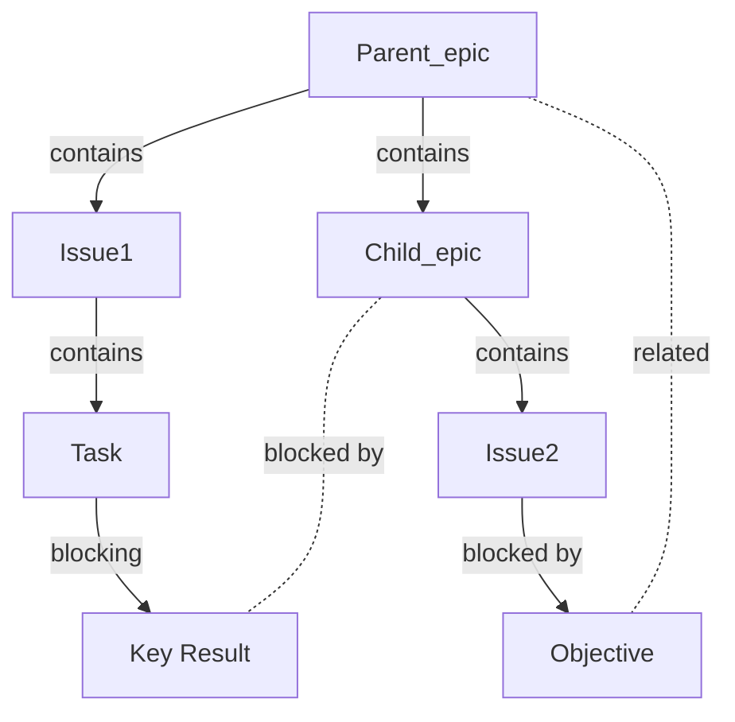



- 티어: Premium, Ultimate
- 제공 서비스: GitLab.com, GitLab Self-Managed, GitLab Dedicated



GitLab의 에픽은 작업 항목을 작업 계층으로 구성하여 대규모 이니셔티브를 조직하고 추적합니다. 에픽은 복잡한 프로젝트를 관리하기 쉽게 합니다. 다음은 그 방법입니다:

- 큰 기능을 증분 가치를 추가하는 작은 결과물로 분해합니다.
- 예약된 시작 및 종료 날짜가 있는 관련 작업 항목의 진행 상황을 추적합니다.
- 기능 범위 및 요구 사항에 대한 논의와 결정을 구성합니다.
- 작업을 전략적 목표와 연결하는 계층적 구조를 생성합니다.
- 목표를 향한 진행 상황을 모니터링하기 위한 시각적 로드맵을 구축합니다.

팀은 에픽을 사용하여 여러 반복에 걸쳐 조정하고 장기 목표를 향한 진행 상황을 추적합니다.

Ultimate 티어에서 [중첩된 에픽](../../work_items/child_items.md#work-with-multi-level-hierarchies)은 애자일 프레임워크와 일치하는 작업 계층을 통해 추가 구조를 제공합니다. 복잡한 프로젝트를 더 관리하기 쉬운 자식 에픽으로 분해합니다. 이러한 자식 에픽은 자신의 이슈 및 작업 집합을 추가로 포함할 수 있습니다. 이 중첩된 구조는 명확성을 유지하는 데 도움이 되며 프로젝트의 모든 측면이 포함되도록 보장하면서 전체 목표를 잃지 않도록 합니다.

  동영상 보기:  <a href="https://www.youtube.com/watch?v=c0EwYYUZppw">GitLab Epics - Setting up your Organization with GitLab</a>

<figure class="video-container">
  <iframe src="https://www.youtube-nocookie.com/embed/c0EwYYUZppw" frameborder="0" allowfullscreen> </iframe>
</figure>
<!-- Video published on 2023-10-30 -->

## 에픽과 다른 항목 간의 관계 {#relationships-between-epics-and-other-items}

에픽과 다른 항목 간의 가능한 관계는 다음과 같습니다:

- 에픽은 하나 이상의 이슈의 상위 항목입니다.
- 에픽은 하나 이상의 [자식 에픽](../../work_items/child_items.md#work-with-multi-level-hierarchies)의 상위 항목입니다. Ultimate만 해당입니다.
- 에픽은 하나 이상의 작업, 목표 또는 핵심 결과에 [연결](linked_epics.md)됩니다.

관계 예시:

### 다른 그룹 계층의 자식 이슈 {#child-issues-from-different-group-hierarchies}

다른 그룹 계층의 이슈를 에픽에 추가할 수 있습니다. 이를 수행하려면 [기존 이슈를 추가](../../work_items/child_items.md#add-an-existing-issue-to-an-epic)할 때 이슈 URL을 붙여넣습니다.

## 작업 항목인 에픽 {#epics-as-work-items}



- `work_item_epics`라는 이름의 [기능 플래그](../../../administration/feature_flags/_index.md)와 함께 GitLab 17.2에 [도입](https://gitlab.com/groups/gitlab-org/-/work_items/9290)되었습니다. 기본적으로 비활성화되었습니다. [베타](../../../policy/development_stages_support.md#beta)에서 도입되었습니다.
- GitLab 17.6에서 [GitLab.com에 사용](https://gitlab.com/gitlab-org/gitlab/-/issues/470685)으로 설정되었습니다.
- GitLab 17.7에서 [GitLab Self-Managed 및 GitLab Dedicated에서 기본적으로 활성화](https://gitlab.com/gitlab-org/gitlab/-/issues/468310)되었습니다.
- GitLab 18.1에서 [일반적으로 사용 가능](https://gitlab.com/gitlab-org/gitlab/-/issues/468310)하게 되었습니다. 기능 플래그 `work_item_epics`이 제거되었습니다.



에픽의 모양을 변경했습니다. Agile Planning 제공 서비스의 제품 요구 사항을 더 잘 충족하기 위해 작업 항목에 대한 통합 프레임워크로 마이그레이션했습니다.

자세한 내용은 [에픽 9290](https://gitlab.com/groups/gitlab-org/-/work_items/9290) 및 다음 블로그 게시물을 참고하십시오:

- [첫 번째 모습: GitLab의 새로운 Agile 계획 경험](https://about.gitlab.com/blog/first-look-the-new-agile-planning-experience-in-gitlab/) (2024년 6월)
- [개선된 Agile 계획을 위한 새로운 에픽 경험 공개](https://about.gitlab.com/blog/unveiling-a-new-epic-experience-for-improved-agile-planning/) (2024년 7월)

이 변경을 시도하는 동안 문제가 발생하면 [피드백 이슈](https://gitlab.com/gitlab-org/gitlab/-/issues/494462)를 사용하여 자세한 내용을 제공할 수 있습니다.

### 작업 항목 Markdown 참고 {#work-item-markdown-reference}



- GitLab 18.1에서 `extensible_reference_filters` [기능 플래그](../../../administration/feature_flags/_index.md)로 [도입](https://gitlab.com/gitlab-org/gitlab/-/issues/352861)되었습니다. 기본적으로 비활성화되었습니다.
- GitLab 18.2에서 [정식 출시](https://gitlab.com/gitlab-org/gitlab/-/merge_requests/197052)되었습니다. 기능 플래그 `extensible_reference_filters`이 제거되었습니다.



GitLab Flavored Markdown 필드에서 `[work_item:123]`을(를) 사용하여 작업 항목을 참조할 수 있습니다. 자세한 내용은 [GitLab 고유 참조](../../markdown.md#gitlab-specific-references)를 참조하세요.

## 관련 항목 {#related-topics}

- [에픽 관리](manage_epics.md) 및 다중 수준 자식 에픽
- 관계 유형을 기반으로 [관련 에픽](linked_epics.md)을(를) 연결합니다.
- [에픽 보드](epic_boards.md)로 워크플로우를 생성합니다.
- 에픽 이벤트에 대해 [알림 켜기](../../profile/notifications.md)
- [이모지 반응 추가](../../emoji_reactions.md) \- 에픽 또는 해당 댓글에
- [스레드](../../discussions/_index.md)에 댓글을 게시하여 에픽에서 협업합니다.
- [상태 확인](manage_epics.md#health-status)을(를) 사용하여 진행 상황을 추적합니다.
- 에픽 설명을 표준화하기 위해 [에픽 템플릿 생성](../../project/description_templates.md#create-a-description-template)
