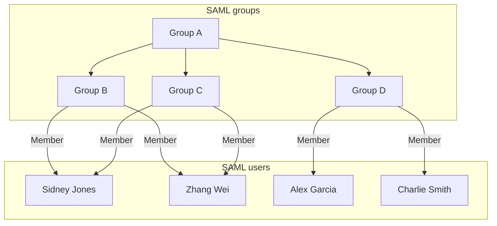
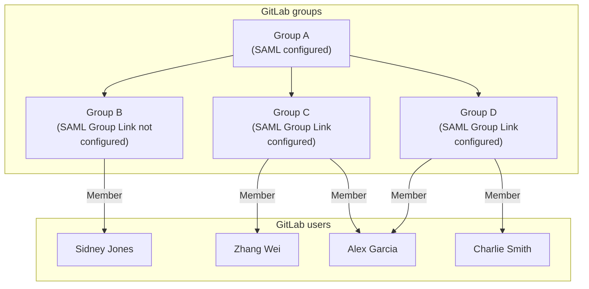
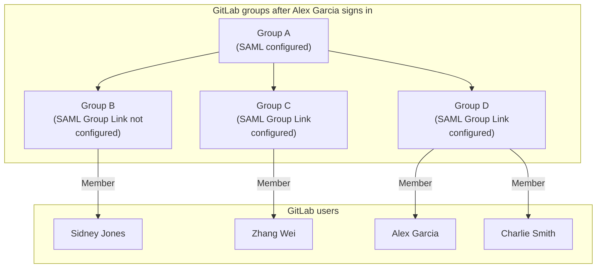



- 티어: Premium, Ultimate
- 제공 서비스: GitLab.com, GitLab Self-Managed, GitLab Dedicated



SAML 그룹 동기화를 사용하여 SAML ID 공급자(IdP)의 사용자 그룹 할당을 기반으로 특정 역할을 가진 사용자를 기존 GitLab 그룹에 할당합니다. SAML 그룹 동기화를 사용하면 SAML IdP 그룹과 GitLab 그룹 간에 다대다 매핑을 만들 수 있습니다.

예를 들어 사용자 `@amelia`이 SAML IdP의 `security` 그룹에 할당된 경우, SAML 그룹 동기화를 사용하여 `@amelia`을 유지 관리자 역할이 있는 `security-gitlab` 그룹에 할당하고 보고자 역할이 있는 `vulnerability` 그룹에 할당할 수 있습니다.

SAML 그룹 동기화는 그룹을 생성하지 않습니다. 먼저 [그룹을 생성](../_index.md#create-a-group)한 후 매핑을 만들어야 합니다.

GitLab.com에서는 SAML 그룹 동기화가 기본적으로 구성됩니다. GitLab Self-Managed에서는 수동으로 구성해야 합니다.

## 역할 우선 순위 {#role-prioritization}

그룹 동기화는 매핑된 그룹에서 사용자의 역할과 멤버십 유형을 결정합니다.

### 여러 SAML IdP {#multiple-saml-idps}



- 제공 서비스: GitLab Self-Managed



사용자가 로그인하면 GitLab은:

- 구성된 모든 SAML 그룹 링크를 확인합니다.
- 다양한 IdP에서 사용자가 속한 SAML 그룹을 기반으로 해당 사용자를 해당하는 GitLab 그룹에 추가합니다.

GitLab의 그룹 링크 매핑은 특정 IdP와 연결되지 않으므로 모든 SAML IdP가 SAML 응답에 그룹 속성을 포함하도록 구성해야 합니다. 즉, GitLab은 로그인하는 데 사용된 IdP와 관계없이 SAML 응답의 그룹을 일치시킬 수 있습니다.

예를 들어, `SAML1`과 `SAML2`의 2개 IdP가 있습니다.

GitLab에서 특정 그룹에서 2개의 그룹 링크를 구성했습니다:

- `gtlb-owner => Owner role`.
- `gtlb-dev => Developer role`.

`SAML1`에서 사용자는 `gtlb-owner`의 멤버이지만 `gtlb-dev`의 멤버는 아닙니다.

`SAML2`에서 사용자는 `gtlb-dev`의 멤버이지만 `gtlb-owner`의 멤버는 아닙니다.

사용자가 `SAML1`으로 그룹에 로그인하면, SAML 응답은 사용자가 `gtlb-owner`의 멤버임을 보여주므로 GitLab은 해당 그룹에서 사용자의 역할을 `Owner`로 설정합니다.

그런 다음 사용자가 로그아웃했다가 `SAML2`으로 그룹에 다시 로그인합니다. SAML 응답은 사용자가 `gtlb-dev`의 멤버임을 보여주므로 GitLab은 해당 그룹에서 사용자의 역할을 `Developer`로 설정합니다.

이제 사용자가 `SAML2`에서 `gtlb-owner` 또는 `gtlb-dev`의 멤버가 아니도록 이전 예제를 변경합시다.

- 사용자가 `SAML1`으로 그룹에 로그인하면, 사용자는 해당 그룹에서 `Owner` 역할이 부여됩니다.
- 사용자가 `SAML2`으로 로그인하면, 구성된 그룹 링크 중 어느 것의 멤버도 아니므로 사용자는 그룹에서 제거됩니다.

### 여러 SAML 그룹 {#multiple-saml-groups}

사용자가 동일한 GitLab 그룹에 매핑되는 여러 SAML 그룹의 멤버인 경우, 해당 SAML 그룹의 가장 높은 역할이 사용자에게 할당됩니다.

예를 들어, 사용자가 한 그룹에서 게스트 역할을 가지고 있고 다른 그룹에서 유지 관리자 역할을 가지고 있으면, 유지 관리자 역할이 할당됩니다.

### 멤버십 유형 {#membership-types}

SAML 그룹에서 사용자의 역할이 해당 하위 그룹 중 하나의 역할보다 높으면, 매핑된 GitLab 그룹의 [멤버십](../../project/members/_index.md#display-direct-members)은 매핑된 그룹에서 할당된 역할을 기반으로 다릅니다.

그룹 동기화를 통해 사용자가 할당된 경우:

- 더 높은 역할이면, 사용자는 그룹의 직접 멤버입니다.
- 같거나 낮은 역할이면, 사용자는 그룹의 상속된 멤버입니다.

## 자동 멤버 제거 {#automatic-member-removal}

그룹 동기화 후 매핑된 SAML 그룹의 멤버가 아닌 사용자는 그룹에서 제거됩니다. GitLab.com에서는 최상위 그룹의 사용자가 제거되는 대신 기본 멤버십 역할이 할당됩니다.

예를 들어, 다음 다이어그램에서:

- Alex Garcia가 GitLab에 로그인하고 SAML Group C에 속하지 않아 GitLab Group C에서 제거됩니다.
- Sidney Jones는 SAML Group C에 속하지만 아직 로그인하지 않았으므로 GitLab Group C에 추가되지 않습니다.







## SAML 그룹 동기화 구성 {#configure-saml-group-sync}

그룹 동기화 구성을 추가하거나 변경하면 그룹 이름이 SAML 응답의 나열된 `groups`과 일치하지 않으면 매핑된 GitLab 그룹에서 사용자가 제거될 수 있습니다. 사용자가 제거되지 않도록 하려면, 그룹 동기화를 구성하기 전에 다음 중 하나를 확인하세요:

- SAML 응답에 `groups` 속성이 포함되어 있고 `AttributeValue` 값이 GitLab의 **SAML 그룹 이름**과 일치하는지 확인합니다.
- 모든 그룹을 GitLab에서 제거하여 Group Sync를 비활성화합니다.

SAML Group Sync를 사용하고 분산 또는 고가용성 아키텍처와 같이 여러 GitLab 노드가 있는 경우, Rails 애플리케이션 노드 외에도 모든 Sidekiq 노드에 SAML 구성 블록을 포함해야 합니다.





SAML 그룹 동기화를 구성하려면:

1. [GitLab.com 그룹용 SAML SSO](_index.md)를 참조하세요.
1. SAML ID 공급자가 `Groups` 또는 `groups`라는 이름의 속성 문을 보내는지 확인합니다.





SAML 그룹 동기화를 구성하려면:

1. [SAML OmniAuth Provider](../../../integration/saml.md)를 구성합니다.
1. SAML ID 공급자가 `groups_attribute` 설정 값과 같은 이름의 속성 문을 보내는지 확인합니다. 이 속성은 대소문자를 구분합니다. `/etc/gitlab/gitlab.rb`에서 다음 공급자 구성 예제를 참조하세요:

   ```ruby
   gitlab_rails['omniauth_providers'] = [
     {
       name: "saml",
       label: "Provider name", # optional label for login button, defaults to "Saml",
       groups_attribute: 'Groups',
       args: {
         assertion_consumer_service_url: "https://gitlab.example.com/users/auth/saml/callback",
         idp_cert_fingerprint: "43:51:43:a1:b5:fc:8b:b7:0a:3a:a9:b1:0f:66:73:a8",
         idp_sso_target_url: "https://login.example.com/idp",
         issuer: "https://gitlab.example.com",
         name_identifier_format: "urn:oasis:names:tc:SAML:2.0:nameid-format:persistent"
       }
     }
   ]
   ```

   이 예제에서, `groups_attribute`은 `name` 및 `label`과 같은 수준의 공급자 해시의 키이며, `args` 내부가 아닙니다. `args` 내부에 있으면 그룹 동기화가 실행되지 않습니다. 사용자는 계속 로그인하고 SAML 응답은 계속 그룹을 전달하지만, GitLab은 멤버십을 변경하지 않고 오류를 로깅하지 않습니다. 자세한 내용은 [SAML 그룹 링크는 존재하지만 멤버십이 변경되지 않음](troubleshooting.md#saml-group-links-exist-but-no-memberships-change)을 참조하세요.





SAML 응답에서 `Groups` 또는 `groups`의 값은 그룹 이름 또는 ID일 수 있습니다. 예를 들어, Azure AD는 이름 대신 Azure Group Object ID를 보냅니다. [SAML 그룹 링크](#configure-saml-group-links)를 구성할 때 ID 값을 사용합니다.

```xml
<saml:AttributeStatement>
  <saml:Attribute Name="Groups">
    <saml:AttributeValue xsi:type="xs:string">Developers</saml:AttributeValue>
    <saml:AttributeValue xsi:type="xs:string">Product Managers</saml:AttributeValue>
  </saml:Attribute>
</saml:AttributeStatement>
```

`http://schemas.microsoft.com/ws/2008/06/identity/claims/groups`과 같은 다른 속성 이름은 그룹의 소스로 수락되지 않습니다.

SAML ID 공급자의 설정에서 필요한 그룹 속성 이름을 구성하는 방법에 대한 자세한 내용은 [Azure AD](example_saml_config.md#group-sync) 및 [Okta](example_saml_config.md#group-sync-1)의 예제 구성을 참조하세요.

## SAML 그룹 링크 구성 {#configure-saml-group-links}

SAML Group Sync는 하나 이상의 SAML 그룹 링크가 있는 경우에만 그룹을 관리합니다.

사전 요구 사항:

- GitLab Self-Managed 인스턴스에 SAML Group Sync가 구성되어 있어야 합니다.

SAML이 활성화되면, 소유자 역할을 가진 사용자는 그룹 **설정** > **SAML 그룹 링크**에서 새 메뉴 항목을 볼 수 있습니다.

- 하나 이상의 **SAML 그룹 링크**를 구성하여 SAML IdP 그룹 이름을 GitLab 역할에 매핑할 수 있습니다.
- SAML IdP 그룹의 멤버는 다음 SAML 로그인 시 GitLab 그룹의 멤버로 추가됩니다.
- 그룹 멤버십은 사용자가 SAML을 사용하여 로그인할 때마다 평가됩니다.
- SAML 그룹 링크는 최상위 그룹 또는 모든 하위 그룹에 대해 구성할 수 있습니다.
- SAML 그룹 링크를 생성한 다음 제거한 경우, 다음 중 하나가 있습니다:
  - 다른 SAML 그룹 링크가 구성되어 있으면, 제거된 그룹 링크에 있던 사용자는 동기화 중에 자동으로 그룹에서 제거됩니다.
  - 다른 SAML 그룹 링크가 구성되지 않으면, 사용자는 동기화 중에 그룹에 남아 있습니다. 해당 사용자는 그룹에서 수동으로 제거해야 합니다.

SAML 그룹을 링크하려면:

1. **SAML 그룹 이름**에 관련 `saml:AttributeValue`의 값을 입력합니다. SAML 그룹 이름은 대소문자를 구분하며 SAML 응답에서 전송된 값과 정확히 일치해야 합니다.
1. **액세스 수준**에서 [기본 역할](../../permissions.md) 또는 [사용자 정의 멤버 역할](../../custom_roles/_index.md)을 선택합니다.
1. **저장**을 선택합니다.
1. 필요한 경우 추가 그룹 링크를 추가하기 위해 반복합니다.

## GitLab Duo 좌석 할당 관리 {#manage-gitlab-duo-seat-assignment}



- 제공 서비스: GitLab.com, GitLab Self-Managed





- GitLab 17.8의 GitLab.com용 [도입](https://gitlab.com/gitlab-org/gitlab/-/issues/480766), [기능 플래그](../../../administration/feature_flags/_index.md) `saml_groups_duo_pro_add_on_assignment` 사용. 기본적으로 비활성화되었습니다.
- GitLab 18.0의 GitLab Self-Managed용 [도입](https://gitlab.com/gitlab-org/gitlab/-/issues/512141).



사전 요구 사항:

- 활성 [GitLab Duo 추가 기능 구독](../../../subscriptions/subscription-add-ons.md)

SAML Group Sync는 IdP 그룹 멤버십을 기반으로 GitLab Duo 좌석 할당 및 제거를 관리할 수 있습니다. 좌석은 구독에 남은 좌석이 있을 때만 할당됩니다.





GitLab.com에 대해 구성하려면:

1. [SAML 그룹 링크를 구성](#configure-saml-group-links)할 때 **이 그룹에 속한 사용자에게 GitLab Duo 좌석을 할당** 확인란을 선택합니다.
1. **저장**을 선택합니다.
1. GitLab Duo Pro 또는 GitLab Duo Enterprise 좌석이 할당되어야 하는 모든 SAML 사용자에 대해 추가 그룹 링크를 추가하기 위해 반복합니다. ID 공급자 그룹 멤버십이 이 설정이 활성화된 그룹 링크와 일치하지 않는 사용자의 GitLab Duo 좌석은 할당되지 않습니다.

활성 GitLab Duo 추가 기능 구독이 없는 그룹의 경우 확인란이 나타나지 않습니다.





GitLab Self-Managed를 구성하려면:

1. [SAML OmniAuth Provider](../../../integration/saml.md)를 구성합니다.
1. 구성에 `groups_attribute` 및 `duo_add_on_groups`이 포함되는지 확인합니다. `duo_add_on_groups` 중 하나 이상의 멤버인 모든 사용자는 좌석을 사용할 수 있으면 GitLab Duo 좌석이 할당됩니다. `/etc/gitlab/gitlab.rb`에서 다음 공급자 구성 예제를 참조하세요:

   ```ruby
   gitlab_rails['omniauth_providers'] = [
     {
       name: "saml",
       label: "Provider name",
       groups_attribute: 'Groups',
       duo_add_on_groups: ['Developers', 'Freelancers'],
       args: {
         assertion_consumer_service_url: "https://gitlab.example.com/users/auth/saml/callback",
         idp_cert_fingerprint: "43:51:43:a1:b5:fc:8b:b7:0a:3a:a9:b1:0f:66:73:a8",
         idp_sso_target_url: "https://login.example.com/idp",
         issuer: "https://gitlab.example.com",
         name_identifier_format: "urn:oasis:names:tc:SAML:2.0:nameid-format:persistent"
       }
     }
   ]
   ```





## Microsoft Azure Active Directory 통합 {#microsoft-azure-active-directory-integration}

> [!note]
> Microsoft가 Azure Active Directory(AD)의 이름을 Entra ID로 변경한다고 [발표](https://azure.microsoft.com/en-us/updates?id=azure-ad-is-becoming-microsoft-entra-id)했습니다.

<i class="fa-youtube-play" aria-hidden="true"></i> Microsoft Azure를 사용한 그룹 동기화의 데모는 [데모: SAML 그룹 동기화](https://youtu.be/Iqvo2tJfXjg)를 참조하세요.

Azure AD는 `groups` 클레임에서 최대 150개의 그룹을 보냅니다. SAML Group Sync에서 Azure AD를 사용할 때, 조직의 사용자가 150개 이상의 그룹의 멤버인 경우, Azure AD는 SAML 응답에서 `groups` 클레임 속성을 [그룹 초과분](https://learn.microsoft.com/en-us/security/zero-trust/develop/configure-tokens-group-claims-app-roles#group-overages)에 대해 보내며, 사용자는 자동으로 그룹에서 제거될 수 있습니다.

이 문제를 방지하려면 Azure AD 통합을 사용할 수 있습니다:

- 150개 그룹으로 제한되지 않습니다.
- Microsoft Graph API를 사용하여 모든 사용자 멤버십을 얻습니다. [그래프 API 엔드포인트](https://learn.microsoft.com/en-us/graph/api/user-list-transitivememberof?view=graph-rest-1.0&tabs=http#http-request)는 [Azure 구성](_index.md#azure) 고유 사용자 식별자(이름 식별자) 속성으로 [사용자 개체 ID](https://learn.microsoft.com/en-us/partner-center/find-ids-and-domain-names#find-the-user-object-id) 또는 [userPrincipalName](https://learn.microsoft.com/en-us/entra/identity/hybrid/connect/plan-connect-userprincipalname#what-is-userprincipalname)만 수락합니다.
- 그룹 동기화를 처리할 때 그룹 고유 식별자(예: `12345678-9abc-def0-1234-56789abcde`)로 구성된 Group Links만 지원합니다.

또는 [그룹 클레임](https://learn.microsoft.com/en-us/entra/identity/hybrid/connect/how-to-connect-fed-group-claims)을 변경하여 **애플리케이션에 할당된 그룹** 옵션을 사용할 수 있습니다.

### Azure AD 구성 {#configure-azure-ad}

통합의 일부로, GitLab이 Microsoft Graph API와 통신할 수 있도록 허용해야 합니다.

<!-- vale gitlab_base.SentenceSpacing = NO -->

Azure AD를 구성하려면:

1. [Azure Portal](https://portal.azure.com)에서 **Microsoft Entra ID** > **앱 등록** > **모든 애플리케이션**으로 이동하여 GitLab SAML 애플리케이션을 선택합니다.
1. **필수 항목** 아래에 **애플리케이션(클라이언트) ID** 및 **디렉토리(테넌트) ID** 값이 표시됩니다. GitLab 구성에 필요하므로 이 값들을 복사합니다.
1. 왼쪽 탐색에서 **인증서 및 비밀**을 선택합니다.
1. **클라이언트 비밀** 탭에서 **새 클라이언트 비밀**을 선택합니다.
   1. **설명** 텍스트 상자에 설명을 추가합니다.
   1. **만료** 드롭다운 목록에서 자격증명의 만료 날짜를 설정합니다. 비밀이 만료되면, 자격증명이 업데이트될 때까지 GitLab 통합이 더 이상 작동하지 않습니다.
   1. 자격증명을 생성하려면 **추가**를 선택합니다.
   1. 자격증명의 **값**을 복사합니다. 이 값은 한 번만 표시되며 GitLab 구성에 필요합니다.
1. 왼쪽 탐색에서 **API 권한**을 선택합니다.
1. **Microsoft Graph** > **애플리케이션 권한**을 선택합니다.
1. **GroupMember.Read.All** 및 **User.Read.All** 확인란을 선택합니다.
1. **권한 추가**를 선택하여 저장합니다.
1. **`<application_name>`에 대한 관리자 동의 부여**를 선택한 다음 확인 대화에서 **예**를 선택합니다. 두 권한의 **상태** 열은 **`<application_name>`에 부여됨**으로 표시되는 녹색 체크 표시로 변경되어야 합니다.

<!-- vale gitlab_base.SentenceSpacing = YES -->

### GitLab 구성 {#configure-gitlab}

Azure AD를 구성한 후 GitLab을 구성하여 Azure AD와 통신해야 합니다.

이 구성을 사용하면, 사용자가 SAML로 로그인하고 Azure가 응답에서 `group` 클레임을 보내면, GitLab은 Group Sync 작업을 시작하여 Microsoft Graph API를 호출하고 사용자의 그룹 멤버십을 검색합니다. 그런 다음 GitLab 그룹 멤버십이 SAML 그룹 링크에 따라 업데이트됩니다.

다음 표는 구성의 GitLab 설정과 해당하는 Azure AD 필드를 나열합니다:

| GitLab 설정 | Azure 필드                                |
| -------------- | ------------------------------------------ |
| Tenant ID      | 디렉토리(테넌트) ID                      |
| Client ID      | 애플리케이션(클라이언트) ID                    |
| 클라이언트 비밀  | 값(**인증서 및 비밀** 페이지) |





GitLab.com 그룹에 대해 Azure AD를 구성하려면:

1. 상단 표시줄에서 **검색 또는 이동**을 선택하고 그룹을 찾습니다. 이 그룹은 최상위 수준에 있어야 합니다.
1. **설정** > **SAML SSO**를 선택합니다.
1. [그룹에 대한 SAML SSO](_index.md)를 구성합니다.
1. **Microsoft Azure 통합** 섹션에서 **이 그룹에 대한 Microsoft Azure 통합 활성화** 확인란을 선택합니다. 이 섹션은 SAML SSO가 그룹에 대해 구성되고 활성화된 경우에만 표시됩니다.
1. Azure Portal에서 Azure Active Directory를 구성할 때 얻은 **Tenant ID**, **클라이언트 ID**, **클라이언트 비밀**을 입력합니다.
1. 선택 사항. 미국 정부 또는 Azure AD 중국용 Azure AD를 사용하는 경우 적절한 **로그인 API 끝점** 및 **그래프 API 엔드포인트**를 입력합니다. 기본값은 대부분의 조직에 적합합니다.
1. **변경 사항 저장**을 선택합니다.





사전 요구 사항:

- 관리자 액세스 권한이 있어야 합니다.

GitLab Self-Managed를 구성하려면:

1. [인스턴스에 대한 SAML SSO](../../../integration/saml.md)를 구성합니다.
1. 오른쪽 위 모서리에서 **Admin**을 선택합니다.
1. 왼쪽 사이드바에서 **설정** > **일반**을 선택합니다.
1. **Microsoft Azure 통합** 섹션에서 **이 그룹에 대한 Microsoft Azure 통합 활성화** 확인란을 선택합니다.
1. Azure Portal에서 Azure Active Directory를 구성할 때 얻은 **Tenant ID**, **클라이언트 ID**, **클라이언트 비밀**을 입력합니다.
1. 선택 사항. 미국 정부 또는 Azure AD 중국용 Azure AD를 사용하는 경우 적절한 **로그인 API 끝점** 및 **그래프 API 엔드포인트**를 입력합니다. 기본값은 대부분의 조직에 적합합니다.
1. **변경 사항 저장**을 선택합니다.





## 전역 SAML 그룹 멤버십 잠금 {#global-saml-group-memberships-lock}



- 제공 서비스: GitLab Self-Managed, GitLab Dedicated



SAML 그룹 멤버십에 전역 잠금을 시행할 수 있습니다. 이 잠금은 멤버십이 SAML 그룹 링크와 동기화되는 하위 그룹에 새 멤버를 초대할 수 있는 사람을 제한합니다.

전역 그룹 멤버십 잠금이 활성화된 경우:

- 그룹 또는 하위 그룹을 [코드 소유자](../../project/codeowners/_index.md)로 설정할 수 없습니다. 자세한 내용은 [전역 그룹 멤버십 잠금과의 비호환성](../../project/codeowners/troubleshooting.md#incompatibility-with-global-group-memberships-locks)을 참조하세요.
- 관리자만 그룹 멤버를 관리하고 액세스 수준을 변경할 수 있습니다.
- 그룹 멤버는 다음을 수행할 수 없습니다:
  - 프로젝트를 다른 그룹과 공유합니다.
  - 그룹에서 생성된 프로젝트에 멤버를 초대합니다.
  - SAML 그룹 링크 동기화를 위해 구성된 최상위 그룹의 멤버십을 수정합니다.

### 그룹 멤버십 잠금 {#lock-group-memberships}

사전 요구 사항:

- [GitLab Self-Managed에 대한 SAML SSO](../../../integration/saml.md)가 구성됩니다.
- 관리자 액세스 권한이 있어야 합니다.

SAML 그룹 링크 동기화에 멤버십을 잠그려면:

1. 오른쪽 위 모서리에서 **Admin**을 선택합니다.
1. 왼쪽 사이드바에서 **설정** > **일반**을 선택합니다.
1. **공개 범위 및 액세스 설정** 섹션을 확장합니다.
1. **SAML 그룹 링크 동기화에 대한 멤버십 잠금** 확인란을 선택합니다.
