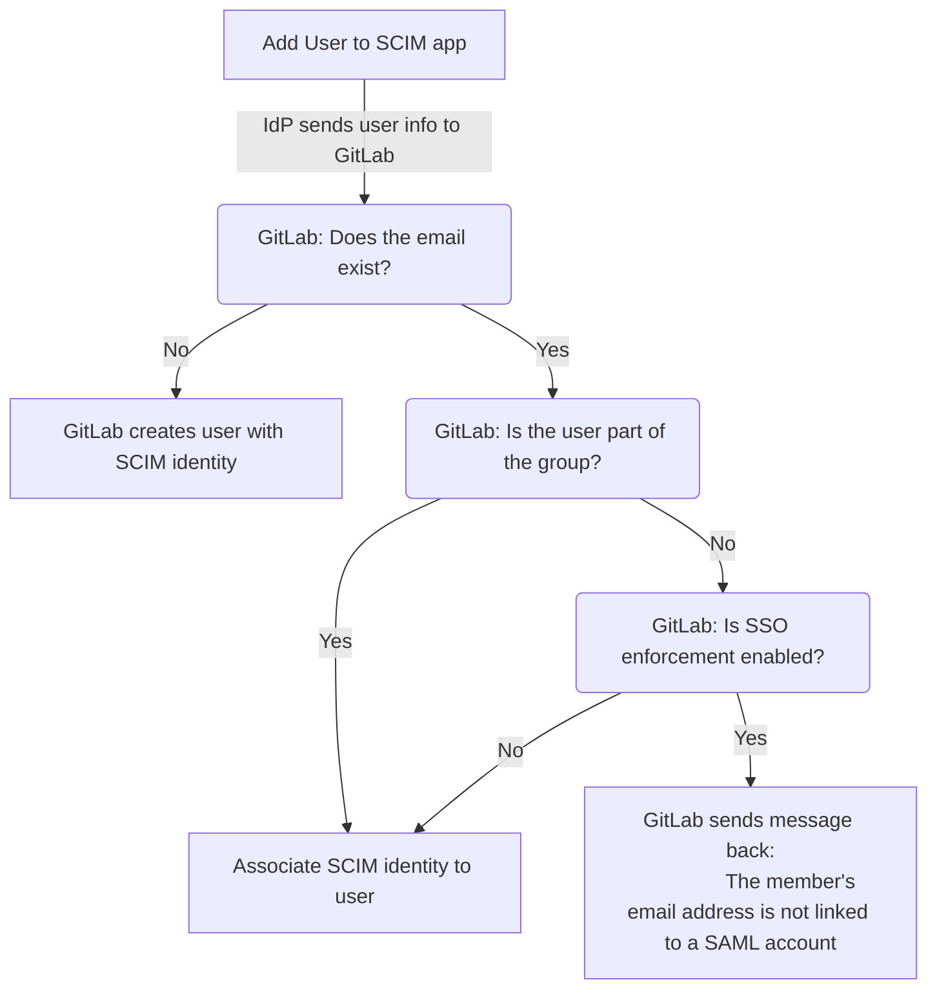
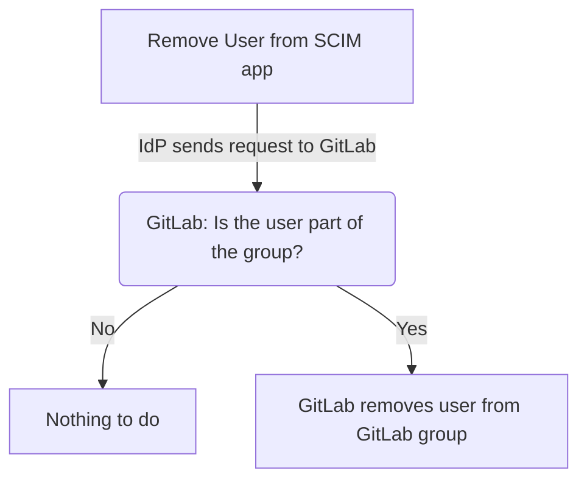



- 티어: Premium, Ultimate
- 제공 서비스: GitLab.com



개방형 표준 SCIM(System for Cross-domain Identity Management)을 사용하여 다음을 자동으로 수행할 수 있습니다:

- 사용자를 생성합니다.
- 사용자를 제거합니다(SCIM 신원 비활성화).
- 사용자를 다시 추가합니다(SCIM 신원 재활성화).

GitLab SAML SSO SCIM은 사용자 업데이트를 지원하지 않습니다.

GitLab 그룹에 SCIM이 활성화되면 해당 그룹의 멤버십이 GitLab과 ID 공급자 간에 동기화됩니다.

[내부 GitLab 그룹 SCIM API](../../../development/internal_api/_index.md#group-scim-api)는 [RFC7644 프로토콜](https://www.rfc-editor.org/info/rfc7644/)의 일부를 구현합니다. ID 공급자는 [내부 GitLab 그룹 SCIM API](../../../development/internal_api/_index.md#group-scim-api)를 사용하여 SCIM 앱을 개발할 수 있습니다.

GitLab Self-Managed에서 SCIM을 설정하려면 [GitLab Self-Managed를 위해 SCIM 구성](../../../administration/settings/scim_setup.md)을 참조하세요.

## GitLab 구성 {#configure-gitlab}

사전 요구 사항:

- [그룹 single sign-on](_index.md)을 구성해야 합니다.

GitLab SAML SSO SCIM을 구성하려면:

1. 상단 표시줄에서 **검색 또는 이동**을 선택하고 그룹을 찾습니다.
1. 왼쪽 사이드바에서 **설정** > **SAML SSO**를 선택합니다.
1. **SCIM 토큰 생성**을 선택하세요.
1. ID 공급자 구성을 위해 다음을 저장하세요:
   - **내 SCIM 토큰** 필드의 토큰입니다.
   - **SCIM API 엔드포인트 URL** 필드의 URL입니다.

## ID 공급자 구성 {#configure-an-identity-provider}

GitLab은 여러 ID 공급자를 사용한 SCIM을 지원합니다. 다른 ID 공급자도 GitLab에서 작동할 수 있지만 테스트되지 않았으며 지원되지 않습니다. 지원되지 않는 공급자에 대한 도움을 받으려면 공급자에 직접 문의하세요. GitLab Support는 관련 로그 항목을 검토하는 데 도움을 줄 수 있습니다.

### Okta 구성 {#configure-okta}

Okta에 대한 [single sign-on](_index.md) 설정 중에 생성된 SAML 애플리케이션을 SCIM용으로 설정해야 합니다.

사전 요구 사항:

- Okta [Lifecycle Management](https://www.okta.com/products/lifecycle-management/) 제품을 사용해야 합니다. 이 제품 티어는 Okta에서 SCIM을 사용하는 데 필요합니다.
- [GitLab이 구성됨](#configure-gitlab).
- [Okta](https://developer.okta.com/docs/guides/build-sso-integration/saml2/main/)용 SAML 애플리케이션은 [Okta 설정 참고](_index.md#okta)에 설명된 대로 설정됩니다.
- Okta SAML 설정이 [구성 단계와 정확히 일치](_index.md)하며, 특히 NameID 구성이 그렇습니다.

Okta에 대해 SCIM을 구성하려면:

1. Okta에 로그인하세요.
1. 오른쪽 위 모서리에서 **Admin**을 선택합니다. 이 버튼은 **운영자** 영역에서 볼 수 없습니다.
1. **Application** 탭에서 **Browse App Catalog**를 선택하세요.
1. **GitLab**을 검색하고, **GitLab** 애플리케이션을 찾아 선택하세요.
1. GitLab 애플리케이션 개요 페이지에서 **추가**를 선택하세요.
1. **Application Visibility** 아래에서 두 체크박스를 모두 선택하세요. 현재 GitLab 애플리케이션은 SAML 인증을 지원하지 않으므로 아이콘이 사용자에게 표시되지 않아야 합니다.
1. **완료**를 선택하여 애플리케이션 추가를 완료하세요.
1. **Provisioning** 탭에서 **Configure API integration**을 선택하세요.
1. **Enable API integration**을 선택하세요.
   - **Base URL**에 GitLab SCIM 구성 페이지의 **SCIM API 엔드포인트 URL**에서 복사한 URL을 붙여넣으세요.
   - **API Token**에 GitLab SCIM 구성 페이지의 **내 SCIM 토큰**에서 복사한 SCIM 토큰을 붙여넣으세요.
1. 구성을 확인하려면 **Test API Credentials**를 선택하세요.
1. **저장**을 선택합니다.
1. API 통합 세부 정보를 저장한 후 왼쪽에 새로운 설정 탭이 나타납니다. **To App**을 선택하세요.
1. **편집**을 선택합니다.
1. **활성화** 체크박스를 **Create Users**와 **Deactivate Users** 둘 다에 대해 선택하세요.
1. **저장**을 선택합니다.
1. **할당** 탭에서 사용자를 할당하세요. 할당된 사용자는 GitLab 그룹에서 생성되고 관리됩니다.

### Microsoft Entra ID 구성 {#configure-microsoft-entra-id}

사전 요구 사항:

- [GitLab이 구성됨](#configure-gitlab).
- [그룹 single sign-on](_index.md)이 구성되어 있습니다.

[single sign-on](_index.md) 설정 중에 생성된 SAML 애플리케이션을 [Azure Active Directory](https://learn.microsoft.com/en-us/entra/identity/enterprise-apps/view-applications-portal)에 대해 SCIM용으로 설정해야 합니다. 예를 들어 [예제 구성](example_saml_config.md#scim-mapping)을 참조하세요.

> [!note]
> SCIM 프로비저닝을 다음 지시 사항에 정확히 따라 구성해야 합니다. 구성이 잘못되면 사용자 프로비저닝 및 로그인 문제가 발생하며, 이를 해결하려면 많은 노력이 필요합니다. 단계에 문제가 있거나 질문이 있으면 GitLab Support에 문의하세요.

Microsoft Entra ID를 SCIM용으로 구성하려면:

1. 앱에서 **Provisioning** 탭으로 이동하고 **시작하기**를 선택하세요.
1. **Provisioning Mode**를 **Automatic**으로 설정하세요.
1. **Admin Credentials**를 다음 값을 사용하여 완료하세요:
   - GitLab의 **SCIM API 엔드포인트 URL**을 **Tenant URL** 필드에 입력하세요.
   - GitLab의 **내 SCIM 토큰**을 **Secret Token** 필드에 입력하세요.
1. **Test Connection**을 선택하세요. 테스트가 성공하면 계속하기 전에 구성을 저장하거나 [문제 해결](troubleshooting.md) 정보를 참조하세요.
1. **저장**을 선택합니다.

저장 후 **Mappings** 및 **설정** 섹션이 나타납니다.

#### 매핑 구성 {#configure-mappings}

**Mappings** 섹션 아래에서 먼저 그룹을 프로비저닝합니다:

1. **Provision Microsoft Entra ID Groups**를 선택하세요.
1. Attribute Mapping 페이지에서 **활성화** 토글을 끄세요. SCIM 그룹 프로비저닝은 GitLab에서 지원되지 않습니다. 그룹 프로비저닝을 활성화된 상태로 두어도 SCIM 사용자 프로비저닝이 손상되지는 않지만, Entra ID SCIM 프로비저닝 로그에 오류가 발생할 수 있으며 혼동과 오도될 수 있습니다.

   > [!note]
   > **Provision Microsoft Entra ID Groups**를 비활성화해도 매핑 섹션에 "활성화됨: 예"가 표시될 수 있습니다. 이 동작은 표시 버그이며 안전하게 무시할 수 있습니다.

1. **저장**을 선택합니다.

다음으로 사용자를 프로비저닝합니다:

1. **Provision Microsoft Entra ID Users**를 선택하세요.
1. **활성화** 토글이 **예**로 설정되어 있는지 확인하세요.
1. 모든 **Target Object Actions**가 활성화되어 있는지 확인하세요.
1. **Attribute Mappings** 아래에서 매핑을 구성하여 [구성된 특성 매핑](#configure-attribute-mappings)과 일치하도록 합니다:
   1. 선택 사항. **customappsso Attribute** 열에서 `externalId`을 찾아 삭제하세요.
   1. 첫 번째 특성을 다음과 같이 편집하세요:
      - `objectId`의 **source attribute**
      - `externalId`의 **target attribute**
      - `1`의 **matching precedence**
   1. 기존 **customappsso** 특성을 업데이트하여 [구성된 특성 매핑](#configure-attribute-mappings)과 일치하도록 합니다.
   1. 다음 표에 없는 추가 특성을 모두 삭제하세요. 삭제되지 않으면 문제가 발생하지 않지만 GitLab은 특성을 사용하지 않습니다.
1. 매핑 목록 아래에서 **Show advanced options** 체크박스를 선택하세요.
1. **Edit attribute list for customappsso** 링크를 선택하세요.
1. `id`이 기본 및 필수 필드이고 `externalId`도 필수인지 확인하세요.
1. **저장**을 선택하면 Attribute Mapping 구성 페이지로 돌아갑니다.
1. **Attribute Mapping** 구성 페이지를 닫으려면 오른쪽 위 모서리에서 `X`를 선택하세요.

#### 설정 구성 {#configure-settings}

**설정** 섹션 아래:

1. 선택 사항. 원하는 경우 **Send an email notification when a failure occurs** 체크박스를 선택하세요.
1. 선택 사항. 원하는 경우 **Prevent accidental deletion** 체크박스를 선택하세요.
1. 필요한 경우 **저장**을 선택하여 모든 변경 사항이 저장되었는지 확인하세요.

매핑과 설정을 구성한 후 앱 개요 페이지로 돌아가 **Start provisioning**을 선택하여 GitLab에서 자동 SCIM 사용자 프로비저닝을 시작하세요.

> [!warning]
> 동기화 후 `id` 및 `externalId`에 매핑된 필드를 변경하면 오류가 발생할 수 있습니다. 여기에는 프로비저닝 오류, 중복 사용자, 기존 사용자가 GitLab 그룹에 액세스하지 못하게 할 수 있는 상황이 포함됩니다.

#### 특성 매핑 구성 {#configure-attribute-mappings}

> [!note]
> Microsoft가 Azure Active Directory에서 Entra ID 명명 체계로 전환하는 동안 사용자 인터페이스에서 불일치를 알 수 있습니다. 문제가 있으면 이 문서의 이전 버전을 보거나 GitLab Support에 문의할 수 있습니다.

[Microsoft Entra ID를 SCIM용으로 구성](#configure-microsoft-entra-id)하는 동안 특성 매핑을 구성합니다. 예를 들어 [예제 구성](example_saml_config.md#scim-mapping)을 참조하세요.

다음 표는 GitLab에 필요한 특성 매핑을 제공합니다.

| Source attribute                                                           | Target attribute               | Matching precedence |
|:---------------------------------------------------------------------------|:-------------------------------|:--------------------|
| `objectId`                                                                 | `externalId`                   | 1                   |
| `userPrincipalName` 또는 `mail`[^mail-source-attribute]                                 | `emails[type eq "work"].value` |                     |
| `mailNickname`                                                             | `userName`                     |                     |
| `displayName` 또는 `Join(" ", [givenName], [surname])`[^join-expression]          | `name.formatted`               |                     |
| `Switch([IsSoftDeleted], , "False", "True", "True", "False")`[^expression-mapping] | `active`                       |                     |

[^mail-source-attribute]: `mail`을 `userPrincipalName`가 이메일 주소가 아니거나 전달할 수 없을 때 source attribute로 사용하세요.
[^join-expression]: `Join` 식을 `displayName`가 `Firstname Lastname`의 형식과 일치하지 않을 때 사용하세요.
[^expression-mapping]: 이것은 직접 매핑이 아닌 식 매핑 유형입니다. **Mapping type** 드롭다운 목록에서 `Expression`을 선택하세요.

각 특성 매핑에는:

- **customappsso Attribute**는 **target attribute**에 해당합니다.
- **Microsoft Entra ID Attribute**는 **source attribute**에 해당합니다.
- matching precedence입니다.

각 특성에 대해:

1. 기존 특성을 편집하거나 새 특성을 추가하세요.
1. 드롭다운 목록에서 필요한 source 및 target 특성 매핑을 선택하세요.
1. **확인**을 선택하세요.
1. **저장**을 선택합니다.

SAML 구성이 [권장 SAML 설정](_index.md#azure)과 다르면 매핑 특성을 선택하고 그에 따라 수정하세요. `externalId` target 특성에 매핑하는 source 특성은 SAML `NameID`에 사용된 특성과 일치해야 합니다.

특성이 표에 나열되지 않으면 Microsoft Entra ID 기본값을 사용하세요. 필수 특성 목록은 [내부 그룹 SCIM API](../../../development/internal_api/_index.md#group-scim-api) 문서를 참조하세요.

## 사용자 액세스 {#user-access}

동기화 프로세스 중에 모든 새 사용자:

- GitLab 계정을 받습니다.
- 초대 이메일로 자신의 그룹에 환영받습니다. [확인된 도메인으로 이메일 확인을 무시](_index.md#bypass-user-email-confirmation-with-verified-domains)할 수 있습니다.

### 제한된 액세스를 사용한 프로비저닝 동작 {#provisioning-behavior-with-restricted-access}



- GitLab 18.6에서 `bso_minimal_access_fallback`라는 [기능 플래그](../../../administration/feature_flags/_index.md)로 [도입](https://gitlab.com/gitlab-org/gitlab/-/merge_requests/206932)되었습니다. 기본적으로 비활성화되었습니다.
- GitLab 18.10에서 [기본적으로 활성화됨](https://gitlab.com/gitlab-org/gitlab/-/merge_requests/225777).



[제한된 액세스](../../../subscriptions/manage_seats.md#restricted-access)가 활성화되고 구독 사용자가 없으면 SCIM을 통해 프로비저닝된 사용자에게 최소 액세스 역할이 할당됩니다.

이 경우 최소 액세스를 사용하여 사용자가 성공적으로 생성되며(응답 `HTTP 201 Created`) 사용자의 `roles` 특성이 이 할당을 반영합니다. 후속 역할 업데이트 작업은 사용자가 없으면 실패할 수 있습니다.

더 많은 정보는 [SAML, SCIM 및 LDAP를 사용한 프로비저닝 동작](../../../subscriptions/manage_seats.md#provisioning-behavior-with-saml-scim-and-ldap)을 참조하세요.

다음 다이어그램은 SCIM 앱에 사용자를 추가할 때 어떤 일이 발생하는지 설명합니다:

프로비저닝 중:

- GitLab 사용자 계정이 있는지 확인할 때 기본 이메일과 보조 이메일이 모두 고려됩니다.
- 중복 사용자 이름은 사용자를 생성할 때 접미사 `1`을 추가하여 처리합니다. 예를 들어 `test_user`가 이미 존재하면 `test_user1`이 사용됩니다. `test_user1`가 이미 존재하면 GitLab은 접미사를 증가시켜 사용하지 않은 사용자 이름을 찾습니다. 4번 시도 후 사용하지 않은 사용자 이름을 찾을 수 없으면 무작위 문자열이 사용자 이름에 첨부됩니다.

후속 방문 시 새로운 사용자와 기존 사용자는 다음 중 하나로 그룹에 액세스할 수 있습니다:

- ID 공급자의 대시보드를 통해.
- 링크를 직접 방문하여.

역할 정보는 [Group SAML](_index.md#user-access-and-management) 페이지를 참조하세요.

### GitLab 그룹을 위해 SCIM으로 만든 사용자를 위한 비밀번호 {#passwords-for-users-created-through-scim-for-gitlab-groups}

GitLab은 모든 사용자 계정에 비밀번호가 필요합니다. SCIM 프로비저닝을 사용하여 생성된 사용자의 경우 GitLab이 무작위 비밀번호를 자동으로 생성하므로 사용자는 처음 로그인할 때 비밀번호를 설정할 필요가 없습니다. GitLab에서 GitLab 그룹용 SCIM으로 생성된 사용자의 비밀번호를 생성하는 방법에 대한 자세한 내용은 [통합 인증을 통해 생성된 사용자를 위한 생성된 비밀번호](../../profile/user_passwords.md)를 참조하세요.

### SCIM 및 SAML 신원 연결 {#link-scim-and-saml-identities}

[group SAML](_index.md)이 구성되어 있고 기존 GitLab.com 계정이 있으면 사용자는 SCIM과 SAML 신원을 연결할 수 있습니다. 동기화가 켜지기 전에 이를 수행해야 합니다. 동기화가 활성화되어 있으면 기존 사용자에 대한 프로비저닝 오류가 발생할 수 있습니다.

SCIM 및 SAML 신원을 연결하려면:

1. GitLab.com 사용자 계정의 [기본 이메일](../../profile/_index.md#change-your-primary-email) 주소를 ID 공급자의 사용자 프로필 이메일 주소와 일치하도록 업데이트하세요.
1. [SAML 신원 연결](_index.md#link-saml-to-your-existing-gitlabcom-account)하세요.

### 액세스 제거 {#remove-access}

ID 공급자에서 사용자를 제거하거나 비활성화하여 다음에 대한 액세스를 제거합니다:

- 최상위 그룹입니다.
- 모든 하위 그룹 및 프로젝트입니다.

ID 공급자가 구성된 일정에 따라 동기화를 수행한 후 사용자의 멤버십이 취소되고 액세스 권한을 잃습니다. 사용자의 GitLab 계정은 삭제되지 않으며 GitLab.com에 계속 존재합니다.

SCIM을 통해 사용자를 프로비저닝 해제해도 연결된 SAML 신원이 제거되지 않습니다.

[Enterprise users](../../enterprise_user/_index.md)를 구성한 경우 [사용자 삭제](../../enterprise_user/_index.md#delete-an-enterprise-user)할 수 있습니다.

SCIM을 활성화하면 SAML 신원이 없는 기존 사용자를 자동으로 제거하지 않습니다.

### 액세스 재활성화 {#reactivate-access}

SCIM을 통해 사용자를 제거하거나 비활성화한 후 SCIM ID 공급자에 추가하여 해당 사용자를 재활성화할 수 있습니다.

ID 공급자가 구성된 일정에 따라 동기화를 수행한 후 사용자의 SCIM 신원이 재활성화되고 그룹 멤버십이 복원됩니다. 프로비저닝 해제 중에 연결된 SAML 신원이 유지되므로 사용자는 SSO를 사용하여 즉시 로그인할 수 있습니다.

GitLab은 SCIM 프로비저닝 해제를 비동기적으로 처리합니다. 프로세스가 완료되기 전에 사용자를 재활성화하면 재활성화 요청이 실패합니다. 자세한 내용은 [오류: `User is pending deprovisioning`](troubleshooting_scim.md#error-user-is-pending-deprovisioning)를 참조하세요.
