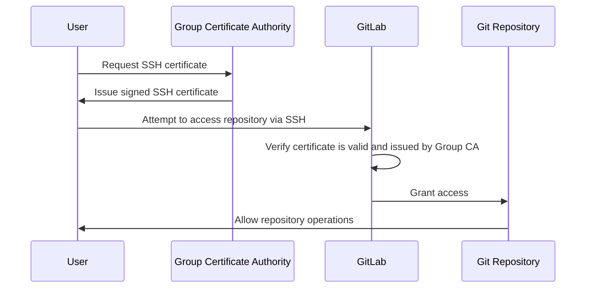



- 티어: Premium, Ultimate
- 제공 서비스: GitLab.com



SSH 인증서를 사용하여 GitLab.com에서 호스팅되는 프로젝트 및 그룹에 대한 Git 액세스를 제어하고 관리합니다.

SSH 인증서는 사용자의 신원과 권한을 인증하는 암호화 방식의 서명된 문서입니다. SSH 인증서는 신뢰할 수 있는 인증 기관(CA)에서 발급되며 사용자의 신원, 유효 기간 및 권한과 같은 정보를 포함합니다.

GitLab Self-Managed 인스턴스 관리자인 경우 인스턴스 전체 SSH 인증서 방식을 사용할 수 있습니다. 다음 방법 중 하나를 선택합니다:

- [`gitlab-sshd`을 사용한 인스턴스 수준 SSH 인증서](../../administration/operations/gitlab_sshd_ssh_certificates.md): 시스템 OpenSSH `sshd_config`를 수정하지 않고 `gitlab-sshd`에서 신뢰할 수 있는 CA 키를 직접 구성합니다.
- [OpenSSH `AuthorizedPrincipalsCommand`을 사용한 사용자 조회](../../administration/operations/ssh_certificates.md): 시스템 OpenSSH 데몬을 사용하여 SSH 인증서를 구성합니다.

SSH 인증서 인증의 이점은 다음과 같습니다:

- 중앙 집중식 액세스 제어: 개별 사용자 관리 SSH 키 대신 중앙 CA를 통해 액세스를 관리할 수 있습니다.
- 향상된 보안: SSH 인증서는 기존 SSH 키보다 더 안전합니다.
- 시간 제한 액세스: 인증서를 특정 기간 후 만료되도록 설정할 수 있습니다.
- 간소화된 자격 증명 관리: 조직은 리포지토리 액세스를 위해 승인된 SSH 인증서 자격 증명 목록을 유지할 수 있습니다.
- 사용자 관리 자격 증명과 독립적: 액세스는 그룹 관리 인증서로 제어되며 사용자의 개인 공개 SSH 키가 아닙니다.

## SSH 인증서 및 SSH 키 {#ssh-certificates-and-ssh-keys}

다음 표는 SSH 인증서 및 SSH 키를 비교합니다:

| 기능               | SSH 인증서                      | SSH 키 |
| --------------------- | ------------------------------------- | -------- |
| 액세스 제어        | 그룹 관리 CA를 통해 중앙 집중식으로 관리됩니다. | 개별 사용자 계정 전체에 분산됩니다. |
| 만료            | 기본 만료 기능이 포함됩니다.                  | 기본 만료 기능이 없습니다. |
| 자격 증명 관리 | 그룹 소유자가 관리합니다.              | 개별 사용자가 관리합니다. |
| 설정 복잡도      | 더 복잡한 초기 설정입니다.           | 더 간단한 초기 설정입니다. |

## 인증 흐름 {#authentication-flow}

다음 다이어그램은 인증서 요청에서 리포지토리 액세스까지 GitLab에서 SSH 인증서 인증이 작동하는 방식을 보여줍니다:



인증 프로세스는 리포지토리 액세스를 허용하기 전에 사용자가 유효한 SSH 인증서를 보유하고 있는지 확인합니다.

## 최상위 그룹에 CA 인증서 추가 {#add-a-ca-certificate-to-a-top-level-group}



- GitLab 16.4에서 `ssh_certificates_rest_endpoints` [기능 플래그](../../administration/feature_flags/list.md)로 [도입](https://gitlab.com/gitlab-org/gitlab/-/issues/421915)되었습니다. 기본적으로 비활성화되었습니다.
- [GitLab.com에서 활성화됨](https://gitlab.com/gitlab-org/gitlab/-/issues/424501) (GitLab 16.9)
- [일반적으로 사용 가능](https://gitlab.com/gitlab-org/gitlab/-/issues/424501) (GitLab 17.7) 기능 플래그 `ssh_certificates_rest_endpoints`이 제거되었습니다.



사전 요구 사항:

- 그룹의 소유자 역할이 있어야 합니다.
- 그룹은 최상위 그룹이어야 하며 하위 그룹이 아닙니다.

그룹에 CA 인증서를 추가하려면:

1. 인증 기관 파일로 사용할 SSH 키 쌍을 생성합니다:

   ```plaintext
   ssh-keygen -f CA
   ```

1. [그룹 SSH 인증서 API](../../api/group_ssh_certificates.md#add-a-group-ssh-certificate)를 사용하여 공개 키를 최상위 그룹에 추가하여 그룹 및 하위 그룹의 프로젝트에 대한 액세스 권한을 부여합니다.

## 사용자를 위한 CA 인증서 발급 {#issue-ca-certificates-for-users}

사전 요구 사항:

- 그룹의 소유자 역할이 있어야 합니다.
- 사용자 인증서는 최상위 그룹 및 하위 그룹의 프로젝트에만 액세스하는 데 사용할 수 있습니다.
- 사용자의 사용자 이름 또는 기본 이메일(`user` 또는 `user@example.com`)을 지정하여 GitLab 사용자를 사용자 인증서와 연결해야 합니다.
- 사용자는 [엔터프라이즈 사용자](../enterprise_user/_index.md)여야 합니다.

사용자 인증서를 발급하려면 [앞서 생성한](#add-a-ca-certificate-to-a-top-level-group) 키 쌍의 개인 키를 사용합니다:

```shell
ssh-keygen -s CA -I user@example.com -V +1d user-key.pub
```

(`user-key.pub`) 키는 SSH 인증을 위해 사용자가 사용하는 SSH 키 쌍의 공개 키입니다. SSH 키 쌍은 사용자가 생성하거나 SSH 인증서와 함께 그룹 소유자 인프라에 의해 프로비저닝됩니다.

만료 날짜(`+1d`)는 SSH 인증서를 사용하여 그룹 프로젝트에 액세스할 수 있는 기간을 식별합니다.

사용자 인증서는 최상위 그룹의 프로젝트에만 액세스하는 데 사용할 수 있습니다.

### 인증서 주체 {#certificate-principals}

이전 `ssh-keygen` 예제는 인증서 주체(`-n` 플래그)를 설정하지 않습니다. 주체가 없으면 OpenSSH는 모든 SSH 로그인 사용자에 대해 인증서를 승인합니다. GitLab은 인증서를 ID(`-I`) 값이 있는 사용자에게 매핑합니다.

하나 이상의 주체로 인증서에 서명하는 경우 목록에 `git`이(가) 포함되어야 합니다. 사용자가 `git` 사용자로 SSH를 통해 GitLab에 인증하기 때문입니다(예: `git@gitlab.com`):

```shell
ssh-keygen -s CA -I user@example.com -n git -V +1d user-key.pub
```

`git`이(가) 비어 있지 않은 주체 목록에서 누락되면 GitLab은 다음과 유사한 오류로 인증서를 거부합니다:

```plaintext
ssh: principal "git" not in the set of valid principals for given certificate: ["user@example.com"]
```

## SSH 인증서 강제 적용 {#enforce-ssh-certificates}



- GitLab 16.7에서 `enforce_ssh_certificates_via_settings`라는 [기능 플래그](../../administration/feature_flags/list.md)로 [도입](https://gitlab.com/gitlab-org/gitlab/-/issues/421915)되었습니다. 기본적으로 비활성화되었습니다.
- [GitLab.com에서 활성화됨](https://gitlab.com/gitlab-org/gitlab/-/issues/426235) (GitLab 16.9)
- [일반적으로 사용 가능](https://gitlab.com/gitlab-org/gitlab/-/issues/488635) (GitLab 17.7) 기능 플래그 `enforce_ssh_certificates_via_settings`이 제거되었습니다.



SSH 인증서의 사용을 강제하고 사용자가 SSH 키 및 액세스 토큰을 사용하여 인증하는 것을 제한할 수 있습니다.

SSH 인증서가 강제될 때:

- 개별 사용자 계정만 영향을 받습니다.
- 서비스 계정, 배포 키 및 기타 유형의 내부 계정에는 적용되지 않습니다.
- 소유자가 그룹에 추가한 SSH 인증서만 리포지토리 액세스를 인증하는 데 사용됩니다.

> [!note]
> SSH 인증서를 강제하면 일반 사용자에 대한 HTTPS 액세스가 비활성화됩니다.

사전 요구 사항:

- 그룹의 소유자 역할이 있어야 합니다.

SSH 인증서 사용을 강제하려면:

1. 상단 표시줄에서 **검색 또는 이동**을 선택하고 그룹을 찾습니다.
1. 왼쪽 사이드바에서 **설정** > **일반**을 선택합니다.
1. **권한 및 그룹 기능** 섹션을 펼치세요.
1. **SSH 인증서 강제 적용** 확인란을 선택합니다.
1. **변경 사항 저장**을 선택합니다.
