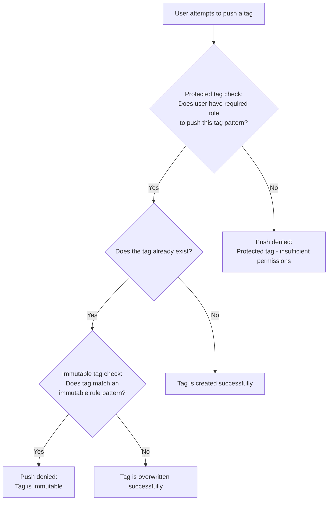



- 티어: Ultimate
- 제공 서비스: GitLab.com, GitLab Self-Managed





- [도입](https://gitlab.com/gitlab-org/gitlab/-/issues/523276)되었으며 GitLab 18.1에서 [실험](../../../policy/development_stages_support.md)으로 [기능 플래그](../../../administration/feature_flags/_index.md) `container_registry_immutable_tags`와 함께 제공됩니다. 기본적으로 비활성화되었습니다.
- GitLab 18.2에서 [GitLab.com에서 활성화](https://gitlab.com/gitlab-org/gitlab/-/issues/523276)되었습니다. 실험에서 베타로 변경되었습니다. 기능 플래그 `container_registry_immutable_tags`이 제거되었습니다.
- GitLab 18.10에서 [일반적으로 사용 가능](https://gitlab.com/gitlab-org/gitlab/-/issues/588640)합니다.



변경불가 태그를 사용하여 프로젝트에서 컨테이너 태그의 업데이트 또는 삭제를 방지합니다.

기본적으로 개발자, 유지보수자 또는 소유자 역할이 있는 사용자는 모든 프로젝트 컨테이너 리포지토리에서 이미지 태그를 푸시하고 삭제할 수 있습니다. 태그 변경불가 규칙을 사용하면 다음을 수행할 수 있습니다:

- 중요한 이미지 태그의 수정을 방지하고 악의적 또는 실수로 인한 변경의 위험을 완화합니다.
- 프로젝트당 최대 5개의 보호 규칙을 만듭니다.
- 프로젝트의 모든 컨테이너 리포지토리에 보호 규칙을 적용합니다.

태그는 최소 하나의 변경불가 보호 규칙이 태그 이름과 일치할 때 변경불가입니다. 여러 규칙이 일치하면 가장 제한적인 규칙이 적용됩니다.

변경불가 태그 규칙:

- 생성만 가능하며 업데이트할 수 없습니다
- [정리 정책](reduce_container_registry_storage.md#cleanup-policy)에 의해 삭제될 수 없습니다.

## 보호된 태그와의 비교 {#comparison-with-protected-tags}

[보호된 태그](protected_container_tags.md)와 변경불가 태그는 모두 이미지 무결성을 유지하지만 목적이 다릅니다.

보호된 태그는 역할을 기반으로 특정 태그를 만들고, 업데이트하고, 삭제할 수 있는 사람을 제한합니다. 태그 변경불가성은 태그가 생성된 후 아무도 이를 업데이트하거나 삭제할 수 없도록 보장합니다.

아래 다이어그램은 이미지 푸시 컨텍스트에서 보호 규칙이 어떻게 평가되는지 보여줍니다:

### 예제 시나리오 {#example-scenarios}

이 규칙을 포함한 프로젝트의 경우:

- 보호된 태그 규칙: 패턴 `v.*`은 유지보수자 또는 소유자 역할이 필요합니다.
- 변경불가 태그 규칙: 패턴 `v\d+\.\d+\.\d+`은 의미 있는 버전 태그를 보호합니다.

| 사용자 역할 | 작업 | 보호된 태그 확인 | 변경불가 태그 확인 | 결과 |
|-----------|--------|-------------------|-------------------|---------|
| Developer | 새 태그 `v1.0.0`을 푸시합니다 | 거부됨 | 평가되지 않음 | 푸시가 거부되었습니다. 사용자가 필요한 역할을 가지지 않습니다. |
| Maintainer | 새 태그 `v1.0.0`을 푸시합니다 | 허용됨 | 평가되지 않음 | 태그가 생성되었습니다. |
| Maintainer | 기존 태그 `v1.0.0`을 덮어씁니다 | 허용됨 | 거부됨 | 푸시가 거부되었습니다. 태그는 변경불가입니다. |
| Maintainer | 새 태그 `v-beta`을 푸시합니다 | 허용됨 | 평가되지 않음 | 태그가 생성되었습니다. |

## 사전 요구 사항 {#prerequisites}

변경불가 컨테이너 태그를 사용하려면 컨테이너 레지스트리를 사용할 수 있는지 확인하세요:

- GitLab.com에서는 컨테이너 레지스트리가 기본적으로 활성화됩니다.
- GitLab Self-Managed에서는 [메타데이터 데이터베이스를 활성화](../../../administration/packages/container_registry_metadata_database.md)하세요.

## 변경불가 규칙 만들기 {#create-an-immutable-rule}

사전 요구 사항:

- Owner 역할이 있어야 합니다.

변경불가 규칙을 만들려면:

1. 상단 바에서 **검색 또는 이동**을 선택하고 프로젝트를 찾습니다.
1. 왼쪽 사이드바에서 **설정** > **패키지 및 레지스트리**를 선택합니다.
1. **컨테이너 레지스트리**를 확장합니다.
1. **Protected container tags** 아래에서 **보호 규칙 추가**를 선택합니다.
1. **보호 유형**에서 **변경불가**를 선택합니다.
1. **태그와 일치하는 불변성 규칙 적용**에서 [RE2 syntax](https://github.com/google/re2/wiki/Syntax)를 사용하는 정규표현식 패턴을 입력합니다. 패턴은 100자를 초과할 수 없습니다. 자세한 내용은 [정규표현식 패턴 예제](#regex-pattern-examples)를 참조하세요.
1. **규칙 추가**를 선택합니다.

변경불가 규칙이 생성되고 일치하는 태그가 보호됩니다.

## 정규표현식 패턴 예제 {#regex-pattern-examples}

컨테이너 태그를 보호하는 데 사용할 수 있는 예제 패턴:

| 패턴           | 설명 |
|-------------------|-------------|
| `.*`              | 모든 태그를 보호합니다. |
| `^v.*`            | "v"로 시작하는 태그를 보호합니다 (`v1.0.0` 또는 `v2.1.0-rc1` 등). |
| `\d+\.\d+\.\d+`   | 의미 있는 버전 태그를 보호합니다 (`1.0.0` 또는 `2.1.0` 등). |
| `^latest$`        | `latest` 태그를 보호합니다. |
| `.*-stable$`      | "-stable"로 끝나는 태그를 보호합니다 (`1.0-stable` 또는 `main-stable` 등). |
| `stable\|release` | "stable" 또는 "release"를 포함하는 태그를 보호합니다 (`1.0-stable` 등). |

## 변경불가 규칙 삭제 {#delete-an-immutable-rule}

사전 요구 사항:

- Owner 역할이 있어야 합니다.

변경불가 규칙을 삭제하려면:

1. 상단 바에서 **검색 또는 이동**을 선택하고 프로젝트를 찾습니다.
1. 왼쪽 사이드바에서 **설정** > **패키지 및 레지스트리**를 선택합니다.
1. **컨테이너 레지스트리**를 확장합니다.
1. **Protected container tags** 아래에서 삭제할 변경불가 규칙 옆에 **삭제** ()를 선택합니다.
1. 확인 메시지가 표시되면 **삭제**를 선택합니다.

변경불가 규칙이 삭제되고 일치하는 태그는 더 이상 보호되지 않습니다.

## 전파 지연 {#propagation-delay}

규칙 변경은 JWT 토큰에 의존하여 서비스 간에 전파됩니다. 결과적으로 보호 규칙 및 사용자 액세스 역할의 변경 사항은 현재 JWT 토큰이 만료된 후에만 적용될 수 있습니다. 지연은 [구성된 토큰 기간](../../../administration/packages/container_registry.md#increase-token-duration)과 같습니다:

- 기본값은 5분
- GitLab.com: [15분](../../gitlab_com/_index.md#container-registry)

대부분의 컨테이너 레지스트리 클라이언트(Docker, GitLab UI 및 API 포함)는 각 작업에 대해 새 토큰을 요청하지만, 사용자 지정 클라이언트는 전체 유효 기간 동안 토큰을 유지할 수 있습니다.

## 이미지 매니페스트 삭제 {#image-manifest-deletions}

GitLab UI 및 API는 직접 이미지 매니페스트 삭제를 지원하지 않습니다. 직접 컨테이너 레지스트리 API 호출을 통해 매니페스트 삭제는 모든 관련 태그에 영향을 미칩니다.

태그 보호를 보장하려면 해당 프로젝트에 변경불가 태그 규칙이 없을 때만 직접 매니페스트 삭제 요청이 허용됩니다.

이 제한은 규칙 패턴이 컨테이너 이미지 태그와 일치하는지 여부에 관계없이 적용됩니다.
