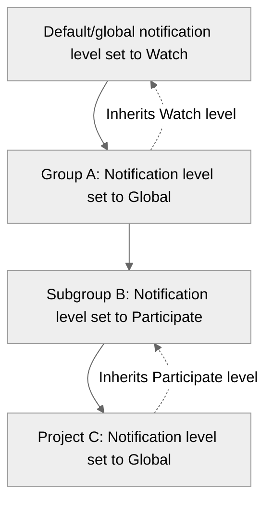



- 티어: Free, Premium, Ultimate
- 제공 서비스: GitLab.com, GitLab Self-Managed, GitLab Dedicated





- 개선된 이메일 스타일이 GitLab 18.3에서 [일반적으로 사용 가능](https://gitlab.com/gitlab-org/gitlab/-/issues/355907)합니다. 기능 플래그 `enhanced_notify_css`이 제거되었습니다.



GitLab의 이메일 알림으로 일어나는 일에 대해 정보를 받으세요. 이슈, 머지 리퀘스트, 에픽 및 디자인의 활동에 대한 업데이트를 받을 수 있습니다.

GitLab 관리자가 사용자에게 메시지를 보내기 위해 사용할 수 있는 도구의 경우 [GitLab에서 이메일 보내기](../../administration/email_from_gitlab.md)를 참조하세요.

GitLab 17.2 이상에서는 [알림이 속도 제한됩니다](../../rate_limits/non_configurable.md) 사용자당 프로젝트 또는 그룹당 24시간마다.

## 알림을 받는 사람 {#who-receives-notifications}

알림이 이슈, 머지 리퀘스트 또는 에픽에 대해 켜져 있으면 GitLab이 거기서 발생하는 작업을 알려줍니다.

다음 이유 중 하나로 알림을 받을 수 있습니다:

- 이슈, 머지 리퀘스트, 에픽 또는 디자인에 참여합니다. 댓글을 달거나 편집하거나 누군가가 사용자 이름을 언급하면 참여자가 됩니다.
- 이슈, 머지 리퀘스트 또는 에픽에서 [알림을 켰습니다](#issue-merge-request-and-epic-events).
- [프로젝트](#change-level-of-project-notifications) 또는 [그룹](#group-notifications)에 대해 알림을 설정했습니다.
- 파이프라인 이메일 [통합](../project/integrations/_index.md)을 통해 그룹 또는 프로젝트 파이프라인 알림을 구독했습니다.

GitLab이 알림을 보내지 않을 때:

- 계정이 프로젝트 봇입니다.
- 계정이 기본 이메일 주소를 가진 서비스 계정입니다.
- 계정이 차단(금지)되었거나 비활성화되었습니다.
- 관리자가 알림을 차단했습니다.

## 글로벌 알림 설정 {#global-notification-settings}

글로벌 알림 설정은 프로젝트 또는 그룹에 대해 다른 설정을 지정하지 않으면 기본 설정입니다. 예를 들어 특정 프로젝트의 모든 활동에 대해 알려지고 싶을 수 있습니다. 다른 프로젝트의 경우 이름으로 언급될 때만 알려지고 싶습니다.

이 알림 설정은 당신에게만 적용됩니다. 다른 사람이 받는 알림에는 영향을 주지 않습니다.

### 알림 설정 편집 {#edit-notification-settings}

알림 설정을 편집하려면:

1. 오른쪽 위 모서리에서 아바타를 선택합니다.
1. **환경설정**을 선택합니다.
1. 왼쪽 사이드바에서 **알림**을 선택합니다.
1. **글로벌 공지 이메일**에 알림이 전송되는 이메일 주소를 입력합니다. 기본값은 기본 이메일 주소입니다.
1. **글로벌 알림 수준**의 경우 알림에 적용할 기본 [알림 수준](#notification-levels)을 선택합니다.
1. **자신의 활동에 대한 알림 받기** 확인란을 선택하여 자신의 활동에 대한 알림을 받습니다. 기본적으로 선택되지 않음.

### 알림 수준 {#notification-levels}

각 프로젝트 및 그룹의 오른쪽에서 알림 수준을 선택할 수 있습니다:

| 수준           | 설명 |
|-----------------|-------------|
| **전역**      | 기본 글로벌 설정이 적용됩니다. |
| **Watch**       | 대부분의 활동에 대한 알림을 받습니다. |
| **참여** | 당신이 [참여하는](#who-receives-notifications) 항목에 대한 알림을 받습니다. |
| **언급**  | 누군가 설명이나 댓글에서 당신을 [언급](../discussions/_index.md#mentions)할 때 알림을 받습니다. |
| **Disabled (비활성화됨)**    | 알림을 받지 않습니다. |
| **커스텀**      | 당신이 [참여하는](#who-receives-notifications) 항목에 대한 알림을 받고, [이슈, 머지 리퀘스트 및 에픽 이벤트](#issue-merge-request-and-epic-events) 또는 당신이 선택한 [파이프라인 이벤트](#cicd-pipeline-events)에 대한 알림을 받습니다. 일부 이벤트는 참여하지 않더라도 선택한 경우에만 전송됩니다. |

### 알림 범위 {#notification-scope}

각 프로젝트 및 그룹에 대해 다른 알림 수준을 선택하여 알림의 범위를 조정할 수 있습니다.

알림 범위는 가장 광범위에서 가장 구체적인 수준으로 적용됩니다:

- 활동이 발생한 프로젝트 또는 그룹에 대해 알림 수준을 선택하지 않은 경우 글로벌 또는 _기본_ 알림 수준이 적용됩니다.
- 그룹 설정이 기본 설정을 무시합니다.
- 프로젝트 설정이 그룹 설정을 무시합니다.

프로젝트 또는 하위 그룹에 대해 알림 수준을 **전역**으로 설정하면 글로벌 알림 설정을 직접 상속하지 않습니다. 대신 계층 위로 올라가서 다음 순서로 설정된 다음 비-글로벌 알림 수준을 상속합니다:

1. 프로젝트 설정.
1. 상위 그룹 설정.
1. 상위 그룹의 설정 (계층 위로 올라가며).
1. 최종 폴백 설정으로서의 글로벌 알림 설정.

예를 들어 기본 글로벌 알림 설정을 **Watch**로 설정하고 그룹 및 프로젝트 알림 수준을 다음과 같이 설정합니다:



프로젝트 C는 하위 그룹 B에서 **참여** 알림 수준을 상속합니다. 글로벌 알림 설정에서 **Watch** 알림 수준을 상속하지 않습니다.

### 그룹 알림 {#group-notifications}

각 그룹에 대해 알림 수준과 이메일 주소를 선택할 수 있습니다.

#### 그룹 알림 수준 변경 {#change-level-of-group-notifications}

그룹에 대한 알림 수준을 선택하려면 다음 방법 중 하나를 사용합니다:

1. 오른쪽 위 모서리에서 아바타를 선택합니다.
1. **환경설정**을 선택합니다.
1. 왼쪽 사이드바에서 **알림**을 선택합니다.
1. **그룹** 섹션에서 그룹을 찾습니다.
1. 원하는 [알림 수준](#notification-levels)을 선택합니다.

또는:

1. 상단 표시줄에서 **검색 또는 이동**을 선택하고 그룹을 찾습니다.
1. 벨 아이콘 () 옆의 알림 드롭다운 목록을 선택합니다.
1. 원하는 [알림 수준](#notification-levels)을 선택합니다.

#### 그룹 알림에 사용되는 이메일 주소 변경 {#change-email-address-used-for-group-notifications}

소속된 각 그룹에 대해 알림을 받을 이메일 주소를 선택할 수 있습니다. 예를 들어 프리랜서로 일하고 고객 프로젝트에 대한 이메일을 별도로 유지하려면 그룹 알림을 사용할 수 있습니다.

1. 오른쪽 위 모서리에서 아바타를 선택합니다.
1. **환경설정**을 선택합니다.
1. 왼쪽 사이드바에서 **알림**을 선택합니다.
1. **그룹** 섹션에서 그룹을 찾습니다.
1. 원하는 이메일 주소를 선택합니다.

### 프로젝트 알림 수준 변경 {#change-level-of-project-notifications}

최신 상태를 유지하려면 각 프로젝트에 대해 알림 수준을 선택할 수 있습니다.

프로젝트에 대한 알림 수준을 선택하려면 다음 방법 중 하나를 사용합니다:

1. 오른쪽 위 모서리에서 아바타를 선택합니다.
1. **환경설정**을 선택합니다.
1. 왼쪽 사이드바에서 **알림**을 선택합니다.
1. **프로젝트** 섹션에서 프로젝트를 찾습니다.
1. 원하는 [알림 수준](#notification-levels)을 선택합니다.

또는:

1. 상단 바에서 **검색 또는 이동**을 선택하고 프로젝트를 찾습니다.
1. 벨 아이콘 () 옆의 알림 드롭다운 목록을 선택합니다.
1. 원하는 [알림 수준](#notification-levels)을 선택합니다.

<i class="fa-youtube-play" aria-hidden="true"></i> 새 릴리스를 사용할 수 있을 때 알림을 받는 방법을 알려면 [릴리스에 대한 알림](https://www.youtube.com/watch?v=qyeNkGgqmH4)을 보세요.

## 알림 이벤트 {#notification-events}

알림은 사용자, 프로젝트 또는 그룹 이벤트와 작업 항목의 활동에 대해 전송됩니다.

### 사용자 이벤트 {#user-events}



- 개인 액세스 토큰 회전에 대한 알림이 GitLab 18.3에서 [도입되었습니다](https://gitlab.com/gitlab-org/gitlab/-/merge_requests/199360).



사용자 알림 이벤트:

| 이벤트                                    | 전송 대상 | 세부 정보 |
|------------------------------------------|---------|---------|
| 이메일 변경됨                            | 사용자    | 보안 이메일, 항상 전송됨. |
| 그룹 액세스 수준 변경됨               | 사용자    |         |
| 새 이메일 주소 추가됨                  | 사용자    | 보안 이메일, 새로 추가된 이메일 주소로 전송됨. |
| 새 이메일 주소 추가됨                  | 사용자    | 보안 이메일, 기본 이메일 주소로 전송됨. |
| 새 SSH 키 추가됨                        | 사용자    | 보안 이메일, 항상 전송됨. |
| 새 사용자 생성됨                         | 사용자    | 사용자 생성 시 전송됨, OmniAuth(LDAP) 제외. |
| 비밀번호 변경됨                         | 사용자    | 보안 이메일, 사용자가 자신의 비밀번호를 변경할 때 항상 전송됨. |
| 관리자가 비밀번호를 변경함        | 사용자    | 보안 이메일, 관리자가 다른 사용자의 비밀번호를 변경할 때 항상 전송됨. |
| 개인 액세스 토큰이 취소되었습니다   | 사용자    | 보안 이메일, 항상 전송됨. |
| 개인 액세스 토큰이 회전되었습니다   | 사용자    | 보안 이메일, 항상 전송됨. |
| 개인 액세스 토큰이 곧 만료됩니다     | 사용자    | 보안 이메일, 항상 전송됨. |
| 개인 액세스 토큰이 생성되었습니다 | 사용자    | 보안 이메일, 항상 전송됨. |
| 개인 액세스 토큰이 만료되었습니다      | 사용자    | 보안 이메일, 항상 전송됨. |
| SSH 키 만료됨                      | 사용자    | 보안 이메일, 항상 전송됨. |
| 2단계 인증이 꺼짐     | 사용자    | 보안 이메일, 항상 전송됨. |

### 프로젝트 이벤트 {#project-events}



- 프로젝트 배포 토큰 만료 예정에 대한 알림이 GitLab 18.3에서 [도입되었습니다](https://gitlab.com/gitlab-org/gitlab/-/issues/512197).
- 삭제 예정 프로젝트에 대한 알림이 GitLab 17.11에서 [도입되었습니다](https://gitlab.com/gitlab-org/gitlab/-/issues/522883).



프로젝트 알림 이벤트:

| 이벤트                               | 전송 대상                               | 세부 정보 |
|-------------------------------------|---------------------------------------|---------|
| 새 릴리스                         | 프로젝트 멤버                       | **릴리스가 생성됨** 커스텀 알림 수준이 선택되었을 때만 전송됩니다. |
| 프로젝트 액세스 만료됨              | 프로젝트 멤버                       | 사용자의 프로젝트 액세스가 7일 내에 만료될 때 전송됩니다. |
| 프로젝트 액세스 수준 변경됨        | 프로젝트 멤버                       | 사용자의 프로젝트 액세스 수준이 변경될 때 전송됩니다. |
| 프로젝트 액세스 토큰이 곧 만료됩니다 | 직접 프로젝트 소유자 및 관리자 | 보안 이메일, 항상 전송됨. |
| 프로젝트 배포 토큰이 곧 만료됩니다 | 프로젝트 소유자 및 관리자        | 보안 이메일, 항상 전송됨. |
| 프로젝트 이동됨                       | 프로젝트 멤버                       | **비활성화됨** 제외한 모든 알림 수준에 대해 전송되거나 **프로젝트가 이동됨** 커스텀 알림 수준이 선택되었을 때 전송됩니다. |
| 삭제 예정 프로젝트      | 프로젝트 소유자                        | 프로젝트가 삭제 예정으로 설정될 때 전송됩니다. |
| 사용자가 프로젝트에 추가됨               | 사용자                                  | 사용자가 프로젝트에 추가될 때 전송됩니다. |

### 그룹 이벤트 {#group-events}



- 삭제 예정 그룹에 대한 알림이 GitLab 17.11에서 [도입되었습니다](https://gitlab.com/gitlab-org/gitlab/-/issues/522883).



그룹 알림 이벤트:

| 이벤트                             | 전송 대상             | 세부 정보 |
|-----------------------------------|---------------------|---------|
| 그룹 액세스 만료됨              | 그룹 멤버       | 사용자의 그룹 액세스가 7일 내에 만료될 때 전송됩니다. |
| 그룹 액세스 토큰이 곧 만료됩니다 | 직접 그룹 소유자 | 보안 이메일, 항상 전송됨. |
| 삭제 예정 그룹      | 그룹 소유자        | 그룹이 삭제 예정으로 설정될 때 전송됩니다. |
| 사용자가 그룹에 추가됨               | 사용자                | 사용자가 그룹에 추가될 때 전송됩니다. |
| 새 SAML/SCIM 사용자 프로비저닝됨    | 사용자                | 사용자가 SAML/SCIM을 통해 프로비저닝될 때 전송됩니다. |

### 이슈, 머지 리퀘스트 및 에픽 이벤트 {#issue-merge-request-and-epic-events}



- 당신이 승인 가능한 머지 리퀘스트에 대한 알림이 GitLab 17.11에서 [이름이 변경되었습니다](https://gitlab.com/gitlab-org/gitlab/-/issues/465347).
- 서비스 계정 파이프라인 알림이 GitLab 18.1에서 [도입되었습니다](https://gitlab.com/gitlab-org/gitlab/-/merge_requests/178740).



이벤트는 선택한 [알림 수준](#notification-levels)을 기반으로 알림을 생성합니다. **커스텀** 알림 수준을 선택하고 원하는 이벤트를 선택하여 일부 알림을 선택적으로 켤 수 있습니다. 에픽, 이슈 또는 머지 리퀘스트에 대해 수동으로 [알림에 구독](#subscribe-to-notifications-for-a-specific-issue-merge-request-or-epic)할 수도 있습니다.

기본적으로 당신이 생성한 이슈, 머지 리퀘스트 또는 에픽에 대한 알림을 받지 않습니다. [자신의 활동에 대한 알림](#global-notification-settings)을 켤 수 있습니다.

에픽 이벤트 알림은 다음 알림 수준에 대해 전송됩니다:

| 이벤트       | Watch | 참여 | 언급 시 | 구독됨 | 커스텀   | 추가 세부정보 |
|-------------|-------|-------------|------------|------------|----------|--------------------|
| 닫힘      | 예   | 예         |            | 예        | 예      |                    |
| 새 에픽    | 예   | 예         | 예        |            | 예      | 누군가 설명에서 사용자 이름으로 언급될 때 전송됩니다. |
| 새 댓글 | 예   | 예         | 예        | 예        | **댓글이 추가됨**이 선택된 경우 | 누군가 댓글에서 사용자 이름으로 언급될 때도 전송됩니다. |
| 다시 열림    | 예   | 예         |            | 예        | 예      |                    |

이슈 이벤트 알림은 다음 알림 수준에 대해 전송됩니다:

| 이벤트                        | Watch | 참여 | 언급 시 | 구독됨 | 커스텀   | 추가 세부정보 |
|------------------------------|-------|-------------|------------|------------|----------|--------------------|
| 닫힘                       | 예   | 예         |            | 예        | **이슈가 닫힘**이 선택된 경우 |                    |
| 내일 마감                 |       | 예         |            |            | **내일이 이슈 마감일**이 선택된 경우 | 알림은 서버의 시간대(GitLab.com의 경우 UTC)에서 00:50에 전송되며, 다음 달력일의 마감일이 있는 공개 이슈의 경우입니다. |
| 마일스톤 변경됨            | 예   | 예         |            | 예        | 예      |                    |
| 마일스톤 제거됨            | 예   | 예         |            | 예        | 예      |                    |
| 새 이슈                    | 예   | 예         | 예        |            | **이슈가 생성됨**이 선택된 경우 | 누군가 설명에서 사용자 이름으로 언급될 때도 전송됩니다. |
| 새 댓글                  | 예   | 예         | 예        | 예        | **댓글이 추가됨**이 선택된 경우 | 누군가 댓글에서 사용자 이름으로 언급될 때도 전송됩니다. |
| 제목 또는 설명 변경됨 | 예   |             | 예        |            |          | 사용자 이름의 새로운 언급. |
| 재할당됨                   | 예   | 예         |            | 예        | **이슈가 재할당됨**이 선택된 경우 | 이전 담당자에게도 전송됩니다. |
| 다시 열림                     | 예   | 예         |            | 예        | **이슈가 다시 열림**이 선택된 경우 |                    |

<!-- For issue due timing source, see 'issue_due_scheduler_worker' in <https://gitlab.com/gitlab-org/gitlab/-/blob/master/config/initializers/1_settings.rb> -->

머지 리퀘스트 알림은 다음 알림 수준에 대해 전송됩니다:

| 이벤트                                                  | Watch | 참여 | 언급 시 | 구독됨 | 커스텀   | 추가 세부정보 |
|--------------------------------------------------------|-------|-------------|------------|------------|----------|--------------------|
| 닫힘                                                 | 예   | 예         |            | 예        | **머지 리퀘스트가 닫힘**이 선택된 경우 |                    |
| 충돌                                               | 예   |             |            |            |          | 머지 리퀘스트를 자동 머지로 설정한 저자 및 사용자. |
| [병합 준비로 표시됨](../project/merge_requests/drafts.md) | 예   | 예         |            |            | 예      |                    |
| 병합됨                                                 | 예   | 예         |            | 예        | **머지 리퀘스트가 머지됨**이 선택된 경우 |                    |
| 자동 머지로 설정됨                                      | 예   | 예         |            | 예        | **머지 리퀘스트가 자동 머지로 설정됨**이 선택된 경우 | 커스텀 알림 수준은 저자, 감시자 및 구독자에 대해 무시됩니다. |
| 마일스톤 변경됨                                      | 예   | 예         |            | 예        | 예      |                    |
| 마일스톤 제거됨                                      | 예   | 예         |            | 예        | 예      |                    |
| 새 머지 리퀘스트                                      | 예   | 예         | 예        |            | **머지 리퀘스트가 생성됨**이 선택된 경우 | 설명에서 사용자 이름으로 언급된 모든 사람. |
| 새 댓글                                            | 예   | 예         | 예        | 예        | **댓글이 추가됨**이 선택된 경우 | 댓글에서 사용자 이름으로 언급된 모든 사람. |
| 새 푸시                                               |       | 예         |            |            | **머지 리퀘스트 푸시를 수신함**이 선택된 경우 |                    |
| 재할당됨                                             | 예   | 예         |            | 예        | **머지 리퀘스트가 재지정됨**이 선택된 경우 | 이전 담당자에게도 전송됩니다. |
| 검토자가 변경됨                                  | 예   | 예         |            | 예        | **머지 리퀘스트 검토자가 변경됨**이 선택된 경우 | 이전 검토자에게도 전송됩니다. |
| 다시 열림                                               | 예   | 예         |            | 예        | **머지 리퀘스트가 다시 열림**이 선택된 경우 |                    |
| 제목 또는 설명 변경됨                           | 예   |             | 예        |            |          | 사용자 이름의 새로운 언급. |
| 당신이 승인 가능한 새 머지 리퀘스트.          |       |             |            |            | **당신이 승인 가능한 머지 리퀘스트가 생성되었습니다**이 선택된 경우 |                    |

#### 특정 이슈, 머지 리퀘스트 또는 에픽에 대한 알림 구독 {#subscribe-to-notifications-for-a-specific-issue-merge-request-or-epic}

특정 이슈, 머지 리퀘스트 또는 에픽에 대해 알림을 전환하려면:

1. 오른쪽 사이드바의 맨 위에서 다음을 선택합니다:
   - **알림 켜짐** () 알림을 켜려면.
   - **알림 꺼짐** () 알림을 끄려면.

#### 이동된 알림 {#moved-notifications}



- 제공 서비스: GitLab.com, GitLab Self-Managed, GitLab Dedicated





- GitLab 19.3에서 [일반적으로 사용 가능](https://gitlab.com/gitlab-org/gitlab/-/issues/426305)합니다. 기능 플래그 `notifications_todos_buttons`이 제거되었습니다.



알림을 켜면 토론에 참여하지 않았더라도 각 업데이트에 대한 알림을 받기 시작합니다. 에픽에서 알림을 켜면 에픽에 연결된 이슈를 자동으로 구독하지 않습니다.

알림을 끄면 업데이트에 대한 알림을 받지 않습니다. 이 토글을 끄면 이 이슈, 머지 리퀘스트 또는 에픽과 관련된 업데이트에서만 구독이 해제됩니다. [GitLab의 모든 이메일 거부](#opt-out-of-all-gitlab-emails)하는 방법을 알아보세요.

### CI/CD 파이프라인 이벤트 {#cicd-pipeline-events}

CI/CD 파이프라인 이벤트 알림은 다음 알림 수준에 대해 파이프라인 작성자에게 전송됩니다:

| 이벤트      | Watch | 커스텀                                    | 추가 세부정보 |
|------------|-------|-------------------------------------------|--------------------|
| 실패     | 예   | **파이프라인 실패**가 선택된 경우         |                    |
| 수정됨      |       | **파이프라인이 수정됨**이 선택된 경우      |                    |
| 성공 | 예   | **파이프라인이 성공함**이 선택된 경우 | 파이프라인이 이전에 실패한 경우 실패 후 첫 번째 성공한 파이프라인에 대해 "파이프라인 수정됨" 메시지가 전송되고 추가 성공한 파이프라인에 대해서는 "파이프라인 성공" 메시지가 전송됩니다. |

서비스 계정 파이프라인 이벤트 알림은 다음 알림 수준에 대해 전송됩니다:

| 이벤트      | Watch | 커스텀 |
|------------|-------|--------|
| 실패     | 예   | **서비스 계정으로 실행된 파이프라인 실패**가 선택된 경우 |
| 수정됨      |       | **서비스 계정으로 실행된 파이프라인이 수정됨**이 선택된 경우 |
| 성공 | 예   | **서비스 계정으로 실행된 파이프라인이 성공함**이 선택된 경우 |

이슈 [501083](https://gitlab.com/gitlab-org/gitlab/-/issues/501083)은 모든 이벤트를 **Watch** 수준에 추가하는 것을 추적합니다.

### 특정 이벤트 비활성화 {#disable-specific-events}

GitLab Self-Managed 및 GitLab Dedicated에서 `always sent` 보안 이메일을 끄려면 인스턴스 관리자가 개별 [백그라운드 작업](../../administration/maintenance_mode/_index.md#background-jobs)을 끌 수 있습니다.

예를 들어:

- `personal_access_tokens_expiring_worker`
- `personal_access_tokens_expired_notification_worker`
- `ssh_keys_expiring_soon_notification_worker`
- `ssh_keys_expired_notification_worker`
- `deploy_tokens_expiring_worker`
- `members_expiring_worker`

## 알려지지 않은 로그인에 대한 알림 {#notifications-for-unknown-sign-ins}



- 지리적 위치가 GitLab 17.5에서 [추가되었습니다](https://gitlab.com/gitlab-org/gitlab/-/issues/296128).



> [!note]
> 이 기능은 GitLab Self-Managed 인스턴스에서 기본적으로 켜져 있습니다. 관리자는 UI의 [로그인 제한](../../administration/settings/sign_in_restrictions.md#email-notification-for-unknown-sign-ins) 섹션을 통해 이 기능을 끌 수 있습니다. 이 기능은 GitLab.com에서 항상 켜져 있습니다.

사용자가 이전에 알려지지 않은 IP 주소 또는 디바이스에서 성공적으로 로그인하면 GitLab이 이메일로 사용자에게 알립니다. 이러한 방식으로 GitLab은 악의적이거나 무단 로그인 가능성이 있는 사용자를 적극적으로 알립니다. 이 알림 이메일에는 다음이 포함됩니다:

- 호스트 이름.
- 사용자의 이름 및 사용자 이름.
- IP 주소.
- 지리적 위치.
- 로그인 날짜 및 시간.

GitLab은 알려진 로그인을 식별하기 위해 여러 방법을 사용합니다. 알림 이메일이 전송되려면 모든 방법이 실패해야 합니다.

- 마지막 로그인 IP: 현재 로그인 IP 주소는 마지막 로그인 IP 주소와 비교하여 확인됩니다.
- 현재 활성 세션: 사용자가 동일한 IP 주소의 기존 활성 세션을 가지고 있는 경우. [활성 세션](active_sessions.md)을 참조하세요.
- 쿠키: 성공적으로 로그인한 후 암호화된 쿠키가 브라우저에 저장됩니다. 이 쿠키는 마지막 성공적인 로그인 후 14일 후 만료되도록 설정됩니다.

## 잘못된 확인 코드를 사용하여 로그인 시도에 대한 알림 {#notifications-for-attempted-sign-ins-using-incorrect-verification-codes}

GitLab은 잘못된 2단계 인증(2FA) 코드를 사용하여 계정에 로그인하려는 시도를 감지하면 이메일 알림을 보냅니다. 이를 통해 악의적인 행동자가 사용자 이름과 비밀번호에 액세스했으며 2FA를 무차별 공격하려고 시도하고 있음을 감지할 수 있습니다.

## 디자인에 대한 알림 {#notifications-on-designs}

누군가 디자인에 댓글을 달 때 참여자에게 이메일 알림이 전송됩니다.

참여자는:

- 디자인의 저자 (다양한 저자가 다양한 버전의 디자인을 업로드한 경우 여러 사람일 수 있음).
- 디자인에 대한 댓글의 저자.
- 디자인의 댓글에서 [언급된](../discussions/_index.md#mentions) 모든 사람.

## 그룹 또는 프로젝트 액세스 만료에 대한 알림 {#notifications-on-group-or-project-access-expiration}

사용자의 그룹 또는 프로젝트 액세스가 7일 내에 만료되면 GitLab이 이메일 알림을 보냅니다. 이는 그룹 또는 프로젝트 멤버가 원하는 경우 액세스 기간을 연장하라고 상기시킵니다.

## 모든 GitLab 이메일 거부 {#opt-out-of-all-gitlab-emails}

더 이상 이메일 알림을 받고 싶지 않은 경우:

1. 오른쪽 위 모서리에서 아바타를 선택합니다.
1. **환경설정**을 선택합니다.
1. 왼쪽 사이드바에서 **알림**을 선택합니다.
1. **글로벌 알림 수준**을 **비활성화됨**으로 설정합니다.
1. **자신의 활동에 대한 알림 받기** 확인란을 해제합니다.
1. 그룹이나 프로젝트에 속해 있는 경우 알림 설정을 **전역** 또는 **비활성화됨**으로 설정합니다.

GitLab Self-Managed 및 Dedicated 인스턴스에서도 이를 수행한 후에도 특정 이벤트 알림이 계속 전송됩니다:

- 인스턴스 관리자가 [여전히 이메일을 보낼 수 있습니다](../../administration/email_from_gitlab.md)
- [알림 이벤트](#notification-events)가 `always sent`입니다

## 알림 이메일에서 구독 취소 {#unsubscribe-from-notification-emails}

GitLab의 알림 이메일에서 리소스 기준으로 구독을 취소할 수 있습니다 (예: 특정 이슈).

### 구독 취소 링크 사용 {#using-the-unsubscribe-link}

GitLab의 모든 알림 이메일은 맨 아래에 구독 취소 링크를 포함합니다.

구독 취소하려면:

1. 이메일의 구독 취소 링크를 선택합니다.
1. 브라우저에서 GitLab에 로그인한 경우 즉시 구독이 취소됩니다.
1. 로그인하지 않은 경우 작업을 확인해야 합니다.

### 이메일 클라이언트 또는 다른 소프트웨어 사용 {#using-an-email-client-or-other-software}

이메일 클라이언트에서 GitLab의 이메일을 볼 때 **구독 취소**가 표시될 수 있습니다. 구독을 취소하려면 이 버튼을 선택합니다.

GitLab의 알림 이메일에는 특수 헤더가 포함됩니다. 이 헤더를 통해 지원되는 이메일 클라이언트 및 다른 소프트웨어가 자동으로 사용자의 구독을 취소할 수 있습니다. 다음은 예입니다:

```plaintext
List-Unsubscribe: <https://gitlab.com/-/sent_notifications/[REDACTED]/unsubscribe>,<mailto:incoming+[REDACTED]-unsubscribe@incoming.gitlab.com>
List-Unsubscribe-Post: List-Unsubscribe=One-Click
```

`List-Unsubscribe` 헤더는 두 개의 항목을 가지고 있습니다:

- 소프트웨어가 `POST` 요청을 보낼 수 있는 링크. 이 작업은 리소스에서 사용자의 구독을 직접 취소합니다. 이 링크로 `GET` 요청을 보내면 구독을 취소하는 대신 확인 대화가 표시됩니다.
- 소프트웨어가 구독 취소 이메일을 보낼 수 있는 이메일 주소. 이메일의 내용은 무시됩니다.

이메일로 구독을 취소하는 것은 이메일에 응답하는 것과 동일한 2년 [보존 정책](../../administration/reply_by_email.md#retention-policy-for-notifications)에 따릅니다.

## 이메일 필터링에 사용할 수 있는 이메일 헤더 {#email-headers-you-can-use-to-filter-email}

알림 이메일 메시지에는 GitLab 관련 헤더가 포함됩니다. 알림을 더 잘 관리하려면 이 헤더의 내용을 기반으로 알림 이메일을 필터링할 수 있습니다.

예를 들어 머지 리퀘스트나 이슈가 할당되는 특정 프로젝트의 모든 이메일을 필터링할 수 있습니다.

다음 표는 모든 GitLab 관련 이메일 헤더를 나열합니다:

| 헤더                        | 설명 |
|-------------------------------|-------------|
| `List-Id`                     | RFC 2919 메일링 목록 식별자의 프로젝트 경로. 이메일 조직화를 위해 필터와 함께 사용할 수 있습니다. |
| `X-GitLab-(Resource)-ID`      | 알림이 적용되는 리소스의 ID. 예를 들어 리소스는 `Issue`, `MergeRequest`, `Commit` 또는 다른 리소스일 수 있습니다. |
| `X-GitLab-(Resource)-State`   | 알림이 적용되는 리소스의 상태. 예를 들어 리소스는 `Issue` 또는 `MergeRequest`일 수 있습니다. 값은 `opened`, `closed`, `merged` 또는 `locked`일 수 있습니다. |
| `X-GitLab-ConfidentialIssue`  | 알림에 대한 이슈 기밀성을 나타내는 부울 값. |
| `X-GitLab-Discussion-ID`      | 댓글에 대한 알림 이메일에서 댓글이 속한 스레드의 ID. |
| `X-GitLab-Group-Id`           | 그룹의 ID. [에픽](../group/epics/_index.md)에 대한 알림 이메일에만 표시됩니다. |
| `X-GitLab-Group-Path`         | 그룹의 경로. [에픽](../group/epics/_index.md)에 대한 알림 이메일에만 표시됩니다. |
| `X-GitLab-NotificationReason` | 알림의 이유. [가능한 값 확인](#x-gitlab-notificationreason). |
| `X-GitLab-Pipeline-Id`        | 파이프라인에 대한 알림 이메일에서 알림이 적용되는 파이프라인의 ID. |
| `X-GitLab-Project-Id`         | 프로젝트의 ID. |
| `X-GitLab-Project-Path`       | 프로젝트의 경로. |
| `X-GitLab-Project`            | 알림이 속한 프로젝트의 이름. |
| `X-GitLab-Group-Id`         | 그룹의 ID. |
| `X-GitLab-Group-Path`       | 그룹의 경로. |
| `X-GitLab-Group`            | 알림이 속한 그룹의 이름. |
| `X-GitLab-Reply-Key`          | 이메일로 회신을 지원하는 고유 토큰. |

### X-GitLab-NotificationReason {#x-gitlab-notificationreason}

`X-GitLab-NotificationReason` 헤더는 알림의 이유를 포함합니다. 값은 우선순위 순서로 다음 중 하나입니다:

- `own_activity`
- `assigned`
- `review_requested`
- `mentioned`
- `subscribed`

알림의 이유는 알림 이메일의 바닥글에도 포함됩니다. 예를 들어 `assigned` 이유가 있는 이메일은 바닥글에 이 문장을 가지고 있습니다:

```plaintext
You are receiving this email because you have been assigned an item on <configured GitLab hostname>.
```

#### On-call 알림 {#on-call-alerts-notifications}



- 티어: Premium, Ultimate
- 제공 서비스: GitLab.com, GitLab Self-Managed, GitLab Dedicated



[on-call 알림](../../operations/incident_management/oncall_schedules.md) 알림 이메일은 [경고의](../../operations/incident_management/alerts.md) 상태 중 하나를 가질 수 있습니다:

- `alert_triggered`
- `alert_acknowledged`
- `alert_resolved`
- `alert_ignored`

#### 인시던트 에스컬레이션 알림 {#incident-escalation-notifications}



- 티어: Premium, Ultimate
- 제공 서비스: GitLab.com, GitLab Self-Managed, GitLab Dedicated



[인시던트 에스컬레이션](../../operations/incident_management/escalation_policies.md) 알림 이메일은 [인시던트의](../../operations/incident_management/incidents.md) 상태 중 하나를 가질 수 있습니다:

- `incident_triggered`
- `incident_acknowledged`
- `incident_resolved`
- `incident_ignored`

`X-GitLab-NotificationReason` 헤더에 포함된 이벤트 목록을 확장하는 것은 [이슈 20689](https://gitlab.com/gitlab-org/gitlab/-/issues/20689)에서 추적됩니다.

## 문제 해결 {#troubleshooting}

### 알림에 대한 수신자 목록 가져오기 {#pull-a-list-of-recipients-for-notifications}

프로젝트에서 알림을 받을 수신자 목록을 가져오려면 (주로 커스텀 알림 문제 해결에 사용) Rails 콘솔에서 `sudo gitlab-rails c`을 실행하고 프로젝트 이름을 업데이트해야 합니다:

```plaintext
project = Project.find_by_full_path '<project_name>'
merge_request = project.merge_requests.find_by(iid: 1)
current_user = User.first
recipients = NotificationRecipients::BuildService.build_recipients(merge_request, current_user, action: "push_to"); recipients.count
recipients.each { |notify| puts notify.user.username }
```

### 더 이상 존재하지 않는 실패한 파이프라인에 대한 알림 {#notifications-about-failed-pipeline-that-doesnt-exist}

더 이상 존재하지 않는 실패한 파이프라인에 대한 알림을 받으면 (이메일 또는 Slack을 통해) 메시지를 트리거했을 수 있는 중복 GitLab 인스턴스가 있는지 다시 확인하세요.

### 이메일 알림이 활성화되었지만 수신되지 않음 {#email-notifications-are-enabled-but-not-received}

GitLab에서 이메일 알림을 켰지만 사용자가 예상대로 알림을 받지 못하는 경우 영향받는 사용자의 이메일이 GitLab에서 확인되었는지 확인하고 이메일 제공자가 GitLab 인스턴스의 이메일을 차단하지 않는지 확인합니다. 많은 이메일 제공자 (Outlook 등)는 알려지지 않은 자체 관리형 메일 서버 IP 주소에서 오는 이메일을 차단합니다. 확인하려면 인스턴스의 SMTP 서버에서 직접 이메일을 보내려고 시도하세요. 예를 들어 Sendmail에서 테스트 이메일은 다음과 같이 표시될 수 있습니다:

```plaintext
# (echo subject: test; echo) | $(which sendmail) -v -Am -i <valid email address>
```

이메일 제공자가 메시지를 차단하는 경우 다음과 같은 출력을 받을 수 있습니다 (이메일 제공자 및 SMTP 서버에 따라):

```plaintext
Diagnostic-Code: smtp; 550 5.7.1 Unfortunately, messages from [xx.xx.xx.xx]
weren't sent. For more information, please go to
http://go.microsoft.com/fwlink/?LinkID=526655 (http://go.microsoft.com/fwlink/?LinkID=526655) AS(900)
```

일반적으로 이 문제는 SMTP 서버의 IP 주소를 메일 제공자의 허용 목록에 추가하여 해결할 수 있습니다. 지침은 메일 제공자의 설명서를 확인하세요.
