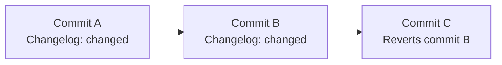
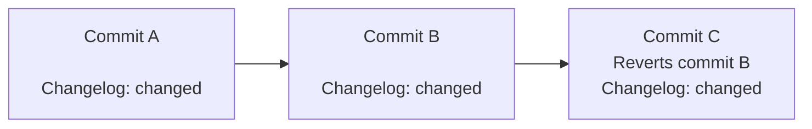



- 티어: Free, Premium, Ultimate
- 제공 서비스: GitLab.com, GitLab Self-Managed, GitLab Dedicated



변경 로그는 커밋 제목 및 Git 트레일러를 기반으로 생성됩니다. 변경 로그에 포함되려면 커밋에 특정 Git 트레일러가 포함되어야 합니다. 변경 로그는 커밋 제목에서 생성되며 Git 트레일러 유형별로 분류됩니다. 머지 리퀘스트 링크 또는 커밋 작성자 세부 정보와 같은 추가 데이터로 변경 로그 항목을 보강할 수 있습니다. 변경 로그 형식은 [템플릿으로 커스터마이즈할 수 있으며](#customize-the-changelog-output) 템플릿을 사용합니다.

기본 변경 로그의 각 섹션에는 버전 번호 및 릴리스 날짜가 포함된 제목이 있습니다. 예를 들면 다음과 같습니다:

```markdown
## 1.0.0 (2021-01-05)

### Features (4 changes)

- [Feature 1](gitlab-org/gitlab@123abc) by @alice ([merge request](gitlab-org/gitlab!123))
- [Feature 2](gitlab-org/gitlab@456abc) ([merge request](gitlab-org/gitlab!456))
- [Feature 3](gitlab-org/gitlab@234abc) by @steve
- [Feature 4](gitlab-org/gitlab@456)
```

섹션의 날짜 형식은 커스터마이즈할 수 있지만 나머지 제목은 커스터마이즈할 수 없습니다. 새 섹션을 추가할 때 GitLab은 이 제목을 구문 분석하여 파일에 새 정보를 배치할 위치를 결정합니다. GitLab은 날짜가 아닌 버전에 따라 섹션을 정렬합니다.

각 섹션에는 "기능"과 같은 범주별로 정렬된 변경 사항이 포함되며, 이러한 섹션의 형식은 변경될 수 있습니다. 섹션 이름은 커밋을 포함 또는 제외하는 데 사용되는 Git 트레일러 값에서 파생됩니다.

변경 로그의 커밋은 미러에서 작동할 때 검색할 수 있습니다. 패치 릴리스에는 공개 프로젝트와 개인 보안 미러 모두의 변경 사항이 포함될 수 있기 때문에 GitLab 자체에서 이 기능을 사용합니다.

## Git 커밋에 트레일러 추가 {#add-a-trailer-to-a-git-commit}

커밋 메시지를 작성할 때 수동으로 트레일러를 추가할 수 있습니다. `Changelog`의 기본 트레일러를 사용하여 커밋을 포함하고 기능으로 분류하려면 `Changelog: feature` 문자열을 커밋 메시지에 추가하면 됩니다. 예를 들면 다음과 같습니다:

```plaintext
<Commit message subject>

<Commit message description>

Changelog: feature
```

머지 리퀘스트에 여러 커밋이 있는 경우 `Changelog` 항목을 첫 번째 커밋에 추가하세요. 이렇게 하면 커밋을 스쿼시할 때 올바른 항목이 생성됩니다.

`Changelog` 트레일러는 다음 값을 허용합니다:

- `added`: 새 기능
- `fixed`: 버그 수정
- `changed`: 기능 변경
- `deprecated`: 새 지원 중단
- `removed`: 기능 제거
- `security`: 보안 수정
- `performance`: 성능 개선
- `other`: 기타

## 변경 로그 생성 {#create-a-changelog}

변경 로그는 API 또는 GitLab CLI를 사용하여 명령줄에서 생성됩니다. 변경 로그 출력은 Markdown으로 형식화되며, [이를 커스터마이즈할 수 있습니다](#customize-the-changelog-output).

### API에서 {#from-the-api}

`curl` 명령을 사용하여 API로 변경 로그를 생성하려면 API 설명서에서 [변경 로그 파일에 변경 로그 데이터 추가](../../api/repositories.md#add-changelog-data-to-file)를 참조하세요.

### GitLab CLI에서 {#from-the-gitlab-cli}



- [GitLab 17.1에 도입됨](https://gitlab.com/gitlab-org/cli/-/merge_requests/1222) `glab` 버전 1.30.0.



사전 요구 사항:

- [GitLab CLI](../../editor_extensions/gitlab_cli/_index.md) 버전 1.30.0 이상을 설치하고 구성했습니다.
- 리포지토리의 태그 명명 스키마는 [예상 태그 명명 형식](#customize-the-tag-format-when-extracting-versions)과 일치합니다.
- 커밋에 [변경 로그 트레일러](#add-a-trailer-to-a-git-commit)가 포함되어 있습니다.

변경 로그를 생성하려면:

1. `git fetch`을 사용하여 리포지토리의 로컬 복사본을 업데이트합니다.
1. `git describe --tags`로 결정된 현재 버전에 대한 변경 로그를 기본 옵션으로 생성하려면:
   - `glab changelog generate` 명령을 실행합니다.
   - 출력을 파일로 저장하려면 `glab changelog generate > <filename>.md` 명령을 실행합니다.
1. 커스터마이즈된 옵션으로 변경 로그를 생성하려면 `glab changelog generate` 명령을 실행하고 원하는 옵션을 추가하세요. 일부 옵션은 다음을 포함합니다:

   - `--config-file [string]`: 프로젝트의 Git 리포지토리에 있는 변경 로그 구성 파일의 경로입니다. 이 파일은 프로젝트의 Git 리포지토리에 존재해야 합니다. `.gitlab/changelog_config.yml`로 기본값 지정합니다.
   - 커밋 범위:
     - `--from [string]`: 변경 로그를 생성하는 데 사용할 커밋 범위(SHA)의 시작입니다. 이 커밋 자체는 변경 로그에 포함되지 않습니다.
     - `--to [string]`: 변경 로그를 생성하는 데 사용할 커밋 범위(SHA)의 끝입니다. 이 커밋은 목록에 포함됩니다. 기본 프로젝트 브랜치의 `HEAD`로 기본값이 지정됩니다.
   - `--date [string]`: 릴리스의 날짜 및 시간으로 ISO 8601(`2016-03-11T03:45:40Z`) 형식입니다. 현재 시간으로 기본값이 지정됩니다.
   - `--trailer [string]`: 커밋을 포함하는 데 사용할 Git 트레일러입니다. `Changelog`로 기본값 지정합니다.
   - `--version [string]`: 변경 로그를 생성할 버전입니다.

GitLab CLI에서 사용할 수 있는 매개변수에 대해 자세히 알아보려면 `glab changelog generate --help`을 실행하세요. 정의 및 사용법은 [리포지토리 API](../../api/repositories.md#add-changelog-data-to-file)를 참조하세요.

## 변경 로그 출력 커스터마이즈 {#customize-the-changelog-output}

변경 로그 출력을 커스터마이즈하려면 변경 로그 구성 파일을 편집하고 이러한 변경 사항을 프로젝트의 Git 리포지토리에 커밋하세요. 이 구성의 기본 위치는 `.gitlab/changelog_config.yml`입니다.

성능 및 보안상 이유로 변경 로그 구성 분석은 `2` 초로 제한됩니다. 구성 분석으로 인해 시간 초과 오류가 발생하는 경우 구성 크기를 줄이는 것을 고려하세요. 파일은 다음 변수를 지원합니다:

- `date_format`: `strftime` 형식의 날짜 형식으로, 새로 추가된 변경 로그 데이터의 제목에 사용됩니다.
- `template`: 변경 로그 데이터를 생성할 때 사용할 커스텀 템플릿입니다.
- `include_groups`: 프로젝트 멤버십에 관계없이 기여도를 인정해야 할 사용자가 포함된 그룹 전체 경로 목록입니다. 변경 로그를 생성하는 사용자는 기여도를 인정받기 위해 각 그룹에 대한 액세스 권한이 있어야 합니다.
- `categories`: 원시 범주 이름을 변경 로그에 사용할 이름에 매핑하는 해시입니다. 변경 로그에 표시되는 이름을 변경하려면 이 줄을 구성 파일에 추가하고 필요에 맞게 편집하세요. 이 예제는 범주 제목을 `### Features`, `### Bug fixes`, `### Performance improvements`로 렌더링합니다:

  ```yaml
  ---
  categories:
    feature: Features
    bug: Bug fixes
    performance: Performance improvements
  ```

### 커스텀 템플릿 {#custom-templates}



- 기본 템플릿이 `commit.reference` 및 `merge_request.reference`을 사용하여 `commit.web_url` 및 `merge_request.web_url`로 [변경됨](https://gitlab.com/gitlab-org/gitlab/-/merge_requests/155806) GitLab 17.1.



범주 섹션은 템플릿을 사용하여 생성됩니다. 기본 템플릿:

```plaintext


### {{ title }} (1 change{{ count }} changes)


- [{{ title }}]({{ commit.web_url }})\
 by {{ author.reference }}\
 ([merge request]({{ merge_request.web_url }}))





No changes.

```

`` 태그는 문이 수행되고 `{{ ... }}`는 데이터를 인쇄하는 데 사용됩니다. 문은 `` 태그를 사용하여 종료되어야 합니다. `if` 및 `each` 문 모두 단일 인수가 필요합니다.

예를 들어 `valid`이라고 하는 변수의 경우 이 값이 참일 때 "yes"를 표시하고, 그 외의 경우 "nope"를 표시할 수 있습니다:

```plaintext

yes

nope

```

`else`의 사용은 선택 사항입니다. 값은 비어 있지 않은 값 또는 부울 `true`일 때 참으로 간주됩니다. 빈 배열 및 해시는 거짓으로 간주됩니다.

루핑은 `each`을 사용하여 수행되며 루프 내의 변수는 해당 범위로 지정됩니다. 루프의 현재 값을 참조하려면 변수 태그 `{{ it }}`를 사용하십시오. 다른 변수는 현재 루프 값에서 해당 값을 읽습니다. 예를 들어 이 템플릿을 살펴봅시다:

```plaintext

{{name}}

```

`users`이 각각 `name` 필드가 있는 객체 배열이라고 가정하면, 이렇게 하면 모든 사용자의 이름을 인쇄합니다.

변수 태그를 사용하여 중첩된 개체에 액세스할 수 있습니다. 예를 들어 `{{ users.0.name }}`은 `users` 변수의 첫 번째 사용자의 이름을 인쇄합니다.

줄이 백슬래시로 끝나면 다음 줄 바꿈이 무시됩니다. 이렇게 하면 Markdown 출력에 불필요한 줄 바꿈을 도입하지 않고도 코드를 여러 줄에 걸쳐 줄 바꿈할 수 있습니다.

``를 사용하는 태그(표현 태그라고 함)는 뒤에 오는 줄 바꿈(있는 경우)을 사용합니다. 즉, 이것은:

```plaintext
---

bar

---
```

다음과 같이 컴파일됩니다:

```plaintext
---
bar
---
```

대신 이것:

```plaintext
---

bar

---
```

구성에서 커스텀 템플릿을 지정할 수 있습니다. 예를 들면 다음과 같습니다:

```yaml
---
template: |
  
  
  ### {{ title }}

  
  - [{{ title }}]({{ commit.web_url }})\
   by {{ author.reference }}

  

  
  
  No changes.
  
```

템플릿을 지정할 때 `template: |`을 사용해야 하며 `template: >`는 사용하지 않아야 합니다. 후자는 템플릿의 줄 바꿈을 보존하지 않기 때문입니다.

### 템플릿 데이터 {#template-data}



- `commit.web_url` 및 `merge_request.web_url`는 GitLab 17.1에 [도입됨](https://gitlab.com/gitlab-org/gitlab/-/merge_requests/155806).



최상위 수준에서 다음 변수를 사용할 수 있습니다:

- `categories`: 모든 변경 로그 범주에 대해 하나씩 객체 배열입니다.

범주에서 다음 변수를 사용할 수 있습니다:

- `count`: 이 범주의 항목 수입니다.
- `entries`: 이 범주에 속하는 항목입니다.
- `single_change`: 변경이 하나뿐인지(`true`) 또는 여러 변경(`false`)이 있는지를 나타내는 부울입니다.
- `title`: 범주의 제목입니다(다시 매핑된 후).

항목에서 다음 변수를 사용할 수 있습니다(여기 `foo.bar`은 `bar`이 `foo`의 하위 필드임을 의미합니다):

- `author.contributor`: 작성자가 프로젝트 멤버가 아닐 때 `true`로 설정되는 부울로, 그렇지 않으면 `false`입니다.
- `author.credit`: `author.contributor`이 `true`이거나 `include_groups`이 구성되어 있고 작성자가 그룹 중 하나의 멤버인 경우 `true`로 설정되는 부울입니다.
- `author.reference`: 커밋 작성자에 대한 참조입니다(예: `@alice`).
- `commit.reference`: 커밋에 대한 참조입니다(예: `gitlab-org/gitlab@0a4cdd86ab31748ba6dac0f69a8653f206e5cfc7`).
- `commit.web_url`: 커밋에 대한 URL입니다(예: `https://gitlab.com/gitlab-org/gitlab/-/commit/0a4cdd86ab31748ba6dac0f69a8653f206e5cfc7`).
- `commit.trailers`: 커밋 본문에 있는 모든 Git 트레일러를 포함하는 개체입니다.

  이러한 트레일러는 `commit.trailers.<name>`을 사용하여 참조할 수 있습니다. 예를 들어 다음 커밋을 가정합니다:

  ```plaintext
  Add some impressive new feature

  Changelog: added
  Issue: https://gitlab.com/gitlab-org/gitlab/-/issues/1234
  Status: important
  ```

  `Changelog`, `Issue` 및 `Status` 트레일러는 다음과 같이 템플릿에서 액세스할 수 있습니다:

  ```yaml
  
   ([link to issue]({{ commit.trailers.Issue }}))
  Status: {{ commit.trailers.Status }}
  
  ```

- `merge_request.reference`: 변경을 처음 도입한 머지 리퀘스트에 대한 참조입니다(예: `gitlab-org/gitlab!50063`).
- `merge_request.web_url`: 변경을 처음 도입한 머지 리퀘스트에 대한 URL입니다(예: `https://gitlab.com/gitlab-org/gitlab/-/merge_requests/50063`).
- `title`: 변경 로그 항목의 제목입니다(이는 커밋 제목입니다).

`author` 및 `merge_request` 개체는 데이터를 결정할 수 없는 경우 존재하지 않을 수 있습니다. 예를 들어 커밋이 해당 머지 리퀘스트 없이 생성되면 머지 리퀘스트가 표시되지 않습니다.

### 버전을 추출할 때 태그 형식 커스터마이즈 {#customize-the-tag-format-when-extracting-versions}

GitLab은 정규식([re2](https://github.com/google/re2/) 엔진 및 구문 사용)을 사용하여 태그 이름에서 시멘틱 버전 관리 버전을 추출합니다. 기본 정규식은:

```plaintext
^v?(?P<major>0|[1-9]\d*)\.(?P<minor>0|[1-9]\d*)\.(?P<patch>0|[1-9]\d*)(?:-(?P<pre>(?:0|[1-9]\d*|\d*[a-zA-Z-][0-9a-zA-Z-]*)(?:\.(?:0|[1-9]\d*|\d*[a-zA-Z-][0-9a-zA-Z-]*))*))?(?:\+(?P<meta>[0-9a-zA-Z-]+(?:\.[0-9a-zA-Z-]+)*))?$
```

이 정규식은 공식 [시멘틱 버전 관리](https://semver.org/) 정규식을 기반으로 하며 `v` 문자로 시작하는 태그 이름을 지원합니다.

프로젝트에서 태그에 다른 형식을 사용하는 경우 다른 정규식을 지정할 수 있습니다. 사용된 정규식은 다음 캡처 그룹을 생성해야 합니다. 이러한 캡처 그룹 중 하나라도 누락되면 태그가 무시됩니다:

- `major`
- `minor`
- `patch`

다음 캡처 그룹은 선택 사항입니다:

- `pre`: 설정된 경우 태그가 무시됩니다. `pre` 태그를 무시하면 변경 로그를 생성할 커밋 범위를 결정할 때 릴리스 후보 태그 및 기타 사전 릴리스 태그를 고려하지 않습니다.
- `meta`: 선택 사항. 빌드 메타데이터를 지정합니다.

이 정보를 사용하여 GitLab은 Git 태그 및 해당 릴리스 버전의 맵을 빌드합니다. 그런 다음 각 태그에서 추출된 버전에 따라 최신 태그가 무엇인지 결정합니다.

커스텀 정규식을 지정하려면 변경 로그 구성 YAML 파일에서 `tag_regex` 설정을 사용하세요. 예를 들어 이 패턴은 `version-1.2.3`와 같은 태그 이름은 일치하지만 `version-1.2`은 일치하지 않습니다.

```yaml
---
tag_regex: '^version-(?P<major>\d+)\.(?P<minor>\d+)\.(?P<patch>\d+)$'
```

정규식이 작동하는지 테스트하려면 [regex101](https://regex101.com/)과 같은 웹사이트를 사용할 수 있습니다. 정규식 구문이 잘못된 경우 변경 로그를 생성할 때 오류가 발생합니다.

## 커밋 처리 되돌리기 {#reverted-commit-handling}

되돌리기 커밋으로 처리되려면 커밋 메시지에 `This reverts commit <SHA>` 문자열이 포함되어야 합니다. 여기서 `SHA`는 되돌릴 커밋의 SHA입니다.

범위에 대한 변경 로그를 생성할 때 GitLab은 해당 범위에서 추가 및 되돌린 커밋을 모두 무시합니다. 이 예에서 커밋 C는 커밋 B를 되돌립니다. 커밋 C에 다른 트레일러가 없기 때문에 커밋 A만 변경 로그에 추가됩니다:



그러나 되돌리기 커밋(커밋 C)도 변경 로그 트레일러를 포함하는 경우 커밋 A와 C가 모두 변경 로그에 포함됩니다:



커밋 B는 건너뜁니다.

## 관련 항목 {#related-topics}

- 리포지토리 API에서 [변경 로그 관련 끝점](../../api/repositories.md).
- GitLab CLI 설명서에서 [`glab changelog`](https://gitlab.com/gitlab-org/cli/-/tree/main/docs/source/changelog).
