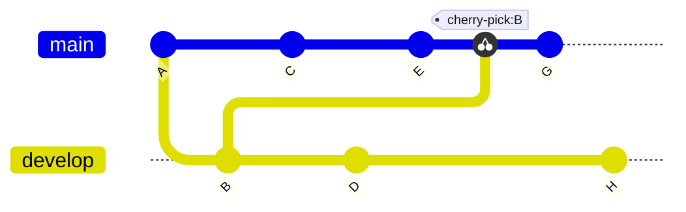



- 티어: Free, Premium, Ultimate
- 제공 서비스: GitLab.com, GitLab Self-Managed, GitLab Dedicated



Git에서 *cherry-picking*은 한 브랜치에서 단일 커밋을 가져와 다른 브랜치의 최신 커밋으로 추가하는 것입니다. 소스 브랜치의 나머지 커밋은 대상에 추가되지 않습니다. 단일 커밋의 내용은 필요하지만 전체 브랜치의 내용은 필요하지 않을 때 커밋을 Cherry-pick합니다. 예를 들어 다음과 같은 경우:

- 기본 브랜치에서 이전 릴리스 브랜치로 버그 수정을 백포트합니다.
- 포크에서 업스트림 리포지토리로 변경 사항을 복사합니다.

GitLab UI를 사용하여 프로젝트 또는 프로젝트 포크에서 단일 커밋 또는 전체 머지 리퀘스트의 내용을 Cherry-pick합니다.

이 예에서 Git 리포지토리에는 `develop`과 `main` 두 개의 브랜치가 있습니다. 커밋 `B`은 `develop` 브랜치에서 `main` 브랜치의 커밋 `E` 뒤에 Cherry-pick됩니다. 커밋 `G`은 Cherry-pick 후에 추가됩니다:

<!-- Diagram reused in `doc/topics/git/cherry_pick.md` -->

## Cherry-pick된 커밋의 시스템 노트 보기 {#view-system-notes-for-cherry-picked-commits}

GitLab UI 또는 API에서 [머지 커밋](methods/_index.md#merge-commit)을 Cherry-pick하면 GitLab은 관련 머지 리퀘스트 스레드에 [시스템 노트](../system_notes.md)를 추가합니다.

시스템 노트는 머지 커밋을 Cherry-pick할 때만 생성됩니다. fast-forward 머지를 사용할 때는 시스템 노트가 생성되지 않습니다. 이는 개별 커밋의 Cherry-pick과 머지 리퀘스트의 모든 변경 사항의 Cherry-pick 모두에 적용됩니다.

GitLab UI 또는 API 외부에서 Cherry-pick된 커밋도 시스템 노트를 생성하지 않습니다.

시스템 노트가 생성되면 형식은  `[USER]` **변경 사항을 브랜치로 Cherry-pick** `[BRANCHNAME]` 커밋 `[SHA]` `[DATE]`입니다:

시스템 노트는 새 커밋과 기존 머지 리퀘스트를 상호 연결합니다. 각 배포의 [관련 머지 리퀘스트 목록](../../../api/deployments.md#list-all-merge-requests-associated-with-a-deployment)에는 Cherry-pick된 머지 커밋이 포함됩니다.

## 머지 리퀘스트에서 모든 변경 사항을 Cherry-pick {#cherry-pick-all-changes-from-a-merge-request}

머지 리퀘스트가 머지된 후 머지 리퀘스트로 도입된 모든 변경 사항을 Cherry-pick할 수 있습니다. 머지 리퀘스트는 업스트림 프로젝트 또는 다운스트림 포크에 있을 수 있습니다.

사전 요구 사항:

- 머지 리퀘스트를 편집하고 리포지토리에 코드를 추가할 수 있는 프로젝트의 역할이 있어야 합니다.
- 프로젝트는 [머지 커밋](methods/_index.md#merge-commit) 방법을 사용해야 하며, 이는 프로젝트의 **설정** > **머지 리퀘스트**에서 설정됩니다.

  fast-forward 커밋은 GitLab UI에서 squashed되었거나 머지 리퀘스트에 단일 커밋이 포함되어 있을 때만 Cherry-pick할 수 있습니다. 항상 [개별 커밋을 Cherry-pick](#cherry-pick-a-single-commit)할 수 있습니다.

  > [!note]
  > [시스템 노트](#view-system-notes-for-cherry-picked-commits)는 fast-forward 머지 방법을 사용할 때 생성되지 않습니다.

다음과 같이 설정합니다.

1. 상단 바에서 **검색 또는 이동**을 선택하고 프로젝트를 찾습니다.
1. 왼쪽 사이드바에서 **코드** > **머지 리퀘스트**를 선택하고 머지 리퀘스트를 찾습니다.
1. 머지 리퀘스트 보고서 섹션으로 스크롤하고 **머지한 이** 보고서를 찾습니다.
1. 보고서의 오른쪽 위 모서리에서 **Cherry-pick**을 선택합니다:

   
1. 대화 상자에서 Cherry-pick할 프로젝트와 브랜치를 선택합니다.
1. 선택 사항. **이 변경 사항으로 새 머지 리퀘스트 시작**을 선택합니다.
1. 선택 사항. **머지 리퀘스트 설명 복사**를 선택하여 설명 템플릿 대신 Cherry-pick한 머지 리퀘스트의 설명에서 새 머지 리퀘스트를 시작합니다. 새 머지 리퀘스트를 시작할 때만 사용 가능합니다.
1. **Cherry-pick**을 선택합니다.

## 단일 커밋 Cherry-pick {#cherry-pick-a-single-commit}

GitLab 프로젝트의 여러 위치에서 단일 커밋을 Cherry-pick할 수 있습니다.

머지 커밋을 Cherry-pick하면 GitLab은 관련 머지 리퀘스트에 [시스템 노트](#view-system-notes-for-cherry-picked-commits)를 생성하여 작업을 추적합니다.

### 프로젝트의 커밋 목록에서 {#from-a-projects-commit-list}

프로젝트의 모든 커밋 목록에서 커밋을 Cherry-pick하려면:

1. 상단 바에서 **검색 또는 이동**을 선택하고 프로젝트를 찾습니다.
1. 왼쪽 사이드바에서 **코드** > **커밋**을 선택합니다.
1. Cherry-pick할 커밋의 [제목](https://git-scm.com/docs/git-commit#_discussion)을 선택합니다.
1. 오른쪽 위 모서리에서 **옵션** > **Cherry-pick**을 선택합니다.
1. Cherry-pick 대화 상자에서 Cherry-pick할 프로젝트와 브랜치를 선택합니다.
1. 선택 사항. **이 변경 사항으로 새 머지 리퀘스트 시작**을 선택합니다.
1. **Cherry-pick**을 선택합니다.

### 리포지토리의 파일 뷰에서 {#from-the-file-view-of-a-repository}

프로젝트의 Git 리포지토리에서 파일을 볼 때 개별 파일에 영향을 주는 이전 커밋 목록에서 Cherry-pick할 수 있습니다:

1. 상단 바에서 **검색 또는 이동**을 선택하고 프로젝트를 찾습니다.
1. 왼쪽 사이드바에서 **코드** > **리포지토리**를 선택합니다.
1. 커밋으로 변경된 파일로 이동합니다. 마지막 커밋 블록에서 **이력**을 선택합니다.
1. Cherry-pick할 커밋의 [제목](https://git-scm.com/docs/git-commit#_discussion)을 선택합니다.
1. 오른쪽 위 모서리에서 **옵션** > **Cherry-pick**을 선택합니다.
1. Cherry-pick 대화 상자에서 Cherry-pick할 프로젝트와 브랜치를 선택합니다.
1. 선택 사항. **이 변경 사항으로 새 머지 리퀘스트 시작**을 선택합니다.
1. **Cherry-pick**을 선택합니다.

## 다른 부모 커밋 선택 {#select-a-different-parent-commit}

GitLab UI에서 머지 커밋을 Cherry-pick하면 mainline은 항상 첫 번째 부모입니다. 명령줄을 사용하여 다른 mainline으로 Cherry-pick합니다. 자세한 내용은 [전체 브랜치의 내용 복사](../../../topics/git/cherry_pick.md#copy-the-contents-of-an-entire-branch)를 참조하세요.

## 관련 항목 {#related-topics}

- [커밋 API](../../../api/commits.md#cherry-pick-a-commit)
- [Git을 사용한 Cherry-pick 변경 사항](../../../topics/git/cherry_pick.md)
