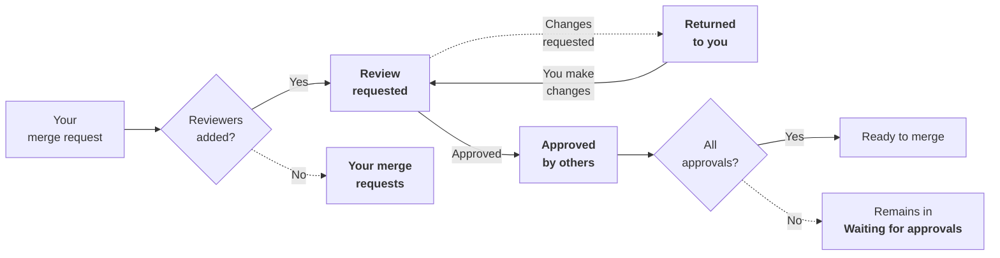



- 티어: Free, Premium, Ultimate
- 제공 서비스: GitLab.com, GitLab Self-Managed, GitLab Dedicated



당신이 머지 리퀘스트의 작성자, 담당자 또는 검토자라면 머지 리퀘스트 홈페이지에 표시됩니다. 이 페이지는 머지 리퀘스트를 **워크플로** 또는 **역할**로 정렬합니다. **워크플로** 보기는 당신의 작업인지 다른 사람의 작업인지 상관없이 어떤 머지 리퀘스트가 먼저 당신의 주의가 필요한지 보여줍니다. 워크플로 보기는 머지 리퀘스트를 이 검토 프로세스의 단계별로 그룹화합니다:

이 검토 흐름은 검토자가 **리뷰 시작** 및 **리뷰 제출** 기능을 사용한다고 가정합니다.

**역할** 보기는 머지 리퀘스트에서 당신의 역할에 따라 머지 리퀘스트를 정렬합니다.

## 머지 리퀘스트 홈페이지 보기 {#see-your-merge-request-homepage}



- 머지 리퀘스트 홈페이지는 GitLab 17.9에서 [도입](https://gitlab.com/groups/gitlab-org/-/work_items/13448)되었으며 [기능 플래그](../../../administration/feature_flags/_index.md)와 함께 이름이 `merge_request_dashboard`입니다. 기본적으로 비활성화되었습니다.
- 기능 플래그 `merge_request_dashboard`이 GitLab.com에서 GitLab 17.9에서 [활성화](https://gitlab.com/gitlab-org/gitlab/-/issues/480854)되었습니다.
- 기능 플래그 `mr_dashboard_list_type_toggle`이 GitLab 18.1에서 GitLab.com을 위해 [활성화](https://gitlab.com/gitlab-org/gitlab/-/issues/535244)되었습니다.
- 기능 플래그 `merge_request_dashboard`이 GitLab 18.2에서 [기본적으로 활성화](https://gitlab.com/gitlab-org/gitlab/-/merge_requests/194999)되었습니다.



> [!flag]
> 이 기능의 사용 가능성은 기능 플래그로 제어합니다. 자세한 내용은 기록을 참조하세요.

GitLab은 모든 페이지의 오른쪽 위 모서리에 **활성** 머지 리퀘스트의 총 개수를 표시합니다. 예를 들어 이 사용자는 다음과 같습니다:

이 사용자는 다음과 같습니다:

- 8개의 열린 이슈 ()
- 3개의 활성 머지 리퀘스트 ()
- 6개의 할 일 항목 ()

머지 리퀘스트 홈페이지는 이러한 머지 리퀘스트에 대한 자세한 정보를 표시합니다. 이를 보려면 다음 방법 중 하나를 사용하십시오:

- <kbd>Shift</kbd>+<kbd>m</kbd> [키보드 단축키](../../shortcuts.md)를 사용합니다.
- 왼쪽 사이드바에서 **머지 리퀘스트**()를 선택합니다.
- 맨 위의 탐색 모음에서 **검색 또는 이동**을 선택한 다음 드롭다운 목록에서 **머지 리퀘스트**를 선택합니다.

당신의 주의가 필요한 것에 집중하는 데 도움을 드리기 위해 GitLab은 머지 리퀘스트 홈페이지를 세 개의 탭으로 구성합니다:

- **활성**: 이러한 머지 리퀘스트는 당신 또는 당신의 팀 멤버로부터 주의가 필요합니다.
- **머지됨**: 이러한 머지 리퀘스트는 지난 14일 동안 머지되었습니다. 이들은 당신의 작업이거나 당신의 검토가 포함되어 있습니다.
- **검색**: 모든 머지 리퀘스트를 검색하고 필요에 따라 필터링합니다.

- **상태**: 머지 리퀘스트의 현재 상태입니다.
- **제목**: 머지 리퀘스트에 대한 중요한 메타데이터입니다(포함):
  - 머지 리퀘스트 제목입니다.
  - 담당자의 아바타입니다.
  - 추가되고 제거된 파일 및 라인의 수(`+` / `-`)입니다.
  - 마일스톤입니다.
- **작성자**: 작성자의 아바타입니다.
- **검토자**: 검토자의 아바타입니다. 녹색 체크 표시가 있는 검토자는 머지 리퀘스트를 승인했습니다.
- **점검**: 병합 가능성에 대한 간단한 평가입니다.
  - 머지 충돌이 있으면 경고()입니다.
  - 해결되지 않은 스레드의 수입니다(예: `0 of 3`).
  - 현재 필요한 [승인 상태](approvals/_index.md#in-the-list-of-merge-requests)입니다.
  - 가장 최근의 파이프라인 상태입니다.
  - 마지막 업데이트 날짜입니다.

### 표시 기본 설정 설정 {#set-your-display-preferences}



- **초안 표시** 기본 설정은 GitLab 18.6에서 [도입](https://gitlab.com/gitlab-org/gitlab/-/issues/551475)되었습니다.



머지 리퀘스트 홈페이지의 오른쪽 위에서 **표시 기본 설정**()을 선택합니다:

- **레이블 표시**를 전환하여 각 머지 리퀘스트의 라벨을 표시하거나 숨깁니다.
- 정렬 기본 설정: **워크플로** 또는 **역할**입니다.
  - **워크플로**는 머지 리퀘스트를 상태별로 그룹화합니다. GitLab은 당신이 작성자인지 검토자인지 상관없이 먼저 주의가 필요한 머지 리퀘스트를 표시합니다.
  - **역할**은 당신이 검토자인지 작성자인지 여부에 따라 머지 리퀘스트를 그룹화합니다.
- **초안 표시**를 전환하여 **당신의 머지 리퀘스트** 목록에서 초안 머지 리퀘스트를 표시하거나 숨깁니다.

활성 머지 리퀘스트는 왼쪽 사이드바에 표시된 총계에 포함됩니다. GitLab은 검토 수에서 **비활성** 머지 리퀘스트를 제외합니다.

### 워크플로 보기: 활성 상태 {#workflow-view-active-statuses}

이러한 머지 리퀘스트는 당신의 주의가 필요합니다. 이들은 왼쪽 사이드바에 표시된 총계에 포함됩니다:

- **당신의 머지 리퀘스트**: 당신은 머지 리퀘스트의 작성자 또는 담당자입니다. 검토자를 추가하여 검토 프로세스를 시작합니다. 상태:
  - **초안**: 머지 리퀘스트가 초안 상태입니다.
  - **검토자가 필요합니다**: 머지 리퀘스트는 초안이 아니지만 검토자가 없습니다.
- **검토가 요청됨**: 당신은 검토자입니다. 머지 리퀘스트를 검토합니다. 피드백을 제공합니다. 선택적으로 승인하거나 변경을 요청합니다. 상태:
  - **변경 요청됨**: 검토자가 변경을 요청했습니다. 변경 요청은 머지 리퀘스트를 차단하지만 [우회할 수 있습니다](reviews/_index.md#bypass-a-request-for-changes).
  - **검토자가 코멘트함**: 검토자가 댓글을 남겼지만 변경을 요청하지 않았습니다.
- **당신에게 반환되었습니다**: 검토자가 피드백을 제공했거나 변경을 요청했습니다. 검토자의 의견을 처리하고 제안된 변경 사항을 적용합니다. 상태:
  - **변경 요청됨**: 검토자가 변경을 요청했습니다.
  - **검토자가 코멘트함**: 검토자가 댓글을 남겼지만 변경을 요청하지 않았습니다.

### 워크플로 보기: 비활성 상태 {#workflow-view-inactive-statuses}

GitLab은 현재 당신의 조치가 필요하지 않으므로 이러한 머지 리퀘스트를 활성 수에서 제외합니다:

- **담당자 대기 중**: 당신이 작성자라면 머지 리퀘스트는 검토를 기다리고 있습니다. 당신이 검토자라면 변경을 요청했습니다. 상태:
  - **변경을 요청 하였습니다**: 당신이 검토를 완료하고 변경을 요청했습니다.
  - **당신이 댓글을 달았습니다**: 당신이 댓글을 달았지만 검토를 완료하지 않았습니다.
- **승인 대기중**: 승인을 기다리고 있는 당신의 할당된 머지 리퀘스트와 당신이 변경을 요청한 리뷰입니다. 상태:
  - **승인 필요**: 필요한 승인의 남은 수입니다.
  - **승인됨**: 당신이 승인했거나 모든 필수 승인이 만족된 상태입니다.
  - **승인 대기중**.
- **당신이 승인함**: 당신이 검토하고 승인한 머지 리퀘스트입니다. 상태:
  - **승인됨**: 당신이 승인했으며 필요한 승인이 만족된 상태입니다.
  - **승인 필요**: 당신이 승인했지만 모든 필수 승인이 만족되지 않은 상태입니다.
- **다른 사람이 승인함**: 다른 팀 멤버로부터 승인을 받은 머지 리퀘스트입니다. 모든 요구 사항이 충족된 경우 병합할 준비가 되어 있을 수 있습니다. 상태:
  - **승인됨**: 머지 리퀘스트가 필요한 승인을 받았습니다.

### 역할 보기 {#role-view}

**역할** 보기는 당신이 담당자 또는 검토자인 머지 리퀘스트를 그룹화합니다:

- **검토자(활성)**: 당신으로부터의 검토를 기다리고 있습니다.
- **검토자(비활성)**: 당신에 의해 이미 검토되었습니다.
- **당신의 머지 리퀘스트(활성)**
- **당신의 머지 리퀘스트(비활성)**

**활성** 목록의 머지 리퀘스트는 왼쪽 사이드바에 표시된 총계에 포함됩니다.

## 관련 항목 {#related-topics}

- [머지 리퀘스트 검토](reviews/_index.md)
