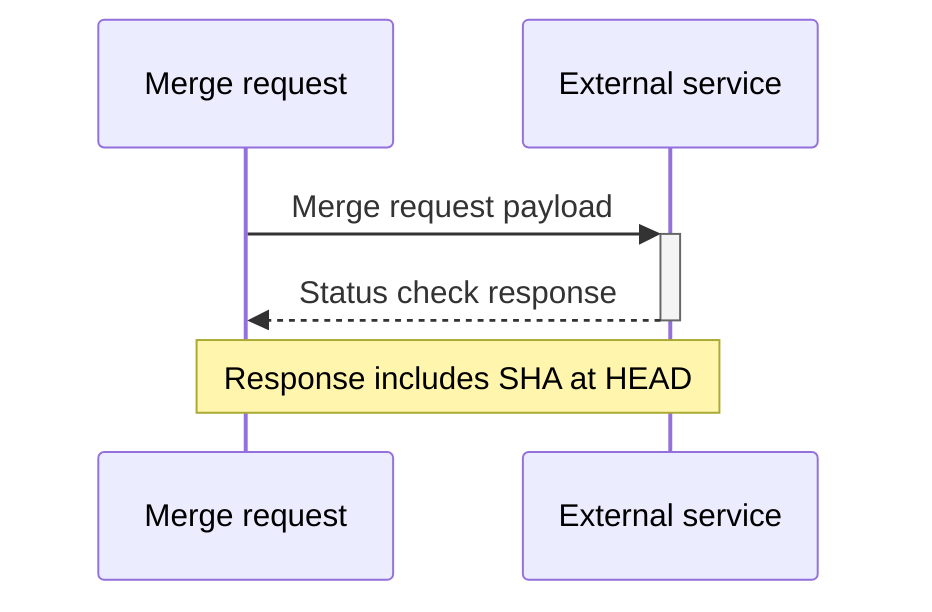



- 티어: Ultimate
- 제공 서비스: GitLab.com, GitLab Self-Managed, GitLab Dedicated



상태 점검은 외부 요구 사항의 상태를 요청하는 외부 시스템에 대한 API 호출입니다.

병합 요청 데이터를 제3자 도구로 보내는 상태 점검을 만들 수 있습니다. 사용자가 병합 요청을 생성, 변경 또는 닫으면 GitLab이 알림을 보냅니다. 사용자 또는 자동화된 워크플로우는 GitLab 외부에서 병합 요청의 상태를 업데이트할 수 있습니다.

이 통합을 통해 ServiceNow와 같은 제3자 워크플로우 도구 또는 선택한 사용자 정의 도구와 통합할 수 있습니다. 제3자 도구는 연결된 상태로 응답합니다. 그런 다음 이 상태는 병합 요청 내의 비차단 위젯으로 표시되며, 이 상태를 병합 요청 작성자 또는 검토자에게 병합 요청 수준에서 표시합니다.

각 개별 프로젝트에 대해 병합 요청 상태 점검을 구성할 수 있습니다. 이러한 점검은 프로젝트 간에 공유되지 않습니다.

상태 점검이 2분 이상 대기 상태에 머물러 있으면 실패합니다.

## 접근 권한 {#access-permissions}

외부 상태 점검 응답은 다음 사용자가 볼 수 있습니다:

- 프로젝트에서 보고자, 개발자, 유지관리자 또는 소유자 역할이 있는 사용자
- 프로젝트의 내부 가시성이 있을 때 병합 요청을 볼 수 있는 인증된 사용자

이는 내부 프로젝트가 있는 경우 병합 요청에 액세스할 수 있는 로그인한 사용자는 외부 상태 점검 응답을 볼 수 있다는 의미입니다.

사용 사례, 기능 검색 및 개발 타임라인에 대한 자세한 정보는 [에픽 3869](https://gitlab.com/groups/gitlab-org/-/epics/3869)를 참조하세요.

## 모든 상태 점검이 통과하지 않으면 병합 요청의 머지 차단 {#block-merges-of-merge-requests-unless-all-status-checks-have-passed}

기본적으로 프로젝트의 병합 요청은 외부 상태 점검이 실패해도 병합될 수 있습니다. 외부 점검이 실패할 때 병합 요청의 병합을 차단하려면:

1. 상단 표시줄에서 **검색 또는 이동**을 선택하고 프로젝트를 찾습니다.
1. 왼쪽 사이드바에서 **설정** > **병합 요청**을 선택합니다.
1. **상태 점검이 성공해야 합니다.** 확인란을 선택하세요.
1. **변경 사항 저장**을 선택합니다.

## 수명 주기 {#lifecycle}

외부 상태 점검은 비동기 워크플로우를 가지고 있습니다. 병합 요청은 다음 경우에 병합 요청 웹후크 페이로드를 외부 서비스로 내보냅니다:

- 병합 요청이 업데이트, 닫혔다가 다시 열어지거나, 승인, 승인 취소 또는 병합되었을 때.
- 병합 요청의 소스 브랜치로 코드가 푸시되었을 때.



페이로드가 수신되면 외부 서비스는 [REST API를 사용하여](../../../api/status_checks.md#set-status-of-an-external-status-check) 병합 요청으로 응답을 다시 게시하기 전에 필요한 프로세스를 실행할 수 있습니다.

병합 요청은 소스 브랜치의 현재 `HEAD`를 참조하지 않는 모든 응답에 `409 Conflict` 오류를 반환합니다. 따라서 외부 서비스가 오래된 커밋을 처리하고 응답하는 것이 안전합니다.

외부 상태 점검은 다음 상태를 가집니다:

- `pending` - 기본 상태입니다. 외부 서비스로부터 병합 요청이 응답을 받지 못했습니다.
- `passed` - 외부 서비스로부터 응답이 수신되었고 이에 의해 승인되었습니다.
- `failed` - 외부 서비스로부터 응답이 수신되었고 이에 의해 거부되었습니다.

GitLab 외부에서 변경 사항이 있으면 [외부 상태 점검의 상태를 설정](../../../api/status_checks.md#set-status-of-an-external-status-check)할 수 있습니다(API 사용). 병합 요청 웹후크 페이로드가 먼저 전송될 때까지 기다릴 필요가 없습니다.

## 상태 점검 서비스 보기 {#view-status-check-services}

병합 요청 설정에서 프로젝트에 추가된 상태 점검 서비스 목록을 보려면:

1. 상단 표시줄에서 **검색 또는 이동**을 선택하고 프로젝트를 찾습니다.
1. 왼쪽 사이드바에서 **설정** > **병합 요청**을 선택합니다.
1. **상태 점검**으로 스크롤하세요. 이 목록은 서비스 이름, API URL, 대상 브랜치 및 HMAC 인증 상태를 표시합니다.


[브랜치 규칙](../repository/branches/branch_rules.md#add-a-status-check-service) 설정에서도 상태 점검 서비스 목록을 볼 수 있습니다.

## 상태 점검 서비스 추가 또는 업데이트 {#add-or-update-a-status-check-service}

### 상태 점검 서비스 추가 {#add-a-status-check-service}

**상태 점검** 하위 섹션 내에서 **상태 점검 추가** 버튼을 선택하세요. **상태 점검 추가** 양식이 표시됩니다.


양식을 작성하고 **상태 점검 추가** 버튼을 선택하면 새 상태 점검이 생성됩니다.

상태 점검은 모든 새로운 병합 요청에 적용되지만 기존 병합 요청에는 소급하여 적용되지 않습니다.

### 상태 점검 서비스 업데이트 {#update-a-status-check-service}

**상태 점검** 하위 섹션에서 편집하려는 상태 점검 옆의 **편집** ()을 선택하세요. **상태 점검 업데이트** 양식이 표시됩니다.


> [!note]
> HMAC 공유 비밀의 값을 보거나 수정할 수 없습니다. 공유 비밀을 변경하려면 새로운 공유 비밀 값으로 외부 상태 점검을 삭제했다가 다시 생성하세요.

상태 점검을 업데이트하려면 양식의 값을 변경하고 **상태 점검 업데이트**를 선택하세요.

상태 점검 업데이트는 모든 새로운 병합 요청에 적용되지만 기존 병합 요청에는 소급하여 적용되지 않습니다.

### 양식 값 {#form-values}

일반적인 양식 오류는 아래 [문제 해결](#troubleshooting) 섹션을 참조하세요.

#### 서비스 이름 {#service-name}

이 이름은 영숫자 값이 될 수 있으며 설정해야 합니다. 이름은 프로젝트 내에서 고유해야 합니다.

#### 확인할 API {#api-to-check}

이 필드는 URL이 필요하며 HTTP 또는 HTTPS 프로토콜 중 하나를 사용해야 합니다. 전송 중인 병합 요청 데이터를 보호하기 위해 HTTPS를 사용하는 것이 좋습니다. URL을 설정해야 하며 프로젝트 내에서 고유해야 합니다.

#### 대상 브랜치 {#target-branch}

상태 점검을 단일 브랜치로 제한하려면 이 필드를 사용하여 이 제한을 설정할 수 있습니다.


브랜치 목록은 프로젝트의 [보호된 브랜치](../repository/branches/protected.md)에서 채워집니다.

브랜치 목록을 스크롤하거나 많은 브랜치가 있고 찾는 브랜치가 즉시 표시되지 않을 때 검색 상자를 사용할 수 있습니다. 검색을 시작하려면 검색 상자에 세 글자의 영숫자 문자를 입력해야 합니다.

상태 점검을 모든 병합 요청에 적용하려면 **모든 브랜치** 옵션을 선택할 수 있습니다.

#### HMAC 공유 비밀 {#hmac-shared-secret}

HMAC 인증은 요청의 조작을 방지하고 정당한 출처에서 오는지 확인합니다.

## 상태 점검 서비스 삭제 {#delete-a-status-check-service}

**상태 점검** 하위 섹션에서 삭제하려는 상태 점검 옆의 **삭제** ()를 선택하세요. **상태 점검 삭제하시겠습니까?** 대화 상자가 표시됩니다.


상태 점검을 삭제하려면 **상태 점검 삭제** 버튼을 선택해야 합니다. 이렇게 하면 상태 점검이 영구적으로 삭제되며 복구할 수 없습니다.

## 상태 점검 위젯 {#status-checks-widget}

상태 점검 위젯은 병합 요청에 표시되며 다음 상태를 표시합니다:

- **대기** (), GitLab이 외부 상태 점검으로부터 응답을 기다리는 동안.
- **성공** () 또는 **실패** (), GitLab이 외부 상태 점검으로부터 응답을 받을 때.

대기 중인 상태 점검이 있을 때 위젯은 **성공** 또는 **실패** 응답을 받을 때까지 몇 초마다 업데이트를 폴링합니다.

실패한 상태 점검을 다시 시도하려면:

1. 상단 표시줄에서 **검색 또는 이동**을 선택하고 프로젝트를 찾습니다.
1. 왼쪽 사이드바에서 **코드** > **병합 요청**를 선택하고 병합 요청을 찾습니다.
1. 병합 요청 보고서 섹션으로 스크롤하고 드롭다운 목록을 확장하여 외부 상태 점검 목록을 표시하세요.
1. 실패한 외부 상태 점검 행에서 **재시도** ()를 선택하세요. 상태 점검이 대기 상태로 돌아갑니다.

조직에서 외부 상태 점검이 통과하지 않으면 병합 요청을 병합하지 않도록 하는 정책이 있을 수 있습니다. 그러나 위젯의 세부 정보는 참고용으로만 제공됩니다.

> [!note]
> GitLab은 외부 상태 점검이 관련 외부 서비스에 의해 제대로 처리된다는 것을 보장할 수 없습니다.

## 문제 해결 {#troubleshooting}

### 중복 값 오류 {#duplicate-value-errors}

```plaintext
Name is already taken
---
External API is already in use by another status check
```

프로젝트별로 상태 점검은 이름 또는 API URL을 한 번만 사용할 수 있습니다. 이 오류는 상태 점검의 이름 또는 API URL이 이미 이 프로젝트의 상태 점검에서 사용되었다는 의미입니다.

현재 상태 점검에 대해 다른 값을 선택하거나 기존 상태 점검의 값을 업데이트해야 합니다.

### 잘못된 URL 오류 {#invalid-url-error}

```plaintext
Please provide a valid URL
```

확인할 API 필드는 제공된 URL이 HTTP 또는 HTTPS 프로토콜 중 하나를 사용하도록 요구합니다. 필드의 값을 업데이트하여 이 요구 사항을 충족해야 합니다.

### 검색 또는 검색 중 브랜치 목록 오류 {#branch-list-error-during-retrieval-or-search}

```plaintext
Unable to fetch branches list, please close the form and try again
```

브랜치 검색 API에서 예기치 않은 응답을 받았습니다. 제안된 대로 양식을 닫았다가 다시 열거나 페이지를 새로 고쳐야 합니다. 이 오류는 임시이어야 하지만 지속되면 [GitLab 상태 페이지](https://status.gitlab.com/)를 확인하여 더 광범위한 중단이 있는지 확인하세요.

### 상태 점검을 로드하지 못함 {#failed-to-load-status-checks}

```plaintext
Failed to load status checks
```

외부 상태 점검 API에서 예기치 않은 응답을 받았습니다. 다음을 수행해야 합니다:

- 이 오류가 임시인 경우를 대비해 페이지를 새로 고치세요.
- 문제가 지속되면 [GitLab 상태 페이지](https://status.gitlab.com/)를 확인하여 더 광범위한 중단이 있는지 확인하세요.

## 관련 항목 {#related-topics}

- [외부 상태 점검 API](../../../api/status_checks.md)
