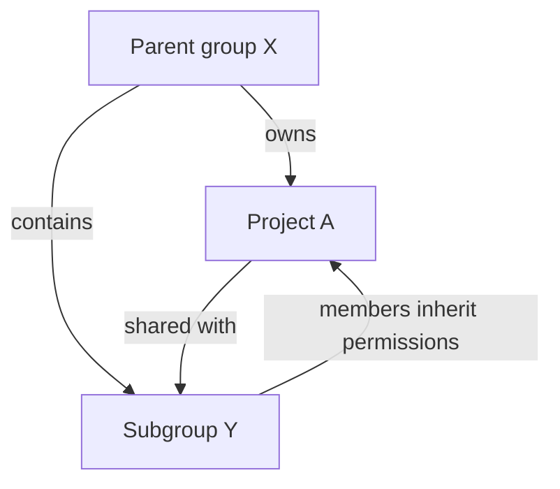
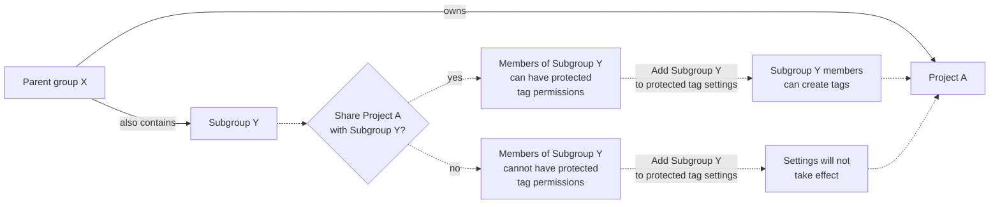



- 티어: Free, Premium, Ultimate
- 제공 서비스: GitLab.com, GitLab Self-Managed, GitLab Dedicated



보호된 [태그](repository/tags/_index.md):

- 태그를 생성할 수 있는 권한이 있는 사용자를 제어합니다.
- 생성 후 실수로 인한 업데이트 또는 삭제를 방지합니다.

각 규칙을 사용하면 다음 중 하나를 일치시킬 수 있습니다:

- 개별 태그 이름.
- 여러 태그를 한 번에 제어하기 위한 와일드카드.

이 기능은 [보호된 브랜치](repository/branches/protected.md)에서 발전했습니다.

> [!note]
> 보호된 태그를 생성하거나 삭제하려면 해당 보호된 태그에 대한 **생성이 허용됨** 목록에 있어야 합니다.

## 보호된 태그 구성 {#configure-protected-tags}

사전 요구 사항:

- 프로젝트에 대해 유지 관리자 또는 소유자 역할이 있어야 합니다.

1. 상단 바에서 **검색 또는 이동**을 선택하고 프로젝트를 찾습니다.
1. 왼쪽 사이드바에서 **설정** > **리포지토리**를 선택합니다.
1. **보호된 태그**를 확장합니다.
1. **신규 추가**를 선택합니다.
1. 단일 태그를 보호하려면 **태그**를 선택한 다음 드롭다운 목록에서 태그를 선택합니다.
1. 이름이 문자열과 일치하는 모든 태그를 보호하려면:
   1. **태그**를 선택합니다.
   1. 태그 일치에 사용할 문자열을 입력합니다. 와일드카드(`*`)가 지원됩니다.
   1. **와일드카드 생성**를 선택합니다.
1. **생성이 허용됨**에서 보호된 태그를 생성할 수 있는 역할을 선택합니다.

   > [!note]
   > GitLab Premium 및 Ultimate에서는 그룹 또는 개별 사용자를 **생성이 허용됨**에 추가할 수도 있습니다.

1. **보호**를 선택합니다.

보호된 태그(또는 와일드카드)가 **보호된 태그** 목록에 표시됩니다.

### 보호된 태그에 그룹 추가 {#add-a-group-to-protected-tags}

그룹 또는 서브그룹의 멤버를 보호된 태그 생성이 허용된 사용자로 설정하려면:

1. 왼쪽 사이드바에서 **검색 또는 이동**을 선택하고 프로젝트를 찾습니다.
1. **설정** > **리포지토리**를 선택합니다.
1. **보호된 태그**를 확장합니다.
1. 다음 필드에 그룹을 추가합니다:

   ```plaintext
   # Allow group members to create protected tags
   Allowed to create: @group-x
   ```

#### 그룹 상속 및 적격성 {#group-inheritance-and-eligibility}



이 예에서:

- 상위 그룹 X(`group-x`)는 프로젝트 A를 소유합니다.
- 상위 그룹 X는 또한 서브그룹인 서브그룹 Y를 포함합니다. (`group-x/subgroup-y`)
- 프로젝트 A는 서브그룹 Y와 공유됩니다.

보호된 태그 권한에 적격인 그룹은:

- 프로젝트 A: 프로젝트 A가 서브그룹 Y와 공유되므로 그룹 X와 서브그룹 Y 모두.

#### 그룹과 프로젝트 공유 {#share-projects-with-groups}

그룹 또는 서브그룹과 프로젝트를 공유하여 해당 멤버가 보호된 태그 권한에 적격이 되도록 할 수 있습니다.



서브그룹 Y 멤버에게 프로젝트 A에 대한 액세스 권한을 부여하려면 서브그룹과 프로젝트를 공유해야 합니다. 보호된 태그 설정에 서브그룹을 직접 추가하는 것은 효과적이지 않으며 서브그룹 멤버에게 적용되지 않습니다.

> [!note]
> 그룹이 보호된 태그 권한을 가지려면 프로젝트가 그룹과 직접 공유되어야 합니다. 상위 그룹으로부터의 상속된 프로젝트 멤버십은 보호된 태그 권한에 충분하지 않습니다.

## 와일드카드 보호된 태그 {#wildcard-protected-tags}

와일드카드와 일치하는 모든 태그를 보호하는 와일드카드 보호된 태그를 지정할 수 있습니다. 예를 들어:

| 와일드카드 보호된 태그 | 일치하는 태그                 |
|------------------------|-------------------------------|
| `v*`                   | `v1.0.0`, `version-9.1`       |
| `*-deploy`             | `march-deploy`, `1.0-deploy`  |
| `*gitlab*`             | `gitlab`, `gitlab/v1`         |
| `*`                    | `v1.0.1rc2`, `accidental-tag` |

두 개의 다른 와일드카드가 동일한 태그와 일치할 수 있습니다. 예를 들어 `*-stable`과 `production-*`는 모두 `production-stable` 태그와 일치합니다. 이 경우 이러한 보호된 태그 중 _하나라도_ **생성이 허용됨** 같은 설정을 가지면 `production-stable`도 이 설정을 상속합니다.

보호된 태그의 이름을 선택하면 GitLab은 일치하는 모든 태그의 목록을 표시합니다.

## 배포 키로 보호된 태그를 생성하도록 허용 {#allow-deploy-keys-to-create-protected-tags}

[배포 키](deploy_keys/_index.md)가 보호된 태그를 생성하도록 허용할 수 있습니다.

사전 요구 사항:

- 배포 키는 프로젝트에 대해 활성화되어야 합니다. 프로젝트 배포 키는 생성될 때 기본적으로 활성화됩니다. 그러나 공개 배포 키는 프로젝트에 대해 [액세스 권한을 부여](deploy_keys/_index.md#grant-project-access-to-a-public-deploy-key)받아야 합니다.
- 배포 키는 프로젝트 리포지토리에 [쓰기 액세스 권한](deploy_keys/_index.md#permissions)이 있어야 합니다.
- 배포 키의 소유자는 프로젝트에 대해 최소한 읽기 액세스 권한이 있어야 합니다.
- 배포 키의 소유자는 또한 프로젝트의 멤버여야 합니다.

배포 키로 보호된 태그를 생성하도록 허용하려면:

1. 상단 바에서 **검색 또는 이동**을 선택하고 프로젝트를 찾습니다.
1. 왼쪽 사이드바에서 **설정** > **리포지토리**를 선택합니다.
1. **보호된 태그**를 확장합니다.
1. **태그** 드롭다운 목록에서 보호할 태그를 선택합니다.
1. **생성이 허용됨** 목록에서 배포 키를 선택합니다.
1. **보호**를 선택합니다.

## 브랜치 이름을 사용한 태그 생성 방지 {#prevent-tag-creation-with-branch-names}

동일한 이름의 태그와 브랜치는 다른 커밋을 포함할 수 있습니다. 태그와 브랜치가 동일한 이름을 사용하는 경우 `git checkout` 명령을 실행하는 사용자가 대신 _브랜치_ `qa`를 확인하려고 했을 때 _태그_ `qa`를 확인할 수 있습니다. 추가 보안 조치로 브랜치와 동일한 이름의 태그를 생성하지 마세요. 둘을 혼동하면 보안 또는 운영 문제가 발생할 수 있습니다.

이 문제를 방지하려면:

1. 태그로 사용하지 않으려는 브랜치 이름을 식별합니다.
1. [보호된 태그 구성](#configure-protected-tags)에 설명된 보호된 태그를 생성합니다:

   - **이름**의 경우 `stable`와 같은 이름을 제공합니다. `stable-*`과 같은 와일드카드를 생성하여 `stable-v1`및 `stable-v2`와 같은 여러 이름을 일치시킬 수도 있습니다.
   - **생성이 허용됨**의 경우 **아무도 없음**을 선택합니다.
   - **보호**를 선택합니다.

사용자는 여전히 브랜치를 생성할 수 있지만 보호된 이름으로 태그를 생성할 수는 없습니다.

## 보호된 태그에서 파이프라인 실행 {#run-pipelines-on-protected-tags}

보호된 태그를 생성할 권한은 사용자가 다음을 수행할 수 있는지 여부를 정의합니다:

- CI/CD 파이프라인을 시작하고 실행합니다.
- 이러한 태그와 연결된 작업에 대해 작업을 실행합니다.

이러한 권한은 승인된 사용자만 보호된 태그에 대한 CI/CD 프로세스를 트리거하고 관리할 수 있도록 합니다.

## 태그 보호 해제 {#unprotect-a-tag}

보호 규칙을 제거하여 태그의 보호를 해제할 수 있습니다. 이 작업은 태그 자체가 아니라 보호 구성을 제거합니다. 태그는 리포지토리에 남아 있지만 더 이상 보호되지 않습니다.

사전 요구 사항:

- Maintainer 또는 Owner 역할이 있어야 합니다.

태그의 보호를 해제하려면:

1. 상단 바에서 **검색 또는 이동**을 선택하고 프로젝트를 찾습니다.
1. 왼쪽 사이드바에서 **설정** > **리포지토리**를 선택합니다.
1. **보호된 태그**를 확장합니다.
1. 제거할 보호된 태그 규칙 옆에서 **보호 해제**를 선택합니다.

> [!warning]
> 태그 패턴의 보호를 해제한 후 개발자, 유지보수자 또는 소유자 역할이 있는 모든 사용자는 해당 패턴과 일치하는 태그를 삭제할 수 있습니다.

## 보호된 태그 삭제 {#delete-a-protected-tag}

보호 규칙이 적용된 태그를 삭제할 수 있습니다. 이것은 보호 규칙이 아니라 리포지토리에서 태그를 제거합니다. 태그를 삭제하지 않고 보호 규칙을 제거하려면 [태그 보호 해제](#unprotect-a-tag)를 참조하세요.

사전 요구 사항:

- 해당 태그에 대한 역할 또는 사용자의 **생성이 허용됨** 목록에 있어야 합니다.
- 프로젝트에서 유지보수자 또는 소유자 역할.

보호된 태그를 삭제하려면:

1. 상단 바에서 **검색 또는 이동**을 선택하고 프로젝트를 찾습니다.
1. 왼쪽 사이드바에서 **코드** > **태그**를 선택합니다.
1. 삭제할 태그 옆에서 **삭제**()를 선택합니다.
1. 확인 대화 상자에서 태그 이름을 입력하고 **예, 보호된 태그를 삭제합니다.**를 선택합니다.

보호된 태그는 GitLab UI 또는 API에서만 삭제할 수 있습니다. 이러한 보호는 로컬 Git 명령 또는 타사 Git 클라이언트를 통해 실수로 태그를 삭제하는 것을 방지합니다.

## 관련 항목 {#related-topics}

- [보호된 태그 API](../../api/protected_tags.md)
- [태그 API](../../api/tags.md)
